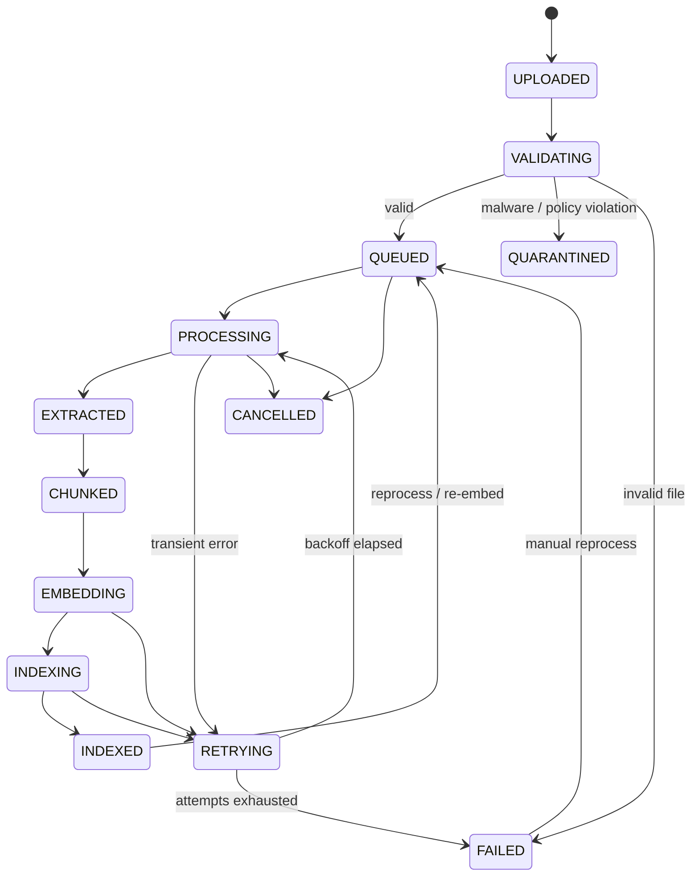

# Stage 1 — Part B: BRD, SRS, Functional and Non-Functional Requirements

| Field | Value |
|---|---|
| Document ID | DIP-S1-B |
| Version | 0.1 (Draft for approval) |
| Priority key | **M** = Mandatory, **S** = Should, **O** = Optional/future |
| Note | Independent reference architecture; not an ISRO specification. Targets are proposals to be ratified by stakeholders. |

---

# PART 1 — Business Requirements Document (BRD)

## 1.1 Business context and problem
A large technical organization holds millions of versioned documents across departments. Observed pain (hypothetical, to be confirmed in discovery interviews):
1. Engineers cannot find the authoritative, current answer; keyword search misses synonyms/units/notation, scans are unsearchable.
2. Superseded or conflicting specifications are used unknowingly.
3. Answers cannot be traced to page-level evidence, so they cannot be trusted or audited.
4. Aggregate questions ("how many", "trend") are answered manually.
5. Confidential material cannot be sent to public AI services.

## 1.2 Business objectives and measures
| ID | Objective | Success measure (target, to be baselined) |
|---|---|---|
| BO-1 | Reduce time to find authoritative information | Median task time ↓ 50% vs. baseline in a timed user study of 30 tasks |
| BO-2 | Trustworthy answers | ≥ 95% citation precision and ≥ 90% answer faithfulness on the golden set; 0 unauthorized-content exposures in security tests |
| BO-3 | Surface stale/conflicting specs | ≥ 85% recall of seeded conflicts/supersessions in a labeled test set |
| BO-4 | Self-service analytics | ≥ 80% of curated analytics questions answered correctly by NL-to-SQL, 100% read-only |
| BO-5 | Full traceability | 100% of queries and document accesses recorded in audit log |
| BO-6 | Scale path | Same architecture runs at 10k docs and 10M docs with measured throughput |

## 1.3 Stakeholders
Executive sponsor; department heads (data owners); document control; research/engineering users; information security; platform/infra operations; compliance/audit; AI/ML team.

## 1.4 Business rules
- BR-1: Access to a document is granted only by explicit policy (role, department, classification, ACL); default deny.
- BR-2: A document version is immutable; corrections create a new version.
- BR-3: Superseded versions remain retrievable only when the user explicitly requests history; default retrieval prefers current versions.
- BR-4: An answer without sufficient evidence must say so.
- BR-5: Deletion honors retention and legal hold before physical erasure.
- BR-6: No document content leaves the trust boundary to an external AI provider.

## 1.5 Benefits, costs, risks (summary)
Benefits: productivity, risk reduction, auditability. Cost drivers (detailed in capacity doc): GPU for OCR/embedding/LLM, storage (~hundreds of TB at full scale), operations staffing. Principal risks listed in Part C of Stage 1 (`03-...`).

## 1.6 Delivery approach
Incremental milestones M1–M14. Value is delivered early: hybrid search over the initial tier (M6–M7) before RAG (M8).

---

# PART 2 — Software Requirements Specification (SRS)

## 2.1 Purpose and overview
Defines what the platform shall do and the quality attributes it shall meet. Intended readers: architects, developers, testers, security, operations.

## 2.2 Product perspective
Microservice platform (Java Spring Boot control plane; Python AI/data-plane workers), event-driven over Kafka, deployed on Kubernetes. Integrates with an enterprise IdP (OIDC), object storage (S3 API), and self-hosted model servers.

## 2.3 Document state model (authoritative)

Notes: **searchability is separate from state:** a reprocess of an INDEXED version (INDEXED → QUEUED) keeps serving the prior index generation until the new generation is confirmed in both indexes, then flips atomically (`06` `serving_pipeline_version`, ADR-014); only never-indexed or deleted versions are non-searchable. State is held per **document version**. Fine-grained progress (per page-range task) lives in `processing_jobs`; the version state is derived from job completion. `RETRYING` returns to the stage that failed (resume from checkpoint), not to the start.

## 2.4 Actors
End User, Document Controller, Analyst, Department Admin, Security Auditor, Platform Admin, Model Admin, External Source System (connector), IdP.

---

# PART 3 — Functional Requirements

ID pattern: `FR-<module>-<nn>`. Every requirement is testable; acceptance criteria are in the Test Strategy later and sketched here where useful.

## 3.1 Identity and Access (IAM)
| ID | Requirement | Pri |
|---|---|---|
| FR-IAM-01 | Authenticate users via OIDC (authorization code + PKCE); services accept only validated JWTs | M |
| FR-IAM-02 | Local registration limited to bootstrap/break-glass; normal onboarding by IdP federation | S |
| FR-IAM-03 | RBAC roles and ABAC attributes (department, classification clearance, project) evaluated by a central policy decision point | M |
| FR-IAM-04 | Organization → department hierarchy; permissions inheritable down the hierarchy, with explicit deny overriding inherit | M |
| FR-IAM-05 | Document-level ACL (user/group/role, read/write/manage) in addition to folder/department inheritance | M |
| FR-IAM-06 | Session management: access token ≤ 15 min, refresh rotation, idle timeout, revoke on demand | M |
| FR-IAM-07 | All authn/authz decisions and admin changes audited | M |
| FR-IAM-08 | Permission changes take effect in retrieval within ≤ 60 s (cached decisions must expire) | M |

## 3.2 Document Management
| ID | Requirement | Pri |
|---|---|---|
| FR-DOC-01 | Single upload and bulk upload (≥ 1,000 files/batch) with per-file result | M |
| FR-DOC-02 | Large file (≥ 5 GB) resumable chunked upload (tus-style / S3 multipart); direct-to-object-storage via presigned URLs so the API does not proxy bytes | M |
| FR-DOC-03 | Validation: extension allowlist, magic-byte MIME verification, size limits, encryption/password detection, malware scan, archive-bomb limits | M |
| FR-DOC-04 | Duplicate detection by SHA-256 (exact) and near-duplicate (MinHash/SimHash on text) flagged, not auto-deleted | M / S |
| FR-DOC-05 | Versioning: new upload with the same document identity creates version N+1; version links (`supersedes`) maintained | M |
| FR-DOC-06 | Lifecycle: DRAFT → ACTIVE → SUPERSEDED → ARCHIVED → DELETED (+ LEGAL_HOLD flag) | M |
| FR-DOC-07 | Retention and deletion policies per classification; secure deletion across object store, indexes, caches | M |
| FR-DOC-08 | Metadata: system (hash, size, pages, language), user (title, project, tags), extracted (authors, dates, identifiers) | M |
| FR-DOC-09 | Status API exposes the §2.3 states with progress and failure reason | M |
| FR-DOC-10 | Reprocess a document/version with a chosen pipeline or model version | M |

## 3.3 Processing Engine
| ID | Requirement | Pri |
|---|---|---|
| FR-PRC-01 | Born-digital PDF text extraction with coordinates, reading order, fonts | M |
| FR-PRC-02 | OCR for scanned PDFs/images; per-page confidence; page-level routing (a PDF may mix digital and scanned pages) | M |
| FR-PRC-03 | Table extraction to structured form (rows/cells) plus a text rendering for search | M |
| FR-PRC-04 | Image/figure extraction with captions; stored as artifacts | M |
| FR-PRC-05 | Equation extraction (LaTeX/MathML where possible; image fallback with nearby text) | S |
| FR-PRC-06 | Header/footer/page-number detection and removal from body text, retained as metadata | M |
| FR-PRC-07 | Layout analysis: sections, headings, lists, captions, footnotes | M |
| FR-PRC-08 | Office formats (DOCX, XLSX, PPTX) extracted natively, not via PDF rendering where avoidable; XLSX sheets also emitted as structured data | M |
| FR-PRC-09 | Document classification (type, domain, classification suggestion — never auto-lowering a classification) | M |
| FR-PRC-10 | Language detection per document and per page | M |
| FR-PRC-11 | Normalization (Unicode, ligatures, hyphenation, units preserved); quality validation with thresholds (e.g., OCR confidence, empty-page ratio) leading to flagged "low-quality" status rather than silent indexing | M |
| FR-PRC-12 | Work divided into page-range tasks so no document blocks the pipeline | M |

## 3.4 Chunking
| ID | Requirement | Pri |
|---|---|---|
| FR-CHK-01 | Structure-aware chunking is the default for structured documents; strategy selected by document type (see §3.4 rationale below) | M |
| FR-CHK-02 | Parent-child chunks: child (~256–512 tokens) for retrieval, parent (section, ≤ ~2,000 tokens) for context | M |
| FR-CHK-03 | Every chunk carries: `chunk_id`, `document_id`, `version_id`, page start/end, section path, bounding-box refs, strategy and chunker version | M |
| FR-CHK-04 | Tables chunked as units (with header row repeated on splits); equations kept with adjacent explanatory text | M |
| FR-CHK-05 | Chunk ID is deterministic (hash of version + position + chunker version) to make re-runs idempotent | M |
| FR-CHK-06 | Strategy and parameters are versioned and changing them triggers evaluation gate (FR-AI-05) | M |

*Why not one strategy for all:* fixed-size splits tables and equations mid-structure; semantic chunking is costly and unstable on tabular/spec text; structure-aware fails on unstructured scans; sliding windows inflate index size ×1.3–2. Strategy is chosen per document type with a fallback chain (structure-aware → recursive → fixed with overlap).

## 3.5 Embedding
| ID | Requirement | Pri |
|---|---|---|
| FR-EMB-01 | Batch embedding service on GPU with dynamic batching; self-hosted models | M |
| FR-EMB-02 | Every vector references `embedding_model_id` and version; mixed-model indexes forbidden within one collection | M |
| FR-EMB-03 | Re-embedding strategies: full, incremental (changed chunks), blue/green collection swap | M |
| FR-EMB-04 | Content-hash embedding cache (same text + same model → reuse) | S |
| FR-EMB-05 | Failed batches retried with bisect-to-isolate poison chunks, then DLQ | M |
| FR-EMB-06 | Model migration without downtime via dual-collection and traffic cutover | M |

## 3.6 Search
| ID | Requirement | Pri |
|---|---|---|
| FR-SRC-01 | Keyword (exact/phrase), BM25, semantic, and hybrid search with metadata filters | M |
| FR-SRC-02 | Authorization filter applied inside both keyword and vector queries (pre-filter), plus post-check | M |
| FR-SRC-03 | Reciprocal Rank Fusion; cross-encoder reranking of top candidates | M |
| FR-SRC-04 | Query rewriting/expansion (acronyms, synonyms, units) with the rewrite visible to the user | S |
| FR-SRC-05 | Default scope prefers current versions; flag/option for historical | M |
| FR-SRC-06 | Results include snippet, document, version, page, section, score components, and highlight | M |
| FR-SRC-07 | Duplicate/near-duplicate result collapsing | S |
| FR-SRC-08 | Parent-child and cross-document retrieval | M |
| FR-SRC-09 | Search cache keyed by (normalized query, filters, **permission fingerprint**); semantic cache only within identical permission scope | S |

## 3.7 AI Question Answering and RAG
| ID | Requirement | Pri |
|---|---|---|
| FR-AI-01 | Query classification/routing: RETRIEVAL, RAG, SQL, SPARK_BATCH, COMPARE, SUMMARIZE, HYBRID; deterministic rules first, small classifier second, LLM fallback last | M |
| FR-AI-02 | RAG pipeline: classify → rewrite → filter → BM25 ∥ vector → fuse → rerank → select → compress → generate → validate citations → respond | M |
| FR-AI-03 | Structured response schema (answer, claims with source refs, evidence_status, contradictions, limitations, confidence band) | M |
| FR-AI-04 | **Citation validation**: each cited chunk/page exists, is in the user's permitted set, was in the retrieved context, and cited claim text is supported by quoted span (lexical + NLI check); failing claims are removed or flagged | M |
| FR-AI-05 | Explicit `INSUFFICIENT_EVIDENCE` response when evidence thresholds are not met | M |
| FR-AI-06 | Contradiction detection across documents/versions, reported with both sources | M |
| FR-AI-07 | Superseded detection using version graph + date + explicit "supersedes" references | M |
| FR-AI-08 | Distinguish facts (quoted/paraphrased evidence) from interpretation (model inference), labeled | M |
| FR-AI-09 | Version comparison (structural + semantic diff, page-referenced) | M |
| FR-AI-10 | Summaries/reports with citations, per document or per set | M |
| FR-AI-11 | Multi-hop via query decomposition (bounded depth ≤ 3); corrective retrieval when evidence is weak (one re-retrieval round) | S |
| FR-AI-12 | Chat sessions with memory limited to the user's own permitted scope; history never expands access | M |
| FR-AI-13 | Graph RAG, full agentic RAG | O |
| FR-AI-14 | Confidence is reported as a *band* computed from evidence signals (retrieval scores, citation validation pass ratio, source agreement), explicitly **not** a calibrated probability, unless calibrated on the golden set | M |

## 3.8 Analytics
| ID | Requirement | Pri |
|---|---|---|
| FR-ANL-01 | Metadata and corpus analytics via SQL (counts, distributions, trends, ingestion health) | M |
| FR-ANL-02 | Safe NL-to-SQL: schema allowlist, parse + validate AST, read-only role, timeout, row cap, cost estimate (EXPLAIN), audit, no DDL/DML | M |
| FR-ANL-03 | Heavy aggregations run on ClickHouse; very large or ML-style jobs on Spark over Iceberg | M / S |
| FR-ANL-04 | Table-level and row-level permissions applied to analytical queries | M |
| FR-ANL-05 | Extracted structured data (tables, XLSX) queryable once promoted to curated datasets | S |
| FR-ANL-06 | Statistical and trend functions (percentiles, regression, seasonality) | S |
| FR-ANL-07 | Predictive analytics | O |
| FR-ANL-08 | Routing between RAG, SQL, Spark or combination is explainable and logged | M |

## 3.9 Audit, Notification, Administration
| ID | Requirement | Pri |
|---|---|---|
| FR-AUD-01 | Append-only audit of logins, document access, searches, AI queries (including chunk IDs exposed, model and prompt version), admin changes | M |
| FR-AUD-02 | Tamper evidence (hash chain per partition, periodic anchoring) | S |
| FR-AUD-03 | Audit search/export for Security Auditor role, itself audited | M |
| FR-NOT-01 | Notify uploader on completion/failure/quarantine; notify admins on DLQ and SLO breaches | M |
| FR-ADM-01 | Operator console: queue lag, failed jobs, reprocess, model registry, reconciliation reports | M |
| FR-MOD-01 | Model registry with embedding/LLM/reranker/prompt versions, deploy, rollback | M |
| FR-EVL-01 | Evaluation pipeline with golden set; regression gates on any change to embedding, chunking, retrieval config, or LLM | M |

---

# PART 4 — Non-Functional Requirements

Targets are **proposed** and measured at stated percentiles under stated load; each becomes a gate in performance testing. "Initial/Medium/Large" refer to the 10k / 1M / 10M tiers.

## 4.1 Performance
| ID | Requirement | Target |
|---|---|---|
| NFR-PRF-01 | Hybrid search latency (excluding LLM), P95 | ≤ 800 ms Initial/Medium; ≤ 1.5 s Large |
| NFR-PRF-02 | Retrieval before-rerank (BM25 ∥ vector), P95 | ≤ 300 ms |
| NFR-PRF-03 | Rerank 30 candidates (maximum 50) on GPU, P95 | ≤ 250 ms |
| NFR-PRF-04 | RAG end-to-end, time to first token / full answer, P95 | ≤ 3 s / ≤ 15 s (answer ≤ 500 tokens) |
| NFR-PRF-05 | Ingestion throughput | Sustain backfill at ≥ 55k docs/day (≈ 10M in ~6 months) at Large; Initial: 10k docs in ≤ 24 h |
| NFR-PRF-06 | Time from upload to INDEXED, P95, typical 100-page digital PDF | ≤ 5 min under normal load (scans: ≤ 30 min) |
| NFR-PRF-07 | Upload API: presign + register | ≤ 300 ms P95 |
| NFR-PRF-08 | Retrieval quality (golden set) | Recall@20 ≥ 0.90, nDCG@10 ≥ 0.75 (to be baselined, then ratcheted) |
| NFR-PRF-09 | Analytics query | P95 ≤ 5 s ClickHouse path; Spark path asynchronous with job status |

## 4.2 Scalability
| ID | Requirement |
|---|---|
| NFR-SCL-01 | Each worker pool and stateless service scales horizontally independently on queue lag or CPU/GPU utilization |
| NFR-SCL-02 | Concurrency (amended at Stage 2 for consistency with Little's law): **concurrent active users** ≥ 1,000 at Medium and ≥ 5,000 at Large, of which the AI-session share is ≥ 100 (Medium) / ≥ 500 (Large) *active sessions*. Translated to request rates through think time (`16` §2.2): planning peaks are 100 search req/s and 20 AI req/s at Medium, 400–500 and 80 at Large. (The original wording, "1,000 concurrent *searches*", would imply ≈ 1,250 searches/s at 0.8 s latency and is not the intended load.) Validated in load tests |
| NFR-SCL-03 | Scaling Initial → Large requires no schema or API breaking change |
| NFR-SCL-04 | A single 10,000-page document shall not increase another document's P95 pipeline latency by > 20% |

## 4.3 Availability, reliability, DR
| ID | Requirement | Target |
|---|---|---|
| NFR-AVL-01 | Availability of search and Q&A | 99.9% monthly (Medium/Large); 99.5% Initial |
| NFR-AVL-02 | Ingestion degrades gracefully: upload accepted even if downstream is down (events buffered) | Required |
| NFR-REL-01 | No document is lost after upload acknowledgment | Durability ≥ 11 nines target via object-store erasure coding/replication |
| NFR-REL-02 | RPO / RTO | PostgreSQL RPO ≤ 5 min, RTO ≤ 1 h; **object store RPO ≤ 15 min for acknowledged-and-replicated uploads (amended at Stage 2: asynchronous replication cannot guarantee 5 min under backfill load; see `14` §4.3 and ADR-022, awaiting ratification at G1)**; derived indexes are rebuildable and restored by tier (T1 degraded ≤ 4 h, full ≤ 8 h at Medium; RTO for rebuild is a stated, tested number, not an assumption — `14` §2) |
| NFR-REL-03 | Consistency | Metadata store is authoritative; indexes are eventually consistent with ≤ 5 min lag at P95; reconciliation detects drift ≥ daily |
| NFR-REL-04 | Delivery semantics | At-least-once; all consumers idempotent; duplicates produce no duplicate chunks/vectors |

## 4.4 Security
| ID | Requirement |
|---|---|
| NFR-SEC-01 | TLS 1.2+ (target 1.3) everywhere including service-to-service (mTLS) |
| NFR-SEC-02 | Encryption at rest for object storage, databases, Kafka volumes, backups; keys in KMS/HSM with rotation ≤ 12 months |
| NFR-SEC-03 | Zero unauthorized chunk exposure: 0 findings in red-team permission-bypass suite |
| NFR-SEC-04 | No outbound internet from inference/processing namespaces (egress deny by default) |
| NFR-SEC-05 | Uploaded files processed in sandboxed, unprivileged, resource-limited containers |
| NFR-SEC-06 | Prompt-injection defenses: retrieved text treated as untrusted data; instruction-hierarchy prompts, output validators, tool allowlists; evaluated against an injection test set |
| NFR-SEC-07 | Secrets never in images/config repos; dynamic secrets from Vault or equivalent |
| NFR-SEC-08 | Tenant/classification isolation per U-02 outcome; verified by automated cross-tenant tests |

## 4.5 Maintainability, observability, operability
| ID | Requirement |
|---|---|
| NFR-OBS-01 | Distributed tracing across HTTP and Kafka (W3C trace context) with ≥ 99% trace coverage of user requests |
| NFR-OBS-02 | RED/USE metrics, queue lag, per-stage latency, GPU utilization dashboards and alerts mapped to SLOs |
| NFR-OBS-03 | Structured logs with correlation IDs; no document text or PII in logs |
| NFR-MNT-01 | Unit-test line coverage ≥ 80% on core services; contract tests for every inter-service API and event schema |
| NFR-MNT-02 | Backward-compatible schema evolution enforced in CI (Schema Registry compatibility = BACKWARD_TRANSITIVE) |
| NFR-MNT-03 | Zero-downtime deployments (rolling/canary) for stateless services |

## 4.6 Data and compliance
| ID | Requirement |
|---|---|
| NFR-DAT-01 | Do not duplicate document text across stores beyond what each index needs (full text only in object store + search index; vector DB holds vector + minimal payload/IDs) |
| NFR-DAT-02 | Retention and deletion executed within configured SLA (e.g., ≤ 30 days after approval) with a deletion certificate recorded in audit |
| NFR-DAT-03 | Audit log retention per policy (U-03); default proposal 7 years, to be confirmed |

## 4.7 Cost and efficiency
| ID | Requirement |
|---|---|
| NFR-CST-01 | Cost per ingested page and per query tracked, reported monthly |
| NFR-CST-02 | OCR invoked only for pages failing digital-text checks |
| NFR-CST-03 | LLM token budget per query enforced (context cap, compression) |

## 4.8 Traceability matrix (excerpt)
| Business objective | Key FR | Key NFR | Verified by |
|---|---|---|---|
| BO-1 | FR-SRC-01..08, FR-AI-02 | NFR-PRF-01, 08 | User study, retrieval eval |
| BO-2 | FR-AI-03..05, 14 | NFR-SEC-03, 06 | RAG eval, red-team |
| BO-3 | FR-AI-06, 07, 09 | NFR-PRF-08 | Seeded-conflict test set |
| BO-4 | FR-ANL-01..04 | NFR-PRF-09 | NL-to-SQL benchmark |
| BO-5 | FR-AUD-01..03 | NFR-DAT-03 | Audit completeness test |
| BO-6 | FR-PRC-12 | NFR-SCL-01..04 | Load and scale tests |
