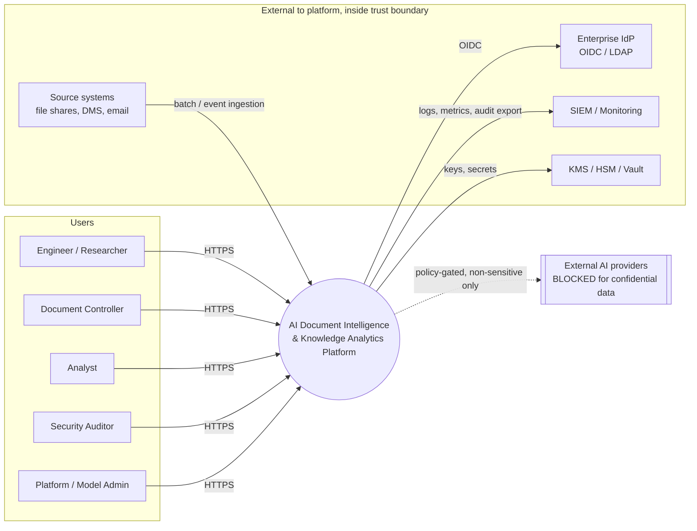
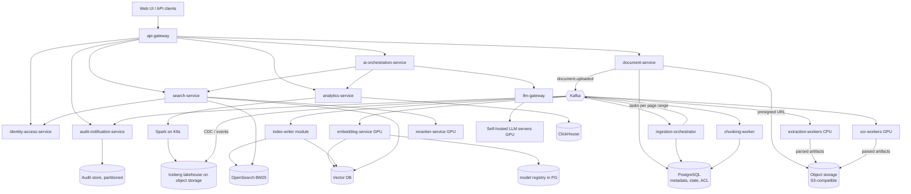
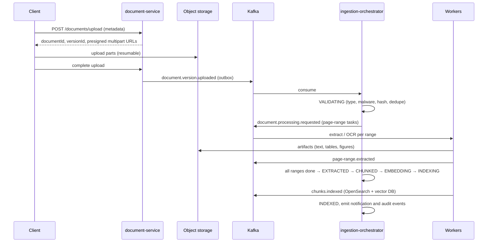
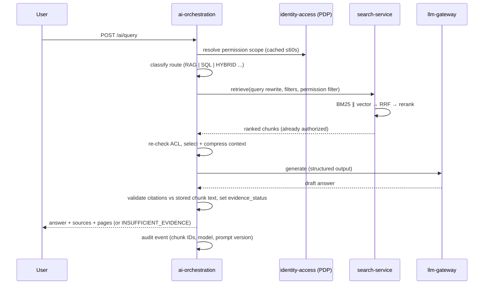

# Stage 1 — Part C: System Context, Initial HLD, Technology Decision Matrix, Architectural Risks

| Field | Value |
|---|---|
| Document ID | DIP-S1-C |
| Version | 0.1 (Draft for approval) |
| Note | Independent reference architecture; not an ISRO specification. Technology choices marked **PROVISIONAL** require a benchmark-backed ADR in Stage 2. |

---

## 1. System Context Diagram

External-provider access is off by default; enabling it is a classification-gated policy decision (U-01, U-09), never a code path reachable by confidential content.

---

## 2. Initial High-Level Design

### 2.1 Architectural style and principles
1. **Modular, event-driven microservices split by business capability and operational profile** (e.g., GPU vs CPU, latency-critical vs batch). We do *not* create a service per function.
2. **Control plane (Java Spring Boot)**: identity, documents, orchestration, search API, analytics API, audit. **Data/AI plane (Python)**: extraction, OCR, chunking, embedding, reranking, model serving.
3. **Sources of truth**: object storage (bytes, parsed artifacts) and PostgreSQL (metadata, state, ACL). All indexes are derived and rebuildable.
4. **Authorization at the data layer**: every retrieval carries a verified permission filter; the LLM never sees unauthorized text.
5. **Deterministic first**: routing, retrieval, validation are code; the LLM generates and (optionally) classifies only where needed.

### 2.2 Service consolidation (17 candidates → 13 deployables: 12 rows below + the separately deployed OCR pool)
| # | Deployable | Merges from your list | Runtime | Justification for the boundary |
|---|---|---|---|---|
| 1 | **api-gateway** | API Gateway | Java (Spring Cloud Gateway) | Edge: TLS, JWT validation, rate limit, routing |
| 2 | **identity-access-service** | Identity + User Management | Java | Wraps IdP (Keycloak-class); org/dept/role/ACL admin; policy decision point. One data owner for authz |
| 3 | **document-service** | Document Management + Upload | Java | Same aggregate (document/version/lifecycle); upload is presign + register, no byte proxying so no separate scaling need |
| 4 | **ingestion-orchestrator** | Document Processing Service | Java | Job/state machine, page-range fan-out, retries, checkpoints, reconciliation. Control logic only |
| 5 | **extraction-workers** | Processing (PDF/Office/tables/layout/classify) + OCR *(OCR as a separate pool)* | Python | Specialized pools by document type; CPU. **OCR-worker pool** is GPU and scales separately but shares code base/contract |
| 6 | **chunking-worker** | Chunking Service | Python | CPU, cheap, separate versioning cadence from extraction |
| 7 | **embedding-service** | Embedding Service | Python (GPU) | GPU batch inference; model lifecycle |
| 8 | **search-service** | Search + Vector Retrieval | Java | One query path: auth filter → BM25 ∥ vector → RRF → rerank call. Vector retrieval is a client module, not a network hop |
| 9 | **reranker-service** | Reranking | Python (GPU) | GPU, different scaling/latency profile |
| 10 | **ai-orchestration-service** | AI Orchestration + LLM Integration | Java (+ Python model gateway) | Router, RAG pipeline, citation validation, NL-to-SQL planning. LLM calls go through a thin **llm-gateway** (egress policy, quotas, prompt registry); may be split out later |
| 11 | **analytics-service** | Analytics | Java | SQL validation/execution, ClickHouse/Spark submission |
| 12 | **audit-notification-service** | Audit + Notification | Java | Both are Kafka-consumer sinks of platform events; append-only write path; can split if load diverges |

(OCR is listed within row 5 for code ownership but deploys as its own GPU pool, hence 13 deployables.) The Stage 2 HLD will re-justify each boundary against *independent deployment, independent scaling, independent failure domain, and data ownership*.

### 2.3 Component architecture

### 2.4 Ingestion data flow

Reliability patterns: transactional **outbox** in document-service (no lost events); **idempotency keys** = `(version_id, stage, range, pipeline_version)`; at-least-once consumers; per-stage checkpoints in `processing_jobs`.

### 2.5 Query data flow (RAG)

### 2.6 Data placement (what lives where)
| Data | Store | Why / what is *not* duplicated |
|---|---|---|
| Original files, parsed artifacts (page JSON, tables, figures, OCR output) | Object storage (versioned, encrypted, content-addressed) | Cheap, durable, immutable; source of truth for text |
| Users, roles, ACLs, document/version/state, jobs, chunk *metadata*, citations, chat, model registry | PostgreSQL | Transactional integrity |
| Full-text of chunks (for BM25 + highlight) | OpenSearch | Needed for lexical retrieval; chunk text also recoverable from object store |
| Vectors + minimal payload (chunk_id, doc/version id, ACL tags, filter fields) | Vector DB | No full text; fetch text by `chunk_id` from OpenSearch/PG |
| Audit trail | Partitioned PostgreSQL → archived to Iceberg | Append-only, tamper-evident |
| Analytical facts and curated datasets | Iceberg on object storage, served by ClickHouse | Columnar, scan-optimized; separate from OLTP |
| Caches | Redis | Permission-fingerprinted keys only |

### 2.7 Operational vs analytical separation
- **Operational path** (OLTP): PostgreSQL, low latency, strict consistency, small rows. Never queried by heavy analytics.
- **Analytical path**: events/CDC (Debezium → Kafka → Iceberg) → ClickHouse for interactive aggregations; Spark for large batch/statistical jobs. Analytics read replicas of curated data, not production tables. NL-to-SQL targets only the analytical store.

Definitions: *transactional DB* = row-oriented, ACID, many small writes; *analytical DB* = columnar, scans/aggregates; *data lake* = raw files on object storage, schema-on-read, no transactions; *lakehouse* = lake + table format (Iceberg/Delta) giving ACID, schema evolution, time travel.

### 2.8 Security architecture (outline)
OIDC at the gateway; short-lived JWT with department/clearance claims; central PDP (RBAC + ABAC); permission filter compiled into OpenSearch/vector queries and re-verified before prompt assembly; mTLS in mesh; namespaces with default-deny NetworkPolicies and no egress from inference/processing; sandboxed document parsing (gVisor/Kata-class, non-root, read-only FS, CPU/mem/time limits); KMS-wrapped keys; Vault for secrets; prompt-injection controls (untrusted-context framing, output schema validation, no tool access from retrieved text); append-only audit.

---

## 3. Technology Decision Matrix

Scoring: 1 (poor) – 5 (excellent) against criteria weights; summary only, full ADRs in Stage 2. **PROVISIONAL** = decision gated on benchmark with our data.

### 3.1 Backbone and storage
| Concern | Candidates | Decision | Rationale | Rejected / trade-off |
|---|---|---|---|---|
| Event backbone | **Kafka (KRaft)**, Pulsar, RabbitMQ, cloud queues | **Kafka** | Replay, partitioned ordering, huge throughput, ecosystem (Connect, Schema Registry, Debezium) | RabbitMQ lacks replay/log semantics at this scale; Pulsar fewer in-house skills. Cost: ops complexity |
| Operational DB | **PostgreSQL**, MySQL, Mongo | **PostgreSQL** | ACID, partitioning, JSONB, RLS, mature HA (Patroni) | Mongo weaker relational integrity for ACL/lifecycle |
| Object storage | **S3-compatible (MinIO/Ceph/cloud)** | S3 API on-prem or cloud (U-01) | Immutable artifacts, erasure coding, versioning, lifecycle | Filesystem/NFS does not scale or offer object semantics |
| Lakehouse format | **Iceberg**, Delta, Hudi | **Iceberg** | Engine-neutral (Spark, Trino, ClickHouse), hidden partitioning, time travel | Delta strongest with Databricks; we avoid vendor coupling |
| Interactive analytics | **ClickHouse**, Postgres, warehouse | **ClickHouse** | Fast columnar aggregation, cheap at scale, self-hostable | Postgres fine at Initial tier (start here, add ClickHouse at Medium); cloud DW rejected if sovereignty requires on-prem |
| Batch / statistical | **Spark** | Spark on K8s, used only above ClickHouse limits | Large joins, ML pipelines, backfills | Overkill for Initial; introduced in M10 |
| Keyword search | **OpenSearch**, Elasticsearch, Postgres FTS | **OpenSearch** | Open license, BM25, ACL filters, sharding, highlighting | PG FTS acceptable ≤ ~10⁷ chunks only; Elasticsearch licensing risk |
| Vector DB | **Qdrant**, Milvus, Weaviate, pgvector | **PROVISIONAL: Qdrant (Initial/Medium); Milvus evaluated for Large** | Qdrant: strong payload filtering, quantization, on-disk HNSW, simple ops. Milvus: more mature for multi-billion distributed (disaggregated storage, DiskANN/IVF). pgvector: best at ≤ ~10M vectors, one fewer system, weaker filtered-ANN at scale | Weaviate: less advantage here. Decision by benchmark on filtered recall/latency at 100M+ vectors |
| Cache | Redis | Redis (permission-scoped keys) | Standard | — |

### 3.2 AI stack
| Concern | Options | Direction |
|---|---|---|
| Embeddings | Self-hosted open models (BGE-M3/E5/GTE class), managed APIs | **Self-hosted** (C-02). Managed APIs rejected for confidential data. Choose via golden-set bake-off; record in registry |
| Reranker | Cross-encoder (bge-reranker class) | Self-hosted GPU; top-30 (max 50)→10 |
| LLM serving | vLLM / TGI / Triton | vLLM-class with continuous batching, behind llm-gateway |
| LLM | Open-weight models inside boundary | **Unresolved (U-09)**; design is model-agnostic via registry |
| OCR / layout | Tesseract, PaddleOCR, docTR, layout models | Tiered: digital text first, OCR only when needed (NFR-CST-02); engine PROVISIONAL, bake-off on sample scans |
| PDF parsing | PyMuPDF/pdfium-class, Apache Tika for Office | Specialized worker per type |
| Orchestration | Choreography on Kafka + state machine in PG vs Temporal | **Kafka + PG state machine** (fewer moving parts); Temporal an ADR candidate if long-running workflow complexity grows |

### 3.3 Platform
Kubernetes + Helm, Argo CD (GitOps), GitHub Actions (CI) or on-prem equivalent, Terraform, OpenTelemetry + Prometheus + Grafana, OpenSearch/Loki for logs, Keycloak-class IdP, Vault, Trivy/Cosign for image scanning/signing. Rationale and alternatives in Infrastructure document.

---

## 4. Major Architectural Risks

Likelihood (L) / Impact (I): H/M/L. Residual after mitigation is reviewed at each gate.

| # | Risk | L | I | Mitigation | Early signal / owner |
|---|---|---|---|---|---|
| R1 | **OCR cost and quality dominate** (scan share unknown, A-06) | H | H | Sample corpus early; page-level OCR routing; confidence thresholds; GPU pool autoscale; accept "low-quality" flag | OCR GPU-hours per 1k pages in M4 spike |
| R2 | **Vector index at billions exceeds memory/budget** | H | H | Quantization, disk ANN, tiering (current vs archive), sharding; consider coarser chunks or skipping low-value pages; benchmark early | Recall/latency curve at 100M vectors |
| R3 | **Permission leakage through retrieval, caches, chat memory, or LLM context** | M | Critical | Filter inside index queries + post-check; permission-fingerprinted caches; red-team suite as release gate; audit chunk exposure | Any cross-scope result in tests |
| R4 | **Index/metadata inconsistency** (partial failures) | H | M | Idempotent stage writes, outbox, reconciliation jobs, version-tagged index entries, only mark INDEXED after both indexes confirm | Reconciliation drift rate |
| R5 | **Large-document head-of-line blocking / skew** | H | M | Page-range tasks, per-tenant/priority topics, fair scheduling, partition-count headroom | P95 latency of small docs during big-doc ingest |
| R6 | **Hallucination and invalid citations** | M | H | Mechanical citation validation, insufficient-evidence path, faithfulness eval gate; no calibrated-confidence claims | Faithfulness/citation precision trend |
| R7 | **Embedding/chunking change forces full re-index (months at scale)** | M | H | Blue/green collections, model registry, incremental re-embedding, cache; plan GPU burst capacity | Re-embedding ETA estimate |
| R8 | **Prompt injection via documents** | M | H | Untrusted-context framing, structured outputs, no tool execution from document text, injection test set, quarantine flag | Injection test pass rate |
| R9 | **Malicious files (parser exploits, bombs)** | M | H | Sandboxed parsers, size/time/page limits, AV scan, quarantine state | Sandbox escapes/timeouts |
| R10 | **NL-to-SQL unsafe or wrong** | M | M | AST validation, read-only role on analytical replica, allowlisted schema, timeouts, EXPLAIN cost cap, golden SQL set | Wrong-result rate |
| R11 | **No golden evaluation data** (U-06) | H | H | Start labeling with SMEs from M1; synthetic bootstrap flagged as such; blocks quality claims otherwise | Golden-set size |
| R12 | **Operational complexity** (Kafka, OpenSearch, vector DB, ClickHouse, Spark, GPUs) | H | M | Phase introduction (no Spark/ClickHouse until needed); platform team; runbooks; managed-equivalent operators | On-call load |
| R13 | **Capacity assumptions wrong** (page counts, scan %, token rates) | H | M | Treat capacity as hypothesis; benchmark each stage; publish sizing with confidence ranges | Variance between benchmark and model |
| R14 | **Open-weight LLM quality below need** | M | M | Retrieval quality first; evaluate multiple models; router limits LLM to tasks it can do; human-visible citations | Faithfulness on golden set |
| R15 | **Kafka misconfiguration (partitions, ordering, lag)** | M | M | Key by `version_id`; headroom partitions; lag alerts; replay runbooks; DLQ per stage | Consumer lag, rebalance rate |
| R16 | **Secure deletion across derived copies** | M | H | Chunk/vector IDs tied to version; deletion saga with verification; crypto-erasure option (U-10) | Deletion verification failures |

---

## 5. Approval Request

Stage 2 will not start until the following are decided.

**Decisions requested from you (architecture approval, Gate G1):**
1. Approve scope, MoSCoW split, and the 13-deployable service consolidation (§2.2).
2. Approve principles: object store + PostgreSQL as truth, derived rebuildable indexes, at-least-once + idempotency, deterministic-first routing.
3. Approve provisional technology directions (§3), especially Qdrant-first with Milvus benchmark, OpenSearch for BM25, Iceberg + ClickHouse + Spark (phased).
4. Provide answers or defaults for unresolved items U-01 … U-10 (at minimum U-01 deployment target, U-02 classification/tenancy, U-09 LLM availability).
5. Confirm NFR targets (§4 of `02-...`) as proposals to ratify or change.

**On approval, Stage 2 delivers, in order:** detailed HLD → LLD → database design (ER, DDL, partitioning) → API specification (OpenAPI) → Kafka event architecture → AI/ML and RAG design → search optimization → security → infrastructure/DR → test strategy → capacity planning → observability → ADRs → roadmap → production-readiness checklist.
