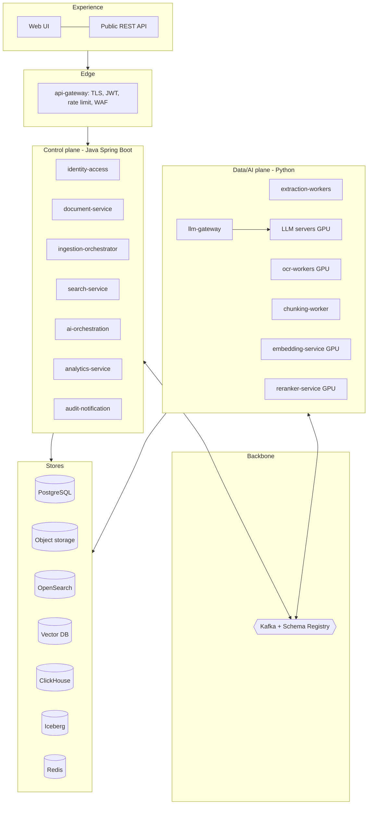
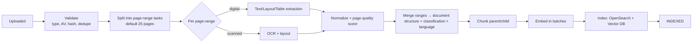
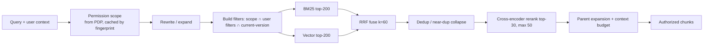
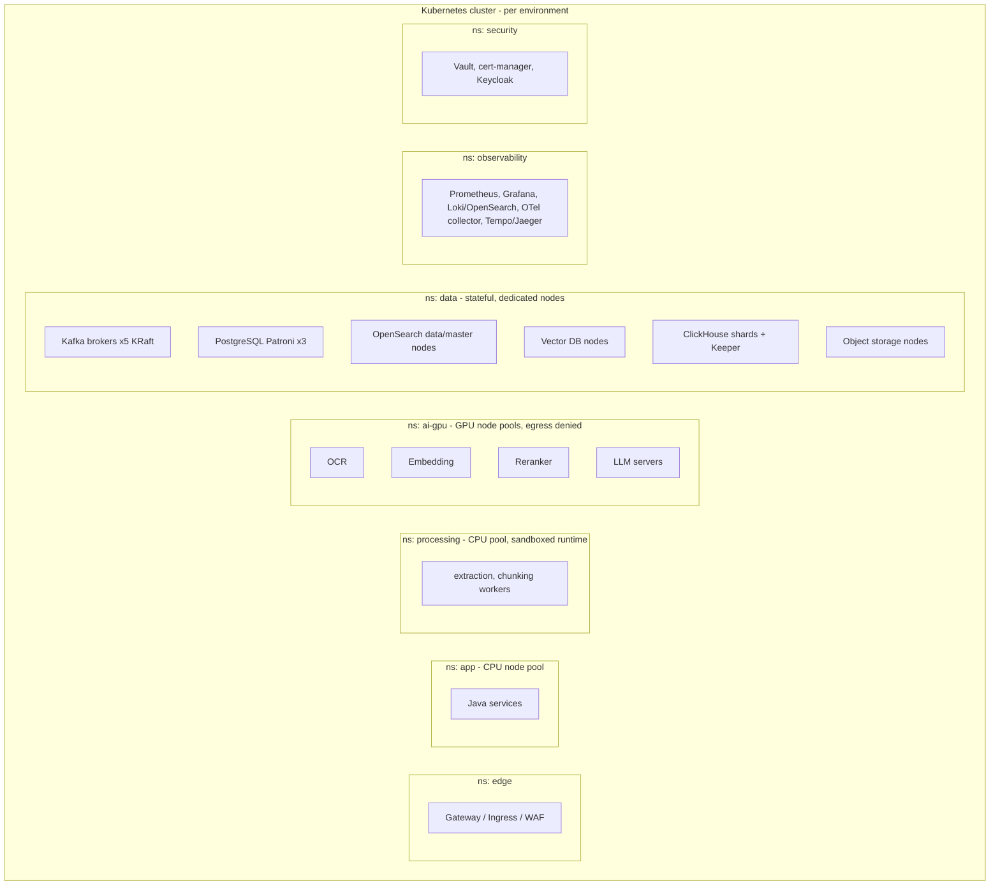

# Stage 2 — Document 1: High-Level Design (Detailed)

| Field | Value |
|---|---|
| Document ID | DIP-HLD-01 |
| Version | 0.2 (Stage 2, post-G1) |
| Builds on | `01`, `02`, `03` (Stage 1, approved) |
| Note | Independent reference architecture; not an ISRO specification. |

## 0. Working defaults for unresolved decisions
Approval at G1 did not answer U-01…U-10. To avoid blocking, this HLD adopts the defaults below. Each is **revisable**; the ADR that depends on it is flagged.

| ID | Working default | Revisit trigger | Affects |
|---|---|---|---|
| U-01 | Kubernetes on infrastructure we control (on-prem or sovereign cloud), S3-compatible storage, no proprietary-SaaS dependency | Hosting decision | ADR-001, Infra doc |
| U-02 | One cluster, **logical isolation by ACL + classification tags**; the highest classification tier (if any) gets a **physically separate index set and namespace** | Classification scheme provided | ADR-004, Security |
| U-03 | Audit retention 7 years, document retention policy-driven per classification | Compliance input | DB retention |
| U-04 | Keycloak-class IdP federating to existing LDAP/AD via OIDC | IdP named | Identity |
| U-05 | English first; multilingual (incl. Indic scripts) is a pluggable OCR/embedding choice (F-04) | Corpus sample | OCR, embeddings |
| U-06 | Golden set bootstrapped from SME-labeled sample (target 500 queries by M6), synthetic data labeled as such | SME availability | Evaluation |
| U-08 | Planning load: 100 queries/s peak at Medium, 400/s at Large (hypothetical) | Pilot telemetry | Capacity |
| U-09 | Model-agnostic via registry; LLM tier chosen by bake-off; no external provider for classified data | LLM approved | AI/ML doc |
| U-10 | Soft delete + legal-hold awareness; physical purge by deletion saga; **crypto-erasure** (per-document data key) for object store | Compliance | Deletion |

## 1. Business context recap
Engineers need authoritative, current, auditable answers from millions of versioned technical documents. The platform ingests, enriches, indexes and analyzes them while enforcing document-level access and producing evidence-backed answers. Success measures: BO-1…BO-6 in `02`.

## 2. Logical architecture (layers)

Layer rules: (1) only the control plane talks to end users; (2) the data plane never calls the control plane synchronously, it communicates via Kafka and shared stores; (3) the query path (search → rerank → LLM) is synchronous and latency-budgeted, the ingestion path is asynchronous.

## 3. Service responsibilities and boundaries

| Service | Owns (data) | Synchronous deps | Emits / consumes | Scales on | Failure domain |
|---|---|---|---|---|---|
| api-gateway | none | identity-access (JWKS) | – | RPS | Edge; stateless, N≥3 |
| identity-access | users, roles, permissions, departments, ACL | IdP, PG, Redis | emits `iam.permission.changed` | RPS | Cached PDP decisions allow brief outage tolerance (≤60 s) |
| document-service | documents, versions, metadata, lifecycle | PG, object store | emits `document.version.uploaded` (outbox); consumes `document.version.state-changed` | RPS, PG | Upload stays available if Kafka is down (outbox buffers) |
| ingestion-orchestrator | processing_jobs, processing_events | PG | consumes stage-completion events, emits task events | Kafka lag | Restart-safe; state in PG |
| extraction-workers | none (writes artifacts) | object store | consumes `ingest.task.extract`, emits `…extracted` | queue lag, CPU | Per-pool; crash → redelivery |
| ocr-workers | none | object store | `ingest.task.ocr` | queue lag, GPU | Separate GPU pool |
| chunking-worker | document_chunks (metadata) | PG, object store | `ingest.task.chunk` | queue lag | – |
| embedding-service | embedding_metadata | model registry, vector DB | `ingest.task.embed` | tokens/s, GPU | GPU pool; breaker on vector DB |
| search-service | none (stateless) | OpenSearch, vector DB, reranker, identity-access, Redis | – | RPS | Degrades: no reranker → fused order; no vector → BM25 only |
| reranker-service | none | – | – | GPU, RPS | Bulkhead; timeout 400 ms → skip rerank |
| ai-orchestration | chat_sessions/messages, ai_responses, citations, search_history | search, analytics, llm-gateway, PG | emits `ai.query.completed` | LLM concurrency | LLM timeout → retrieval-only result |
| analytics-service | none (read-only access) | ClickHouse, Trino/Spark | emits `analytics.query.executed` | query concurrency | Separate from operational DB |
| audit-notification | audit_logs | PG, SMTP/chat | consumes all `*.audit` events | write throughput | Append-only; events buffered in Kafka |

**Boundary tests used** (a split is justified only if at least two hold): independent scaling profile (GPU vs CPU vs I/O), independent failure domain, independent release cadence, distinct data ownership, distinct security zone. This is why extraction, OCR, embedding, reranking are separate while upload is merged with document management, and vector retrieval is merged into search.

## 4. Component architecture of the ingestion pipeline

### 4.1 Stage graph

### 4.2 Preventing large documents from blocking the pipeline
1. **Page-range tasks** (default 25 pages, configurable per type) so a 10,000-page document becomes 400 tasks interleaved with others.
2. **Two-level fairness**: separate Kafka topics per priority (`p0` interactive reprocess, `p1` normal, `p2` backfill) and a **per-document concurrency cap** in the orchestrator (e.g., ≤ 8 in-flight range tasks per document, lifted when queues are empty).
3. **Size-class routing**: documents > N pages are routed to a "bulk" worker group so small documents always have capacity.
4. **Backfill throttle**: p2 consumption is paused when p0/p1 lag exceeds thresholds.
5. **Cheap-first checks**: page triage (digital text present? → skip OCR).
6. Timeouts per task (e.g., 5 min digital, 15 min OCR range); a stuck range is retried, not the document.

### 4.3 Checkpointing and idempotency
- `processing_jobs` row per (version, stage, range, pipeline_version), unique key = idempotency key.
- A worker writes artifacts to a deterministic object key (`artifacts/{version}/{stage}/{range}/{pipeline_version}.json`) then marks job `DONE` and emits completion; re-execution overwrites identical bytes.
- Orchestrator advances a stage when all range jobs are `DONE` (count check in a single SQL transaction, guarding duplicates).
- Resume after crash: unfinished jobs are re-issued by a sweeper (`updated_at < now - lease`).

## 5. Query architecture

### 5.1 Retrieval path

Latency budget (target P95, Medium): permission 15 ms (cached), rewrite 30 ms (rule-based) / 300 ms (LLM, optional), BM25 ∥ vector 250 ms, fuse+dedupe 20 ms, rerank 250 ms, parent fetch 40 ms ≈ 600–650 ms, inside NFR-PRF-01 (800 ms).

### 5.2 Authorization strategy ("filter before the LLM")
- **Scope representation**: each chunk is indexed with `acl_tags` (e.g., `dept:PROP`, `class:RESTRICTED`, `grp:g123`, `doc:d456` for individual grants) and `version_state`.
- PDP expands the user into a bounded set of tags; the filter is `acl_tags ∩ user_tags ≠ ∅ AND class_level ≤ clearance`.
- Tag explosion guard: if a user's expansion exceeds a threshold (e.g., 1,000 tags), use **group-based tags only** and resolve individual doc grants through an allow-list join in search-service post-filter.
- Permission changes publish `iam.permission.changed`; affected tag sets are re-indexed asynchronously; **until re-index completes, a post-filter check against PG (authoritative) runs on every candidate** before text enters the prompt. Revocation therefore takes effect immediately (via post-check), grants within minutes.
- Caches are keyed by (query hash, filters, permission fingerprint) only.

### 5.3 RAG path
`ai-orchestration` = route → retrieve → ACL post-check → select context (token budget, diversity across documents, parent expansion) → compress (extractive: sentence selection with query relevance; abstractive only when budget exceeded) → generate with JSON schema → validate citations → compute evidence status → persist `ai_responses`/`citations` → audit event. Detailed algorithms in the RAG Pipeline Design and LLD.

### 5.4 Routing between RAG, SQL, Spark
Ordered deterministic classifier:
1. Pattern/rule layer (aggregation verbs, "how many/average/trend", explicit date/ID filters → SQL; "what does / explain / compare text" → RAG).
2. Small supervised classifier (trained on labeled queries) producing route + confidence.
3. If confidence < threshold, LLM classification restricted to a closed label set.
4. `HYBRID`: plan with ≤ 3 steps (e.g., SQL selects the set of documents; RAG answers within it). Route and reason are logged.
Spark is selected only when the SQL planner's EXPLAIN estimate exceeds ClickHouse limits or the request is a defined batch/statistical job (asynchronous).

## 6. Data architecture (summary; full DB doc follows)

| Store | Content | Partitioning/sharding | Rebuildable? |
|---|---|---|---|
| PostgreSQL (authoritative) | Identity, document/version, jobs, chunk metadata, citations, chat, registry | Range-partition `processing_events`, `audit_logs`, `search_history` by month; hash-partition `document_chunks` by `document_id` once > ~500M rows (or move chunk metadata fully to ClickHouse and keep only IDs) | No → backups + PITR |
| Object storage | Originals, page JSON, tables, figures, OCR output, chunk text snapshots (Parquet) | Prefix by `tenant/version_id`; lifecycle tiers | No → replicated/erasure coded |
| OpenSearch | Chunk text + filters + BM25 | Index per time/era or per classification tier; shards ≈ 30–50 GB; replicas ≥ 1 | Yes (from object store) |
| Vector DB | Vectors + minimal payload | Collection per (embedding model version); shards by hash; replicas ≥ 2 at Medium+ | Yes (from chunks + model) |
| Iceberg + ClickHouse | Events, metadata snapshots, curated datasets, audit archive | Partition by day/month and org | Partly (events from Kafka retention + archive) |
| Redis | Permission cache, search cache | – | Yes |

**Chunk text single-sourcing:** canonical chunk text lives in object storage (Parquet by version); OpenSearch holds an indexed copy because BM25 requires it; vector DB holds none; PG holds none (only offsets, hashes, token counts). Citation validation reads from object store/OpenSearch by `chunk_id`.

**Consistency model (four systems):**
| Pair | Guarantee |
|---|---|
| Object store ↔ PG | Strong for committed uploads (PG row inserted only after object upload verified by hash) |
| PG ↔ OpenSearch / Vector DB | Eventual (≤ 5 min P95); each index entry carries `version_id`, `pipeline_version`; version marked INDEXED only after both confirm |
| OpenSearch ↔ Vector DB | Reconciled by job: set diff of `chunk_id` per version; drift triggers re-index of the missing side |
| Visibility | Search filters on `version_state IN (ACTIVE)`; a version becomes searchable by an atomic flag flip *after* both indexes are complete, so users never see half-indexed documents |

## 7. Kafka design (HLD level)

> **Governing document:** this table is the HLD-level summary. The full topic catalog (including `ingest.task.validate`, `ingest.task.classify`, `ingest.stage.failed`, `index.retag.requested`, `.p1/.p2` embed topics, `model.registry.changed`, `config.changed`, `cdc.*`) is in `08` §3 and governs on any difference.

**Topic naming:** `<domain>.<entity>.<event-or-task>.<env-agnostic>`; environment is the cluster/namespace, not the name. DLQ: `<topic>.dlq`; retry: `<topic>.retry.<n>` (backoff tiers 1m/10m/1h).

| Topic | Key | Partitions (Medium→Large) | Retention | Purpose |
|---|---|---|---|---|
| `document.version.uploaded` | version_id | 24 → 96 | 7 d | Start of pipeline |
| `ingest.task.extract.p0/p1/p2` | `version_id:range` | 48 → 192 | 3 d | Page-range extraction |
| `ingest.task.ocr.p0/p1/p2` | `version_id:range` | 48 → 192 | 3 d | OCR |
| `ingest.stage.completed` | version_id | 24 → 96 | 7 d | Orchestrator input |
| `ingest.task.chunk` | version_id | 24 → 96 | 3 d | Chunking |
| `ingest.task.embed` | `version_id:batch` | 48 → 192 | 3 d | Embedding batches |
| `ingest.task.index` | `version_id:batch` | 48 → 192 | 3 d | Index writes |
| `document.version.state-changed` | version_id | 12 → 48 | 30 d | Status for notifications, analytics |
| `iam.permission.changed` | doc_or_group_id | 12 | 30 d | Re-tag, cache invalidate |
| `audit.event` | actor_id | 24 → 96 | 7 d (then Iceberg) | Audit ingestion |
| `ai.query.completed` | session_id | 12 → 48 | 30 d | Evaluation, analytics |
| `*.dlq` | original key | 6 | 30 d | Manual triage |

Partition counts are starting points from throughput arithmetic (target consumer parallelism × 2 headroom) and are to be validated in M3 benchmarks. **Ordering** is only guaranteed per key, so state transitions are keyed by `version_id`; consumers do not depend on cross-key ordering. **Delivery**: producers `acks=all`, `enable.idempotence=true`; consumers commit offsets after the side-effect is durable (at-least-once); exactly-once is limited to Kafka-to-Kafka transactional hops, never claimed across PG/OpenSearch/Vector DB. **Poison messages**: after 5 attempts → DLQ with error headers; DLQ depth alerts. **Schemas**: Avro/Protobuf in Schema Registry, `BACKWARD_TRANSITIVE`. **Backpressure**: bounded in-flight per consumer, pause/resume partitions on downstream breaker open, autoscale (KEDA) on lag.

## 8. Deployment architecture

- Node pools: `cpu-general`, `cpu-processing` (sandboxed runtime class), `gpu-ocr`, `gpu-embed`, `gpu-rerank`, `gpu-llm`, `stateful-*` (local NVMe for Kafka/OpenSearch/vector DB).
- Network: default-deny NetworkPolicies; explicit allow-lists service→service; mTLS via mesh or SPIFFE-style identities; `ai-gpu` and `processing` namespaces have **no egress**; model artifacts come from an internal registry.
- HA: ≥ 3 AZ/rack failure domains where available; PodDisruptionBudgets; topology spread; PG synchronous replica for RPO≈0 in-site and async DR replica.
- DR: second site/region warm standby for PG + object store replication + Kafka MirrorMaker 2 for critical topics; indexes rebuilt or snapshot-restored (snapshots for OpenSearch and vector DB shorten RTO). Details in DR Plan.

## 9. Security architecture (detailed outline)
| Layer | Controls |
|---|---|
| Identity | OIDC code+PKCE for humans; client credentials with short-lived tokens for services; token audience scoping; MFA at IdP |
| Authorization | PDP with RBAC + ABAC; default deny; evaluation logged; explicit-deny precedence |
| Data | Envelope encryption: KMS master → per-tenant KEK → per-document DEK (supports crypto-erasure); encrypted PG volumes, Kafka, OpenSearch, vector DB snapshots, backups |
| Network | Zero-trust segmentation, mTLS, egress deny for AI and parsing namespaces |
| Ingestion | File type allow-list, magic-byte check, AV (ClamAV-class + optional multi-engine), sandbox parsing, archive/page/time limits, quarantine |
| AI | Untrusted-context template; delimiters + instruction hierarchy; structured outputs only; no function/tool calls triggered by document content; output scan; injected-instruction detector at ingestion flags suspicious chunks; red-team suite in CI |
| Privacy | Logs contain IDs not text; prompts persisted encrypted with retention limits; PII tagging optional |
| Governance | Classification tags immutable-downward without approval; audit of every context exposure |

## 10. Scalability bottlenecks and responses
| Bottleneck | Symptom | Response |
|---|---|---|
| OCR GPU throughput | OCR queue lag, backfill ETA grows | Autoscale GPU pool, triage non-scanned pages, lower DPI adaptively, batch pages, burst GPU capacity for backfill |
| Embedding throughput | Embed lag | Larger dynamic batches, FP16/INT8 inference, cache by text hash, smaller model for archive tier |
| Vector index memory | OOM / latency spike | Scalar/binary quantization with rescoring, on-disk vectors, tiering, more shards |
| Filtered ANN recall drop | Low recall under restrictive ACL filters | Payload-indexed filtering with filterable HNSW, per-tier collections, over-fetch factor, exact search fallback for tiny filtered sets |
| PG write/connection pressure | Pool exhaustion | PgBouncer, batch writes, partition high-volume tables, move chunk metadata to columnar if needed |
| Kafka hot partitions | Skewed lag | Key by `version_id:range` not `version_id` for task topics |
| LLM concurrency | Queueing, TTFT up | Continuous batching, prompt caching, context caps, request prioritization, degrade to retrieval-only |
| Reranker | Latency | Limit candidates to 50, distill smaller cross-encoder, FP16 |
| OpenSearch shard count | Cluster state size | Time/tier-based indices, ILM rollover, target 30–50 GB shards |

## 11. Indicative deployment scenarios (hypothesis; to be benchmarked)
Calculation basis from `01` §3.2. Counts show **order of magnitude and the formula**, not a quote.

| Item | Initial 10k docs | Medium 1M docs | Large 10M docs |
|---|---|---|---|
| Pages / chunks | 5M / 5.5M | 500M / 550M | 5B / 5.5B |
| Vector storage (float32 → chosen) | 22 GB → float32 in RAM | 2.2 TB → int8 ≈ 550 GB + graph ≈ 100 GB | 22 TB → int8 + disk ≈ 5.5 TB + ≈ 1 TB graph, tiered |
| Vector DB topology | single node (or pgvector as simplest start) | 3–6 nodes, 2 replicas | sharded cluster, tiers (hot vs archive) |
| OpenSearch text (≈ 1.3 KB/chunk + index overhead ×~1.5) | ≈ 11 GB | ≈ 1.1 TB | ≈ 11 TB (+replica) |
| Embedding GPU-hours total (assumed 20k tok/s/GPU) | ≈ 40 h | ≈ 3,900 h | ≈ 39,000 h |
| OCR volume (30% scanned) | 1.5M pages | 150M pages | 1.5B pages (GPU-hours depend on engine; benchmark in M4) |
| Kafka | 3 brokers | 5 brokers | 5–9 brokers, tiered storage |
| PostgreSQL | 1 primary + 1 replica | primary + 2 replicas, partitioned | partitioned; chunk metadata offloaded |
| Analytics | PostgreSQL | + ClickHouse 2 shards | ClickHouse multi-shard + Spark |

## 12. Major architectural decisions (ADR index)
> Superseded by the full register in `18` (32 ADRs, with statuses and evidence gates); the table below lists the first 15 as written at HLD time.
| ADR | Decision | Status | Depends on |
|---|---|---|---|
| ADR-001 | Kubernetes, S3-compatible storage, self-managed data services | Accepted (default U-01) | U-01 |
| ADR-002 | Kafka as backbone; PG-backed state machine instead of Temporal | Accepted | – |
| ADR-003 | Page-range task granularity (25 pages default) | Accepted, tune in M3 | benchmark |
| ADR-004 | Logical isolation by ACL tags + physical isolation for top classification tier | Accepted (default U-02) | U-02 |
| ADR-005 | OpenSearch for BM25; Elasticsearch/PG FTS rejected | Accepted | – |
| ADR-006 | Vector DB: Qdrant first, Milvus benchmark gate before Large | **Provisional** | benchmark M5/M6 |
| ADR-007 | Self-hosted embeddings; bake-off on golden set | Accepted (method), model TBD | U-05, U-06 |
| ADR-008 | Structure-aware parent-child chunking default with fallback chain | Accepted | eval |
| ADR-009 | Iceberg lakehouse + ClickHouse + Spark (phased) | Accepted | – |
| ADR-010 | Authorization filter in index + PG post-check | Accepted | – |
| ADR-011 | Deterministic-first query routing; LLM only as last-resort classifier | Accepted | – |
| ADR-012 | Citation validation mechanical; confidence = evidence band, not probability | Accepted | – |
| ADR-013 | Transactional outbox for event publication | Accepted | – |
| ADR-014 | Searchability flag flipped after both indexes confirm | Accepted | – |
| ADR-015 | Per-document DEK for crypto-erasure | Proposed | U-10 |

## 13. Open items entering the LLD
1. Exact chunk size/overlap per document type (needs sample corpus; LLD gives starting values, M5 tunes).
2. Tag-explosion threshold for ACL filters (benchmark in M6).
3. OCR engine and layout model bake-off (M4).
4. NL-to-SQL schema surface (curated views) — define with analysts.

## 14. Next documents (order)
LLD (class diagrams, DTOs, state machine code, retry, sequences) → Database Design (ER, DDL, partitioning, retention) → API Specification (OpenAPI) → Kafka Event Architecture (schemas) → AI/ML, RAG, Search docs → Security, Infra/DR, Test, Capacity, Observability → ADRs → Roadmap → Production Readiness.
