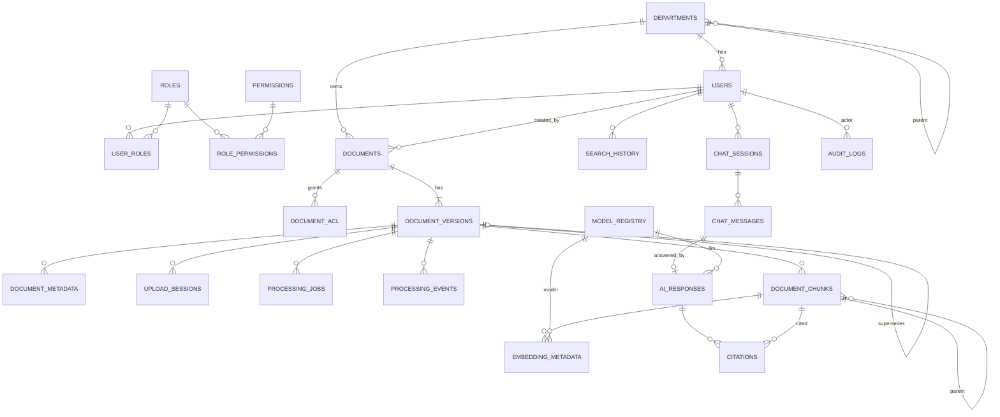

# Stage 2 — Document 3: Database Design

| Field | Value |
|---|---|
| Document ID | DIP-DB-01 |
| Version | 0.1 |
| Builds on | `04-hld-detailed.md` §6 (data placement), `05-lld.md` (state machine, jobs, outbox, chunk identity) |
| Target engine | PostgreSQL 16 (Patroni HA, PgBouncer). Vector DB, OpenSearch, ClickHouse, Iceberg are covered in §9. |
| Note | Independent reference architecture. Row-count and size figures are hypothetical, derived from `01` §3.2. |

---

## 1. Design principles
1. **PostgreSQL is authoritative for state, identity, ACL and provenance. It does not store document text or vectors.**
2. Every table has an owner service; no cross-service writes (see §2). Cross-service reads go through APIs or events, not shared tables.
3. Primary keys are UUIDv7 (time-ordered, index-friendly) except chunks (deterministic text ID) and high-volume append tables (bigint identity or composite with timestamp).
4. All timestamps `timestamptz` UTC. No soft-delete by nullable flags on hot tables unless required (`deleted_at` is used for documents, users).
5. Optimistic locking via `row_version` on state-bearing tables.
6. High-volume append-only tables are **range-partitioned by time**; the largest entity table (chunks) is **hash-partitioned**.
7. Constraints in the database are the last line of defense for idempotency (unique keys) and integrity (FKs, CHECKs).

## 2. Table ownership

| Owner service | Tables |
|---|---|
| identity-access | `departments`, `users`, `roles`, `permissions`, `role_permissions`, `user_roles`, `document_acl` |
| document-service | `documents`, `document_versions`, `document_metadata`, `upload_sessions`, `outbox_events` |
| ingestion-orchestrator | `processing_jobs`, `processing_events`, `processed_events` |
| chunking-worker (via orchestrator DB role) | `document_chunks` |
| embedding-service | `embedding_metadata`, `model_registry` |
| search-service | `search_history` |
| ai-orchestration | `chat_sessions`, `chat_messages`, `ai_responses`, `citations`, `config_params` |
| audit-notification | `audit_logs` |

Physical deployment: Initial tier uses one PostgreSQL cluster with **schema-per-service** (`iam`, `docs`, `ingest`, `ai`, `audit`) and one DB role per schema (owner can write; others have `SELECT` on explicitly granted views only). Medium/Large split high-churn schemas (`ingest`, `audit`, `ai`) onto separate clusters. Because services never join across schemas in code, the split needs no application change. FKs across schemas are therefore declared only where both tables stay in the same cluster (documented in DDL; cross-schema references otherwise are logical UUID references validated at write time by the owning service).

---

## 3. ER diagram (logical)



Relationship rules: a `document` is a stable identity; every upload creates a `document_version`; chunks, jobs, metadata belong to a **version** (never the document), so a new version cannot corrupt the old one. `citations` point at a chunk *and* snapshot the page/section so a citation stays interpretable after the chunk is re-indexed (see §4.5).

---

## 4. Physical schema (DDL)

Conventions: `CREATE EXTENSION IF NOT EXISTS pgcrypto, btree_gin, pg_trgm, citext, ltree;` UUID defaults use an application-generated UUIDv7 (or `uuidv7()` when available). Enumerations are `text` + `CHECK` (easier online migration than PG enums).

### 4.1 Identity and access (`iam`)

```sql
CREATE SCHEMA iam;

CREATE TABLE iam.departments (
  id             uuid PRIMARY KEY,
  parent_id      uuid REFERENCES iam.departments(id),
  code           text NOT NULL,
  name           text NOT NULL,
  path           ltree NOT NULL,                       -- materialized path for inheritance queries
  created_at     timestamptz NOT NULL DEFAULT now(),
  UNIQUE (code),
  CHECK (parent_id IS DISTINCT FROM id)
);
CREATE INDEX ix_dept_path ON iam.departments USING gist (path);

CREATE TABLE iam.users (
  id             uuid PRIMARY KEY,
  external_subject text NOT NULL,                      -- OIDC 'sub'
  issuer         text NOT NULL,
  email          citext NOT NULL,
  display_name   text NOT NULL,
  department_id  uuid NOT NULL REFERENCES iam.departments(id),
  clearance      smallint NOT NULL DEFAULT 0 CHECK (clearance BETWEEN 0 AND 9),
  attributes     jsonb NOT NULL DEFAULT '{}',          -- ABAC attributes (project, location …)
  status         text NOT NULL DEFAULT 'ACTIVE' CHECK (status IN ('ACTIVE','SUSPENDED','DEACTIVATED')),
  created_at     timestamptz NOT NULL DEFAULT now(),
  last_login_at  timestamptz,
  deleted_at     timestamptz,
  row_version    integer NOT NULL DEFAULT 0,
  UNIQUE (issuer, external_subject),
  UNIQUE (email)
);
CREATE INDEX ix_users_dept ON iam.users(department_id) WHERE deleted_at IS NULL;

CREATE TABLE iam.roles (
  id             uuid PRIMARY KEY,
  name           text NOT NULL UNIQUE,                 -- e.g. END_USER, DOC_CONTROLLER, AUDITOR
  description    text,
  is_system      boolean NOT NULL DEFAULT false
);

CREATE TABLE iam.permissions (
  id             uuid PRIMARY KEY,
  code           text NOT NULL UNIQUE,                 -- e.g. document:read, document:upload, audit:read
  description    text
);

CREATE TABLE iam.role_permissions (
  role_id        uuid NOT NULL REFERENCES iam.roles(id) ON DELETE CASCADE,
  permission_id  uuid NOT NULL REFERENCES iam.permissions(id) ON DELETE CASCADE,
  PRIMARY KEY (role_id, permission_id)
);

CREATE TABLE iam.user_roles (
  user_id        uuid NOT NULL REFERENCES iam.users(id) ON DELETE CASCADE,
  role_id        uuid NOT NULL REFERENCES iam.roles(id) ON DELETE CASCADE,
  scope_department_id uuid REFERENCES iam.departments(id),   -- role valid for dept subtree; NULL = global
  granted_by     uuid REFERENCES iam.users(id),
  granted_at     timestamptz NOT NULL DEFAULT now(),
  expires_at     timestamptz,
  id             uuid PRIMARY KEY
);
-- PK cannot contain an expression, so uniqueness (NULL scope = global) is a unique expression index
CREATE UNIQUE INDEX ux_user_roles ON iam.user_roles(user_id, role_id,
  COALESCE(scope_department_id, '00000000-0000-0000-0000-000000000000'::uuid));
CREATE INDEX ix_user_roles_role ON iam.user_roles(role_id);

-- Document-level grants and explicit denies (override inheritance)
CREATE TABLE iam.document_acl (
  id             uuid PRIMARY KEY,
  document_id    uuid NOT NULL,                        -- logical FK to docs.documents (same cluster: real FK)
  principal_type text NOT NULL CHECK (principal_type IN ('USER','ROLE','DEPARTMENT')),
  principal_id   uuid NOT NULL,
  access         text NOT NULL CHECK (access IN ('READ','WRITE','MANAGE')),
  effect         text NOT NULL DEFAULT 'ALLOW' CHECK (effect IN ('ALLOW','DENY')),
  inherit        boolean NOT NULL DEFAULT true,
  granted_by     uuid NOT NULL REFERENCES iam.users(id),
  granted_at     timestamptz NOT NULL DEFAULT now(),
  expires_at     timestamptz,
  UNIQUE (document_id, principal_type, principal_id, access)
);
CREATE INDEX ix_acl_principal ON iam.document_acl(principal_type, principal_id);
```
*Permission evaluation order (implemented in the PDP):* explicit DENY → explicit ALLOW → department-subtree role grant → default deny; clearance ≥ classification level is an additional ABAC condition that cannot be bypassed by ACL.

### 4.2 Documents (`docs`)

```sql
CREATE SCHEMA docs;

CREATE TABLE docs.documents (
  id             uuid PRIMARY KEY,
  external_ref   text,                                  -- id in source system
  title          text NOT NULL,
  doc_type       text,                                  -- classifier output / user value
  department_id  uuid NOT NULL REFERENCES iam.departments(id),
  classification smallint NOT NULL CHECK (classification BETWEEN 0 AND 9),
  lifecycle      text NOT NULL DEFAULT 'ACTIVE'
                 CHECK (lifecycle IN ('DRAFT','ACTIVE','SUPERSEDED','ARCHIVED','DELETED')),
  legal_hold     boolean NOT NULL DEFAULT false,
  current_version_id uuid,                              -- FK added after document_versions (deferred)
  created_by     uuid NOT NULL REFERENCES iam.users(id),
  created_at     timestamptz NOT NULL DEFAULT now(),
  updated_at     timestamptz NOT NULL DEFAULT now(),
  delete_after   timestamptz,                           -- retention-driven purge date
  deleted_at     timestamptz,
  row_version    integer NOT NULL DEFAULT 0
);
CREATE UNIQUE INDEX ux_documents_extref ON docs.documents(department_id, external_ref) WHERE external_ref IS NOT NULL AND deleted_at IS NULL;
CREATE INDEX ix_documents_dept_lifecycle ON docs.documents(department_id, lifecycle) WHERE deleted_at IS NULL;
CREATE INDEX ix_documents_delete_after ON docs.documents(delete_after) WHERE delete_after IS NOT NULL AND deleted_at IS NULL;
CREATE INDEX ix_documents_title_trgm ON docs.documents USING gin (title gin_trgm_ops);

CREATE TABLE docs.document_versions (
  id             uuid PRIMARY KEY,
  document_id    uuid NOT NULL REFERENCES docs.documents(id),
  version_no     integer NOT NULL CHECK (version_no > 0),
  supersedes_version_id uuid REFERENCES docs.document_versions(id),
  storage_uri    text NOT NULL,                         -- s3://raw/...
  file_name      text NOT NULL,
  mime_type      text,
  size_bytes     bigint NOT NULL CHECK (size_bytes >= 0),
  sha256         char(64) NOT NULL,
  duplicate_of   uuid REFERENCES docs.document_versions(id),
  page_count     integer,
  language       text,
  state          text NOT NULL DEFAULT 'UPLOADED' CHECK (state IN
                 ('UPLOADED','VALIDATING','QUEUED','PROCESSING','EXTRACTED','CHUNKED',
                  'EMBEDDING','INDEXING','INDEXED','RETRYING','FAILED','CANCELLED','QUARANTINED')),
  resume_state   text,                                  -- stage to return to from RETRYING
  failure_reason text,
  searchable     boolean NOT NULL DEFAULT false,        -- flipped after both indexes confirm (ADR-014)
  pipeline_version text,
  dek_wrapped    bytea,                                 -- wrapped per-document data key (crypto-erasure, ADR-015)
  effective_date date,                                  -- from document content/metadata when known
  uploaded_by    uuid NOT NULL REFERENCES iam.users(id),
  created_at     timestamptz NOT NULL DEFAULT now(),
  updated_at     timestamptz NOT NULL DEFAULT now(),
  row_version    integer NOT NULL DEFAULT 0,
  UNIQUE (document_id, version_no),
  serving_pipeline_version text,                        -- generation currently served by the indexes (NULL = never indexed)
  CHECK (searchable = false OR serving_pipeline_version IS NOT NULL)
  -- Note: searchable is NOT tied to state = 'INDEXED'. Reprocessing an INDEXED version moves state back to QUEUED, but the
  -- previously served generation stays searchable until the new generation is confirmed in BOTH indexes (blue/green);
  -- the flip then updates serving_pipeline_version atomically. Versions never indexed or being deleted have searchable = false.
);
ALTER TABLE docs.documents
  ADD CONSTRAINT fk_current_version FOREIGN KEY (current_version_id)
  REFERENCES docs.document_versions(id) DEFERRABLE INITIALLY DEFERRED;
CREATE INDEX ix_versions_doc ON docs.document_versions(document_id, version_no DESC);
CREATE INDEX ix_versions_sha ON docs.document_versions(sha256);
CREATE INDEX ix_versions_state ON docs.document_versions(state, updated_at) WHERE state NOT IN ('INDEXED','CANCELLED');
CREATE INDEX ix_versions_searchable ON docs.document_versions(document_id) WHERE searchable;

CREATE TABLE docs.document_metadata (
  version_id     uuid NOT NULL REFERENCES docs.document_versions(id) ON DELETE CASCADE,
  key            text NOT NULL,
  value          jsonb NOT NULL,
  source         text NOT NULL CHECK (source IN ('SYSTEM','USER','EXTRACTED','CLASSIFIER')),
  confidence     real,
  created_at     timestamptz NOT NULL DEFAULT now(),
  PRIMARY KEY (version_id, key, source)
);
CREATE INDEX ix_meta_key_value ON docs.document_metadata(key) INCLUDE (version_id);
CREATE INDEX ix_meta_value_gin ON docs.document_metadata USING gin (value jsonb_path_ops);

CREATE TABLE docs.upload_sessions (
  id             uuid PRIMARY KEY,
  version_id     uuid NOT NULL REFERENCES docs.document_versions(id),
  s3_upload_id   text NOT NULL,
  part_size      bigint NOT NULL,
  declared_size  bigint NOT NULL,
  status         text NOT NULL DEFAULT 'OPEN' CHECK (status IN ('OPEN','COMPLETED','ABORTED','EXPIRED')),
  expires_at     timestamptz NOT NULL,
  created_at     timestamptz NOT NULL DEFAULT now()
);
CREATE INDEX ix_upload_open ON docs.upload_sessions(expires_at) WHERE status = 'OPEN';

CREATE TABLE docs.outbox_events (
  id             uuid PRIMARY KEY,
  topic          text NOT NULL,
  event_key      text NOT NULL,
  payload        bytea NOT NULL,
  headers        jsonb NOT NULL DEFAULT '{}',
  created_at     timestamptz NOT NULL DEFAULT now(),
  published_at   timestamptz
);
CREATE INDEX ix_outbox_unpublished ON docs.outbox_events(created_at) WHERE published_at IS NULL;
```
`outbox_events` is trimmed by a job (delete rows `published_at < now() - interval '3 days'`). The same outbox DDL exists in `ingest` for the orchestrator.

### 4.3 Processing (`ingest`)

```sql
CREATE SCHEMA ingest;

CREATE TABLE ingest.processing_jobs (
  id             uuid PRIMARY KEY,
  idempotency_key text NOT NULL UNIQUE,                 -- "{version}:{stage}:{range}:{pipeline_version}"
  version_id     uuid NOT NULL,                         -- logical FK docs.document_versions
  stage          text NOT NULL CHECK (stage IN ('VALIDATE','EXTRACT','OCR','CLASSIFY','CHUNK','EMBED','INDEX')),
  range_from     integer,
  range_to       integer,
  pipeline_version text NOT NULL,
  priority       smallint NOT NULL DEFAULT 1 CHECK (priority IN (0,1,2)),
  status         text NOT NULL DEFAULT 'PENDING' CHECK (status IN
                 ('PENDING','RUNNING','DONE','FAILED_RETRYABLE','FAILED_PERMANENT','CANCELLED')),
  attempt        smallint NOT NULL DEFAULT 0,
  worker_id      text,
  lease_expires_at timestamptz,
  output_uri     text,
  error_class    text,
  error_message  text,
  metrics        jsonb,
  created_at     timestamptz NOT NULL DEFAULT now(),
  started_at     timestamptz,
  finished_at    timestamptz,
  updated_at     timestamptz NOT NULL DEFAULT now(),
  CHECK (range_to IS NULL OR range_to >= range_from)
);
CREATE INDEX ix_jobs_version_stage ON ingest.processing_jobs(version_id, stage, status);
CREATE INDEX ix_jobs_pending ON ingest.processing_jobs(priority, created_at) WHERE status = 'PENDING';
CREATE INDEX ix_jobs_lease ON ingest.processing_jobs(lease_expires_at) WHERE status = 'RUNNING';

-- Append-only, time-partitioned
CREATE TABLE ingest.processing_events (
  id             bigint GENERATED ALWAYS AS IDENTITY,
  occurred_at    timestamptz NOT NULL DEFAULT now(),
  version_id     uuid NOT NULL,
  job_id         uuid,
  event_type     text NOT NULL,                         -- STATE_CHANGED, JOB_STARTED, JOB_DONE, JOB_FAILED, RETRY_SCHEDULED, DLQ ...
  from_state     text,
  to_state       text,
  detail         jsonb,
  trace_id       text,
  PRIMARY KEY (id, occurred_at)
) PARTITION BY RANGE (occurred_at);
CREATE INDEX ix_pe_version ON ingest.processing_events(version_id, occurred_at);
CREATE INDEX ix_pe_type_time ON ingest.processing_events(event_type, occurred_at);

-- Consumer-side event dedupe (retained 7 days)
CREATE TABLE ingest.processed_events (
  consumer       text NOT NULL,
  event_id       uuid NOT NULL,
  processed_at   timestamptz NOT NULL DEFAULT now(),
  PRIMARY KEY (consumer, event_id)
);
CREATE INDEX ix_processed_at ON ingest.processed_events(processed_at);
```

### 4.4 Chunks and embeddings (`ingest`)

At the Large tier (~5.5 B chunks) a single PostgreSQL cluster is not the right home for chunk *metadata* (see §6.3). The DDL below is the Initial/Medium design; the Large design replaces row storage with per-version Parquet manifests and keeps only a summary row per version in PostgreSQL.

```sql
CREATE TABLE ingest.document_chunks (
  chunk_id       char(26) NOT NULL,                     -- deterministic (LLD §6.2)
  document_id    uuid NOT NULL,
  version_id     uuid NOT NULL,
  parent_chunk_id char(26),
  ordinal        integer NOT NULL,
  chunk_type     text NOT NULL CHECK (chunk_type IN ('TEXT','TABLE','FIGURE_CAPTION','EQUATION','SLIDE','PARENT')),
  page_start     integer NOT NULL,
  page_end       integer NOT NULL,
  section_path   text[],
  bbox_refs      jsonb,                                 -- [{page,x0,y0,x1,y1}]
  token_count    integer NOT NULL,
  text_hash      char(64) NOT NULL,
  text_uri       text NOT NULL,                         -- parquet object + row offset; NOT the text itself
  language       text,
  quality_score  real,
  source         text NOT NULL CHECK (source IN ('DIGITAL','OCR')),
  chunker_version text NOT NULL,
  created_at     timestamptz NOT NULL DEFAULT now(),
  PRIMARY KEY (document_id, chunk_id),                  -- includes partition key
  CHECK (page_end >= page_start)
) PARTITION BY HASH (document_id);
-- create 64 partitions: CREATE TABLE ingest.document_chunks_p00 PARTITION OF ... FOR VALUES WITH (MODULUS 64, REMAINDER 0); ...
CREATE UNIQUE INDEX ux_chunk_version_ord ON ingest.document_chunks(document_id, version_id, chunker_version, ordinal);
CREATE INDEX ix_chunk_version ON ingest.document_chunks(version_id, page_start);
CREATE INDEX ix_chunk_parent ON ingest.document_chunks(document_id, parent_chunk_id) WHERE parent_chunk_id IS NOT NULL;
CREATE INDEX ix_chunk_texthash ON ingest.document_chunks(text_hash);   -- embedding cache, dedupe

CREATE TABLE ai.model_registry (
  id             uuid PRIMARY KEY,
  kind           text NOT NULL CHECK (kind IN ('EMBEDDING','RERANKER','LLM','OCR','CLASSIFIER','NLI','PROMPT')),
  name           text NOT NULL,
  version        text NOT NULL,
  artifact_uri   text,                                  -- internal registry / object store
  checksum       text,
  dimensions     integer,                               -- embeddings
  max_tokens     integer,
  license        text,
  status         text NOT NULL DEFAULT 'CANDIDATE' CHECK (status IN ('CANDIDATE','ACTIVE','DEPRECATED','REJECTED','RETIRED')),
  eval_report_uri text,
  params         jsonb NOT NULL DEFAULT '{}',
  created_by     uuid,
  created_at     timestamptz NOT NULL DEFAULT now(),
  promoted_at    timestamptz,
  UNIQUE (kind, name, version)
);
CREATE UNIQUE INDEX ux_model_active ON ai.model_registry(kind, name) WHERE status = 'ACTIVE';

CREATE TABLE ingest.embedding_metadata (
  document_id    uuid NOT NULL,
  chunk_id       char(26) NOT NULL,
  model_id       uuid NOT NULL REFERENCES ai.model_registry(id),
  collection     text NOT NULL,
  vector_ref     text,                                  -- id/point in the vector DB (usually = chunk_id)
  status         text NOT NULL CHECK (status IN ('PENDING','EMBEDDED','FAILED')),
  failure_reason text,
  embedded_at    timestamptz,
  PRIMARY KEY (document_id, chunk_id, model_id),
  FOREIGN KEY (document_id, chunk_id) REFERENCES ingest.document_chunks(document_id, chunk_id) ON DELETE CASCADE
) PARTITION BY HASH (document_id);
CREATE INDEX ix_emb_status ON ingest.embedding_metadata(model_id, status) WHERE status <> 'EMBEDDED';
```
*Note:* a model_registry FK from `ingest` into `ai` is allowed only while both schemas share a cluster; otherwise `model_id` becomes a logical reference verified by the embedding service (which owns both tables anyway, so ownership should move the registry beside `embedding_metadata` if clusters are split).

### 4.5 Search, chat, AI, citations (`ai`)

```sql
CREATE SCHEMA ai;   -- (model_registry above lives here)

CREATE TABLE ai.search_history (
  id             bigint GENERATED ALWAYS AS IDENTITY,
  searched_at    timestamptz NOT NULL DEFAULT now(),
  user_id        uuid NOT NULL,
  query_text     text NOT NULL,                         -- subject to retention; may be sensitive
  mode           text NOT NULL,
  filters        jsonb,
  result_count   integer,
  took_ms        integer,
  degraded       boolean NOT NULL DEFAULT false,
  clicked_chunk_ids char(26)[],
  trace_id       text,
  PRIMARY KEY (id, searched_at)
) PARTITION BY RANGE (searched_at);
CREATE INDEX ix_sh_user_time ON ai.search_history(user_id, searched_at DESC);

CREATE TABLE ai.chat_sessions (
  id             uuid PRIMARY KEY,
  user_id        uuid NOT NULL,
  title          text,
  scope_filters  jsonb,                                 -- e.g. fixed document set
  status         text NOT NULL DEFAULT 'ACTIVE' CHECK (status IN ('ACTIVE','ARCHIVED','DELETED')),
  created_at     timestamptz NOT NULL DEFAULT now(),
  last_activity_at timestamptz NOT NULL DEFAULT now()
);
CREATE INDEX ix_chat_user ON ai.chat_sessions(user_id, last_activity_at DESC) WHERE status = 'ACTIVE';

CREATE TABLE ai.chat_messages (
  id             uuid PRIMARY KEY,
  session_id     uuid NOT NULL REFERENCES ai.chat_sessions(id) ON DELETE CASCADE,
  seq            integer NOT NULL,
  role           text NOT NULL CHECK (role IN ('USER','ASSISTANT','SYSTEM')),
  content        text NOT NULL,                         -- retention-limited, encrypted at rest
  created_at     timestamptz NOT NULL DEFAULT now(),
  UNIQUE (session_id, seq)
);

CREATE TABLE ai.ai_responses (
  id             uuid PRIMARY KEY,
  message_id     uuid NOT NULL UNIQUE REFERENCES ai.chat_messages(id) ON DELETE CASCADE,
  route          text NOT NULL CHECK (route IN ('RETRIEVAL','RAG','SQL','SPARK_BATCH','COMPARE','SUMMARIZE','HYBRID')),
  llm_model_id   uuid REFERENCES ai.model_registry(id),
  prompt_name    text,
  prompt_version text,
  evidence_status text NOT NULL CHECK (evidence_status IN ('SUPPORTED','PARTIALLY_SUPPORTED','CONFLICTING','INSUFFICIENT_EVIDENCE')),
  confidence_band text CHECK (confidence_band IN ('HIGH','MEDIUM','LOW')),
  claims_total   integer,
  claims_supported integer,
  response_json  jsonb NOT NULL,                        -- full structured response (claims, contradictions, limitations)
  input_tokens   integer,
  output_tokens  integer,
  latency_ms     integer,
  retrieval_ms   integer,
  created_at     timestamptz NOT NULL DEFAULT now()
);
CREATE INDEX ix_air_time ON ai.ai_responses(created_at);
CREATE INDEX ix_air_status ON ai.ai_responses(evidence_status, created_at);

CREATE TABLE ai.citations (
  id             uuid PRIMARY KEY,
  response_id    uuid NOT NULL REFERENCES ai.ai_responses(id) ON DELETE CASCADE,
  ref            text NOT NULL,                         -- S1, S2 …
  claim_id       text,
  document_id    uuid NOT NULL,
  version_id     uuid NOT NULL,
  chunk_id       char(26) NOT NULL,
  page_number    integer NOT NULL,
  section        text,
  document_name  text NOT NULL,                         -- snapshot: stays valid if renamed
  quote          text,
  validation     text NOT NULL CHECK (validation IN ('VERIFIED','FAILED_NOT_IN_CONTEXT','FAILED_NOT_PERMITTED','FAILED_PAGE','FAILED_QUOTE','FAILED_UNSUPPORTED')),
  nli_score      real,
  UNIQUE (response_id, ref, claim_id)
);
CREATE INDEX ix_cit_doc ON ai.citations(document_id, version_id);
CREATE INDEX ix_cit_chunk ON ai.citations(chunk_id);

CREATE TABLE ai.config_params (
  key            text NOT NULL,
  scope          text NOT NULL DEFAULT 'GLOBAL',
  value          jsonb NOT NULL,
  updated_by     uuid,
  updated_at     timestamptz NOT NULL DEFAULT now(),
  PRIMARY KEY (key, scope)
);
```
Citations intentionally have **no FK to `document_chunks`** (different cluster at Large; chunks can be regenerated with new IDs on re-chunking). They hold `document_id`, `version_id`, `page_number`, `document_name` snapshots so the audit trail stays human-readable even if chunk rows change. Orphan check is a reconciliation job (§7).

### 4.6 Audit (`audit`)

```sql
CREATE SCHEMA audit;

CREATE TABLE audit.audit_logs (
  id             bigint GENERATED ALWAYS AS IDENTITY,
  occurred_at    timestamptz NOT NULL,
  actor_id       uuid,
  actor_type     text NOT NULL DEFAULT 'USER' CHECK (actor_type IN ('USER','SERVICE','SYSTEM')),
  action         text NOT NULL,                         -- LOGIN, DOC_READ, DOC_UPLOAD, SEARCH, AI_QUERY, PERM_CHANGE, DELETE, EXPORT ...
  resource_type  text NOT NULL,
  resource_id    text,
  outcome        text NOT NULL CHECK (outcome IN ('SUCCESS','DENIED','ERROR')),
  context        jsonb,                                 -- chunk_ids exposed, model, prompt_version, route, filters
  source_ip      inet,
  user_agent     text,
  trace_id       text,
  prev_hash      bytea,                                 -- hash chain within partition
  row_hash       bytea NOT NULL,                        -- sha256(prev_hash || canonical(row))
  PRIMARY KEY (id, occurred_at)
) PARTITION BY RANGE (occurred_at);
CREATE INDEX ix_audit_actor ON audit.audit_logs(actor_id, occurred_at DESC);
CREATE INDEX ix_audit_resource ON audit.audit_logs(resource_type, resource_id, occurred_at DESC);
CREATE INDEX ix_audit_action ON audit.audit_logs(action, occurred_at DESC);
CREATE INDEX ix_audit_brin ON audit.audit_logs USING brin (occurred_at);
-- append-only enforcement
REVOKE UPDATE, DELETE, TRUNCATE ON audit.audit_logs FROM PUBLIC;
CREATE FUNCTION audit.deny_mutation() RETURNS trigger LANGUAGE plpgsql AS
$$ BEGIN RAISE EXCEPTION 'audit_logs is append-only'; END $$;
CREATE TRIGGER audit_no_mutation BEFORE UPDATE OR DELETE ON audit.audit_logs
  FOR EACH ROW EXECUTE FUNCTION audit.deny_mutation();   -- partition drops by the retention job bypass row triggers
```
Tamper evidence: each batch's final `row_hash` is anchored daily (written to object store with WORM/object-lock and optionally signed). Partition drops are the only deletion path and run only under retention policy via a privileged, audited job.

---

## 5. Table summary matrix (keys, constraints, relationships)

| Table | PK | FKs | Unique | Main indexes | Relationships |
|---|---|---|---|---|---|
| departments | id | parent_id→departments | code | gist(path) | self-tree; 1:N users, documents |
| users | id | department_id | (issuer,subject), email | dept partial | N:M roles |
| roles | id | – | name | – | N:M permissions, users |
| permissions | id | – | code | – | N:M roles |
| role_permissions | (role_id,permission_id) | role, permission | – | – | join |
| user_roles | composite incl. scope | user, role, dept | – | role_id | join with scope |
| document_acl | id | document, user (granted_by) | (doc,principal,access) | principal | doc 1:N |
| documents | id | department, created_by, current_version | (dept,external_ref) partial | dept+lifecycle, delete_after, trigram title | 1:N versions |
| document_versions | id | document, supersedes, duplicate_of, uploaded_by | (document,version_no) | sha256, state partial, searchable partial | 1:N metadata/jobs/chunks |
| document_metadata | (version,key,source) | version | – | key, GIN(value) | N:1 version |
| upload_sessions | id | version | – | open-expiry partial | N:1 version |
| outbox_events | id | – | – | unpublished partial | event buffer |
| processing_jobs | id | (logical) version | idempotency_key | version+stage+status, pending, lease | N:1 version |
| processing_events | (id,occurred_at) | (logical) version, job | – | version+time, type+time | append log |
| processed_events | (consumer,event_id) | – | – | processed_at | dedupe |
| document_chunks | (document_id,chunk_id) | (logical) version | (doc,version,chunker,ordinal) | version+page, parent, text_hash | self-tree; N:1 version |
| embedding_metadata | (doc,chunk,model) | chunk, model | – | status partial | N:1 chunk, model |
| model_registry | id | – | (kind,name,version); 1 ACTIVE per (kind,name) | – | referenced by embeddings, responses |
| search_history | (id,searched_at) | – | – | user+time | append log |
| chat_sessions | id | – (user logical) | – | user+activity partial | 1:N messages |
| chat_messages | id | session | (session,seq) | – | 1:1 ai_response |
| ai_responses | id | message, llm_model | message_id | time, status | 1:N citations |
| citations | id | response | (response,ref,claim) | doc/version, chunk | N:1 response |
| audit_logs | (id,occurred_at) | – (actor logical) | – | actor, resource, action, BRIN | append log |
| config_params | (key,scope) | – | – | – | – |

"(logical)" = reference to another schema validated by the owning service; promoted to a real FK only while both schemas share a cluster and the table is not partitioned in a way that prevents it.

---

## 6. Indexing and partitioning strategy

### 6.1 Indexing rules
- Index only for a named access path; every index above maps to one query in the service LLDs (e.g., `ix_jobs_pending` = dispatcher pull; `ix_versions_state` = operator console and sweeper).
- Prefer **partial indexes** on state columns (most rows are terminal states) to keep the index small.
- GIN on `jsonb` only for metadata search; `jsonb_path_ops` to cut size.
- `fillfactor = 85` on `document_versions` and `processing_jobs` (frequent updates → HOT updates).
- Autovacuum tuned per table: `processing_jobs` (scale_factor 0.02), `outbox_events` (0.01); monitor bloat and `n_dead_tup`.
- Review with `pg_stat_statements` each milestone; drop unused indexes (`idx_scan = 0` after 30 days).

### 6.2 Partitioning

| Table | Method | Key | Granularity | Retention action |
|---|---|---|---|---|
| processing_events | RANGE | occurred_at | monthly | detach → Parquet archive after 90 days → drop after 13 months |
| search_history | RANGE | searched_at | monthly | drop after 12 months (policy), aggregate counts kept in ClickHouse |
| audit_logs | RANGE | occurred_at | monthly | archive to Iceberg after 13 months; drop after retention (default 7 years, U-03) |
| document_chunks | HASH | document_id | 64 partitions (Initial/Medium) | none (lifecycle follows version) |
| embedding_metadata | HASH | document_id | 64 | follows chunks |
| processed_events | none | – | – | `DELETE … WHERE processed_at < now()-7d` (small) |

Automation: `pg_partman` (or a scheduled job) pre-creates the next 3 months; an alert fires if fewer than 2 future partitions exist. Query plans must include the partition key; `ai`/`audit` queries default to a time window.

### 6.3 Chunk metadata at scale (decision)
| Tier | Chunks | Where chunk metadata lives |
|---|---|---|
| Initial (5.5 M) | single PG, hash partitions optional | PostgreSQL |
| Medium (550 M) | ≈ 550 M rows × ~350 B ≈ 190 GB + indexes ≈ 400–500 GB | PostgreSQL, 64–128 hash partitions, dedicated cluster; **viable but a risk (R12)** |
| Large (5.5 B) | ≈ 1.9 TB heap + ≥ 2 TB indexes | **Not in PostgreSQL**. Authoritative chunk table is Iceberg/Parquet (partitioned by version bucket) served by ClickHouse for point lookups by `chunk_id`; PostgreSQL keeps `chunk_manifest(version_id, chunker_version, chunk_count, parquet_uri)` |
The switch is hidden behind a `ChunkRepository` interface (LLD) so no service code changes. This is a deliberate evolution path, not a first-day complexity.

### 6.4 Connections
Per-service pools (HikariCP) sized `≈ (cores × 2)`; PgBouncer in transaction mode in front of the writable primary; total connections bounded < 500 server-side. Workers (Python) never open direct connections at scale: they use a small number of orchestrator-owned callbacks via Kafka events plus a bounded pool through PgBouncer for job leases.

---

## 7. Data retention and secure deletion

| Data | Default retention (proposal, confirm with U-03) | Mechanism |
|---|---|---|
| Original documents, versions | Per policy by classification; lifecycle ARCHIVED → DELETED | Deletion saga below |
| Parsed artifacts, chunks, vectors, index entries | Life of the version | Deleted with version |
| Superseded versions | Retained (default 10 years or policy) but excluded from default search | `searchable` + lifecycle flags |
| processing_events | 13 months (archive earlier) | Partition drop |
| search_history | 12 months | Partition drop |
| chat sessions/messages | 90 days after last activity (configurable), user can delete earlier | Scheduled purge; `ai_responses`/`citations` kept per audit policy only if marked as audit-relevant, else purged with the session |
| audit_logs | 7 years | Archive then drop |
| outbox_events / processed_events | 3 / 7 days | Cleanup job |
| Kafka topics | per topic (3–30 days) | Broker retention |

**Deletion saga (document version)** — idempotent steps, each logged in `processing_events`:
1. Check `legal_hold` and retention; if blocked → reject with reason.
2. Mark version `DELETED`/`searchable=false` (instant exclusion from search).
3. Delete OpenSearch docs by `version_id` (delete-by-query) and vector points by filter.
4. Delete chunk/embedding metadata rows (or Parquet manifests).
5. Delete object-store artifacts and original; **destroy wrapped DEK** (crypto-erasure covers backups and replicas).
6. Verify: counts in each store = 0 for the version; record a **deletion certificate** in `audit_logs`.
7. Reconciliation job re-checks after 24 h to catch resurrected entries from lagging replicas.

**Reconciliation jobs** (scheduled; results in operator console):
| Job | Check | Frequency |
|---|---|---|
| Index parity | For each INDEXED version: chunk_count in PG/manifest = OpenSearch count = vector count | daily (sampled hourly) |
| Orphan citations | `citations.version_id` exists | weekly |
| Stuck states | Versions in non-terminal state > threshold | every 5 min |
| Outbox lag | Unpublished older than 60 s | alert |
| Retention due | `delete_after < now()` not processed | daily |

## 8. Migration strategy
- **Tool:** Flyway (Java services) with versioned SQL (`V<yyyymmddhhmm>__desc.sql`); each service owns its schema's migrations in its repo; Python workers have no DDL rights.
- **Expand → migrate → contract** for all breaking changes: (1) add nullable column/new table, deploy code that writes both, (2) backfill in batches (idempotent, throttled, e.g., 10k rows with sleep), (3) switch reads, (4) drop old column in a later release. Never rename in place on large tables.
- **Zero-downtime rules:** `CREATE INDEX CONCURRENTLY`; add constraints as `NOT VALID` then `VALIDATE CONSTRAINT`; avoid table rewrites (`ALTER COLUMN TYPE` on big tables → new column); set `lock_timeout = 3s`, `statement_timeout` on migrations, retry on lock failure.
- **CI gates:** migrations tested against a restored sample dump; `squawk`-style linting for unsafe DDL; forward-only (rollback = new forward migration; backout plan documented per release); compatibility test that version N and N+1 service images both run against schema N+1 (rolling-deploy safety).
- **Seed data:** roles, permissions, system config via repeatable migrations (`R__`).
- **Partitions:** managed outside Flyway by partman/job to avoid migration/partition races.
- **Event/schema coupling:** DB schema changes that affect event payloads follow Kafka schema compatibility (`BACKWARD_TRANSITIVE`).

## 9. What lives where (anti-duplication rules)

| Information | PostgreSQL | OpenSearch | Vector DB | Object storage | ClickHouse/Iceberg |
|---|---|---|---|---|---|
| Original file | uri, hash, size | – | – | **bytes** | – |
| Page/table/figure artifacts | – | – | – | **JSON/PNG/Parquet** | optional curated tables |
| Chunk text | **never** (uri + hash only) | **indexed copy (BM25, snippets)** | **never** | **canonical Parquet** | Large tier: chunk table |
| Chunk metadata (page, section, parent) | rows (Initial/Medium) | filter/display fields | filter fields only (doc/version id, ACL tags, version_state, class_level, chunk_type) | in Parquet | Large tier |
| Vectors | `embedding_metadata` only | – | **vectors** | optional snapshots | – |
| ACL / permissions | **authoritative** | `acl_tags` (derived) | `acl_tags` (derived) | – | – |
| Users, roles, departments | **authoritative** | – | – | – | snapshot for analytics |
| Jobs / events | **authoritative** (events partitioned) | – | – | archives | event warehouse |
| Chat, responses, citations | **authoritative** | – | – | – | analytics copy (no raw text unless policy allows) |
| Audit | **authoritative (recent)** | – | – | **WORM anchors, archives** | long-term archive (Iceberg) |
| Metrics/logs/traces | – | log index (separate cluster) | – | – | – |

Derived copies (`acl_tags`, `version_state`) are written by the indexer from PG; on any permission change event the indexer updates them, and the PG post-check (HLD §5.2) remains authoritative.

## 10. Sizing sketch (hypothetical, for planning only)
| Table | Rows (Large) | Approx row size | Heap | Note |
|---|---|---|---|---|
| documents | 10 M | ~400 B | ~4 GB | easy |
| document_versions | 25 M | ~600 B | ~15 GB | easy |
| document_metadata | ~250 M (10 keys/version) | ~150 B | ~40 GB | consider key allow-list |
| processing_jobs | 25 M versions × ~40 range tasks = 1 B (active window only; purge DONE after 30 days) | ~350 B | steady state ~100–200 GB | **hot table**, purge aggressively |
| processing_events | ~5 B/yr unpartitioned-equivalent | ~200 B | monthly partitions ~80 GB each | archive early |
| document_chunks | 5.5 B | ~350 B | 1.9 TB + indexes | moves to lakehouse at Large |
| citations | per answer ~5; 100 q/s sustained would be ≫ — retention-limited | ~300 B | tens of GB/month | partition candidate if retention long |
| audit_logs | ~ queries + accesses; 10⁸–10⁹/yr | ~500 B | 50–500 GB/yr | partitioned, archived |
Assumptions: to be replaced by measurements from the M3–M6 load tests. `processing_jobs` sizing assumes 25-page tasks across stages and is the most sensitive figure; purge/archive policy is therefore a must-have.

## 11. Open items
| Item | Resolution plan |
|---|---|
| Move `model_registry` beside `embedding_metadata` if clusters split | Decide at Medium deployment design |
| Citation retention vs chat retention | Needs compliance input (U-03): are citations part of the audit record? |
| RLS (row-level security) for `documents` as defense in depth | Prototype in M11; adds planner complexity, evaluate performance |
| Multi-tenant column (`tenant_id`) | Not included: U-02 default is single-organization with classification tiers; adding it later is an expand-migrate-contract change on every table, so confirm U-02 early |
| Audit hash-chain throughput | Batch hashing per partition; benchmark in M11 |

## 12. Next
API Specification (OpenAPI-compatible: auth, permissions, request/response, validation, status codes, errors, rate limits, pagination) → Kafka Event Architecture → AI/ML, RAG, Search documents.
