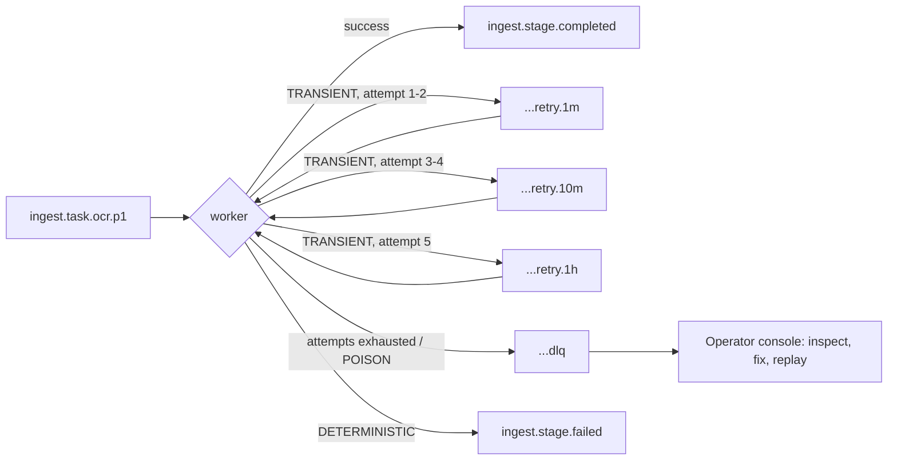

# Stage 2 — Document 5: Kafka Event Architecture

| Field | Value |
|---|---|
| Document ID | DIP-KFK-01 |
| Version | 0.1 |
| Builds on | `04` §7 (topic table), `05` §3, §7 (retry model, envelope), `06` (outbox, processed_events, jobs) |
| Note | Independent reference architecture. Throughput and partition figures are calculated from hypothetical assumptions (`01` §3) and must be validated in the M3 load test. |

---

## 1. Role of Kafka and what it is not

| Kafka **is** | Kafka **is not** |
|---|---|
| The asynchronous backbone between services and worker pools | A database or source of truth (PostgreSQL + object store are) |
| A replayable log for derived-state rebuilds (analytics, audit archive, re-indexing triggers) | A store for document text, vectors, or large payloads (events carry **references**) |
| The buffer that lets uploads succeed while downstream is down | A synchronous RPC mechanism (query path is HTTP) |
| A back-pressure and fairness mechanism (priority topics, lag) | A guarantee of exactly-once effects across PostgreSQL/OpenSearch/vector DB |

**Why Kafka over alternatives (summary of ADR-002):** replay and retention for rebuilds, partitioned ordering by key, consumer-group scaling, Connect/Schema Registry/Debezium ecosystem, throughput headroom. RabbitMQ/SQS-style queues lack cheap replay and log semantics; Pulsar offers similar features but our operational skills and ecosystem fit favor Kafka. Cost: cluster operations, partition planning, and no per-message priority (solved with priority topics, §6).

---

## 2. Event taxonomy

| Class | Meaning | Naming | Examples |
|---|---|---|---|
| **Domain event** (fact, past tense) | Something happened in a bounded context | `<domain>.<entity>.<fact>` | `document.version.uploaded`, `document.version.state-changed`, `iam.permission.changed` |
| **Task / command** (work to do, imperative) | Request a worker to do a unit of work | `ingest.task.<stage>[.<priority>]` | `ingest.task.extract.p1`, `ingest.task.embed` |
| **Completion** | Result of a task | `ingest.stage.completed` | one topic for all stages, discriminated by `stage` |
| **Audit / telemetry event** | Append-only record for compliance/analytics | `audit.event`, `ai.query.completed` | – |
| **Technical topics** | Retry, DLQ, internal | `<topic>.retry.<tier>`, `<topic>.dlq` | `ingest.task.ocr.p1.retry.10m` |

Rules: lowercase, dot-separated, hyphens inside segments; **no environment in the name** (environment = cluster/namespace); version suffix `.v2` only for breaking schema change; one event type per topic except `ingest.stage.completed` (discriminated union) and `audit.event` (single schema, `action` enumerates).

---

## 3. Topic catalog

Partition counts are shown **Medium → Large** (Initial uses minimums: 6 for task topics, 3 for others, RF=3 requires ≥3 brokers; Initial may run RF=3 with 3 brokers). Retention is time-based unless noted. `min.insync.replicas=2`, `unclean.leader.election.enable=false`, `acks=all` everywhere.

| Topic | Key | Partitions | Retention | Cleanup | Producer | Consumer group(s) |
|---|---|---|---|---|---|---|
| `document.version.uploaded` | `version_id` | 24 → 96 | 7 d | delete | document-service (outbox) | `cg.orchestrator.intake`, `cg.analytics.sink` |
| `document.version.state-changed` | `version_id` | 12 → 48 | 30 d | delete | ingestion-orchestrator, document-service | `cg.notification`, `cg.docservice.statesync`, `cg.analytics.sink` |
| `ingest.task.validate` | `version_id` | 24 → 96 | 3 d | delete | orchestrator | `cg.worker.validate` |
| `ingest.task.extract.p0` / `.p1` / `.p2` | `version_id:range` | 12/48/48 → 48/192/192 | 3 d | delete | orchestrator | `cg.worker.extract` |
| `ingest.task.ocr.p0` / `.p1` / `.p2` | `version_id:range` | 12/48/48 → 48/192/192 | 3 d | delete | orchestrator, extraction-workers (page-level OCR routing) | `cg.worker.ocr` |
| `ingest.task.classify` | `version_id` | 12 → 48 | 3 d | delete | orchestrator | `cg.worker.classify` |
| `ingest.task.chunk` | `version_id` | 24 → 96 | 3 d | delete | orchestrator | `cg.worker.chunk` |
| `ingest.task.embed.p1` / `.p2` | `version_id:batch` | 48 → 192 | 3 d | delete | orchestrator (via chunk completion) | `cg.embedding` |
| `ingest.task.index` | `version_id:batch` | 48 → 192 | 3 d | delete | embedding-service / orchestrator | `cg.indexer` |
| `ingest.stage.completed` | `version_id` | 24 → 96 | 7 d | delete | all workers | `cg.orchestrator.advance` |
| `ingest.stage.failed` | `version_id` | 12 → 48 | 14 d | delete | all workers | `cg.orchestrator.failure` |
| `iam.permission.changed` | `document_id` or `group_id` | 12 | 30 d | delete | identity-access | `cg.indexer.retag`, `cg.cache.invalidate`, `cg.audit` |
| `index.retag.requested` | `document_id` | 24 → 48 | 7 d | delete | indexer | `cg.indexer.retag` |
| `audit.event` | `actor_id` | 24 → 96 | 7 d, then Iceberg archive | delete | every service (Java/Python) | `cg.audit.writer`, `cg.lake.audit` |
| `ai.query.completed` | `session_id` | 12 → 48 | 30 d | delete | ai-orchestration | `cg.eval.sampler`, `cg.analytics.sink` |
| `model.registry.changed` | `kind:name` | 3 | 30 d | **compact + delete** | model registry | all services caching model config |
| `config.changed` | `key` | 3 | compact | **compact** | config service | all services |
| `cdc.*` (Debezium: `cdc.docs.documents`, `cdc.docs.document_versions` …) | PK | 12 → 24 | 7 d | delete | Debezium | `cg.lake.cdc` (→ Iceberg) |
| `<topic>.retry.1m` / `.10m` / `.1h` | original key | same as source topic ÷ 2 | 2 d | delete | consumers | the same consumer group (retry-tier consumer) |
| `<topic>.dlq` | original key | 6 | 30 d | delete | consumers | operators (`cg.ops.dlq-viewer`), replay tool |

### 3.1 Why these partition counts (and why the HLD numbers are consumer-parallelism numbers)

Throughput is **not** what drives partitions here. Calculation (Large backfill, assumptions A-01…A-09):

| Quantity | Calculation | Result |
|---|---|---|
| Documents/day during backfill | 10 M ÷ ~180 days | ≈ 55,000 |
| Tasks per document (500 pages) | 20 extract/OCR ranges + 1 classify + 1 chunk + ~3 embed batches (550 chunks ÷ 256) + ~3 index batches ≈ 28 | 28 tasks |
| Messages per document (task + completion, +retry margin 10%) | 28 × 2 × 1.1 | ≈ 62 |
| Messages/s average | 55,000 × 62 ÷ 86,400 | ≈ 40 msg/s (peak 10× ≈ 400 msg/s) |
| Message size | references only | ≈ 1–2 KB |
| Kafka storage (7 d, RF 3, ingestion topics) | 55,000 × 62 × 1.5 KB × 7 × 3 | ≈ 107 GB |
| Audit/AI events (400 queries/s peak planning load, ~3 events/query, 2 KB) | 400 × 3 × 2 KB | ≈ 2.4 MB/s peak, ≈ 100–200 GB/day at sustained peak (far lower in practice) |
| OCR tasks | 30% of 5 B pages ÷ 25 ≈ 60 M tasks ÷ 180 d | ≈ 3.9 tasks/s |
| OCR concurrency needed | 3.9 tasks/s × task duration (25 pages × assumed 1 s/page = 25 s) | ≈ 100 concurrent tasks (**duration is an assumption, benchmark in M4**) |

Conclusion: Kafka throughput is trivial (tens to hundreds of msgs/s); a 5-broker cluster has orders of magnitude of headroom. Partitions are chosen as **max consumer concurrency × 2 headroom**, because within a consumer group, parallelism is capped by partition count (OCR needs ~100+ concurrent workers → 192 partitions). Over-partitioning has a cost (more open files, longer rebalances, leader elections), so Initial/Medium use fewer and Large increases **before** it is needed — partition count can only be increased (never decreased), and increasing it changes key→partition mapping for new messages, which is acceptable for our stateless task topics but must be planned for `version_id`-ordered topics (§5).

---

## 4. Event envelope and schema standards

### 4.1 Envelope (all topics)
Serialization: **Avro with Confluent-compatible Schema Registry** (compact, enforceable compatibility, good Java/Python support). JSON Schema is used only for external API documentation. Each topic's value schema subject = `<topic>-value` (TopicNameStrategy), key = string.

```json
{
  "type": "record", "name": "EventEnvelope", "namespace": "ai.dip.events",
  "fields": [
    { "name": "event_id",       "type": { "type": "string", "logicalType": "uuid" } },
    { "name": "event_type",     "type": "string" },
    { "name": "event_version",  "type": "int", "default": 1 },
    { "name": "occurred_at",    "type": { "type": "long", "logicalType": "timestamp-millis" } },
    { "name": "producer",       "type": "string" },
    { "name": "trace_id",       "type": ["null", "string"], "default": null },
    { "name": "tenant_id",      "type": "string" },
    { "name": "payload",        "type": "bytes" }
  ]
}
```
Practical rule: each topic defines a **typed payload record** embedded in the value schema (not opaque bytes); the `bytes` form above is the logical contract and is replaced per-topic by the concrete record below. Kafka **headers** carry: `traceparent`, `event_id`, `attempt`, `error_class`, `error_message` (truncated), `original_topic`, `original_partition`, `original_offset` (the last five only on retry/DLQ).

### 4.2 Compatibility and evolution
| Rule | Detail |
|---|---|
| Compatibility mode | `BACKWARD_TRANSITIVE` for all subjects (new consumers read old and all prior data → consumers upgrade first) |
| Allowed | Add field **with default**; add optional (nullable) field; add enum symbol only with an enum default |
| Forbidden | Remove/rename field, change type, remove enum symbol, change key semantics |
| Breaking change | New topic `…v2`; dual-publish for a defined overlap; consumers migrate; v1 retired by ADR |
| CI gate | Schema compatibility check against the registry on every PR; contract tests with sample events (Pact-like consumer-driven schema tests) |
| No PII/text | Payloads carry IDs/URIs/hashes/metrics only; never document text, prompts or answers (those go to PG/object store). Audit `context` carries chunk IDs, not text |
| Size | Target ≤ 10 KB, hard limit 100 KB (`max.message.bytes`); larger data goes to object storage and is referenced by URI |

### 4.3 Concrete schemas (Avro payload records)

**document.version.uploaded (v1)**
```json
{ "type": "record", "name": "DocumentVersionUploaded", "namespace": "ai.dip.events.document",
  "fields": [
    { "name": "document_id", "type": "string" },
    { "name": "version_id", "type": "string" },
    { "name": "version_no", "type": "int" },
    { "name": "storage_uri", "type": "string" },
    { "name": "sha256", "type": "string" },
    { "name": "size_bytes", "type": "long" },
    { "name": "mime_declared", "type": "string" },
    { "name": "department_id", "type": "string" },
    { "name": "classification", "type": { "type": "enum", "name": "Classification", "symbols": ["PUBLIC","INTERNAL","RESTRICTED","CONFIDENTIAL"], "default": "CONFIDENTIAL" } },
    { "name": "uploaded_by", "type": "string" },
    { "name": "existing_document", "type": "boolean", "default": false }
  ] }
```
Enum default is set to the **most restrictive** level, so an unknown future symbol is treated safely by older consumers.

**ingest.task.\* (shared task record, v1)**
```json
{ "type": "record", "name": "IngestTask", "namespace": "ai.dip.events.ingest",
  "fields": [
    { "name": "idempotency_key", "type": "string" },
    { "name": "version_id", "type": "string" },
    { "name": "stage", "type": { "type": "enum", "name": "Stage", "symbols": ["VALIDATE","EXTRACT","OCR","CLASSIFY","CHUNK","EMBED","INDEX"], "default": "VALIDATE" } },
    { "name": "range_from", "type": ["null","int"], "default": null },
    { "name": "range_to",   "type": ["null","int"], "default": null },
    { "name": "pipeline_version", "type": "string" },
    { "name": "priority", "type": "int", "default": 1 },
    { "name": "attempt", "type": "int", "default": 0 },
    { "name": "timeout_seconds", "type": "int" },
    { "name": "input_uri", "type": "string" },
    { "name": "output_uri", "type": "string" },
    { "name": "params", "type": { "type": "map", "values": "string" }, "default": {} }
  ] }
```
Embed-specific parameters (`embedding_model_id`, `collection`, `chunk_count`) travel in `params` to avoid a new schema per stage; the stage worker validates required keys (a deliberate trade-off: fewer schemas vs. weaker typing — revisit if `params` misuse is observed).

**ingest.stage.completed (v1)**
```json
{ "type": "record", "name": "StageCompleted", "namespace": "ai.dip.events.ingest",
  "fields": [
    { "name": "idempotency_key", "type": "string" },
    { "name": "version_id", "type": "string" },
    { "name": "stage", "type": "ai.dip.events.ingest.Stage" },
    { "name": "range", "type": ["null","string"], "default": null },
    { "name": "status", "type": { "type": "enum", "name": "Status", "symbols": ["DONE","SKIPPED"], "default": "DONE" } },
    { "name": "output_uri", "type": ["null","string"], "default": null },
    { "name": "metrics", "type": { "type": "map", "values": "double" }, "default": {} },
    { "name": "worker_id", "type": "string" },
    { "name": "duration_ms", "type": "long" }
  ] }
```
**ingest.stage.failed (v1)**: `idempotency_key, version_id, stage, range, error_class {TRANSIENT, RESOURCE, DETERMINISTIC, POISON}, error_message (≤ 500 chars), attempt, retryable, worker_id`.

**document.version.state-changed (v1)**: `document_id, version_id, from_state, to_state, reason, changed_at, actor (USER|SYSTEM)`; consumers must treat it as **a hint, not as the authoritative state** (PG is authoritative).

**iam.permission.changed (v1)**: `change_id, scope {DOCUMENT, USER, GROUP, DEPARTMENT, ROLE}, subject_id, affected_document_ids (≤ 1,000 else empty + "bulk=true"), change_kind {GRANT, REVOKE, RECLASSIFY, ROLE_CHANGE}, effective_at`. For bulk/department-level changes the indexer expands by querying PG (not by trusting a huge event).

**audit.event (v1)**: `actor_id, actor_type, action, resource_type, resource_id, outcome, context (map<string,string>; chunk_ids joined or sampled with "chunk_count"), source_ip, user_agent, occurred_at`. Audit events from services are **also** written locally (e.g., a transactional outbox) so a Kafka outage does not lose security-relevant events (§9).

**ai.query.completed (v1)**: `response_id, session_id, user_id_hash, route, evidence_status, confidence_band, retrieval_ms, llm_ms, input_tokens, output_tokens, model, prompt_version, cache_hit`. No question or answer text.

---

## 5. Keys, partitioning and ordering

| Topic family | Key | Ordering guarantee provided | Ordering the consumer must **not** assume |
|---|---|---|---|
| Version lifecycle (`uploaded`, `state-changed`, `stage.completed`, `stage.failed`, `task.classify/chunk`) | `version_id` | All events for one version are processed in order by one consumer at a time | Order between versions |
| Page-range tasks (`extract`, `ocr`) | `version_id:range` | Order within one range only | Order of ranges of the same document (results merged by the orchestrator, which tolerates any order) |
| Embed/index batches | `version_id:batch` | Per batch | Cross-batch order |
| Permission changes | `document_id` / `group_id` | Per subject | Cross-subject |
| Audit | `actor_id` | Per actor | Global time order (audit time = `occurred_at`; DB orders by it) |

Design rules:
1. **Why not key everything by `version_id`:** a 10,000-page document would land all its range tasks on one partition → hot partition, one consumer, head-of-line blocking (risk R5). Task topics therefore key by `version_id:range` (murmur2 hashing spreads ranges).
2. **State transitions are order-insensitive by design:** the orchestrator's `StageAdvancer` uses a conditional SQL update (`06`/`05` §3.4); a late or duplicated completion produces zero updated rows. We never rely on Kafka ordering for correctness, only for efficiency.
3. **Partition count changes:** allowed only for task topics (no ordering dependency across restarts). For `version_id`-keyed lifecycle topics, increase only during a controlled window and accept that in-flight versions may briefly be handled by different consumers — safe because of rule 2 and idempotent handlers.
4. **Poison-pill isolation:** consumers never stop on a bad record (§8).

---

## 6. Priority, fairness and backpressure

### 6.1 Priority
Kafka has no message priority. We use **separate topics per priority** (`p0` interactive reprocess and small uploads, `p1` normal ingestion, `p2` backfill/re-embedding) and **weighted consumption** in each worker pool:
- Each worker subscribes to all three topics of its stage.
- A small `PriorityPoller` polls with weights (e.g., 6:3:1 per cycle) so p0 is served first but p2 is never starved while p0/p1 are quiet; if p0 and p1 lag is zero, p2 gets 100%.
- **Backfill governor:** the orchestrator stops *releasing* p2 tasks (pull-based dispatch from PG, `05` §3.3) when p0/p1 consumer lag exceeds thresholds (e.g., p1 lag > 2,000 msgs or oldest-message age > 60 s), so p2 never even enters Kafka during pressure.

### 6.2 Backpressure chain
1. Downstream dependency slow (vector DB, OCR GPU) → worker's in-flight limit reached → consumer `pause()` on affected partitions (not stop) → lag grows in Kafka (the buffer).
2. Lag metrics (`records-lag-max`, oldest-message-age) → KEDA autoscaling of the worker deployment (bounded by GPU quota).
3. Lag persists above SLO → orchestrator governor reduces release rate; alert fires.
4. Circuit breaker open on a dependency → worker pauses its partitions for the breaker's open duration instead of burning retry budget.

### 6.3 Large documents
Per-document concurrency cap (default 8 in-flight range tasks) lives in the orchestrator and PG, so a 10,000-page document produces at most 8 tasks in Kafka at a time. Consequence: Kafka never holds a 400-task burst from one document, and fairness is enforced upstream where it is cheap.

---

## 7. Consumers: groups, delivery semantics and idempotency

### 7.1 Consumer groups
`cg.<service-or-pool>.<function>`; one group per logical consumer so each can scale and lag independently; `group.instance.id` set (static membership) for worker pods to avoid rebalances on rolling restarts; `partition.assignment.strategy=CooperativeStickyAssignor` (incremental rebalance); `session.timeout.ms=45000`, `heartbeat.interval.ms=15000`, `max.poll.interval.ms` sized to the **longest** task (OCR: 20 min) **or** (preferred) long tasks run on a worker thread with the consumer polling/pausing so `max.poll.interval.ms` stays ≤ 5 min.

### 7.2 Delivery guarantees (what we do and do not claim)
| Hop | Guarantee | Mechanism |
|---|---|---|
| Producer → Kafka | At-least-once, no duplicates from producer retries | `acks=all`, `enable.idempotence=true`, `max.in.flight.requests.per.connection=5`, `delivery.timeout.ms=120000` |
| Kafka → consumer | At-least-once | `enable.auto.commit=false`; commit **after** side effects are durable |
| Service state ↔ event | Atomic via outbox | Transactional outbox in the same DB transaction as state change (document-service, orchestrator) |
| Consumer side effects (PG, object store, OpenSearch, vector DB) | **Effectively-once via idempotency**, not true exactly-once | deterministic IDs/keys + upserts + `processing_jobs.idempotency_key` + `processed_events(consumer, event_id)` |
| Kafka → Kafka (e.g., retry republish) | Exactly-once possible with transactions | Used only for retry-topic republish + offset commit atomically (`transactional.id` per instance) when the worker has no external side effects in that step |

**Why we do not use Kafka exactly-once for the whole pipeline:** EOS covers only Kafka read-process-write; our steps write to PostgreSQL, object storage, OpenSearch and the vector DB, which are outside the transaction. A crash between "write to OpenSearch" and "commit offset" always yields a replay, so every consumer is written to be **safe to run twice**. This is stated in the SRS (NFR-REL-04).

### 7.3 Idempotency patterns by consumer
| Consumer | Idempotency key | How a duplicate is neutralized |
|---|---|---|
| Orchestrator intake | `event_id` | `processed_events` insert; conflict → skip |
| Extraction/OCR/Chunk worker | `idempotency_key` | `processing_jobs` status DONE → ack and skip; artifact written to deterministic key |
| Embedding | `(chunk_id, model_id)` + `text_hash` cache | Vector upsert by point ID = `chunk_id`; same vector overwritten |
| Indexer (OpenSearch) | `_id = chunk_id` | Index with same `_id` overwrites; `version_id` + `pipeline_version` stored for diagnostics |
| Stage advancement | conditional SQL | 0 rows updated when already advanced |
| Notification | `event_id` + recipient | Deduplication table (7 days) to avoid double emails |
| Audit writer | `event_id` unique in audit store | `ON CONFLICT DO NOTHING`; hash chain computed after dedupe |

### 7.4 Deduplication windows
`processed_events` retained 7 days (≥ longest Kafka retention for those topics); replays older than the window rely on natural idempotency (deterministic keys), which is the real protection — the table is an optimization for non-naturally-idempotent consumers.

---

## 8. Retry, DLQ and replay

### 8.1 Retry topology (non-blocking)

- Delay mechanics: retry-tier consumers read the record, compare `now` with `produce_time + tier_delay` and `pause()`/`seek` until due (a delay-aware consumer); messages in a retry tier keep order by arrival which is consistent with due time since the delay is constant per tier.
- Backoff within a tier family: 1 m → 10 m → 1 h with full jitter on re-entry; total retry budget ≈ 6 attempts ≈ 1 h 25 min before DLQ (matches `05` §3.5).
- Retry preserves key (same partition as original), the `idempotency_key`, and increments `attempt` header + payload field.
- **Errors are classified by the worker** (`error_class` header): TRANSIENT → retry tiers; RESOURCE → one retry with reduced batch parameters, then DLQ; DETERMINISTIC → `ingest.stage.failed` immediately (no retry, orchestrator decides skip-page or fail-document); POISON (deserialization/schema failure) → DLQ directly.

### 8.2 DLQ handling
| Item | Design |
|---|---|
| Record | Original key/value bytes + headers `original_topic/partition/offset`, `error_class`, `error_message`, `attempt`, `first_failure_at`, `consumer_group` |
| Alert | DLQ depth > 0 for 15 min (warn), > 100 or growth rate > 10/min (page) |
| Triage UI | Operator console groups by `error_class + error_message prefix`; shows linked document/version; buttons: replay, replay-with-parameters (e.g., smaller batch), discard-with-reason (audited) |
| Replay | `POST /admin/jobs/{id}/retry` republishes to the original topic with `attempt=0` and header `replayed_by`; idempotency makes repeats safe |
| Retention | 30 days; before expiry a job exports unresolved DLQ records to object storage and opens a ticket |

### 8.3 Event replay (rebuild scenarios)
| Scenario | Method |
|---|---|
| Rebuild OpenSearch/vector index for a version | **Do not replay Kafka.** Re-run from object-store artifacts via `reprocess` (from_stage INDEX/EMBED) — deterministic and independent of Kafka retention |
| Rebuild analytics/lake tables | Replay `cdc.*` and domain events from Iceberg archive (long-term) or Kafka (within retention); consumers are idempotent (`MERGE` by key + `event_id`) |
| Recover from a consumer bug | Reset consumer-group offsets to a timestamp (`kafka-consumer-groups --reset-offsets --to-datetime`) on a **copy group** first, validate, then apply; handlers must be idempotent |
| Audit re-ingestion | Audit writer dedupes by `event_id`; Iceberg archive is the system of record beyond Kafka retention |
Replay safety rules: replays run at p2 priority with throttling; the orchestrator rejects task events whose `pipeline_version` is older than the version's current target (stale-event guard).

---

## 9. Cross-cutting concerns

### 9.1 Reliability: producing to Kafka when Kafka is unavailable
| Producer | Strategy |
|---|---|
| document-service, orchestrator | Transactional outbox; business operation succeeds; publisher drains when Kafka returns (upload continues to work) |
| Workers | Cannot complete a task without publishing completion → they retry publish with backoff; the lease keeps the job RUNNING; if the lease expires the sweeper re-issues (safe: idempotent) |
| Any service emitting `audit.event` | Local durable spool (outbox table or local WAL file with fsync) → relay to Kafka; audit loss is not acceptable (FR-AUD-01) |
| `ai.query.completed` (telemetry) | Best-effort with bounded in-memory buffer; drops counted in a metric (loss tolerated) |

### 9.2 Security
| Control | Detail |
|---|---|
| Transport | TLS 1.3 for client and inter-broker traffic; mTLS client authentication (SPIFFE-style cert per workload) |
| AuthN/AuthZ | Kafka ACLs per principal: producers `WRITE` on specific topics, consumers `READ` on topics + their consumer group; deny by default; no wildcard ACLs in production; ACLs managed as code (Terraform/Strimzi `KafkaUser` CRDs) |
| Encryption at rest | Encrypted volumes (LUKS/cloud KMS-backed); sensitive fields are references, not content |
| Data content | No document text/PII in events (§4.2); `audit.event.context` contains chunk IDs only |
| Schema Registry | Authenticated; write access only for CI pipeline principal; read for services |
| Network | Brokers in `data` namespace; NetworkPolicies allow only service namespaces; no external listeners |
| Multi-environment | Separate clusters per environment (never shared topics across dev/stage/prod) |

### 9.3 Observability
| Metric | Source | Alert |
|---|---|---|
| Consumer lag (records) per group/topic/partition | Kafka exporter / Burrow-style | Lag growth for 10 min above autoscale ceiling |
| **Oldest message age** per group (time-based lag) | Computed from record timestamp at consume | p1 > 60 s warn, > 300 s page; p2 informational |
| End-to-end stage latency | Span from `occurred_at` to completion | per-stage SLO |
| Under-replicated partitions, offline partitions | Broker JMX | > 0 for 5 min page |
| ISR shrink rate, request handler idle %, disk usage | Broker JMX | disk > 70% warn / 80% page |
| DLQ depth and rate | Topic metrics | §8.2 |
| Rebalance rate | Consumer metrics | > 3/hour per group |
| Produce/consume error rates, retry rates by `error_class` | App metrics (Micrometer/OTel) | error ratio > 2% |
| Trace propagation | `traceparent` header | trace coverage ≥ 99% (NFR-OBS-01) |

### 9.4 Cluster design
| Aspect | Initial | Medium | Large |
|---|---|---|---|
| Brokers (KRaft, dedicated controllers 3) | 3 (combined mode acceptable for non-prod only) | 5 | 5–9 + tiered storage (object store) for long retention topics |
| RF / min ISR | 3 / 2 | 3 / 2 | 3 / 2, rack-aware (`broker.rack`) across ≥3 failure domains |
| Disk | NVMe/SSD, retention-sized with 40% headroom | same | same; tiered storage for `audit.event`, `cdc.*` |
| Kafka Connect | optional | Debezium + S3/Iceberg sink | distributed, separate cluster |
| DR | Backups of topic config; rebuild from PG/object store | MirrorMaker 2 for critical topics (`document.version.*`, `audit.event`, `iam.*`) | MM2 to DR site; consumer-offset sync |
Sizing basis: storage ≈ 107 GB ingestion topics + audit/telemetry (§3.1) — negligible against broker disks; the real constraint is partition count per broker (target ≤ ~4,000 partition-replicas per broker): Large ≈ 2,400 partitions on primary topics + ≈ 2,300 on retry tiers (half the source partitions × 3 tiers) ≈ 4,700 × RF 3 ≈ 14,000 replicas ÷ 5–9 brokers ≈ 1,600–2,800 per broker — within the limit but not by a wide margin on 5 brokers, so retry-tier partition counts (÷2 here) may be reduced further (e.g., ÷4) if the benchmark shows it is needed.

---

## 10. Failure scenarios (Kafka-specific)

| Failure | Detection | Behavior / recovery | Data-loss risk |
|---|---|---|---|
| Single broker down | URP > 0, ISR shrink | Leaders elect from ISR; `min.insync.replicas=2` keeps producers working with RF 3; replace broker, reassign | None |
| Two brokers down (RF 3, min ISR 2) | Producers get `NotEnoughReplicas` | Writes fail → outbox buffers; consumers continue reading until partitions go offline; restore brokers | None (outbox), audit spool protects security events |
| Full cluster outage | All producers failing | Uploads still accepted (outbox); workers idle; on recovery outbox drains; leases expire and sweeper re-issues unfinished jobs | None for committed uploads |
| Consumer crash mid-task | Heartbeat timeout → rebalance | Uncommitted offset redelivered; idempotent handler redoes task; lease prevents double concurrent run | None |
| Duplicate messages | – | `idempotency_key`, `processed_events`, conditional updates | No effect |
| Poison message | Deserialization/handler exception class POISON | Goes to DLQ after bounded attempts; partition not blocked | None |
| Rebalance storm | Rebalance rate alert | Static membership + cooperative assignor; check `max.poll.interval.ms` | Latency only |
| Hot partition | Skewed per-partition lag | Re-key (`version_id:range`), add partitions to task topics | Latency only |
| Schema incompatibility released | Registry rejects in CI; if bypassed → deserialization errors | Rollback producer; consumers send to DLQ; replay after fix | None (DLQ) |
| Retention too short for a long outage | Lag > retention | Alert at lag > 50% of retention; extend retention temporarily; or rebuild from PG (`reprocess`) because state is in PG/object store | Bounded by rebuildability |
| Offset commit lost | Duplicates after restart | Idempotent processing | None |
| Disk full on broker | Disk alert | Prioritize retention cut on low-value topics; expand volume | Avoided by thresholds |
| Clock skew | Timestamp anomalies | Use broker `LogAppendTime` for lag/age metrics, `occurred_at` for business time | None |

---

## 11. Implementation examples

### 11.1 Spring Kafka producer (outbox publisher)
```java
@Configuration
class KafkaProducerConfig {
  @Bean ProducerFactory<String, SpecificRecord> pf(KafkaProperties p) {
    Map<String,Object> c = new HashMap<>(p.buildProducerProperties());
    c.put(ProducerConfig.ACKS_CONFIG, "all");
    c.put(ProducerConfig.ENABLE_IDEMPOTENCE_CONFIG, true);
    c.put(ProducerConfig.DELIVERY_TIMEOUT_MS_CONFIG, 120_000);
    c.put(ProducerConfig.COMPRESSION_TYPE_CONFIG, "zstd");
    c.put(ProducerConfig.LINGER_MS_CONFIG, 20);
    c.put(ProducerConfig.MAX_IN_FLIGHT_REQUESTS_PER_CONNECTION, 5);
    c.put(KafkaAvroSerializerConfig.AUTO_REGISTER_SCHEMAS, false);   // schemas registered only by CI
    return new DefaultKafkaProducerFactory<>(c);
  }
}

@Component
class OutboxPublisher {
  @Scheduled(fixedDelay = 200)
  @Transactional
  void drain() {
    List<OutboxEvent> batch = repo.lockUnpublished(500);              // SELECT ... FOR UPDATE SKIP LOCKED
    for (OutboxEvent e : batch) {
      var rec = new ProducerRecord<>(e.topic(), e.key(), e.avro());
      rec.headers().add("event_id", e.id().toString().getBytes(UTF_8));
      tracing.inject(rec.headers());
      kafka.send(rec).whenComplete((r, ex) -> { if (ex == null) repo.markPublished(e.id()); else log.warn("publish failed {}", e.id(), ex); });
    }
  }
}
```
(`markPublished` after ack makes a crash between send and mark produce a duplicate, which consumers dedupe — by design.)

### 11.2 Spring Kafka consumer with retry-topic and DLQ routing
```java
@KafkaListener(topics = "ingest.task.ocr.p1", groupId = "cg.worker.ocr", concurrency = "4")
void onTask(ConsumerRecord<String, IngestTask> rec, Acknowledgment ack) {
  try {
    handler.handle(rec.value());                       // idempotent
    ack.acknowledge();
  } catch (TransientException e) {
    retryPublisher.toTier(rec, nextTier(rec), e);       // publish to .retry.<tier>, then ack original
    ack.acknowledge();
  } catch (PermanentException e) {
    failedPublisher.stageFailed(rec, e);
    ack.acknowledge();
  } catch (SerializationException e) {
    dlq.send(rec, e);
    ack.acknowledge();
  }
}
// ContainerProperties: AckMode.MANUAL_IMMEDIATE; DefaultErrorHandler with FixedBackOff(0, 0) -- retries are topic-based, not in-thread
```

### 11.3 Python worker consumer (confluent-kafka)
```python
conf = {
  "bootstrap.servers": BOOTSTRAP, "group.id": "cg.worker.extract",
  "group.instance.id": POD_NAME, "enable.auto.commit": False, "auto.offset.reset": "earliest",
  "partition.assignment.strategy": "cooperative-sticky", "session.timeout.ms": 45000,
  "max.poll.interval.ms": 300000, "security.protocol": "SSL", **TLS_CONF,
}
consumer = DeserializingConsumer({**conf, "value.deserializer": AvroDeserializer(schema_registry, schema_str=None)})
consumer.subscribe(["ingest.task.extract.p0", "ingest.task.extract.p1", "ingest.task.extract.p2"])

while running:
    msg = priority_poll(consumer, weights=(6, 3, 1))     # weighted across the three topics
    if msg is None: continue
    if msg.error(): handle_error(msg); continue
    if in_flight.full():                                  # backpressure
        consumer.pause(consumer.assignment()); wait_until(in_flight.has_capacity); consumer.resume(consumer.assignment())
    executor.submit(process, msg)                         # process() handles idempotency, publish, then commits via commit_queue
```
Offsets are committed only after `process()` finishes, in order per partition via a commit queue (store the highest contiguous completed offset).

### 11.4 Topic provisioning (as code, Strimzi style)
```yaml
apiVersion: kafka.strimzi.io/v1beta2
kind: KafkaTopic
metadata: { name: ingest.task.ocr.p1, labels: { strimzi.io/cluster: dip-kafka } }
spec:
  partitions: 48
  replicas: 3
  config:
    retention.ms: "259200000"        # 3 days
    min.insync.replicas: "2"
    max.message.bytes: "102400"
    compression.type: "producer"
    unclean.leader.election.enable: "false"
```
Topic changes go through PR review; a CI check validates naming (`^[a-z]+(\.[a-z0-9-]+)+$`), RF/min-ISR policy, and that every topic has an owner label and a DLQ if consumed by a worker.

---

## 12. Testing strategy for events
| Test | Method | Acceptance |
|---|---|---|
| Schema compatibility | Registry compatibility check in CI | 0 breaking changes merged without version bump |
| Consumer contract | Sample-event contract tests (consumer-driven) | All consumers deserialize all current producer samples |
| Idempotency | Redeliver each message N=3 times (Testcontainers Kafka) | Final DB/index state identical to single delivery; no duplicate chunks/vectors |
| Ordering independence | Shuffle completion events for a version | Stage advances exactly once |
| Retry/DLQ | Inject transient/deterministic/poison failures | Correct tier path; partition not blocked; DLQ headers complete |
| Crash recovery | Kill worker mid-task (chaos) | Task completes ≤ lease + backoff; no double side effects |
| Broker failure | Kill 1 broker, then 2 | No loss, outbox drains, lag recovers < defined RTO |
| Backpressure | Throttle vector DB | Consumers pause, lag bounded, no OOM, backfill released rate drops |
| Load | Synthetic 10× peak (400 msg/s→4,000 msg/s) for 1 h | P99 produce latency < 100 ms; lag returns to 0 |
| Replay | Offset reset on shadow group | Derived tables converge to identical checksums |

## 13. Open items
| Item | Plan |
|---|---|
| Avro vs Protobuf | Avro chosen for registry/ecosystem; Protobuf is acceptable if Java/Python gRPC reuse proves valuable — decide at M3 start (low cost before first producer ships) |
| `params` map vs typed per-stage payload | Revisit after M5 if parameter errors appear |
| Tiered storage availability on chosen distribution/on-prem | Depends on U-01; fallback: bigger disks + early Iceberg archive |
| Delay-aware retry consumer vs Kafka Streams punctuator vs external scheduler | Prototype in M3; pick simplest that keeps partitions unblocked |
| MirrorMaker 2 scope for DR | Define in DR Plan (RPO targets per topic) |
| Exact priority weights and lag thresholds | Tune in M3 load tests |

## 14. Next
AI/ML Architecture, RAG Pipeline Design, and Search and Retrieval Optimization documents (model registry and lifecycle, embedding/reranker/LLM serving, evaluation pipeline and regression gates, Graph/Agentic/Corrective RAG positioning, retrieval parameter tuning).
