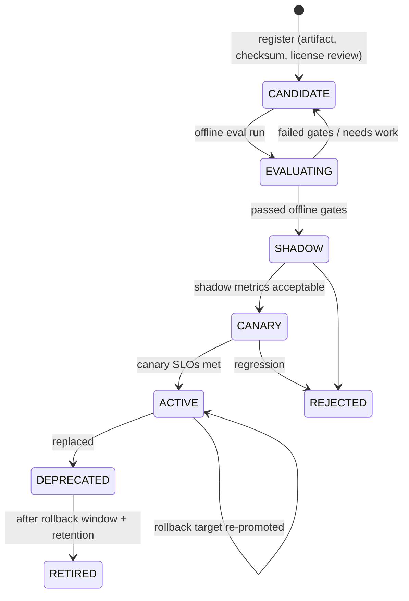
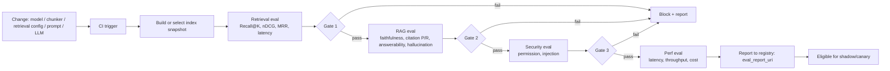

# Stage 2 — Document 6: AI/ML Architecture

| Field | Value |
|---|---|
| Document ID | DIP-AIML-01 |
| Version | 0.1 |
| Builds on | `04` §3, §10; `05` §4.4, §8; `06` (`model_registry`, `embedding_metadata`); `08` (`model.registry.changed`) |
| Note | Independent reference architecture. Model *classes* and candidate families are named for evaluation; **no model is selected without the bake-off in §9**. Throughput/GPU figures are illustrative assumptions marked **(A)** and must be replaced by benchmarks on our hardware and data. |

---

## 1. Scope: the models in the platform

| # | Model role | Used by | Hardware | Latency class | Selection method |
|---|---|---|---|---|---|
| M1 | Embedding (bi-encoder) | embedding-service (ingest), search-service (query) | GPU (batch); query-time CPU or small GPU slice | batch / online | Golden-set bake-off (§9) |
| M2 | Reranker (cross-encoder) | reranker-service | GPU | online ≤ 250 ms | Bake-off |
| M3 | LLM (generation) | llm-gateway ← ai-orchestration | GPU (multi-GPU for larger sizes) | online, streaming | Bake-off on faithfulness + cost |
| M4 | OCR + layout/table models | ocr-workers, extraction-workers | GPU/CPU | batch | Bake-off on sampled scans |
| M5 | Document classifier | extraction pool (classify stage) | CPU | batch | Supervised on labeled sample; start rules + small model |
| M6 | Language detector | extraction pool | CPU | batch | Off-the-shelf (fastText-class) |
| M7 | Query router/classifier | ai-orchestration | CPU | online ≤ 20 ms | Rules + small supervised; LLM only as fallback |
| M8 | NLI / entailment | citation validator | GPU (shared small) | online ≤ 150 ms/claim batch | Bake-off |
| M9 | Near-duplicate detection (MinHash/SimHash) | extraction/chunk | CPU | batch | Algorithmic, no model |
| M10 | Sparse/lexical expansion (optional, e.g., SPLADE-class or BGE-M3 sparse head) | search | GPU | batch + online | Evaluate in M7 against BM25 baseline |

Principle: **use the smallest model that meets the measured quality gate**; large LLMs only where generation needs them (answer, summary, compare). Everything else is a small model or a deterministic algorithm.

---

## 2. Model registry and lifecycle

### 2.1 Registry (table `ai.model_registry`, see `06` §4.4)
Each entry is immutable once registered: `kind, name, version, artifact_uri (internal registry/object store), checksum, license, dimensions, max_tokens, params, eval_report_uri, status`. **Prompts are registry entries too** (`kind=PROMPT`, `name=rag-answer`, `version=7`, artifact = template text + JSON schema), versioned with the same promotion machinery.

### 2.2 Lifecycle

- **Offline gate:** golden-set suite (§9) must meet thresholds *and not regress* against ACTIVE beyond tolerance (e.g., Recall@20 −0.5 pt, faithfulness −1 pt, p95 latency +15%).
- **Shadow:** the candidate processes real queries in parallel; outputs are logged and compared, never shown to users (embedding candidates run against a *shadow collection*, §4).
- **Canary:** 5% → 25% → 100% of eligible traffic by user hash (not random per request, so a user sees consistent behavior). Automatic rollback on SLO breach.
- **Promotion is a registry action** (`POST /admin/models/{id}/promote`) that **fails unless the linked evaluation report meets the gate**; audited; emits `model.registry.changed` (compacted topic) so services refresh without restart.
- **Rollback:** previous ACTIVE stays `DEPRECATED` and warm for the rollback window (default 14 days). Rollback = re-promote; for embeddings it is an alias flip to the previous collection (still present, §4.4).
- **Licensing gate:** CANDIDATE → EVALUATING requires recorded license review (commercial use, redistribution, acceptable-use restrictions, weights provenance, checksum verified, scanned for unsafe serialization — prefer `safetensors`, forbid pickle from unknown sources).

### 2.3 Deployment topologies
| Concern | Design |
|---|---|
| Serving runtime | Embedding/reranker/NLI: Triton or a lightweight FastAPI + ONNX/TensorRT/PyTorch with dynamic batching. LLM: vLLM-class server (continuous batching, paged attention, prefix caching) |
| Images | Model weights **not** baked into images; mounted from internal artifact store by checksum (read-only volume or init container), so one image serves many model versions |
| Isolation | `ai-gpu` namespace, egress denied, no internet, internal registry only; separate node pools per workload type (`gpu-embed`, `gpu-rerank`, `gpu-llm`, `gpu-ocr`) so a backfill never starves interactive inference |
| GPU sharing | Dedicated GPUs for LLM; MIG partitions or time-slicing for small models (reranker/NLI) where utilization is low; no sharing between interactive and batch pools |
| Scaling | HPA/KEDA: embedding on Kafka lag; reranker/LLM on queue depth + GPU utilization; scale-to-zero for batch pools outside backfill windows if GPUs are shared with other tenants |
| Warm start | Model load time (tens of seconds to minutes) → min replicas ≥ 2 for online services, readiness probe only after a warm-up inference |

### 2.4 Monitoring
| Signal | Metric | Alert |
|---|---|---|
| Serving health | latency p50/p95/p99, error rate, queue wait, batch size, GPU util/memory, OOM count | p95 > SLO for 5 min |
| Embedding drift | Mean cosine of new-chunk vectors to corpus centroid; norm distribution; proportion of near-duplicate vectors; nearest-neighbor recall vs exact on a sampled canary set (weekly) | recall drop > 2 pt |
| Retrieval quality (online proxy) | Click-through/“useful” feedback rate, zero-result rate, low-confidence rate, reformulation rate | trend breaks |
| RAG quality | Citation validation pass rate, INSUFFICIENT_EVIDENCE rate, repair-attempt rate, claim removal rate, sampled human review | pass rate drops > 3 pt |
| Safety | Injection detector hit rate, blocked outputs, NOT_PERMITTED citation attempts (must be 0 reaching users) | any nonzero NOT_PERMITTED-leak |
| Cost | tokens/query, GPU-seconds/query, cost per 1k pages ingested | budget thresholds |

---

## 3. Embedding infrastructure

### 3.1 Candidate comparison

| Option | Examples (families to evaluate) | Pros | Cons | Verdict |
|---|---|---|---|---|
| Open-source, self-hosted | BGE-M3 (dense+sparse+multi-vector, long context, multilingual), E5 / multilingual-E5, GTE, Nomic-embed, Jina-embeddings (check license), Arctic-embed | Data never leaves boundary; fixed versions (no silent change); tunable/fine-tunable; cost = GPU we own; batch-friendly | We operate GPUs; quality must be proven on *our* domain; larger models cost more per token | **Default direction** |
| Managed API | Cloud embedding APIs from model vendors | Zero ops, strong general quality | Sends confidential text outside the boundary (violates C-02); vendor can deprecate/alter models; per-token cost × 2.8 T tokens at Large is large; rate limits throttle backfill; no air-gap | **Rejected for confidential data**; allowed only for public/dev corpora under explicit policy |
| Fine-tuned domain model | Fine-tune open model on in-domain pairs | Often large gains on jargon, part numbers, units | Needs labeled data (U-06), MLOps, re-embedding on every change | Future (F-06), only if bake-off shows plateau |

### 3.2 Selection criteria (scored in the bake-off, weights proposed)
| Criterion | Weight | Measurement |
|---|---|---|
| Retrieval quality on golden set (nDCG@10, Recall@50) incl. hard negatives such as near-identical spec revisions | 35% | §9 harness |
| Handling of technical content: units, symbols, identifiers, tables rendered as text, equations | 15% | targeted subset |
| Max input length and behavior at 512 tokens | 10% | tokens/chunk design is 384–512 |
| Throughput (tokens/s/GPU at FP16/INT8) | 15% | benchmark |
| Dimension → index size/latency | 10% | memory model §3.3 |
| Multilingual/script support (U-05) | 10% | language subset |
| License and provenance | 5% | review (hard gate, not a weight, if disallowed) |

### 3.3 Dimension and storage trade-off
| Dimensions | float32/vec | int8/vec | binary/vec | Index size at 5.5 B chunks (float32 / int8 / binary) |
|---|---|---|---|---|
| 384 | 1.5 KB | 384 B | 48 B | 8.3 TB / 2.1 TB / 0.26 TB |
| 768 | 3 KB | 768 B | 96 B | 16.5 TB / 4.2 TB / 0.53 TB |
| 1024 | 4 KB | 1 KB | 128 B | 22 TB / 5.6 TB / 0.7 TB |
Decision rule: choose the **smallest dimension that stays within 1 pt nDCG@10 of the best candidate** after quantization with rescoring; where the model supports Matryoshka-style truncation, evaluate 256/512 dims. HNSW graph (M=16) adds ≈ 128–256 B/vector regardless of dimension. Dimension is a registry attribute: one collection = one (model, version, dimension, quantization).

### 3.4 Embedding input construction
Embedded text = `contextual_prefix + "\n" + chunk_text` (document title, section path; `05` §6.4). Query side uses the model's required query instruction/prefix if any (E5/BGE-style), stored in registry `params` so it is versioned with the model. Embeddings are L2-normalized; cosine = dot product.

### 3.5 Embedding service internals (see `05` §4.4 for code)
| Aspect | Design |
|---|---|
| Batching | token-budget batches (e.g., 64k tokens), length-sorted to reduce padding waste |
| Precision | FP16 (or INT8 via TensorRT/ONNX where recall-neutral per bake-off) |
| Throughput planning **(A)** | 20k tokens/s/GPU for a ~300–600 M parameter encoder at FP16; 2.8×10¹² tokens → ≈ 39,000 GPU-hours (`01` §3.2). Benchmark before committing GPU counts |
| Cache | key `(text_hash, model_id, model_version, dim)`; stored in vector-DB-adjacent KV (e.g., Redis/RocksDB) or inferred from existing collection by `chunk_id`+`text_hash`; savings arise on re-chunking with unchanged text and duplicates across versions (superseded versions share most text) |
| Failure handling | bisect-on-OOM, poison chunk isolation → DLQ, retry tiers (`08` §8) |
| Query embedding | Online path uses a replicated small deployment (p95 ≤ 40 ms, batch 1–8, CPU-ONNX for small models or a GPU slice); same model version as the **active collection**, never mixed |
| Cross-version dedupe | Version N+1 reuses vectors of unchanged chunks from version N when `text_hash` matches (huge saving for revisions that change a few pages) |

### 3.6 Re-embedding and model migration (blue/green)
| Step | Action | Safety |
|---|---|---|
| 1 | Register `modelB` (CANDIDATE); create collection `chunks_<modelB>_v1` | Active traffic untouched |
| 2 | Re-embed **from object-store chunk text** (not from OpenSearch), p2 priority, throttled by backfill governor; resume-able per version via `embedding_metadata` | Idempotent upserts |
| 3 | Incremental sync: new/changed chunks dual-written to both collections while migration runs | No gap at cutover |
| 4 | Offline eval + shadow queries on collection B | Regression gate |
| 5 | Canary: alias `chunks_active` split by user hash | Auto-rollback |
| 6 | Cutover: alias → B; A retained for rollback window | Instant rollback |
| 7 | Retire A (delete collection, recover storage) | After window |
Capacity implication: during migration, storage and RAM for **two** collections are needed unless tiering migrates hot tier first. For Large, plan migration **by tier** (current/active documents first, archive later, possibly never re-embedded and served by the old model through a tier-specific alias — query path embeds the query with both models only for tiers still on the old model). That is a conscious cost-control mechanism, documented as a **mixed-tier mode**, never mixed vectors within one collection.
Triggers for migration: eval shows ≥ 3 pt nDCG gain; license/security issue; model deprecation; dimension reduction for cost; language expansion.

---

## 4. Other models (specification-level)

### 4.1 Reranker (M2)
Cross-encoder (query, chunk) → relevance score. Candidates: bge-reranker-class, mxbai/jina-reranker-class (license check), distilled MiniLM-class cross-encoders; late-interaction (ColBERT-class) as an alternative bi-encoder-quality/cross-encoder-cost midpoint. Capacity illustration **(A)**: 30 candidates × ≤ 256 tokens (chunk truncated around best-matching window) + ~30-token query ≈ 8.6k tokens/query; at 100 search q/s ≈ 860k tokens/s; if a base-size cross-encoder processes ~60–100k tokens/s/GPU at FP16 (A) → ≈ 9–14 GPUs at the planning peak. Mitigations built into the design (in order of preference): adaptive reranking (skip when RRF top-1 margin is large and BM25/vector agree), result caching, distilled smaller model, lower candidate counts, truncation windows, batching across concurrent requests, and degrade-to-fused-order under load. This is the most likely *hidden* GPU cost in the system and is therefore a named benchmark item (§9.5).

### 4.2 LLM serving (M3)
| Aspect | Design |
|---|---|
| Access path | Only via `llm-gateway` (policy: model allow-list per route, per-user/org token quotas, request/response size caps, timeout, circuit breaker, redaction of secrets patterns, prompt+response hashing for audit) |
| Model tiering | **Small-fast tier** (query rewrite, classification fallback, extractive compression, NL-to-SQL drafting with schema) and **large tier** (final answer, multi-document comparison, summaries). Route by task, not by user |
| Serving | vLLM-class: continuous batching, prefix caching (the system prompt and schema are shared across requests → large win), speculative decoding where supported, FP8/INT8/AWQ-GPTQ-style quantization if the quality gate holds |
| Context | Budget 6,000 tokens of evidence + ≤ 1,000 tokens instructions/schema (RAG default); summarization uses map-reduce with ≤ 8k per call |
| Streaming | SSE; `final` event after validation (`07` §4.1) |
| Capacity illustration **(A)** | 8–14B-class model on one GPU: aggregate prefill ≈ 8–10k tokens/s, decode ≈ 1–2k tokens/s with batching. Planning load 20 AI queries/s × 6k prompt tokens = 120k prefill tokens/s ⇒ ≈ 12–15 GPUs; decode 20 × 300 = 6k tokens/s ⇒ ≈ 3–6 GPUs; **prefill dominates**, so context compression, prefix caching and smaller context are the primary cost levers. A 70B-class model multiplies GPU needs several-fold — a quality-versus-capacity decision settled by the bake-off, not assumed |
| Degradation | LLM unavailable/timeout → retrieval-only response (sources + extractive snippets) flagged `llm_unavailable` |
| Determinism | `temperature ≤ 0.2` for factual routes, fixed seed where supported; stored with the response (model, prompt, params) for replay and audit |

### 4.3 OCR, layout, tables (M4)
Tiered: (1) digital text layer when present (free), (2) OCR only for flagged pages, (3) layout/table model only on pages with tables/figures detected. Candidate engines: Tesseract-class (CPU, baseline), PaddleOCR / docTR-class (GPU, stronger on layouts), table-structure models (Table-Transformer-class), math OCR (Nougat/pix2tex-class) for equation pages only. Bake-off metrics: CER/WER on a labeled scan sample, table cell F1 (TEDS-like), reading-order accuracy, throughput pages/s/GPU, % pages flagged low quality. Output includes per-word confidence used downstream (`quality_score`).

### 4.4 Classifier and routers (M5, M7)
| Model | Approach | Evaluation |
|---|---|---|
| Document type (specification/report/paper/drawing list/…) | TF-IDF + linear model or small fine-tuned encoder over title+first pages; start with rules on headers ("TECHNICAL REPORT", numbering schemes) | macro-F1 ≥ 0.9 on labeled set; low-confidence → "UNCLASSIFIED" never guessed |
| Suggested classification label | Suggest only; **never auto-lowers** classification; human confirms | – |
| Query router | Rules → small classifier → LLM closed-set fallback (ADR-011) | route accuracy ≥ 95% on labeled queries; wrong-route cost tracked |

### 4.5 NLI / claim verification (M8)
Cross-encoder NLI model (entail/neutral/contradict) over (evidence span, claim). Runs in the GPU namespace; claims batched per answer; threshold τ_nli fit on golden claims (`05` §8.3). Complemented by deterministic checks (numbers/units/identifiers must appear in the evidence) because NLI models are weakest exactly on numeric edits — the dominant failure in technical text.

---

## 5. Data for ML: evaluation datasets

### 5.1 Golden evaluation set (U-06)
| Component | Content | Size target | Source / labeling |
|---|---|---|---|
| Retrieval set | (query, relevant chunk/page IDs, graded 0–3) | 500 by M6, 2,000 by M9 | SMEs label from pooled results of multiple retrievers (pooling avoids bias to one system) |
| Hard-negative set | Near-identical content across revisions, similar parts with different values | 200 | Constructed from real version pairs |
| QA set | (question, gold answer, supporting spans, answerability flag) | 300 → 1,000 | SME-written; 15–20% **unanswerable** items to test INSUFFICIENT_EVIDENCE |
| Conflict/supersession set | Seeded and real conflicting statements; superseded vs current | 100+ | Doc controllers |
| Multi-hop/compare set | Questions requiring ≥ 2 docs | 100+ | SMEs |
| SQL set | (question, gold SQL, gold result) | 150 | Analysts |
| Security set | Permission-boundary probes, injection documents, exfiltration prompts | 200+ (growing) | Security team/red team |
| OCR set | Scans with ground-truth text | 300 pages across quality levels | Manual transcription |
| Language subset | Per U-05 | proportional | – |

Rules: **frozen test split** (never used for tuning, 30%), dev split (70%); versioned in object store with checksums; every dataset item stores corpus snapshot version (relevance judgments are tied to chunk *text hashes*, so re-chunking can re-map labels automatically via text overlap); synthetic queries (LLM-generated from chunks) are allowed **only as a bootstrap or for regression smoke tests, labeled as synthetic**, never as the sole basis for quality claims (risk R11). Dataset contains no data above the classification of the evaluation environment.

### 5.2 Privacy of evaluation and feedback data
Online feedback (clicks, thumbs) stores IDs only; query text retained per retention policy; labeling tools run inside the boundary with RBAC; contractors/annotators follow the same document access rules.

---

## 6. Metrics definitions

| Metric | Definition | Used for | Target (to ratchet from baseline) |
|---|---|---|---|
| Recall@K | fraction of relevant items found in top K (macro-avg over queries) | retrieval stage | Recall@50 ≥ 0.95 pre-rerank; Recall@20 ≥ 0.90 final |
| Precision@K | relevant in top K ÷ K | result quality | P@5 ≥ 0.6 |
| MRR | mean of 1/rank of first relevant | "find the one answer" | ≥ 0.7 |
| nDCG@K | graded-relevance discounted gain normalized by ideal | ranking quality | nDCG@10 ≥ 0.75 |
| Answer faithfulness | share of answer claims entailed by cited evidence (human-adjudicated sample + NLI-assisted) | RAG | ≥ 0.95 |
| Citation precision | cited (claim, source) pairs where the source supports the claim ÷ all citations | RAG | ≥ 0.95 |
| Citation recall | claims that *should* be cited and are (gold support available) ÷ claims needing support | RAG | ≥ 0.90 |
| Hallucination rate | answers with ≥ 1 unsupported FACT claim after validation ÷ answers (reported pre- and post-validation) | safety | post-validation ≤ 2% |
| Answerability accuracy | correct INSUFFICIENT_EVIDENCE decisions on unanswerable items; false-refusal rate on answerable | calibration of refusal | unanswerable detected ≥ 90%; false refusal ≤ 10% |
| Conflict detection recall/precision | on seeded set | BO-3 | recall ≥ 0.85 |
| NL-to-SQL execution accuracy | result-set match to gold | BO-4 | ≥ 0.80; 0 non-read-only executions |
| Retrieval latency | p50/p95/p99 search without LLM | SLO | NFR-PRF-01/02 |
| End-to-end latency | request → final | SLO | NFR-PRF-04 |
| Cost/query | (GPU-seconds × unit cost + token costs + infra share) ÷ queries; also cost per 1,000 ingested pages | budget | tracked monthly |
| Confidence-band reliability | per band, observed faithfulness (bands are *measured*, not claimed as probabilities) | calibration | HIGH band ≥ 0.97 observed |

Statistical practice: report mean with 95% bootstrap CI; a regression is "significant" when the paired-bootstrap CI excludes zero **and** the effect exceeds the tolerance; minimum 200 queries for retrieval comparisons, 150 QA items for faithfulness (smaller sets only as smoke tests).

---

## 7. Evaluation pipeline and regression testing

### 7.1 Pipeline

### 7.2 What triggers which suite
| Change | Re-index needed? | Suites run | Extra |
|---|---|---|---|
| Embedding model/version/dimension/quantization | yes (shadow collection) | Retrieval, RAG, perf | Index memory/latency profile; recall vs exact (ANN fidelity) |
| Chunking strategy/params/version | yes (shadow index of **eval subset** — a fixed 50k-chunk-equivalent corpus slice including all gold documents) | Retrieval, RAG | Label re-mapping by text overlap; chunk-count/size distribution check |
| Retrieval config (k, RRF k, filters, rerank candidates, rewrite) | no | Retrieval, RAG (sample), perf | Latency budget check |
| Reranker | no | Retrieval, perf | GPU capacity check |
| LLM or prompt version | no | RAG, security, perf | Cost/latency |
| Citation validator/NLI thresholds | no | RAG, security | Failure-injection tests |
| OCR/extraction pipeline | yes for affected docs | OCR eval, retrieval (downstream) | Page-quality distribution |
### 7.3 Gating rules (starting values)
| Metric | Gate |
|---|---|
| nDCG@10, Recall@20 | no drop > 0.01 absolute vs ACTIVE (or improvement required for a *promotion* of a new model) |
| Faithfulness, citation precision | not below absolute floors (0.95) **and** not down > 0.01 vs ACTIVE |
| Hallucination rate (post-validation) | ≤ 2% and not up > 0.5 pt |
| Security suite | **100% pass** (zero unauthorized exposure, zero successful injection exfiltration in the test set) |
| Latency p95 | not up > 15% vs ACTIVE; absolute SLOs hold |
| Cost/query | not up > 20% without explicit approval |
Overrides require a signed-off waiver in the model registry (named approver, reason, expiry), audited.

### 7.4 Nightly and online evaluation
Nightly: smoke suite (200 queries, synthetic + gold) against production index snapshot → drift dashboards. Weekly: ANN-vs-exact recall audit on 2,000 sampled queries. Online: sampled responses (e.g., 1%) go to human review queue; user feedback signals; canary comparisons (A/B by user hash) with guardrail metrics.

---

## 8. Batch inference and scheduling
| Workload | Queue | Priority | GPU pool | Notes |
|---|---|---|---|---|
| Ingestion OCR | `ingest.task.ocr.p1` | normal | `gpu-ocr` | autoscale on lag |
| Backfill OCR/embedding | `.p2` | low | same pools, weighted consumption (`08` §6) | governor pauses under interactive pressure |
| Re-embedding | `ingest.task.embed.p2` | low | `gpu-embed` | throttled; resume-able |
| Eval runs | CI job queue | normal | burst on idle GPUs or dedicated eval node | must not preempt interactive |
| LLM batch summaries/reports | async job API | low | `gpu-llm` secondary replicas/off-peak | token budget quotas |
GPU cost control: schedule backfill to consume otherwise idle GPU capacity; preemptible/low-priority pods yield to interactive pools (PriorityClasses); utilization targets 70–85% for batch pools, ≤ 60% average for interactive pools (headroom for bursts).

---

## 9. Bake-off protocol (applies to M1, M2, M3, M4, M8)
1. Freeze corpus sample (≥ 5,000 documents drawn to match the real distribution: type, length, scanned %, language) and golden set (§5).
2. Candidate list ≥ 3 per role (include a strong baseline: BM25 for retrieval, Tesseract for OCR).
3. Same preprocessing/chunking, same hardware; measure quality **and** throughput, memory, latency, license, operability.
4. Report per-slice results (document type, language, scanned vs digital, table-heavy) — a model that wins on average but loses on tables may need a routed approach.
5. Decision recorded as an ADR with scores, CI intervals, cost model, and the failure examples reviewed by SMEs.
6. Re-run when candidates change materially (annual model review minimum).

### 9.5 Named benchmark items (capacity-critical)
| ID | Question | Output |
|---|---|---|
| B1 | Embedding tokens/s/GPU per candidate (FP16/INT8) | GPU-hours for backfill |
| B2 | OCR seconds/page per engine on our scans | OCR GPU/CPU count |
| B3 | Reranker tokens/s/GPU and quality vs candidate count | rerank GPU count, adaptive-skip thresholds |
| B4 | LLM prefill/decode throughput at target context | LLM GPU count |
| B5 | ANN recall/latency/memory at 10M, 100M, 1B vectors with filters | vector DB decision (ADR-006) |
| B6 | NLI throughput and accuracy on numeric claims | validator budget |

---

## 10. Security and governance of AI assets
| Control | Detail |
|---|---|
| Artifact integrity | Checksums + signatures (cosign-style) for model artifacts; admission policy refuses unsigned model volumes |
| Supply chain | Weights from vetted sources mirrored into internal store; safetensors/ONNX preferred; scan for pickle/exec payloads; license record per model |
| Access | Only `llm-gateway`/model servers reachable from app namespaces; model servers have no egress; per-service identities and mTLS |
| Data use | No fine-tuning or prompt logging on data beyond its classification; prompts/responses stored encrypted with retention limits; opt-in sampling for evaluation |
| Prompt injection | Prompt templates treat sources as untrusted; instruction hierarchy; no tool execution driven by retrieved text; output schema validation; injection-detection classifier at ingestion marks suspicious chunks; red-team set in CI (§5.1) |
| Model misuse | Per-user quotas, anomaly detection (bulk extraction patterns), full audit of context exposure (chunk IDs) |
| Explainability | Every answer shows sources, versions, pages; routing reason; model/prompt versions in metadata |

## 11. Costs (operational, qualitative + formulas; numbers come from benchmarks)
`Ingestion cost per 1,000 pages = OCR_GPU_s × scan% + embed_tokens ÷ throughput × GPU_rate + storage + Kafka/PG overhead`; `Query cost = embed + rerank_tokens ÷ throughput + LLM(prefill + decode) ÷ throughput + infra share`. Dominant at Large: OCR GPU-hours (scan% sensitivity), embedding backfill (~39k GPU-h **(A)**), LLM prefill at AI query volume. Levers: page triage, cross-version vector reuse, tiering/quantization, adaptive reranking, prefix caching, context compression, semantic cache within identical permission scope.

## 12. Risks and open items
| Item | Status |
|---|---|
| No model chosen yet | By design; bake-off in M4 (OCR), M5 (embedding), M7 (reranker), M8 (LLM) |
| LLM availability/licence (U-09) | Open; gates quality ceiling |
| Golden data availability (U-06) | Open; blocks quality claims |
| Reranker GPU cost | Named risk; adaptive reranking + benchmark B3 |
| Multilingual needs (U-05) | Open; may force multilingual embedding/OCR models |
| Embedding migration cost at Large | Mitigated by tiered migration, vector reuse across versions |

## 13. Next
RAG Pipeline Design and Search & Retrieval Optimization (documents 10 and 11).
