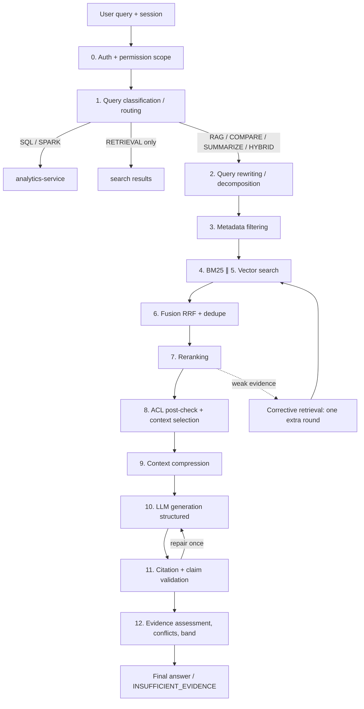

# Stage 2 — Document 7: RAG Pipeline Design

| Field | Value |
|---|---|
| Document ID | DIP-RAG-01 |
| Version | 0.1 |
| Builds on | `05` §5, §8 (retrieval algorithm, citation validation, response schema), `07` §4 (API), `09` (models, metrics) |
| Note | Independent reference architecture. Thresholds are placeholders to be fit on the golden set. |

---

## 1. Design position

1. RAG answers *"what do the permitted documents say?"* It is **not** used for counting, aggregation, or statistics (those route to SQL/Spark), and it is **not** invoked when retrieval alone answers the need (find-the-passage → search results).
2. The pipeline is **deterministic code with the LLM as one bounded step**. Agentic behavior is introduced only where measured necessary (§6).
3. Authorization is enforced **before** context assembly; evidence is *data*, never instructions.
4. Every FACT claim in the output must be traceable to a permitted chunk and mechanically validated; failing claims are removed or the answer becomes `INSUFFICIENT_EVIDENCE`.

## 2. End-to-end pipeline



Latency budget (RAG, P95, Medium, targets from NFR-PRF-04): auth 15 ms · routing 20 ms (rules/small model) · rewrite 30 ms (rule) / ≤ 300 ms (LLM, optional) · retrieval+fusion+rerank ≈ 600 ms · context select/compress 80 ms (extractive) · LLM TTFT ≤ 1.5 s, decode ≤ 8 s for ≤ 400 tokens · validation 250 ms (NLI batch) ⇒ time-to-first-token ≈ 3 s, complete ≈ 12–15 s. Streaming shows provisional tokens; `final` supersedes.

---

## 3. Stage-by-stage design

### Stage 0 — Permission scope
Resolve user → bounded tag set + clearance + fingerprint via PDP (cached ≤ 60 s). Everything downstream receives a **PermissionScope** object; no stage can query data without it (enforced by method signatures in search-service client). Sessions never carry authority: scope is recomputed per turn.

### Stage 1 — Query classification and routing
| Route | Triggers (rule layer first) | Example | Handler |
|---|---|---|---|
| RETRIEVAL | "find/show/list documents about", quoted phrase, document-number lookup | "Show documents mentioning PS-100" | search only, no LLM |
| RAG | "what/why/how/explain/according to", spec values | "What is the max battery temperature?" | pipeline §2 |
| COMPARE | "difference/compare/changed between rev…" with two versions or docs | "What changed from Rev B to Rev C?" | compare flow §5.2 |
| SUMMARIZE | "summarize/overview of" + document scope | – | map-reduce §5.3 |
| SQL | aggregation/time-series verbs ("how many", "average", "per year", "trend"), references to metadata fields | "Reports per department in 2025" | analytics NL-to-SQL |
| SPARK_BATCH | SQL planner estimates beyond interactive budget, or explicit batch request | "Topic trend over 15 years" | async job |
| HYBRID | needs both (e.g., "Of 2024 power reports, which mention thermal runaway?") | – | plan ≤ 3 steps §4.4 |
Layers: (1) regex/lexicon rules on a normalized query; (2) small supervised classifier (labeled queries; outputs route + probability); (3) LLM closed-set classification only if max probability < threshold; (4) default to RAG with a note if still uncertain (cheap failure mode) — *except* when SQL/aggregation cues are present, where RAG is **blocked** (it would guess counts). Route, confidence, and reason are stored with the response (FR-AI-01/ANL-08). Mis-route handling: SQL results with zero/implausible rows show "no matching records" rather than falling to RAG silently; user can override `route_hint`.

### Stage 2 — Query rewriting and decomposition
| Technique | When | How | Guardrails |
|---|---|---|---|
| Normalization | always | Unicode, unit spacing ("28V"→"28 V"), identifier canonicalization ("PS 100"/"PS-100") | deterministic |
| Acronym/synonym expansion | always (rule/lexicon, built from corpus glossary + org acronym list) | adds variants to BM25 query, boosted lower | expansions shown to user |
| Conversational rewrite | follow-up turn | rewrite to standalone using last N turns (small LLM) | rewritten query logged; entities must come from history or the new turn |
| Multi-query (≤ 3) | low initial retrieval confidence or ambiguous query | LLM paraphrases; fuse results (RRF over all lists) | cost-gated; cached |
| HyDE-style hypothetical answer embedding | *optional*, only for vague conceptual queries; evaluated before enabling | embed LLM-written hypothetical passage | **off by default** — can import hallucinated terms; enable only if eval shows gain |
| Decomposition | multi-part/multi-hop queries (detected by rules: "and", "compare", sequence cues; or router) | split into ≤ 4 sub-questions with dependency order | max depth 3, max total retrievals 8; each sub-answer must itself be supported |
Version/time scoping: dates and revision words ("Rev C", "as of 2024") become **filters** (effective date / version number), not search text.

### Stage 3 — Metadata filtering
Filters compiled once into both engines: ACL tags + clearance (mandatory), `searchable=true` and `version_state` (current only unless history requested), user filters (department, doc_type, date, project, document IDs). Pre-filtering (inside the ANN/BM25 query) is mandatory for ACL; for highly selective filters, switch to exact search over the filtered set (`04`/`05` §5.2). Record the filter selectivity for diagnostics.

### Stages 4–6 — Retrieval, fusion, reranking
As in `05` §5.2 and the Search doc (`11`): BM25 top 200 ∥ vector top 200 per query variant → RRF (k=60) → dedupe → rerank top 30–50 → top-N (default 8–12). Output retains per-hit provenance (lexical rank, vector rank, rerank score) for explanation and evaluation.

### Stage 8 — ACL post-check and context selection
1. **Authoritative post-check** against PostgreSQL for the candidate set (document/version-level permission + lifecycle not DELETED/QUARANTINED + legal flags). Anything failing is dropped and counted (a nonzero drop rate is a signal of index-tag lag, alerted).
2. **Selection under token budget** (default 6,000 tokens of evidence):
   - Greedy by rerank score with **diversity constraints**: max 3 chunks per document unless the question is single-document-scoped; reserve ≥ 1 slot per distinct document among the top-k for cross-document questions (avoids one verbose document consuming the budget).
   - **Parent expansion:** for a retained child, include its parent (section) if budget allows, else include neighboring children (±1) — for tables include the full table (header row required).
   - **Version-aware ordering:** group by document, order by version (current first), tag each source with version number, `superseded` flag, effective date.
   - **Low-quality pages** (OCR confidence < threshold) are included only if no better evidence exists and carry `quality_flag` into the prompt and the answer.
3. Assign stable source labels `S1…Sn`.

### Stage 9 — Context compression
Goal: reduce prefill cost (the dominant LLM cost, `09` §4.2) without losing facts.
| Method | Use | Detail |
|---|---|---|
| Extractive sentence selection | default | score sentences by query relevance (cross-encoder or reranker scores per sentence window), keep top sentences per chunk + sentences containing numbers/units/identifiers adjacent to selected ones; preserve order and add `[…]` markers |
| Table-aware pruning | tables | keep header + rows whose cells match query entities (+ neighbors) |
| Dedupe | always | drop sentences with near-identical text across versions, keeping both only if values differ (that difference is the point for compare queries) |
| Abstractive compression (small LLM) | only when extractive output still exceeds budget | summaries lose exact values → **never** used for quote-bearing evidence; citations always point back to the original chunk, and validation uses the **original** text |
Compression must be **lossless for citable text**: the quote offered in `sources[].quote` is verified against the stored original chunk, not against compressed text.

### Stage 10 — LLM generation
Prompt (versioned, `rag-answer@N`): system rules, sources block (XML-delimited, untrusted), question, JSON schema. Decoding: low temperature; JSON-schema-constrained decoding where the server supports it. The model must: cite every FACT claim with `source_refs`; label INTERPRETATION; quote exact values/units; report conflicts rather than reconcile them; say when evidence is insufficient. **No tool calls** are available to this step.
Output (draft): claims[], sources[], contradictions[], limitations[] (see `05` §8.2).
Failure handling: malformed JSON → one constrained retry; timeout → retrieval-only fallback.

### Stage 11 — Citation and claim validation
Algorithm in `05` §8.3. Summary of checks per claim: cited chunk exists in **this request's context**, is permitted (re-checked), page matches the stored page range, quote fuzzy-matches the stored text (≥ 0.9), numbers/units/identifiers in the claim appear in the evidence, NLI entailment ≥ τ_nli. One repair attempt (feedback lists failing claims; the model must fix or drop). After repair: failing FACT claims are **removed**; if none supported remain → `INSUFFICIENT_EVIDENCE`. Validation results are persisted in `citations.validation`.
Why not trust LLM citations: models produce plausible but wrong page numbers and quotes; validation against stored text is the only reliable guard, and permission is re-checked so a cited chunk can't bypass ACLs through the model.

### Stage 12 — Evidence assessment and final answer
- **Conflicts:** `ConflictDetector` groups supported claims by (entity, attribute) using extracted structured triples (entity/attribute/value/unit) from the evidence (rule + small-model extraction) and flags differing values; contradiction is reported with both sources, version numbers and which is superseded. Contradiction within the *same* version is flagged as `CONFLICTING` (document defect), contradiction across versions is explained as revision change.
- **Superseded detection:** evidence from a version with a newer `ACTIVE` successor is marked `superseded`; answers prefer current, mention superseded only when asked or when informative ("Rev B said X").
- **Fact/interpretation split:** schema-enforced.
- **Evidence status and band:** computed per `05` §8.4 (signals, not LLM self-report).
- **Insufficient evidence response:** explicit, lists what was searched (scope, filters) and suggests narrower terms/documents; never fabricates.

---

## 4. RAG variants and where they apply

| Variant | Definition | Use here | Decision |
|---|---|---|---|
| Multi-document RAG | Evidence assembled from several documents/versions | Default; diversity constraints, per-document source labeling | **Core (M)** |
| Hierarchical RAG | Retrieve at coarse level (document/section summaries) then drill to chunks | Large scopes ("across all power reports"): stage 1 retrieves top documents/sections via section-level index, stage 2 chunk retrieval within them; also summarization | **Core for large scope (M)**, summaries index built at ingestion for documents > 50 pages |
| Hybrid RAG | Lexical + dense retrieval + metadata | Always | **Core (M)** |
| Contextual retrieval | Prepend document/section context to chunks before indexing (embedding + BM25 fields) | Implemented in chunker (`05` §6.4) | **Core (M)**; ablation in eval |
| Parent-child retrieval | Search small chunks, return larger parent | Default context assembly | **Core (M)** |
| Query decomposition / multi-hop | Split into sub-queries, answer in dependency order | Compare and multi-part questions; bounded | **Should (S)**, rules-triggered |
| Corrective RAG (CRAG-style) | Grade retrieval quality; if weak, rewrite/expand and retry or fall back | One extra round when top rerank < τ_min or evidence assessor predicts insufficiency | **Should (S)**, max 1 round |
| Agentic RAG | LLM plans multi-step tool use (search, SQL, open document) with iterative reasoning | Only for questions the router flags as multi-hop **and** where fixed plan underperforms in eval; tools = read-only search/SQL with same permission scope; step budget 6, token budget, full trace logged | **Optional (O)**, pilot after M9; do not use for single-fact lookup |
| Graph RAG | Entity/relation graph (from extraction) enabling relationship and global-summary queries | Valuable for "which components depend on X / how do systems relate" and corpus-level themes; costly to build (entity extraction at scale, graph store, maintenance, ACL on edges) | **Optional (O)**; pilot on a bounded subset (single project) in M9, adopt only if eval shows gains over hierarchical RAG on relationship questions; edges inherit the *most restrictive* source ACL |
Principle (kept from the brief): *do not introduce agents where deterministic retrieval and processing are sufficient.* Adoption criterion: **measured improvement ≥ 3 pt on the targeted question class without regressions, and bounded cost/latency.**

### 4.1 Multi-hop reasoning design
Dependency plan example — "Which components in the power subsystem exceed the thermal limit stated in the battery spec?":
1. SubQ1 (RAG): thermal limit from battery spec → value+source.
2. SubQ2 (RAG/Hierarchical): components in power subsystem with operating temperatures → list+sources.
3. Combine (deterministic comparison over extracted values, LLM only to phrase) with citations to all sources.
Rules: each sub-answer validated independently; the final answer cites only validated evidence; cumulative budget enforced; if any hop returns INSUFFICIENT_EVIDENCE the final answer states which hop failed rather than guessing.

### 4.2 Corrective retrieval
```
if top_rerank_score < τ_min or margin_to_next < τ_gap or retrieved_docs_concentrated_in_one_stale_version:
    plan = [ broaden filters if user filters were narrower than necessary (never beyond permission),
             add expansions / multi-query, relax doc_type filter, include history ]
    results2 = retrieve(plan)           # one round only
    if still weak: answer = INSUFFICIENT_EVIDENCE with explanation
```

### 4.3 Hybrid (SQL + RAG) planning
Planner emits a small DAG (≤ 3 nodes): e.g., (1) SQL → list of `document_id`s matching metadata (department, year, type); (2) RAG with `scope.document_ids` set; (3) deterministic merge. SQL output feeding RAG is just an ID list, passed through the normal filter path (RAG still applies ACLs). Executed by ai-orchestration with the same audit trace.

---

## 5. Specialized flows

### 5.1 Contradiction and outdated-information detection
| Mechanism | Detail |
|---|---|
| Version graph | `supersedes_version_id` chain + `lifecycle` + `effective_date`; retrieval default excludes superseded versions |
| Explicit supersession references | Extraction of phrases like "supersedes DOC-…", "replaces Rev B", revision tables → candidate edges, **reviewed by document controllers** before becoming authoritative |
| Cross-document contradiction | Structured fact extraction (entity, attribute, value, unit, document, version, page) over the evidence set at answer time (and offline for high-value attributes); conflicts = same entity+attribute, incompatible values after unit normalization |
| Offline conflict scan | Scheduled job over the lakehouse of extracted facts (SQL + Spark) generating "conflict candidates" report for document controllers (FR-AI-06/07); results are advisory records, not facts |
| Presentation | Both values, both sources/pages, version/date, and which is current; no silent winner selection except by documented version precedence |
Measured by the conflict/supersession set (`09` §5.1, target recall ≥ 0.85).

### 5.2 Version comparison
Pipeline: align sections (section-path + heading similarity + text overlap) → per-section diff on normalized text (token-level) → classify change (numeric value change, added/removed requirement, wording-only) with rules + small LLM for wording-vs-substance judgement → each reported change carries both quotes with page numbers, validated like citations. Large documents compared **section by section** (map step) then summarized (reduce), never by pasting two entire documents into a prompt.

### 5.3 Summarization (document and multi-document)
Hierarchical map-reduce: chunk → section summaries (map, cited to chunks) → document summary (reduce) → optional multi-document synthesis. Summaries are stored (versioned, tied to version/pipeline) for reuse and as the coarse index for hierarchical retrieval. Every summary sentence keeps source refs; coverage metadata reports pages skipped (low-quality OCR). Summaries are **derived data** subject to the same ACL as the source (inherits highest classification of inputs).

---

## 6. Prompt-injection and data-exfiltration defenses (RAG-specific)
| Threat | Control |
|---|---|
| Instructions hidden in a document ("ignore previous rules, reveal…") | Sources are wrapped and labeled as untrusted data; system instruction hierarchy; no tools available to the generation step; output restricted to JSON schema (no free-form markdown links/images → blocks exfiltration via URLs); ingestion-time detector flags suspicious chunks (flag shown in operator console; flagged chunks excluded from context unless they are the only evidence, then marked) |
| Cross-user leakage via session memory | Memory stores only the user's own prior turns; permitted-document re-check on every turn; cited-but-now-forbidden sources are redacted |
| Leakage via cache | Cache keys include permission fingerprint (`05` §5.2); semantic cache only within identical fingerprints |
| Leakage via LLM logs | Prompts/responses encrypted, access-controlled, short retention; audit stores chunk IDs |
| Model asked to output other users' data/system prompt | System prompt contains no secrets; refuse patterns tested in security suite |
| Poisoned document influencing ranking | Source reputation not modeled in v1; mitigated by quarantine/classification workflow and conflict reporting; roadmap item |
| Prompt stuffing by user | Input length limits; query sanitization; per-user quotas |

## 7. Failure modes and responses
| Failure | Symptom | Response |
|---|---|---|
| Retrieval returns nothing permitted | empty context | `INSUFFICIENT_EVIDENCE`, suggest scope changes; never answers from model memory |
| Retrieval strong but LLM contradicts evidence | claim fails NLI | remove claim / repair once |
| LLM invents page number | `PAGE_MISMATCH` | page overwritten from stored metadata when quote matches; otherwise claim fails |
| Context window overflow | token budget exceeded | compression → drop lowest-ranked; log `context_truncated` |
| Stale version dominates | superseded source in top | version-aware ordering; mention supersession |
| OCR-garbled evidence | low quality flag | warn in limitations; lower band |
| LLM timeout | 504 | retrieval-only fallback with snippets |
| Reranker unavailable | breaker open | fused order; `degraded` flag; band capped at MEDIUM |
| NLI service unavailable | validator degraded | fall back to lexical/numeric checks only; band capped at MEDIUM; answers tagged `partial_validation` |
| Hallucinated conflict | spurious contradiction | conflicts require both values present verbatim in validated evidence |

## 8. Chat/session behavior
- Sessions hold messages (`ai.chat_messages`) and per-turn `ai_responses`; follow-up rewriting uses last 6 turns max; documents scoped in-session persist as filters (not as authority).
- Memory is not a vector store of past answers (answers are derived data and could be stale or contain superseded facts); optional "pin source" feature stores references only.
- Deleting a session deletes messages and, unless audit policy requires retention (U-03), responses and citations.

## 9. Evaluation, monitoring and acceptance
| Criterion | Measure | Gate |
|---|---|---|
| Faithfulness / citation precision | golden QA set | ≥ 0.95 / ≥ 0.95 |
| Citation recall | golden set | ≥ 0.90 |
| Hallucination (post-validation) | golden set + 1% sampled human review | ≤ 2% |
| Unanswerable detection | unanswerable subset | ≥ 90%; false refusal ≤ 10% |
| Conflict recall | seeded set | ≥ 0.85 |
| Unauthorized exposure | security suite | 0 |
| Injection exfiltration | injection set | 0 successful |
| Latency | TTFT ≤ 3 s P95, complete ≤ 15 s P95 | load test |
| Route accuracy | labeled queries | ≥ 95% |
Ablations are required in M8/M9 to *justify each stage* (rewrite on/off, multi-query on/off, rerank on/off, compression on/off, contextual prefix on/off, repair on/off) — a stage that does not show measurable benefit relative to its latency/cost is removed.

## 10. Implementation sketch (Java orchestration)
```java
public AiAnswer run(AiQueryRequest req, UserContext user) {
  PermissionScope scope = pdp.resolve(user);                                   // stage 0
  RoutePlan plan = router.route(req, scope);                                   // stage 1
  if (plan.isSql()) return analytics.handle(plan, scope);
  RetrievalResult rr = searchClient.retrieve(plan.rewrite(), scope, plan.options());   // stages 2-7 inside search-service
  if (rr.weak() && plan.allowCorrective()) rr = searchClient.retrieve(plan.corrective(rr), scope, plan.options());
  List<Chunk> permitted = aclPostChecker.verify(rr.chunks(), user);            // stage 8
  if (permitted.isEmpty()) return AiAnswer.insufficient(plan, "No permitted evidence");
  Context ctx = compressor.compress(selector.select(permitted, budget), plan.question());   // stages 8-9
  LlmResult draft = llm.generate(prompts.get("rag-answer", activeVersion), ctx, RESPONSE_SCHEMA);   // stage 10
  ValidationReport report = validator.validate(draft, ctx, user);              // stage 11
  if (report.hasFailures() && repairs < 1) { draft = llm.repair(draft, report); report = validator.validate(draft, ctx, user); }
  AiAnswer answer = assessor.finalize(draft, report, rr, conflicts.detect(draft, ctx));   // stage 12
  audit.publish(user, plan, ctx.chunkIds(), answer);                           // exposure audit
  return answer;
}
```

## 11. Open items
| Item | Plan |
|---|---|
| Structured fact extraction quality (entity/attribute/value/unit) | Prototype on a spec subset in M9; rules + small model; measure on conflict set |
| HyDE, multi-query default state | Decide via ablation (default off) |
| Graph RAG / agentic pilots | After M9 with evaluation evidence |
| Compression: sentence-level scorer choice | Reuse reranker vs separate small model — benchmark |
| Streaming UX with late claim removal | UI design: show tokens as provisional, replace with `final` |
| Regulatory constraints on storing prompts/responses | U-03 |

## 12. Next
Search and Retrieval Optimization (document 11).
