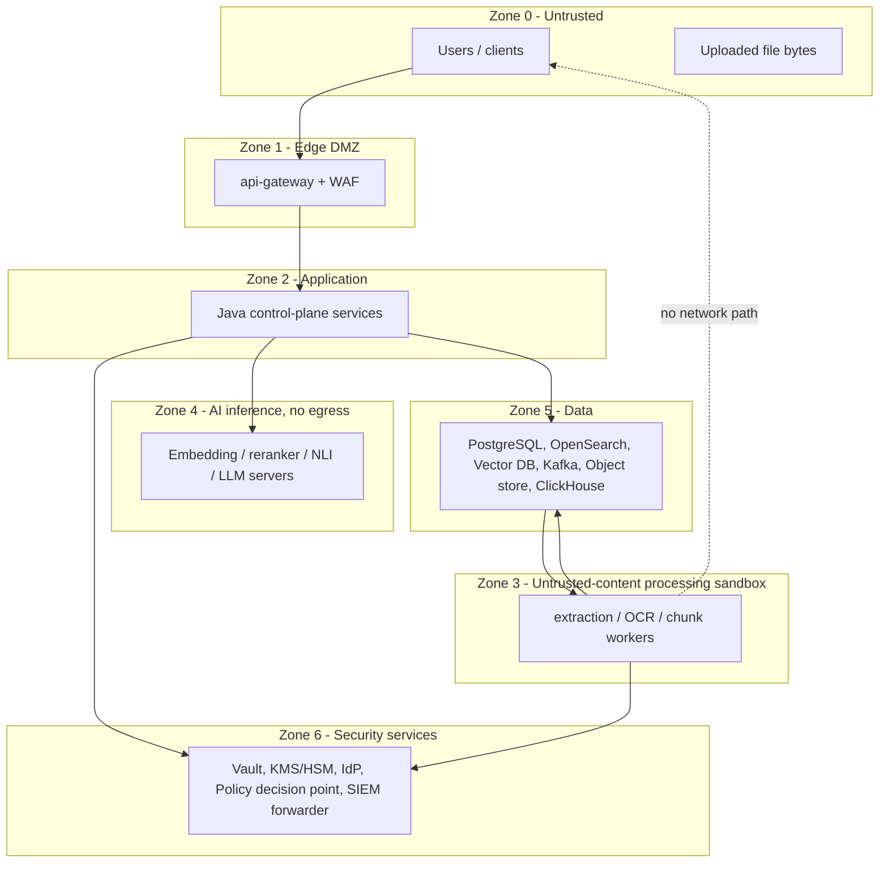

# Stage 2 — Document 9: Security Architecture

| Field | Value |
|---|---|
| Document ID | DIP-SEC-01 |
| Version | 0.1 |
| Builds on | `02` NFR-SEC-*, `04` §9, `06` (ACL, DEK, audit), `07` §1.2–1.3, `08` §9.2, `09` §10, `10` §6 |
| Note | Independent reference architecture. **It is not an ISRO security policy and does not claim compliance with any named government or industry standard.** The compliance regime is unresolved (U-03); §14 shows how controls map to control *families* so a real standard can be mapped later. Where a control depends on an unresolved decision it says so. |

---

## 1. Security objectives and non-negotiables

| ID | Objective | Measure |
|---|---|---|
| SO-1 | **Confidentiality:** no user obtains content they are not entitled to — through search, RAG, caches, chat memory, logs, exports, or error messages | 0 findings in permission-bypass suite (NFR-SEC-03) |
| SO-2 | **No confidential content to external AI providers** (C-02) | Egress-deny verified by test; no external endpoints in inference namespaces |
| SO-3 | **Authorization before the LLM:** unauthorized text never enters a prompt | Chunk-level exposure audit; PG post-check; red-team tests |
| SO-4 | **Integrity:** documents immutable; audit tamper-evident; models/artifacts signed | Hash chain verification; admission policy |
| SO-5 | **Accountability:** every access, query and admin change attributable | 100% audit coverage (BO-5) |
| SO-6 | **Availability of security services:** identity/PDP/KMS outages degrade safely (deny, not allow) | Fail-closed tests |
| SO-7 | **Least privilege everywhere:** users, services, workers, operators | Quarterly access review; default-deny network and Kafka ACLs |
| SO-8 | **Defense in depth:** a single control failure does not expose data | Architecture review: every asset protected by ≥ 2 independent controls |

Design rules: (1) default deny; (2) fail closed on authorization uncertainty, fail open never; (3) never trust LLM output, document content, or client-supplied claims; (4) secrets and keys never in code, images, config repos, logs; (5) every privileged action is audited and, for the highest risk, requires two-person approval.

---

## 2. Assets, trust zones and threat model

### 2.1 Assets (ranked)
1. Document content and derived data (chunks, vectors, summaries — vectors can be partially inverted, treat as sensitive as the text).
2. Authorization data (roles, ACLs, classification), identity data.
3. Audit trail.
4. Prompts/responses/chat history.
5. Models and prompts (integrity, licensing; not secret per se).
6. Keys and secrets.
7. Operational telemetry (may leak metadata).

### 2.2 Trust zones

Zone rules: Zone 3 handles attacker-controlled bytes → least privilege, no outbound network, no database credentials (workers write via narrowly-scoped object-store prefixes and Kafka topics only), no access to other documents. Zone 4 has no egress and no inbound from Zone 0/1. Zone 6 has the strictest admin access (break-glass, two-person).

### 2.3 Threat analysis (STRIDE-oriented, top threats and mitigations)

| # | Threat | Category | Mitigation (section) | Residual / test |
|---|---|---|---|---|
| T1 | User retrieves another department's confidential chunk via search | Info disclosure | ACL filter inside engines + PG post-check (§5), fingerprinted caches | Permission suite |
| T2 | RAG leaks content through prompt/citation/chat memory | Info disclosure | Authorize before prompt; re-check citations; session re-authorization (§5.4) | Red-team |
| T3 | Prompt injection in a document hijacks the LLM or exfiltrates data | Tampering/Info disclosure | §10 | Injection corpus |
| T4 | Malicious file exploits parser (RCE), zip/PDF bomb | Elevation/DoS | §11 sandbox, limits, quarantine | Fuzzing, bomb tests |
| T5 | Stolen JWT replay | Spoofing | Short TTL, audience binding, DPoP/mTLS-bound tokens (optional), revocation list, anomaly detection | Token tests |
| T6 | Compromised service identity moves laterally | Elevation | mTLS, per-service identities, NetworkPolicies, least-priv DB roles, Kafka ACLs (§7) | Pen-test |
| T7 | Insider bulk-extracts data via AI/search | Info disclosure | Quotas, anomaly detection, exposure audit, export controls (§12) | Detection drills |
| T8 | Admin tampers with audit log | Repudiation | Append-only, hash chain, WORM anchors, separate audit admin role (§9) | Chain verification |
| T9 | Poisoned/tampered model weights | Tampering | Signed artifacts, checksum, admission control (§8.3) | Supply-chain tests |
| T10 | Misrouted NL-to-SQL reads data beyond grants / modifies data | Info disclosure/Tampering | AST validation, read-only role, row-level predicates, allow-listed views (§6.4) | SQL injection suite |
| T11 | Backup/DR copy leaks data | Info disclosure | Encrypted backups, separate KEKs, access-controlled restore (§13) | Restore audit |
| T12 | Secrets in repos/images/logs | Info disclosure | Vault, secret scanning, log scrubbing (§8.2) | CI scanners |
| T13 | Denial of service (query flood, upload flood, expensive queries) | DoS | Rate limits, quotas, query budgets, bulkheads (`07` §1.9) | Load/abuse tests |
| T14 | Cross-tenant/classification mix-up (U-02) | Info disclosure | Tag model + physical isolation for top tier (§6.5) | Cross-tier tests |
| T15 | Re-identification from vectors/embeddings inversion | Info disclosure | Same ACL on vectors; vector DB inside zone 5; no external embedding APIs | Policy |
| T16 | Supply-chain compromise of dependencies/images | Tampering | SBOM, pinned digests, scanning, signed images, internal mirrors (§8.1) | Pipeline gates |
| T17 | Social engineering of document controllers (fake supersession) | Spoofing | Supersession edges reviewed/approved by controllers; audit | Process |
Threat model is a living artifact: reviewed each milestone and for each new feature (design review checklist, §15).

---

## 3. Identity and authentication

| Aspect | Design |
|---|---|
| IdP | Keycloak-class OIDC provider federating the organization's directory (LDAP/AD, U-04); MFA enforced at IdP for all human users; phishing-resistant factors (WebAuthn) recommended for admins/auditors |
| Human flow | Authorization code + PKCE; access token TTL ≤ 15 min; refresh tokens rotating, bound to session, idle timeout (e.g., 30 min) and absolute (e.g., 12 h) |
| Machine flow | Client-credentials / SPIFFE-style workload identity; tokens ≤ 5 min; audience-restricted (`aud`) per target service |
| Token validation | Gateway: signature (JWKS cached with rotation), `iss`, `aud`, `exp`, `nbf`; services re-validate (zero-trust inside); reject `alg=none`; clock-skew ≤ 60 s |
| Session revocation | Back-channel logout + short-lived tokens + a revocation cache (jti/`sid` denylist in Redis, checked at gateway) for immediate revocation of compromised sessions |
| Step-up | Sensitive operations (download original of RESTRICTED+, permission changes, export audit, model promotion, quarantine release) require recent MFA (`auth_time` ≤ 5 min / `acr` claim) |
| Local accounts | Break-glass only, vaulted credentials, alarms on use, disabled by default |
| Service-to-service | mTLS (mesh or SPIFFE/SPIRE) with certificate TTL ≤ 24 h, auto-rotated (cert-manager); identity = namespace/service account |
| Client types | Browser UI (BFF pattern: tokens held server-side or in memory, `SameSite` cookies for BFF session, no tokens in localStorage), service/batch clients (confidential clients) |
| API protections | Strict CORS allow-list, CSRF protections on cookie-based BFF, security headers (`07` §9), request size caps |

---

## 4. Authorization architecture (RBAC + ABAC)

### 4.1 Model
- **RBAC**: roles → permissions (`document:read`, `ai:query`, …) optionally scoped to a department subtree (`06` `user_roles.scope_department_id`).
- **ABAC**: attributes of subject (department, clearance, project, location/network zone if used), resource (classification, department, owner, tags, lifecycle, legal hold), action, environment (time, MFA recency, client type).
- **Document ACLs** (`document_acl`): explicit ALLOW/DENY for users/roles/departments; DENY overrides.
- **Classification clearance** is a **hard floor**: `user.clearance ≥ document.classification` must hold regardless of ACL (an ACL cannot grant above clearance); changing clearance/classification is audited and may require two-person approval.

### 4.2 Evaluation order (PDP)
1. Authentication valid and not revoked; account ACTIVE.
2. Environment constraints (e.g., step-up for the operation).
3. Clearance ≥ classification (else DENY).
4. Explicit DENY (document, department, role) → DENY.
5. Explicit ALLOW (document ACL) → ALLOW.
6. Role permission + department-subtree match (with inheritance) → ALLOW.
7. Default → DENY.

### 4.3 PDP/PEP architecture
- **PDP**: identity-access service (policy engine: either hand-coded in Java with a table-driven model or an OPA/Cedar-class engine; choice is an ADR candidate — OPA/Rego gives auditable, testable policies-as-code, Java implementation gives lower latency and simpler ops; start with Java + policy tests, keep a clean interface to swap).
- **PEPs**: api-gateway (coarse: authentication, RBAC permission), each service (fine: resource checks), search-service (bulk filter compilation + post-check), analytics-service (table/row policies).
- **Decision caching:** scope (tag set + fingerprint) cached ≤ 60 s; document-level post-check reads PG directly (authoritative, indexed batch query).
- **Fail-closed:** if PDP unreachable and cache expired → deny for writes and for any read of RESTRICTED+; stale cache (≤ 60 s) permitted for lower classifications only (policy-configurable), as stated in `05` §9.2.
- **Policy tests**: a table-driven authorization matrix (role × resource × action) is executed in CI; any change requires approval by the security owner.

### 4.4 Permission propagation to indexes
`acl_tags` are derived from PG. A permission change emits `iam.permission.changed` → indexer retags. **Revocation is immediate** (PG post-check removes the document from any result regardless of tag lag); **grants** may take minutes to appear (acceptable, safe direction). A reconciliation job compares tags vs PG ACL daily and alerts on drift; drift that *over-grants* in the index is harmless to confidentiality because of the post-check but is still fixed (post-check drop-rate alert > 1% indicates lag or a bug).

---

## 5. Document-level authorization in retrieval and AI (SO-1, SO-3)

### 5.1 Layers (each independent)
| Layer | Control | Fails safe? |
|---|---|---|
| L1 | Gateway RBAC (`search:execute`, `ai:query`) | yes (401/403) |
| L2 | **Index pre-filter** — `acl_tags ∩ user_tags` and `class_level ≤ clearance`, compiled server-side by search-service; clients cannot submit raw filters | yes (no match) |
| L3 | **PG post-check** on candidates, authoritative | yes (drops) |
| L4 | **Prompt assembly guard**: only chunks that passed L3 enter the context; chunk IDs recorded | yes |
| L5 | **Citation validator** re-checks each cited chunk's permission and rejects citations not in context | yes |
| L6 | **Response filter**: sources and quotes are server-assembled from stored text, not LLM-emitted free text; links/images disallowed in output | yes |
| L7 | **Audit**: chunk IDs exposed per query (post-hoc detection) | detective |

### 5.2 Tag explosion and special cases
Per `04` §5.2: group-based tags primarily; if a user's expansion > threshold, search uses group tags only and individual-document grants are resolved by an allow-list join in the post-check path (still correct, slightly slower). Documents with individual grants are indexed with a `doc:<id>` tag so the fast path works for the common case.

### 5.3 Derived artifacts inherit ACLs
Chunks, vectors, summaries, extracted facts/triples, comparison outputs, analytics curated tables built from documents inherit the **highest classification and the intersection of ACLs** of their inputs. A summary spanning documents A (RESTRICTED) and B (CONFIDENTIAL) is CONFIDENTIAL and visible only to users permitted on **both**. Lakehouse curated datasets declare their source classification; row-level security applies (§6.4).

### 5.4 Chat memory and caches
Session history is data owned by the user; every turn re-authorizes cited documents (access revoked ⇒ citations redacted: "source no longer available to you"). No cross-user memory. Caches keyed by permission fingerprint (`11` §5.3); semantic cache off for RAG answers by default.

---

## 6. Data protection

### 6.1 Classification and handling
| Level (placeholder names, U-02) | Examples | Handling rules (proposal) |
|---|---|---|
| PUBLIC | Published papers | Normal; may be shared outside |
| INTERNAL | General project docs | Authenticated users in org; no download restriction by default |
| RESTRICTED | Sensitive design docs | Department/project ACL; step-up for download/export; audit on read |
| CONFIDENTIAL (top tier) | Highest-sensitivity (if any) | **Physically separate index sets/namespace** (ADR-004), dedicated KEK, no cross-tier derived artifacts, two-person approval for access grants, no download without approval, optional separate cluster |
Rules: classification assigned at upload (cannot exceed uploader clearance), classifier **suggests** but never lowers; downgrade requires approval workflow (audited); label travels with chunk/vectors/artifacts (`class_level` field); exports and logs carry the level.

### 6.2 Encryption in transit
TLS 1.3 (1.2 minimum) for all external endpoints; mTLS service-to-service (mesh/SPIFFE); Kafka TLS + mTLS client auth; PostgreSQL `sslmode=verify-full`; OpenSearch, vector DB, ClickHouse, Redis over TLS; object-store presigned URLs over HTTPS only with short expiry (≤ 1 h, single operation, IP-bound where feasible); cipher suites restricted (AEAD only); HSTS at edge.

### 6.3 Encryption at rest and key management
| Layer | Mechanism |
|---|---|
| Volumes (PG, Kafka, OpenSearch, vector DB, ClickHouse) | Encrypted block devices (LUKS/dm-crypt or storage-layer encryption), keys from KMS |
| Object storage | Server-side encryption with **per-document data keys** (envelope): `KMS master (HSM-backed) → tenant/classification KEK → per-document DEK (wrapped, stored in `document_versions.dek_wrapped`)` |
| Backups/snapshots | Encrypted with separate backup KEKs (not the production KEK) so a production key compromise doesn't expose backups and vice versa |
| Application-level fields | Chat message content, prompt/response payloads encrypted with an app-layer key (field-level, AES-256-GCM, key id stored per row) so DB admins cannot read them |
| Vectors | Protected by volume encryption and ACL; not separately encrypted (searchability) — risk accepted and documented (T15) |
Key policy: AES-256-GCM; KEK rotation ≤ 12 months (re-wrap DEKs, not re-encrypt data); DEK rotation on re-upload; HSM or KMS with audit; split-knowledge/dual control for master key operations; key access audited; separate KEK per top classification tier; **crypto-erasure**: destroying a document's wrapped DEK renders object-store data (and replicas/backups holding that ciphertext) unreadable (ADR-015, U-10). Caveat: derived plaintext in OpenSearch/other stores must still be actively deleted (deletion saga, `06` §7).

### 6.4 Analytics/NL-to-SQL security (T10)
| Control | Detail |
|---|---|
| Parser-level | SQL parsed to AST; allow only `SELECT` (and CTEs of SELECT); reject multiple statements, DDL/DML, `INTO OUTFILE`, table functions (`file`, `url`, `s3`, `remote`), system tables, user-defined functions outside allow-list |
| Schema allow-list | Only curated views (e.g., `analytics.v_documents`), never base tables; the LLM sees only permitted view metadata (no leakage of table names the user cannot query) |
| Row-level policies | Department/classification predicates injected into the plan (ClickHouse row policies bound to a per-request role or injected in AST rewrite) |
| Database privileges | Read-only role, `readonly=1`, `max_execution_time`, `max_memory_usage`, `max_rows_to_read`, `max_result_rows`, quotas per user |
| Injection | LLM output never executed as string-concatenation with user text; parameters bound; user question is never inserted into SQL text by the platform, only the validated model output is executed |
| Audit | question, generated SQL, plan, cost, rows returned (count), user, outcome |
| Result handling | Rows limited and classified; exports of large results require permission and are audited |

### 6.5 Tenant and classification isolation (U-02)
| Mode | When | Mechanism |
|---|---|---|
| Logical (default) | Single organization, same classification band | ACL tags, clearance, per-department scoping, RLS on analytics |
| Strong logical | Different departments with stricter separation | Separate OpenSearch indices and vector collections per department group; shared compute |
| **Physical** | Top classification tier (or separate organizations) | Separate namespace, node pools, storage, Kafka topics/cluster, KEKs, and optionally separate cluster/network; no shared caches; identity claims distinct |
`tenant_id` column is intentionally absent now (U-02 default: single organization). If multi-organization becomes a requirement, adding it is an expand/migrate/contract change on every table plus index/collection partitioning — flagged as a decision to confirm early (`06` §11).
Verification: automated cross-tier tests (user A with tier-1 clearance cannot see tier-2 data by any API, cache, or error message) run in CI and nightly.

### 6.6 Sensitive information handling
| Concern | Control |
|---|---|
| PII/sensitive entity detection | Optional detector (regex + NER) at ingestion tags chunks (`pii_flags`) for policy: masking in logs/analytics exports, restricted summaries; not used to *decide* access |
| Logging | IDs, hashes, counts only; no document text, queries are logged only if policy allows and then with retention; error messages sanitized |
| Prompts/responses | Stored encrypted; retention ≤ policy (default 90 d); access only by Security Auditor under audit |
| Telemetry | Traces use IDs; baggage never carries content; LLM spans omit prompt text (store hashes) |
| Screenshots/exports | Watermark with user ID/time on downloads/PDF exports (optional for RESTRICTED+) |
| Clipboard/copy | UI-level controls out of scope (cannot be enforced technically) |
| Non-prod | No production documents in dev/test/staging; synthetic or sanitized corpora; staging uses a separately approved sample (public or sanitized) |

---

## 7. Network and infrastructure security

| Control | Design |
|---|---|
| Segmentation | Namespaces per zone (`edge`, `app`, `processing`, `ai-gpu`, `data`, `obs`, `sec`); default-deny `NetworkPolicy` ingress and egress; explicit allows (service→service, workers→Kafka/object store, services→data stores) |
| Egress | **Deny all** from `processing`, `ai-gpu`, `data`; `app` only to named internal endpoints (IdP, SMTP relay); internal registry/mirrors only; DNS restricted |
| Mesh/mTLS | Sidecar or ambient mesh (or SPIFFE/SPIRE + library-level mTLS) with authorization policies at L7 (service identity + method + path) |
| Edge | WAF (OWASP CRS tuned), TLS termination, DDoS/rate controls, request size caps, bot controls as needed; admin APIs on separate internal ingress |
| Admin access | Bastion/zero-trust access broker, MFA, session recording, JIT privileged access with approval and expiry; no standing cluster-admin; `kubectl` access by role, audited via API-server audit logs |
| Kubernetes hardening | Pod Security Standards "restricted" (non-root, read-only root FS, drop all capabilities, seccomp RuntimeDefault, no hostPath/hostNetwork/privileged), resource quotas/limits, `automountServiceAccountToken=false` unless needed, admission policies (Kyverno/OPA Gatekeeper) enforce: signed images only, no `latest`, required labels/limits, approved registries; etcd encryption (secrets) with KMS provider; API server audit logging; node OS hardening (CIS-style baselines), automated patching |
| Sandbox for untrusted parsing | `RuntimeClass` with gVisor/Kata-class isolation for `processing` pods; seccomp profile; ephemeral tmpfs workspace; CPU/memory/time/page limits; no service-account token; egress deny |
| Kafka | TLS+mTLS, ACLs per principal (`08` §9.2), no external listeners |
| Databases | Private subnets only, per-service DB roles with least privilege (no `SUPERUSER`), connection via PgBouncer with TLS, row-level security as defense in depth (prototype M11) |
| Object storage | Private endpoints, bucket policies per prefix/service identity, versioning + object lock on audit anchors/backups, presigned URL constraints, no public buckets (policy check in CI) |
| Physical/host | Depends on U-01; for on-prem: access-controlled data center, disk encryption, hardware attestation optional |

---

## 8. Application, supply chain and secrets security

### 8.1 Secure SDLC and supply chain
| Stage | Control |
|---|---|
| Design | Threat modeling for new features (checklist §15), security design review for new data flows |
| Code | Mandatory code review, branch protection, signed commits; SAST (SpotBugs/Semgrep/CodeQL-class), secret scanning pre-commit and in CI; dependency pinning |
| Dependencies | SCA (OWASP Dependency-Check/Trivy), SBOM (CycloneDX/SPDX) per build, license policy, internal mirrors/proxies (no direct internet in build runners for prod pipelines), automated updates with tests |
| Build | Hermetic/reproducible builds where feasible, ephemeral runners, least-privilege CI credentials (OIDC federation, no long-lived cloud keys) |
| Images | Minimal base (distroless/chiseled), pinned by digest, Trivy/Grype scan (fail on critical/high with fix available), **cosign signature + SBOM attestation**; admission controller verifies signatures |
| Release | Provenance (SLSA-style attestation), two-person approval for production promotion, immutable artifacts |
| Testing | DAST on staging, API fuzzing (schemathesis against OpenAPI), authorization tests, parser fuzzing for extraction workers |

### 8.2 Secrets management
Vault (or equivalent HSM-backed secrets manager): dynamic database credentials (TTL ≤ 1 h, per-pod), PKI for internal certs, KV for static secrets (rare); Kubernetes integration via CSI/agent injection (no secrets in env files, ConfigMaps, images, Helm values in Git); secrets never logged (log scrubbers and tests); automated rotation; break-glass procedure with alarms; Vault unseal keys via Shamir/KMS auto-unseal with custody procedure (DR doc); detection: secret scanning (gitleaks-class) in CI plus periodic repository history scans.

### 8.3 Model and AI asset security
Signed, checksummed model artifacts (`09` §10); unsigned or unverified weights rejected by admission policy; no `pickle`-based weights unless converted in an isolated pipeline; model servers run non-root in no-egress namespace; model registry changes require `model:manage` + step-up + (for ACTIVE promotion) two-person approval; inference logs exclude content; rate limits per user on LLM; output sanitization (§10).

---

## 9. Audit, monitoring and incident response

### 9.1 Audit trail
What is recorded: authentication events (success/failure, MFA), authorization denials, document read/download/export, uploads, deletions, permission/classification changes, search queries (policy-controlled content), AI queries (route, model/prompt version, **chunk IDs exposed**, evidence status), analytics queries (SQL, plan), admin/model/config changes (before/after), key operations, quarantine releases, audit reads.
Properties: append-only (`06` §4.6), hash-chained per partition, daily anchors written to WORM object store (object lock) and optionally signed by an HSM key; Kafka transport with local durable spool for loss prevention (`08` §9.1); separate **Audit Admin** role (cannot be held by platform admins) — separation of duties; audit reads are themselves audited; retention 7 years (proposal, U-03), then archive/destroy by policy.
Integrity verification: automated nightly chain verification; alert on mismatch; periodic independent verification by the security team.

### 9.2 Security monitoring (SIEM)
Forward audit events, Kubernetes audit logs, WAF logs, IdP logs, Vault audit device, Kafka authorizer logs, OS/auditd to SIEM (OpenSearch-based or enterprise SIEM) with detection rules:
| Detection | Rule (examples) |
|---|---|
| Bulk extraction | > N distinct documents exposed to one user in M minutes; high AI query rate with high distinct-source fan-out |
| Privilege misuse | Admin action outside change window; model promotion without approval; ACL changes followed by access |
| Auth anomalies | Impossible travel, repeated MFA failures, token reuse from new IP/ASN, break-glass usage |
| Data egress | Any denied egress from `ai-gpu`/`processing` (should be impossible; alert = policy breach or compromise) |
| Injection indicators | Spike in flagged chunks, validator `NOT_PERMITTED`/`NOT_IN_CONTEXT` counts, outputs containing URLs (blocked) |
| Integrity | Audit hash mismatch, unsigned image admission attempts, schema registry changes outside CI |
| Pipeline abuse | Upload spikes, repeated quarantine events from one user |

### 9.3 Incident response (outline)
Roles (incident commander, security lead, comms), severity matrix, runbooks for: suspected data exposure (identify exposed chunk IDs from audit → affected users/documents → revoke sessions/keys → notify per policy), compromised credentials, malicious document, model compromise, ransomware/destructive attack (hand-off to DR plan), insider abuse. Evidence preservation (immutable audit + snapshots), forensics access, post-incident review, metrics (MTTD/MTTR). Tabletop exercises twice a year; red-team once a year (scope includes prompt injection and permission bypass).

---

## 10. Prompt-injection and AI-specific security
(Consolidates `10` §6 as normative security requirements.)
| ID | Requirement |
|---|---|
| AI-SEC-1 | Retrieved text is always passed as delimited, labeled **untrusted data**; system instructions state precedence; the generation step has **no tools** and no network |
| AI-SEC-2 | Output must conform to the JSON schema; free-form rendering disallows active content (links auto-fetch, images, HTML/JS); UI renders text safely (escape, no markdown image fetch) |
| AI-SEC-3 | Ingestion-time injection detector (pattern + classifier) flags chunks; flagged chunks are excluded from context unless sole evidence, then labeled |
| AI-SEC-4 | Sources and quotes shown to users come from **stored** chunk text (validated), not from model text |
| AI-SEC-5 | Agentic/HYBRID steps use only read-only, permission-scoped tools; each tool call authorized with the user's scope; step and token budgets enforced |
| AI-SEC-6 | System prompts contain no secrets and are not treated as confidential; the model cannot access credentials |
| AI-SEC-7 | Rate limits and anomaly detection against model-extraction/bulk-exfiltration through Q&A (many narrowly varied questions); quotas on distinct documents exposed per day (policy value, e.g., configurable) |
| AI-SEC-8 | Jailbreak/abuse content filters are secondary (not relied upon for confidentiality); confidentiality relies on L1–L7 authorization layers, which hold even if the model is fully compromised by an injected prompt |
| AI-SEC-9 | Evaluation: injection corpus (direct, indirect-in-document, multi-turn, encoded/obfuscated, tool-misuse) run in CI; any successful exfiltration or permission violation blocks release |
Key principle: **assume the LLM can be talked into anything; ensure that what it can see is only what the user may see, and that its output cannot cause actions or exfiltration.**

---

## 11. Malicious document and upload security

| Stage | Control |
|---|---|
| Pre-upload (API) | Allow-list extensions, max size, rate limits, authenticated + authorized department upload, presigned URL scoped to one object key/size/content-type constraints |
| Landing | Quarantine bucket/prefix (no read access for general services); only the validator can read |
| Validation | Magic-byte MIME sniffing (libmagic-class) must match declared type; structure validation (PDF xref sanity, OOXML zip structure); **active content detection** (JavaScript/launch actions in PDF, VBA macros/OLE/DDE in Office, embedded executables, external links/templates) → flag/quarantine/strip policy; encrypted/password-protected → reject or pending-password workflow; archive handling (zip bomb limits: compression ratio, nesting depth, entry count, total uncompressed size); page/object count limits |
| Malware scanning | ClamAV-class engine (+ optional second engine/sandbox detonation for high-risk classifications); signature updates via internal mirror; results recorded; infected → `QUARANTINED` (terminal; release only via `security:release` with justification, two-person) |
| Safe processing | Parsers run in Zone 3 sandbox (§7); no network; resource limits; output re-serialized to a canonical safe format (JSON/text); original never executed or rendered server-side except by hardened converters; thumbnails/previews generated in sandbox; downloads served as attachments with `nosniff` and, optionally, content-disarm-and-reconstruction (CDR) copies for sharing |
| Post-processing | Extracted text normalized (strip control chars/zero-width/RTL-override characters that could hide injection) |
| Monitoring | Quarantine rate per uploader, scan failures, parser crash/timeouts (crash = suspected exploit → alert) |
Decision: malware scanning is **detective + policy**, not proof of safety; the sandbox + canonical re-serialization are the primary controls.

---

## 12. Data lifecycle: retention and secure deletion (links `06` §7)
- Retention schedules per classification; legal hold overrides deletion (`documents.legal_hold`).
- Deletion saga removes: search entries, vectors, chunk metadata, artifacts, originals, caches (keys by chunk/version), derived summaries/facts, analytics copies (lakehouse delete via Iceberg `DELETE` + snapshot expiry + compaction to physically remove files), and **destroys the DEK** (crypto-erasure covers backups and replicas).
- Verification and **deletion certificate** in the audit log; reconciliation re-checks after 24 h.
- Backups: expiring per retention; crypto-erasure covers data in backups after DEK destruction (the wrapped DEK exists only in the DB; backups of the DB containing the wrapped DEK remain restorable until they expire. Honest consequence: crypto-erasure is complete only when the **oldest backup containing the wrapped DEK has expired**. Mitigation: keep key-bearing backups (the DB and Vault/KMS snapshots) on a **shorter retention (proposal: 35 days)** than data backups, and re-run the erasure after any restore (restore runbook replays the deletion ledger); detailed in DR doc §9.)
- Export controls: bulk export requires permission, justification, watermark; large exports require approval (policy-driven).
- Data subject/right-to-erasure obligations: applicability depends on jurisdiction and organization policy (U-03); the mechanism above supports it.

---

## 13. Security of backup and DR (summary; details in DR plan)
Backups encrypted with dedicated KEKs; restore requires break-glass approval and is audited; backup storage immutability (object lock/WORM) protects against ransomware/insider deletion; restore tests verify not only data but permissions (ACL tags re-derived and verified); DR site has equivalent controls (same policies as code).

---

## 14. Control-family mapping (illustrative, not a compliance claim)
| Control family | Where addressed |
|---|---|
| Access control | §3, §4, §5 |
| Audit and accountability | §9 |
| Identification and authentication | §3 |
| System and communications protection | §6.2, §7 |
| Configuration management | §7 (hardening), `13` (IaC, GitOps) |
| Incident response | §9.3 |
| Media protection / data protection | §6, §12 |
| Risk assessment | §2 threat model |
| Supply chain risk management | §8 |
| Contingency planning | `14` DR plan |
| Personnel security / physical | Organization-owned, out of platform scope |
Mapping to an actual framework (e.g., a national/organizational standard) is a Stage-3 task after U-03 is resolved; **no compliance status is asserted here.**

---

## 15. Security requirements traceability and acceptance

| Req | Acceptance test | Pass criterion |
|---|---|---|
| NFR-SEC-01 TLS/mTLS | Scan all endpoints (testssl, mesh policy audit) | No plaintext or TLS < 1.2; mTLS enforced on all internal services |
| NFR-SEC-02 Encryption at rest/keys | Config audit + key rotation drill | All stores encrypted; rotation completes without data loss; per-document crypto-erasure verified on test data |
| NFR-SEC-03 Permission bypass | 10k randomized + adversarial probes across search, AI, cache, chat, export, errors | 0 unauthorized exposures |
| NFR-SEC-04 No egress | Attempt outbound connections from `ai-gpu`/`processing` pods | 100% blocked and alerted |
| NFR-SEC-05 Sandbox | Exploit-style corpus (malformed PDFs/OOXML, bombs, polyglots) | No escape, no crash cascade; limits enforced; quarantine on policy violation |
| NFR-SEC-06 Prompt injection | Injection corpus ≥ 200 cases | 0 successful exfiltration/permission violation; ≥ 95% flagged where detectable |
| NFR-SEC-07 Secrets | Secret scanners on repos/images; log review | 0 findings |
| NFR-SEC-08 Tenant/tier isolation | Cross-tier test suite | 0 leaks |
| Audit integrity | Tamper test (modify a row in a copy) | Chain verification detects 100% |
| AuthZ matrix | Role × resource × action test table | 100% expected outcomes; fail-closed on PDP outage |
| SQL safety | NL-to-SQL injection/DDL/DML/function corpus | 100% rejected or neutralized |
| Supply chain | Pipeline gates | No unsigned or critical-vuln image reaches production |
| Pen-test | External + internal before production; annually | No unresolved critical/high |
| Design review checklist (each feature) | New data flow? new store? new model? → threat model update | Completed before merge to main for flagged changes |

## 16. Residual risks and open decisions
| Item | Note |
|---|---|
| Vector inversion | Embeddings protected by access control/encryption of volume only; accepted risk, revisit if threat model for top tier requires encrypted or "split" indexes (searchable-encryption schemes are immature/costly) |
| DEK/backup interaction | Crypto-erasure vs DB backups containing wrapped DEKs: resolved by KMS-held key versions (DR §9), needs U-10 decision |
| PDP technology (Java vs OPA/Cedar) | ADR to be written (M11); interface kept pluggable |
| Compliance regime (U-03) | Open; mapping deferred |
| Highest-tier physical isolation scope (U-02) | Open; may imply separate cluster/GPU pool — cost impact |
| Insider threat with legitimate access | Mitigated by quotas, anomaly detection and audit, not eliminated |
| LLM jailbreak completeness | Not relied on for confidentiality (AI-SEC-8) |
| Dependence on IdP availability | Cached JWKS/short-lived tokens; IdP HA; documented degraded mode |

## 17. Next
Infrastructure and Deployment (doc 13) and Disaster Recovery Plan (doc 14).
