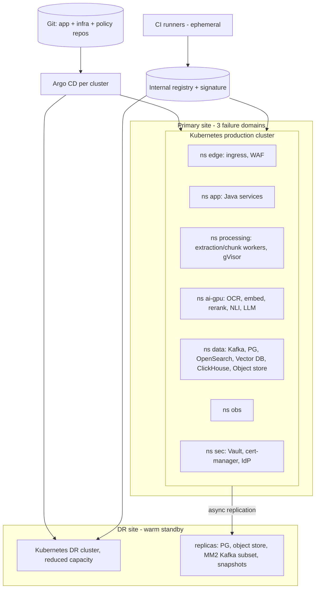

# Stage 2 — Document 10: Infrastructure and Deployment

| Field | Value |
|---|---|
| Document ID | DIP-INF-01 |
| Version | 0.1 |
| Builds on | `04` §8, §10–11; `08` §9.4; `09` §2.3, §8; `11` §3.3, §8; `12` §7–8 |
| Note | Independent reference architecture. Node counts are **derived from stated formulas and assumptions (A)** and are placeholders until benchmarks B1–B6 and the load tests in M3/M6/M13 replace them. Hosting model follows working default U-01 (infrastructure we control; no proprietary-SaaS dependency). |

---

## 1. Design goals and principles
1. **Same architecture at every scale** — Initial, Medium and Large differ in replica/shard/node counts, not in components (NFR-SCL-03).
2. **Everything as code:** infrastructure (Terraform), cluster config and apps (Helm + GitOps/Argo CD), policies (Kyverno/OPA), dashboards/alerts (Git).
3. **Immutable, signed, reproducible artifacts**; promote the *same* image digest through environments.
4. **Stateless by default**; stateful services run on dedicated node pools with operators and tested backup/restore.
5. **Isolation by zone** (`12` §2.2) enforced at namespace, network, node-pool and admission-policy level.
6. **Cost awareness**: GPU pools sized per workload with priority classes; backfill uses spare capacity; scale-to-zero where safe.
7. **Portable:** S3 API, Kubernetes, Kafka, PostgreSQL, OpenSearch — no cloud-proprietary primitives in application code.

---

## 2. Technology selection (with alternatives)

| Concern | Choice | Alternatives considered | Reason / trade-off |
|---|---|---|---|
| Container runtime/orchestration | **Kubernetes** (distribution depends on U-01: upstream/RKE2/OpenShift/managed) | Nomad, VM-only | Standard for GPU scheduling, operators for stateful services, ecosystem; cost: operational complexity (mitigated by GitOps) |
| Packaging | **Helm** charts + Kustomize overlays | raw manifests, Jsonnet | Templating + versioned releases; Argo CD renders both |
| GitOps/CD | **Argo CD** | Flux | UI, app-of-apps, sync waves, RBAC; Flux acceptable alternative |
| CI | **GitHub Actions** (or on-prem GitLab/Jenkins if the code host is internal — decided with U-01/C-04) | Jenkins, GitLab CI | Ecosystem; runners must run inside the boundary for prod builds (ephemeral, no direct internet) |
| IaC | **Terraform/OpenTofu** (+ Ansible for bare-metal provisioning if on-prem) | Pulumi, Crossplane | Mature providers; state in encrypted remote backend with locking |
| Registry | Internal OCI registry (Harbor-class) with replication, scanning, signature policy | Cloud registries | Air-gap capable, policy hooks |
| Ingress/edge | Ingress controller (NGINX/Envoy-based) + WAF + cert-manager | Cloud LB only | Portable; mTLS and rate limiting |
| Service mesh | Istio/Linkerd (ambient/sidecar) **or** SPIFFE/SPIRE + library mTLS | none | mTLS + L7 authz; adds overhead — choose in ADR with latency measurement |
| Autoscaling | HPA (CPU/RPS), **KEDA** (Kafka lag, queue depth), Cluster Autoscaler/Karpenter (cloud) or pre-provisioned pools (on-prem) | – | Lag-based scaling is required for workers |
| Stateful operators | Strimzi (Kafka), CloudNativePG or Patroni (PostgreSQL), OpenSearch Operator, Qdrant Helm/operator (or Milvus Operator), ClickHouse Operator, MinIO/Rook-Ceph (object) | Manual | Automates rollout, rebuilds, backups |
| Secrets/PKI | Vault + cert-manager (`12` §8.2) | cloud KMS only | HSM/KMS integration, dynamic secrets |
| Observability | Prometheus + Alertmanager, Grafana, Loki or OpenSearch (logs), Tempo/Jaeger (traces), OpenTelemetry Collector | ELK, vendor APM | Open, portable; see Monitoring doc |
| GPU stack | NVIDIA GPU Operator, device plugin, DCGM exporter, MIG where supported | – | Scheduling, metrics |
| Policy | Kyverno or OPA Gatekeeper | PodSecurity only | Signed-image, labels, limits enforcement |
| Backup | pgBackRest/WAL-G, Velero (cluster objects, PV snapshots where CSI supports), operator-native snapshots | – | See DR plan |

---

## 3. Environments

| Aspect | Dev | Test (CI/integration) | Staging (pre-prod) | Production |
|---|---|---|---|---|
| Purpose | Developer iteration | Automated integration/contract/e2e, ephemeral | Production-like validation, performance, DR drills, security tests | Real use |
| Cluster | Shared small cluster or local (kind/k3d) + shared dev data services | **Ephemeral namespaces per PR/pipeline** on a shared test cluster | Dedicated cluster, same topology as prod at ~10–25% scale (HA enabled) | Dedicated cluster(s), multi-zone; DR site |
| Data | Synthetic only | Synthetic + fixtures | **Sanitized/public corpus**; never production data; seeded golden evaluation set copy (if classification allows) | Real |
| Stateful services | Single-instance containers (Kafka 1 broker, PG 1, OpenSearch 1, Qdrant 1, MinIO 1) | Testcontainers or small per-run instances | Full HA topology (3 brokers, PG 3, OS 3+, vector replicas, ClickHouse 2) | Full HA + sizing per tier |
| GPUs | CPU/mocks or 1 shared GPU | Mock models / tiny models in CI | 2–4 GPUs for functional + benchmark representativeness | Per sizing |
| Models | Small distilled/dev models | Tiny models + recorded fixtures | Same models as prod candidates (for eval) | Registry ACTIVE |
| Deployment | Auto from main (or on demand) | On every PR | Auto after tests pass + manual gate for DR/perf windows | Manual approval (two-person), canary/blue-green |
| Security posture | Baseline policies | Policies enforced (same admission rules) | Identical to prod (policies, mTLS, network policies) | Strictest |
| Access | Developers | CI only | Limited (QA/SRE/security) | JIT privileged, audited |
| Observability | Basic | Test-run artifacts | Full stack | Full stack + SIEM |
| Cost control | Auto-scale-to-zero nights | Ephemeral, TTL 4 h | Scheduled scale-down off-hours | – |
Rules: no shared credentials/secrets across environments; separate Vault namespaces/KMS keys; separate Kafka clusters; network paths between environments blocked; config differences only via overlays (values files), not code branches; production data never copied down.

---

## 4. Reference deployment architecture



### 4.1 Node pools (production)
| Pool | Purpose | Instance profile | Taints/labels | Notes |
|---|---|---|---|---|
| `cpu-general` | Java services, gateway, Redis, small workers | 8–16 vCPU, 32–64 GB | none | HPA; spread across failure domains |
| `cpu-processing` | extraction, chunking, classification workers | 16–32 vCPU, 64 GB, fast local scratch | `workload=processing`, runtime class gVisor/Kata | Sandbox overhead (≈10–30% CPU, assumption) included in sizing |
| `gpu-ocr` | OCR | GPU (e.g., 24–48 GB class) | `gpu=ocr` | scale on `ingest.task.ocr.*` lag |
| `gpu-embed` | Embedding workers + query embedding | GPU 24–48 GB | `gpu=embed` | backfill + online replicas |
| `gpu-rerank` | Reranker, NLI | GPU 24 GB; MIG/time-slicing | `gpu=rerank` | latency-sensitive |
| `gpu-llm` | LLM servers | GPU(s) per model size (24–80 GB; multi-GPU for large) | `gpu=llm` | tensor parallelism; NVLink if multi-GPU |
| `stateful-kafka` | Kafka brokers | NVMe/SSD, 16 vCPU, 64 GB | `stateful=kafka` | local PV, anti-affinity per rack |
| `stateful-pg` | PostgreSQL | NVMe, 16–32 vCPU, 128–256 GB | `stateful=pg` | synchronous replica in another domain |
| `stateful-search` | OpenSearch data/master | NVMe, 16–32 vCPU, 128–256 GB (heap ≤ 31 GB, rest page cache) | `stateful=search` | shard sizing 30–50 GB |
| `stateful-vector` | Vector DB | high-RAM (256–512 GB), NVMe | `stateful=vector` | RAM-resident quantized index (`11` §3.3) |
| `stateful-analytics` | ClickHouse (+Keeper) | NVMe, 32 vCPU, 256 GB | `stateful=ch` | – |
| `storage` | Object store (MinIO/Ceph) | dense HDD/NVMe tiers, erasure coding | `stateful=object` | capacity-driven |
Scheduling: PriorityClasses `interactive-critical` > `interactive` > `batch-p1` > `batch-p2`; PodDisruptionBudgets; topology spread across ≥ 3 failure domains; separate GPU pools so backfill cannot starve interactive inference.

### 4.2 Storage classes
| Class | Backing | Used by |
|---|---|---|
| `fast-local-nvme` | Local PV (no network hop) with replication at app level | Kafka, OpenSearch, Vector DB, ClickHouse |
| `replicated-ssd` | Replicated block (Ceph RBD/Longhorn/cloud EBS-like) | PostgreSQL (Patroni sync replica), Vault raft, Keycloak DB |
| `object` | S3-compatible object store, erasure coded, versioned | Documents, artifacts, Parquet, snapshots, backups, Iceberg |
| `scratch` | `emptyDir` on NVMe/tmpfs | Worker temp files (size-limited) |

### 4.3 Network
Pod network via CNI with NetworkPolicy support (Cilium/Calico); dedicated high-bandwidth fabric for the data tier (≥ 25 GbE; 100 GbE for GPU/object-store paths at Large); MTU consistent; ingress separated into **public/user** and **admin** controllers; east-west traffic mTLS; DNS policies; egress via explicit gateways for the few allowed external endpoints. Bandwidth sanity checks: upload ingest at backfill 55k docs/day × 20 MB ≈ 1.1 TB/day ≈ 13 MB/s average (peaks 10× ≈ 130 MB/s) — low; the dominant flows are worker ↔ object store (read original once, write artifacts ≈ 1–2× original size) and embedding (small) and vector-DB replication; query path network is small.

---

## 5. Sizing the three deployment scenarios

Method: workload → resource formula → count, using assumptions from `01` §3 and the (A)-flagged throughput numbers; every row is "replace after benchmark". Numbers rounded; headroom 30–40%.

### 5.1 Compute formulas
```
Extraction workers   = (docs/day × pages/doc × digital_share × t_page_cpu_s) / (86400 × util × cores_per_worker)
OCR GPUs             = (scanned_pages/day × t_page_gpu_s) / (86400 × util)
Embedding GPUs       = (chunks/day × tokens/chunk) / (tokens_per_s_per_GPU × 86400 × util)
Reranker GPUs        = (search_qps × cand × tokens/cand) / (tokens_per_s_per_GPU × util)            # B3
LLM GPUs (prefill)   = (ai_qps × prompt_tokens) / (prefill_tps_per_GPU × util)
LLM GPUs (decode)    = (ai_qps × output_tokens) / (decode_tps_per_GPU × util)
Vector nodes         = ceil( resident_bytes / (node_RAM × 0.6) ) × replicas                          # 11 §3.3
OpenSearch data nodes= max( ceil( index_bytes × (1+replicas) / (node_disk × 0.7) ),            # disk-driven (small)
                            ceil( index_bytes × (1+replicas) / indexed_TB_per_node ) )          # latency-driven: page-cache ratio, (A) ≈ 0.5–1 TB indexed per 128–256 GB node
                         and  shards ≤ ~20 per GB heap rule
Kafka brokers        = max(3, replicas by partition-replica budget, disk) — throughput is not binding (08 §3.1)
```

### 5.2 Scenario summary (indicative; **(A)** = assumption-based)
Assumptions beyond `01`: 6-month backfill for Medium and Large; Initial 10k docs ingested within 24 h (a one-time burst, using burstable capacity); steady-state ingestion afterwards is a fraction of backfill; scanned share 30%; t_page_cpu 0.4 s/page **(A)**; t_page_gpu OCR 0.5 s/page/GPU **(A)**; embedding 20k tok/s/GPU **(A)**; planning peaks per U-08 (Initial 5 search QPS/1 AI QPS; Medium 100/20 — Large 400/80? The HLD gave 100 and 400 total q/s; here AI QPS = 20% of that).

| Component | Initial (10k docs, 5 M pages) | Medium (1 M docs, 500 M pages) | Large (10 M docs, 5 B pages) |
|---|---|---|---|
| Ingestion burst/rate | 10k docs/24 h ≈ 58 pages/s | 1M/180 d ≈ 5,600 docs/d ≈ 32 pages/s average, peaks 3–5× | 55k docs/d ≈ 320 pages/s average, peaks 3–5× |
| Extraction CPU cores (digital 70%) | 58×0.7×0.4 ≈ 16 cores → 2 workers × 8 | 32×0.7×0.4 ≈ 9 cores avg; provision 4× peak ≈ 40 cores | 320×0.7×0.4 ≈ 90 cores avg; peaks → ≈ 400 cores (autoscaled), + sandbox overhead |
| OCR GPUs (30% scanned) | 58×0.3×0.5 ≈ 9 GPU-s/s → **≈ 9–12 GPUs for 24 h burst**, or stretch to 5 days with ≈ 2 GPUs | 32×0.3×0.5 ≈ 5 GPUs avg → **≈ 8–10** with peak headroom | 320×0.3×0.5 ≈ 48 GPUs avg → **≈ 60–70** (backfill), drop to ≈ 10–15 steady state |
| Embedding GPUs | 5.5M×512 = 2.8 B tokens ≈ 39 GPU-h → **1–2 GPUs** (≈ 20–40 h) | 2.8e11 tokens → 3,900 GPU-h over 180 d ≈ **1–2 avg GPUs; 4–8 to keep lag low** | 2.8e12 tokens → 39,000 GPU-h over 180 d ≈ 9 avg GPUs → **16–24 GPUs** with headroom; more for re-embedding windows |
| Reranker GPUs (before adaptive skip) | 5 q/s × 8.6k tok ≈ 43k tok/s → **1 GPU** | 100 q/s → 860k tok/s → **9–14 GPUs** (B3) | 400 q/s → 3.4 M tok/s → **35–55 GPUs** *before* mitigations; adaptive skip/cache/distillation are mandatory at this scale |
| LLM GPUs (8–14B-class, A) | 1 q/s × 6k = 6k prefill tok/s → **1 GPU** (HA: 2) | 20 q/s → 120k prefill tok/s → **12–15 GPUs at 100% utilization; ≈ 22 at the 65% ceiling, ≈ 12 with mitigations** (see `16` §4.3, which supersedes this row) | 80 q/s → 480k tok/s → **50–60 GPUs at 100%; ≈ 87 at 65%, ≈ 47 with mitigations** (`16` §4.3); context compression/prefix caching essential; 70B-class models multiply this |
| Vector DB (1024-d, int8 + graph) | 5.5M×(1 KB+0.15 KB) ≈ 6.3 GB → **single node 64 GB**; float32 (22 GB) also fits | ≈ 635 GB resident → **≈ 5 shards × 2 replicas = 10 nodes** (256 GB), or 3–4 nodes + disk rescoring | ≈ 6.4 TB resident for all → **tiered**: hot tier ≈ 20% ≈ 1.3 TB → 9 shards × 2 ≈ 18 nodes + archive on disk/binary (≈ 6–12 nodes) — **decision via B5** |
| OpenSearch data | 5.5M × ~2 KB ≈ 11 GB → 3 nodes (HA) | ≈ 1.1 TB (+replica = 2.2 TB) → disk needs only ~2 nodes, but the page-cache ratio (A: 0.5–1 TB per node) gives **≈ 3–6 data nodes** | ≈ 11 TB (+replica 22 TB) → **≈ 22–44 data nodes** (ratio-driven; disk alone ≈ 16) + 3 masters; index groups by tier |
| PostgreSQL | 1 primary + 1 sync replica, 8 vCPU/32 GB | 1 + 2 replicas, 16–32 vCPU/128–256 GB; partitioned tables; chunk metadata ≈ 0.5 TB | Same plus chunk metadata moved to lakehouse; audit/jobs on separate clusters |
| Kafka | 3 brokers (small) | 5 brokers | 5–9 brokers, tiered storage |
| Object storage (raw: 10k×20MB×2.5=0.5 TB; ×1.5 artifacts) | ≈ 1.5 TB usable | ≈ 150 TB usable | ≈ 1.5 PB raw-equivalent (erasure-coded ≈ 1.4× overhead → ≈ 2 PB raw disk) *(A: 20 MB/doc, 2.5 versions; sampled values matter)* |
| ClickHouse | none (PG for analytics) | 2 shards × 2 replicas (small) | 4–8 shards × 2 replicas + Spark on K8s |
| App services (Java) | 2 replicas each, ≈ 12 pods, 24 vCPU | ≈ 40–60 pods ≈ 150 vCPU | ≈ 100–150 pods ≈ 400 vCPU |
| Observability | single Prometheus/Loki | HA pair, retention 15–30 d | sharded/Thanos-Mimir-class, long-term object storage |
| Environments | dev+test+staging+prod (staging ≈ 25%) | same | same + DR site (≈ 30–50% prod GPU/compute, 100% data replicas) |

Reading the table honestly: **Initial** fits a handful of nodes. **Medium** is a serious but conventional cluster (GPU count dominated by reranker and LLM at the planning peaks). **Large** is a multi-hundred-node system whose GPU bill is dominated by the *online* AI path (reranker and LLM prefill) rather than ingestion, which is why the mitigations in `09`/`11` (adaptive rerank, caching, compression, tiering) are architectural requirements, not optimizations, and why the Large scenario should not be committed to until benchmarks B1–B6 and real query volumes (U-08) exist. Planning figures for U-08 are hypothetical.

### 5.3 Cost drivers (operational)
Ranked (Large): (1) GPU capacity (reranker + LLM + OCR backfill), (2) vector-DB RAM, (3) OpenSearch/NVMe, (4) object storage, (5) staffing for SRE/ML-Ops. Levers: tiering, quantization, adaptive reranking, scheduled backfill on idle GPUs, scale-down of staging, committed/reserved capacity where cloud, spot/preemptible only for batch pools that tolerate interruption (idempotent tasks make this safe).

---

## 6. CI/CD pipeline

### 6.1 Pipeline stages

```mermaid
flowchart LR
    PR[Pull request] --> L[Lint + format + SAST + secret scan]
    L --> U[Unit tests + coverage gate 80%]
    U --> B[Build images - distroless, pinned digests]
    B --> SC[SCA + image scan + SBOM + sign cosign]
    SC --> I[Integration + contract tests - Testcontainers Kafka/PG/OpenSearch/Qdrant]
    I --> E[Ephemeral env deploy + API tests + authz matrix + OpenAPI diff]
    E --> M[Merge to main]
    M --> D[Deploy dev auto]
    D --> T[E2E + eval smoke suite]
    T --> S[Promote to staging by digest via GitOps PR]
    S --> P[Perf, security DAST, chaos subset, full eval gates]
    P --> A{Approval - two-person for prod}
    A --> C[Canary 5% to 25% to 100%]
    C --> R[Prod]
```

Gates (merge/promotion blockers): unit coverage ≥ 80% (core), zero critical/high vulns with available fix, SBOM present, signature valid, OpenAPI breaking-change check (`oasdiff`), Avro schema compatibility check, Flyway migration lint + replay on a sample dump, authz matrix 100%, contract tests pass, evaluation gates (`09` §7) when model/retrieval/chunking/prompt files change (path-based triggers), license policy.

### 6.2 Artifacts and promotion
- One build per commit; image tag = digest; Helm chart version + `values-<env>.yaml` in a config repo; **promotion = Git PR changing the digest in the next environment's overlay**; Argo CD syncs; rollbacks = revert PR.
- Repositories: `app-*` (services), `platform-config` (Helm values/overlays, GitOps), `infra` (Terraform), `policies` (Kyverno/OPA, network policies, OPA/Rego tests), `eval` (datasets metadata, harness), `docs`.
- Database migrations: Flyway runs as a Kubernetes Job (pre-sync hook) with `lock_timeout`; expand-migrate-contract ensures N and N+1 images both run (`06` §8).
- Model/prompt promotion is **separate** from code deployment (registry-driven, `09` §2.2); deploying code never changes the ACTIVE model.

### 6.3 Deployment strategies
| Component type | Strategy | Details |
|---|---|---|
| Stateless Java services | **Rolling** by default; **canary** (Argo Rollouts/Flagger) for search-service, ai-orchestration, analytics-service | 5% → 25% → 100% with automated analysis (error rate, latency p95, 5xx, business metrics like zero-result rate); auto-rollback on SLO breach |
| API gateway / ingress | **Blue-green** (two controllers, traffic switch) | Instant rollback; TLS and rate-limit config validated on green first |
| Workers | Rolling with `maxUnavailable` small; **drain**: stop polling, finish in-flight tasks (terminationGracePeriod ≥ task timeout or tasks idempotently re-run via lease expiry) | No lost work thanks to idempotency |
| Model servers | **Blue-green by model version** (new Deployment, warm-up, shift traffic by alias); LLM canary by user-hash | Weights mounted by checksum |
| Stateful data services | Operator-managed rolling upgrades with strict PDBs, one replica/broker at a time, health gates (ISR, shard allocation, replication lag); **never** upgrade major versions during backfill peaks | Pre-upgrade snapshot + tested restore |
| Database schema | Expand → migrate → contract (`06` §8) | Backward compatible |
| Kafka schemas | Compatible evolution (`08` §4.2) | – |
| Feature flags | OpenFeature; new retrieval/RAG behaviors default off | Controlled rollout |
Rollback matrix: services → revert digest (minutes); model → alias flip (seconds–minutes); config → revert Git; schema → forward-fix (no down-migrations), backout plan per release; index change → alias switch back to previous collection/index (retained for rollback window).

### 6.4 Release management
Semantic versioning per service; release train for platform; change calendar with freeze during backfill milestones/DR drills; change record per production promotion (who approved, digest, tests, rollback plan) in the audit trail; hotfix path (fast-track with the same gates minus long perf suite, plus mandatory post-release review).

---

## 7. Container and platform security (links `12` §7–8)
Base images: distroless/minimal, non-root UID, read-only root FS, no shell in production images (debug via ephemeral containers with approval); JVM: container-aware flags, `-XX:MaxRAMPercentage=70`, G1/ZGC chosen per service latency; Python: slim base, pinned wheels with hashes, `--require-hashes`, no build tools in runtime image; image scanning at build, at registry (continuous re-scan), and at admission; signature verification (cosign policy); runtime detection (Falco-class) for shell spawn, unexpected network, file writes; node patching cadence (monthly, critical out-of-band) with rolling drains; Kubernetes version policy (N-1 supported, upgrade quarterly, tested in staging); etcd backup (DR doc); API server audit; RBAC reviewed quarterly.

---

## 8. Configuration management (links `05` §11)
| Layer | Mechanism |
|---|---|
| Per-environment immutable | Helm values per env in `platform-config` repo (PR-reviewed) |
| Secrets | Vault injection (never Git) |
| Runtime tunables | `config_params` + `config.changed` compacted topic; changes audited and versioned; bounded ranges validated server-side |
| Models/prompts | Registry (`09`) |
| Feature flags | OpenFeature provider |
| Drift detection | Argo CD self-heal + alert on out-of-sync; Terraform plan in CI nightly to detect infra drift |
| Policy config | Policies as code (`policies` repo) with tests |

---

## 9. Observability and operations hooks (details in Monitoring doc)
Every service exposes `/actuator/health/liveness|readiness`, Prometheus metrics, OpenTelemetry traces/logs; SLO dashboards (search latency, RAG latency, ingestion age, queue lag, error budgets); alert routing (PagerDuty-like on-call, ticketing); GPU DCGM metrics; synthetic probes (upload→INDEXED canary document every 15 min, search canary, RAG canary with a known answer) — a failing canary pages before users notice; capacity dashboards (forecast to saturation); cost dashboards (GPU-hours per stage).

### 9.1 Health checks and probes
| Probe | Semantics |
|---|---|
| Liveness | Process healthy (not deadlocked); **never** checks downstream dependencies (avoids restart storms) |
| Readiness | Can serve: dependencies required for *this instance's* function reachable (DB pool, Kafka for consumers); model servers ready only after warm-up inference |
| Startup | Long start (model load) tolerated via `startupProbe` (up to 10 min) |
| Deep health (separate endpoint, not used by orchestrator) | Dependency matrix for operators and canaries |

---

## 10. Capacity, scaling and resilience policies
| Policy | Value (starting) |
|---|---|
| Min replicas | 2 for all online services (3 for gateway, PDP/identity), spread across failure domains |
| HPA | CPU 60%, RPS-based for gateway/search; memory guard for JVM |
| KEDA scalers | Kafka lag per consumer group (e.g., target lag 500 messages/replica or oldest age 30 s), GPU utilization for model servers; cooldowns to avoid flapping (scale-down 10 min) |
| Pod resources | Requests = typical use, limits ≈ 1.5–2× for CPU (JVM) and = requests for memory (avoid OOM overcommit); GPU: whole GPU or MIG slice |
| PDB | `maxUnavailable: 1` (stateless ≥ 3 replicas: 25%); stateful per operator |
| Failure domains | Spread constraints on zone/rack; anti-affinity for replicas of the same shard |
| Graceful shutdown | `preStop` + drain; Kafka consumer `close()` with static membership; terminationGracePeriod aligned to max task time or lease-based re-run |
| Quotas | Namespace ResourceQuotas; GPU quotas per workload; LimitRanges |
| Overload protection | Gateway rate limits, search-service bulkheads, adaptive retrieval load-shedding (`11` §6), LLM queue max depth → fast 429/degrade |
| Maintenance | Rolling node upgrades with drain; GPU driver upgrades pool-by-pool |

---

## 11. Infrastructure acceptance criteria and tests
| ID | Criterion | Test |
|---|---|---|
| I-AC1 | Full environment recreated from code | Terraform + Argo bootstrap to a clean cluster in ≤ 4 h (staging), measured quarterly |
| I-AC2 | Zero-downtime deploy of stateless services | Continuous load during rollout: 0 failed requests beyond SLO error budget |
| I-AC3 | Rollback ≤ 10 min for service/model/config | Rollback drill |
| I-AC4 | Autoscaling reacts to lag | Inject backlog → workers scale to target within 5 min; lag returns to baseline |
| I-AC5 | Node/zone loss tolerance | Kill a node pool member / a failure domain: availability SLO maintained for online path |
| I-AC6 | Policy enforcement | Deploy unsigned image / privileged pod / `latest` tag → rejected by admission |
| I-AC7 | Network isolation | Test matrix of allowed/denied flows 100% as designed |
| I-AC8 | Backup/restore jobs healthy | Success rate 100% weekly, restore test per DR plan |
| I-AC9 | Security patch SLA | Critical CVE patched in prod ≤ 7 days (proposal) |
| I-AC10 | Cost observability | GPU-hour and storage cost dashboards available by milestone M12 |

## 12. Risks and open items
| Item | Plan |
|---|---|
| U-01 hosting (on-prem vs sovereign cloud) | Determines GPU procurement lead time (potentially months), storage platform and managed services; decide before M12; start procurement early for Medium/Large |
| Service mesh choice and overhead | ADR with latency/CPU measurement in staging |
| Sandboxing runtime availability (gVisor/Kata with GPU not needed for CPU workers) | Validate on target kernel/hardware in M4 |
| OCR on GPU in sandbox | GPU workers are in the no-egress zone but not gVisor-sandboxed (GPU passthrough limitation) — compensate with minimal images, seccomp, no network, per-task ephemeral pods optional; documented risk |
| Large-scale object store platform (Ceph vs MinIO vs vendor) | Benchmark small-object and large-object workloads (millions of artifacts per day) |
| Operator maturity at scale (vector DB, OpenSearch) | Runbooks + fallback manual procedures; chaos testing in staging |
| Staffing | Platform/SRE team sizing and on-call model need explicit decision (operational cost) |

## 13. Next
Disaster Recovery Plan (doc 14).
