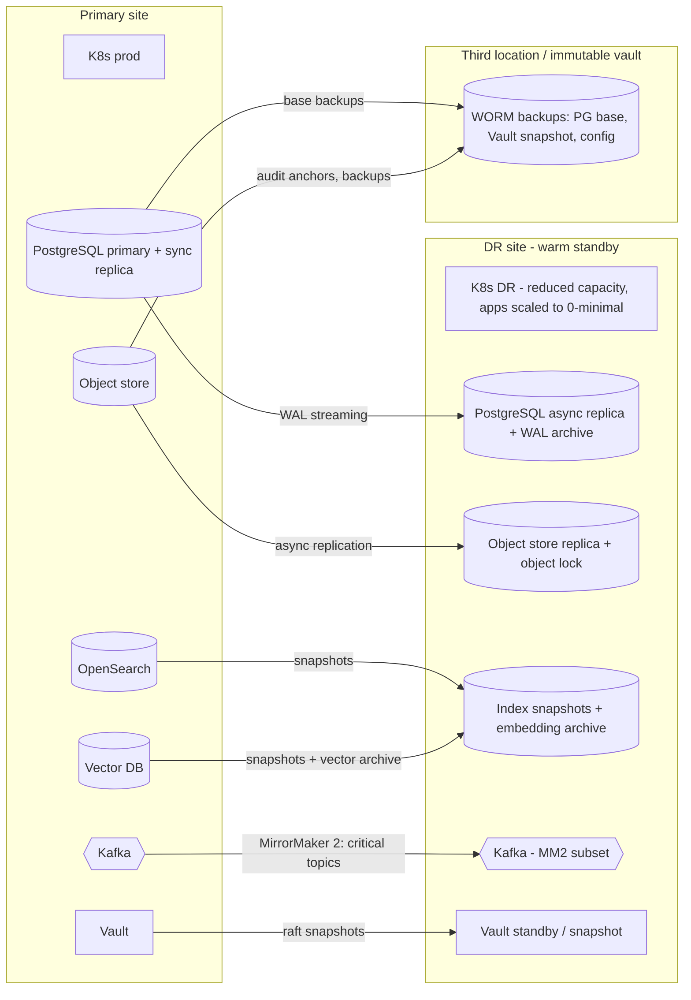
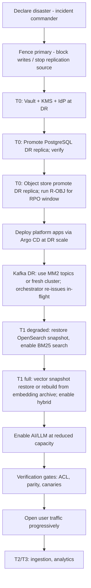

# Stage 2 — Document 11: Disaster Recovery Plan (with Reliability and Failure Management)

| Field | Value |
|---|---|
| Document ID | DIP-DR-01 |
| Version | 0.1 |
| Builds on | `02` NFR-AVL/REL, `04` §6, §8, `06` §7, `08` §8–10, `11` §9, `12` §6, §13, `13` §4 |
| Note | Independent reference architecture. RPO/RTO values are **proposals** to be ratified; rebuild-time figures are calculated from labeled assumptions **(A)** and become *measured* values in the first DR drill (a drill result always overrides an estimate in this document). |

---

## 1. Purpose, scope and principles
Scope: loss or degradation of a component, a failure domain, the primary site, data corruption, or a malicious/destructive event (ransomware, insider). Out of scope: business continuity beyond the platform (staffing, facilities) which the organization owns.

Principles:
1. **Source of truth is small; everything else is derived.** Authoritative: object store (originals/artifacts), PostgreSQL (state, ACL, audit), Vault/KMS (keys), Git (config/code). Derived (rebuildable): OpenSearch, vector DB, ClickHouse tables, caches, Kafka contents.
2. **Recovery order follows dependency:** identity/keys → authoritative data → serving indexes (degraded first) → ingestion → analytics.
3. **Degrade before fail:** BM25-only search is restored before vector search; retrieval-only answers before LLM answers (`07`, `10` §7).
4. **Restore and rebuild are different tools:** restore from snapshot is fast but may carry stale/inconsistent state; rebuild from artifacts is slow but deterministic. We plan for both and measure both.
5. **Nothing is "backed up" until it has been restored in a drill.**
6. **Permissions fail safe:** after any recovery, access control is re-verified before user traffic is admitted (§8.6).

---

## 2. Recovery objectives (proposed)

Definitions: RPO = maximum acceptable data loss window; RTO = maximum time to restore service; measured at the *service level seen by users*, not the component level.

| Tier | Capability | Components | RPO | RTO | Notes |
|---|---|---|---|---|---|
| **T0** | Identity, keys, authoritative data | IdP, Vault/KMS, PostgreSQL (all schemas), object store, Git/registry | PG ≤ 5 min; Vault ≤ 1 h (config changes are rare, and rebuilt from IaC where possible); **object store ≤ 15 min** (see §4.3) | **≤ 1 h** for PG failover and IdP; object store read access ≤ 1 h | Refines NFR-REL-02: the SRS stated 5 min for both PG and object store; asynchronous cross-site object replication cannot guarantee 5 min under backfill load (§4.3), so 15 min is proposed for ratification, with a mitigation for recently uploaded documents |
| **T1** | Search and Q&A serving (online) | OpenSearch, vector DB, search-service, reranker, ai-orchestration, LLM | indexes: derived (RPO = last snapshot + replay of events; irrelevant to correctness thanks to reconciliation) | **≤ 4 h** to *degraded* (BM25 search + metadata) ; **≤ 8 h** to full hybrid + RAG (Medium); Large tier targets are stated after the drill (§8.3 estimates are days if a rebuild is needed) | Differs from the 1 h figure for T0 because indexes must be restored or rebuilt; the 4 h degraded-mode objective is achievable via snapshot restore (§8.3) |
| **T2** | Ingestion pipeline | Kafka, orchestrator, workers, GPU pools | In-flight tasks may repeat (idempotent); no loss of acknowledged uploads | ≤ 8 h (uploads accepted again sooner: ≤ 1 h via outbox + document-service) | Backlog drains after recovery |
| **T3** | Analytics | ClickHouse, Spark, lakehouse | ≤ 24 h (rebuildable from PG/Kafka archive/Iceberg) | ≤ 24 h | Lowest business impact |
| **T4** | Observability, CI/CD | Prometheus, logs, traces, Argo CD, runners | metrics: tolerate gaps; logs: ≤ 1 h for security logs (SIEM) | ≤ 24 h (security log forwarding ≤ 4 h) | Needed to operate recovery; a minimal DR-site observability stack is part of T0/T1 recovery |
Audit trail (in PG and anchors in WORM store) is T0: RPO ≤ 5 min, and local spools (`08` §9.1) cover Kafka loss.

Failure classes and targets: single node/pod (no user impact), single failure domain/zone (no outage for online path, degraded capacity), whole-site loss (RTO per tier above), data corruption/logical error (PITR to a point before the event; §6, S13), malicious destruction (§10).

---

## 3. DR topology

- **Pattern:** warm standby (active/passive). Data tier continuously replicated; compute scaled down (≈ 30–50% GPU/CPU, 100% data replicas); GPU capacity at DR may be smaller → **degraded AI capacity is accepted** and defined (e.g., LLM concurrency capped, reranker adaptive skipping forced).
- Active/active rejected for v1: cost, consistency complexity across PG/indexes, and split-brain risk outweigh the RTO benefit for this use case; revisit if RTO < 1 h for T1 becomes a requirement.
- The DR site is part of the same security boundary with identical policies-as-code; DR drills prove this.
- Network: dedicated link/VPN with encryption; bandwidth sized for sustained replication (estimate: object replication ≈ ingestion volume ≈ 13 MB/s avg, 130 MB/s peak; PG WAL ≈ tens of MB/s at backfill; snapshot shipping bursts — sized in the capacity doc).
- Third location/immutable vault: backups that survive loss of both sites and malicious deletion (object lock/WORM, separate credentials, separate admin domain).

---

## 4. Backup and replication strategy by component

### 4.1 Summary
| Component | Method | Frequency / lag | Retention | Restore target | Verified by |
|---|---|---|---|---|---|
| PostgreSQL | Streaming replication (sync replica same site, async replica DR) + continuous WAL archiving to object store + base backup (pgBackRest/WAL-G, incremental/differential) | WAL continuous (RPO ≤ 5 min); full weekly, diff daily | 35 d (PITR window); this is the **only** retention for PostgreSQL backups because they contain wrapped DEKs (§9 rule 3). Longer-term needs (e.g., audit) are met by logical exports/archives to Iceberg/WORM that **exclude** the `dek_wrapped` column, never by older base backups | Replica promotion (minutes) or PITR | Weekly automated restore + checksum + app smoke test |
| Object store (documents, artifacts) | Versioned buckets; cross-site async replication; object lock (compliance mode) on a **backup replica** bucket; erasure coding locally | Replication lag monitored (alert > 10 min); continuous | Per document lifecycle; versioning keeps overwritten/deleted objects for 30 d (undelete window) except crypto-erased objects | Failover to replica; restore from versions | Replication lag SLO; weekly random-sample checksum verification (1% objects) between sites |
| Vault | Raft snapshots (hourly) to object store, encrypted; unseal via KMS auto-unseal + offline Shamir shares custody | hourly | 35 d | Restore snapshot to standby | Quarterly drill |
| KMS/HSM | Vendor/HSM-native backup of key material (split knowledge); key hierarchy documented | on change | per key policy | HSM restore procedure | Annual drill |
| Keycloak/IdP | DB in PG (covered) + realm export in Git (config) | per change | – | Redeploy from Git + DB restore | Quarterly |
| OpenSearch | Snapshot repository on object store (incremental, segment-level), snapshot after bulk loads and daily; cross-site replication of snapshot bucket | daily + post-bulk | 7 daily + 4 weekly | Restore into DR cluster (§8.3) | Weekly restore of a sampled index to staging + count/query validation |
| Vector DB | Native snapshots to object store (per shard/collection) daily + **embedding archive** (see 4.2) | daily | 7 daily + 4 weekly | Restore snapshots or rebuild graph from archive | Weekly restore of a collection shard; recall check on 200 queries |
| Kafka | **Not backed up** (log is transient and rebuildable); MirrorMaker 2 for critical topics (`document.version.*`, `iam.*`, `audit.event`, `model.registry.changed`, `config.changed`) | continuous (lag alert) | – | Failover consumers to DR cluster; offsets via MM2 offset sync | Quarterly failover test |
| ClickHouse / Iceberg | Iceberg tables on object store (inherently replicated with object store); ClickHouse `BACKUP` to object store daily; marts rebuildable from Iceberg | daily | 14 d | Restore or rebuild | Monthly rebuild test (T3) |
| Redis | Not backed up (cache); session revocation list persisted in PG too | – | – | Warm up | – |
| Kubernetes state | GitOps (declarative; no backups needed for app definitions); etcd snapshots + Velero for PV/CRDs/secrets-references | etcd every 1 h; Velero daily | 14 d | Rebuild cluster from IaC + Argo | Quarterly full bootstrap |
| Config/code/policies | Git (primary + mirror at DR/third location); registry replicated | continuous | permanent | Re-clone / re-pull | Quarterly |
| Model artifacts | Internal artifact store (object) replicated to DR; checksums | on change | all ACTIVE + N-1 | Pull | Part of deploy test in DR |
| Audit anchors | WORM object store at third location | daily | per audit retention | Verify chain after restore | Monthly verification |

### 4.2 The embedding archive (decision)
Rebuilding the vector index by **re-embedding** is a GPU problem (Medium ≈ 3,900 GPU-hours; Large ≈ 39,000 GPU-hours **(A)**, i.e., ≈ 60 h on 64 GPUs for Medium and ≈ 25 days on 64 GPUs for Large). Rebuilding the **graph from stored vectors** is a CPU problem. Therefore: **persist embeddings** (chunk_id, model version, vector in int8/fp16) as Parquet in the object store alongside chunk text, written by the embedding service at embed time. Cost: ≈ 0.55 TB (Medium, int8, 1024-d) / ≈ 5.5 TB (Large) — cheap versus GPU weeks. Benefits: DR rebuild without GPUs, fast re-index into a new engine (ADR-006 migration), and cross-version reuse. Trade-off: vectors are as sensitive as text (T15) → same encryption, ACLs, and deletion saga; included in `06` §9 placement table as an object-store artifact.

### 4.3 Object-store replication and the RPO caveat
Asynchronous replication means a recent upload may exist only at the primary at the moment of site loss. Handling:
- `document_versions` gets a replication marker: the version is flagged `replicated=true` when the replication lag check confirms the object is at DR (event from the storage platform or a verifier job comparing checksums). The upload API response and UI show "safely stored" only after that flag (typically < 15 min).
- On failover, versions with `replicated=false` created inside the RPO window are listed in a **loss report**; since the source systems (U-07) or the uploaders still hold the originals, the documents are re-ingested (`DOC-RECOVER` runbook). This is why we claim RPO ≤ 15 min *for acknowledged-and-replicated uploads* and a bounded, reported exposure for the window; synchronous multi-site writes are the alternative if the organization requires zero loss (cost: write latency, capacity — raised as open item O-1).
- Replication lag during backfill: throttle p2 ingestion if lag > threshold (the backfill governor already exists, `08` §6.1).

---

## 5. Consistency requirements across stores (source document, metadata, keyword index, vector DB)

| ID | Requirement | Mechanism |
|---|---|---|
| CR-1 | **Authority order:** object store (bytes) and PostgreSQL (state/ACL) are authoritative; OpenSearch/vector DB are derived and must never be the only copy of anything | Architecture rule; archive of vectors/text in object store |
| CR-2 | Uploaded and acknowledged version: PG row and object exist, hash verified | PG row inserted only after hash verification; outbox for event |
| CR-3 | **A version is searchable only if all of its chunks are present in both OpenSearch and the vector DB** | `searchable` flag flipped after both confirm (ADR-014); count/ID checks |
| CR-4 | Index lag bound: P95 ≤ 5 min from `INDEXED` decision to visible; no user sees partially indexed versions | Atomic flag; monitored lag SLO |
| CR-5 | **Deletes and permission revocations are never weaker in an index than in PG**: revocation immediate through PG post-check; deletion removes index entries before the object (saga ordering) | PG post-check; deletion saga order (`06` §7) |
| CR-6 | Orphan control: index entries for versions unknown to PG, or in DELETED state, are removed within 24 h; PG versions marked INDEXED but missing index entries are repaired within 24 h (re-index from artifacts) | Reconciliation jobs (below) |
| CR-7 | Monotonic pipeline versions: stale tasks (older `pipeline_version`) cannot overwrite newer output | Idempotency keys + stale-event guard |
| CR-8 | After any restore/failover: PG is authoritative; indexes are reconciled to PG before `searchable` traffic is enabled for affected versions | §8.6 |

Reconciliation job catalogue (extends `06` §7):
| Job | Compare | Fix | Frequency |
|---|---|---|---|
| R-INDEX | PG chunk manifest vs OpenSearch ID set vs vector ID set, per version | re-run INDEX/EMBED from artifacts; delete orphans | continuous sample (hourly), full nightly |
| R-OBJ | PG `storage_uri`/`sha256` vs object existence/checksum (sampled; full after failover for the RPO window) | mark `NEEDS_REUPLOAD`, alert | weekly sample 1%; post-failover full window |
| R-ACL | PG ACL vs index `acl_tags` | retag | daily |
| R-STATE | Versions stuck non-terminal | sweeper/orchestrator re-issue | 5 min |
| R-DEL | Deletion ledger vs all stores | re-delete | daily + after restore |
| R-KAFKA | Outbox unpublished, DLQ age | republish/alert | continuous |
Drift metrics are SLIs; sustained drift > 0.01%/day opens an incident (S-AC7).

---

## 6. Failure scenarios and recovery (reliability catalogue)

For each: detection → automatic response → manual recovery → data impact → user impact → test.

| # | Failure | Detection | Automatic behavior | Manual recovery | Data impact | User-visible |
|---|---|---|---|---|---|---|
| S1 | **Kafka broker failure** (1) | URP/ISR alerts | Leader election; RF 3, min ISR 2 keeps producing; clients retry | Replace broker, reassign partitions (cruise-control) | None | None |
| S1b | Kafka quorum loss / cluster outage | Producer errors, controller alerts | Outbox buffers (document-service, orchestrator); workers retry publish within lease; audit spool | Restore brokers; if data lost → orchestrator re-issues tasks for non-terminal versions from PG; consumers resume (idempotent) | No loss of acknowledged uploads; some task repeats | Upload OK; processing paused; status shows PROCESSING |
| S2 | **Consumer crash** | Heartbeat/rebalance, lag | Redelivery after rebalance; lease expiry sweeper | – | Duplicate execution (idempotent) | Slight delay |
| S3 | **Duplicate messages** | `processed_events` conflicts, 0-row updates | Dedup/idempotency | – | None | None |
| S4 | **OCR service failure** (pool down/OOM/poison page) | Lag, error class metrics, DLQ | Retry tiers; RESOURCE → smaller batch retry; DETERMINISTIC page failure → mark page `OCR_FAILED`, document flagged partial (policy: index remaining pages + warning) | Fix/restart pool; replay DLQ | Partial processing flagged, never silent | Document shows warning |
| S5 | **Embedding service/API failure** (GPU node loss, model server crash) | Lag, breaker open | Bulkhead; consumers pause partitions; retry tiers; bisect poison chunks | Replace nodes; replay | No loss; delayed search visibility (`searchable` only after complete) | New docs delayed; existing search unaffected |
| S6 | **Vector DB unavailable** | Retriever errors, breaker open | search-service → BM25-only (`degraded`); indexer pauses writes (embed completions queue in Kafka/PG) | Restore node/replica; if data lost, restore snapshot / rebuild from embedding archive (§8.3) | None (derived) | Lower recall for semantic queries; RAG band capped at MEDIUM |
| S6b | OpenSearch unavailable | same | Vector-only (`degraded`); keyword/exact queries weak | Restore snapshot/rebuild from artifacts | None | Identifier/exact lookups degraded |
| S7 | **PostgreSQL failure** (primary down) | Patroni/operator health, connection errors | Automatic failover to sync replica (RPO≈0 in-site), PgBouncer reconnect; services use circuit breakers and retry idempotent ops; PDP serves cached scopes ≤ 60 s for low classifications, **denies** RESTRICTED+ and writes when expired | Rebuild replica; PITR for logical corruption | None (sync) | Writes briefly fail (≈ 30–60 s) |
| S7b | PG whole-site loss | Site monitors | **Manual decision** to fail over (avoid false positive split-brain): promote DR replica, fence old primary | §8.1 | ≤ 5 min | Outage ≈ RTO |
| S8 | **LLM timeout/unavailable** | `llm-gateway` timeout/breaker | Retrieval-only response with sources/snippets + `llm_unavailable`; queue shedding | Restart/scale LLM pool | None | Answers become search results |
| S9 | **Network partition** (between zones/sites) | Mesh errors, health failing | Services in minority partition lose data stores → breakers open, read-only/degraded; PG failover requires quorum (Patroni DCS) to avoid split-brain; Kafka brokers in minority stop accepting; ingress health removes partitioned replicas | Heal network; reconcile (R-STATE, R-INDEX); check for divergent writes (none expected thanks to quorum/fencing) | None if quorum rules hold | Partial outage by zone |
| S10 | **Partial document processing** (some ranges done, others failed) | `processing_jobs` status counts | Retry/DLQ; document state remains PROCESSING/RETRYING; permanently failed ranges follow policy (skip with flag / fail) | Operator reprocess from failed stage | No partial index exposure (flag flip is atomic) | Status shows which stage failed |
| S11 | **Inconsistent indexes** (missing chunks, stale ACL tags, orphan entries) | R-INDEX/R-ACL drift | Auto-repair jobs; post-check protects confidentiality | Targeted reindex; alias rollback to previous index | Temporary recall loss, never over-exposure | Possibly missing hits |
| S12 | **Object storage failure** (disk/node/rack) | Storage health, EC repair alarms | Erasure coding/replication heals; reads served from remaining shards/replica site | Replace hardware; if below EC threshold, failover to replica site | Possibly unavailable objects until healed; no loss within EC tolerance | Download/processing errors for some docs; search unaffected |
| S12b | Object store logical corruption/accidental delete | Checksum mismatch, user report | Versioning (30 d undelete) | Restore versions; compare with replica | Recoverable within window | – |
| S13 | **Logical data corruption** (bad deploy/migration/human error) | Anomaly alerts, reconciliation | – | PITR of PG to point before error into a side cluster, extract/merge affected rows (preferred over whole-cluster rollback); redeploy fixed code | ≤ RPO of affected tables | Depends |
| S14 | Secrets/Vault unavailable | Vault health | Services cache dynamic creds until TTL (≤ 1 h); new pods may not start | Restore Vault from snapshot/standby | None | New scaling blocked |
| S15 | IdP unavailable | Login failures | Existing JWTs valid until expiry (≤ 15 min), cached JWKS; no new logins | Restore IdP/DB; break-glass access for operators | None | New logins fail |
| S16 | Zone/failure-domain loss | Node/zone alerts | Spread constraints keep ≥ 2 replicas of stateless services; stateful replicas elsewhere; autoscaler re-provisions (cloud) or capacity buffer (on-prem) | Replace capacity | None | Reduced capacity / higher latency |
| S17 | Poison document crashes workers repeatedly | Crash loops, DLQ | Crash counted per `idempotency_key`; > N crashes → DLQ + quarantine flag (suspected exploit) | Security triage | None | Document quarantined |
| S18 | GPU driver/node failure | DCGM | Pods rescheduled; pool autoscale | Replace node | None | Capacity dip |
| S19 | Registry unavailable | Pull errors | Cached images on nodes; mirror at DR | Restore registry | None | Scaling new versions blocked |
| S20 | Certificate expiry | cert-manager alerts (14/7/3 days) | Auto-renew | Manual renew if automation broken | None | Total outage if unnoticed → expiry alerts are paging |

### 6.1 Cross-cutting resilience mechanisms (design requirements)
| Mechanism | Implementation | Where |
|---|---|---|
| **Retry with exponential backoff + jitter** | `delay = rand(0, min(cap, base·2^attempt))`; only idempotent operations; budgeted (max attempts; retry budget ≤ 10% of traffic to avoid storms) | HTTP clients (Resilience4j), Kafka retry tiers (`08` §8) |
| **Dead-letter queues** | Per topic `.dlq`; headers; operator console replay | Kafka (`08` §8.2) |
| **Circuit breakers** | Failure-rate/slow-call based per dependency; half-open probes; breakers tied to Kafka pause/resume | `05` §9.2 table |
| **Bulkheads** | Separate thread pools/semaphores per dependency; separate node pools and namespaces per workload; separate Kafka topics per priority | Services, K8s |
| **Timeouts** | Every remote call has a timeout < caller's timeout (deadline propagation via header); no infinite waits | Standard (client libs) |
| **Idempotency** | Deterministic IDs, unique keys, `Idempotency-Key` on API, conditional updates | Everywhere (`05`, `06`, `07`, `08`) |
| **Load shedding** | Adaptive retrieval, rerank skipping, 429/503 with `Retry-After`, queue depth caps | Search, AI |
| **Hedged requests** | For tail latency on replicated reads (vector shards) | search-service |
| **Distributed tracing** | W3C `traceparent` across HTTP and Kafka; sampling 10% + all errors/slow | OpenTelemetry (NFR-OBS-01) |
| **Health checks** | liveness/readiness/startup distinctions (`13` §9.1) | All services |
| **Graceful degradation matrix** | defined per dependency (see S-table) | Service LLDs |
| **Reconciliation jobs** | §5 | Orchestrator/ops |
| **Chaos engineering** | Staging weekly (pod/zone/dependency faults); prod game days quarterly | §12 |
| **Backpressure** | Pause/resume consumers, governor | `08` §6 |

---

## 7. Recovery sequencing (site loss) — overview

Decision authority: the incident commander (with security lead for T0 key operations); **automatic cross-site failover is disabled** (risk of split-brain and false positives), in-site failovers are automatic. Decision criteria: primary unrecoverable within RTO/2 or confirmed data-center loss.

---

## 8. Recovery procedures (runbook level)

### 8.1 PostgreSQL
| Case | Procedure | Time (target) |
|---|---|---|
| Primary pod/node loss | Patroni promotes sync replica; PgBouncer reroutes; verify replication; rebuild replica | ≤ 60 s automatic |
| Site loss | Fence primary (STONITH/network); `promote` DR replica after confirming last received LSN; check replication lag report (data loss window); update service endpoints/DNS; run migrations consistency check; start apps | ≤ 30 min |
| Logical corruption | Restore PITR into a temporary cluster to target time (pgBackRest `--type=time`), compare, export fixed rows, apply; if widespread, cut over to the restored cluster | RTO depends on size: base backup restore ≈ DB size ÷ restore throughput (e.g., 1.5 TB at ~500 MB/s ≈ 50 min **(A)**) + WAL replay (≈ 30–90 min) ⇒ plan 2–3 h; this is **not** the 1 h RTO — the 1 h RTO relies on replica promotion |
After any PG recovery: run schema checks, `R-STATE`, `R-OBJ`, outbox replay (unpublished events re-sent; consumers dedupe), invalidate caches, **revocation re-check** (any ACL revocations made in the lost window must be re-applied — the audit/WAL gap is listed; for permission changes in the RPO window, the security team reviews the change log from Kafka MM2 `iam.permission.changed` and audit anchors and re-applies; until done, RESTRICTED+ documents recently changed are blocked from search via a temporary deny-list).

### 8.2 Object store
Replica promotion (DNS/endpoint switch, credentials via Vault); verify bucket policies/object-lock config; run R-OBJ over versions with `created_at ≥ failover_time − 60 min`; list `replicated=false` versions → loss report and re-ingest from sources; start background full-checksum verification of 1% per day then ramp.

### 8.3 Search indexes — restore vs rebuild (calculated, **(A)**)
| Scenario | Method | Estimated time (Medium: 550 M chunks, 635 GB vector RAM-resident; Large in parentheses) | Notes |
|---|---|---|---|
| OpenSearch, snapshot available | Restore snapshot to DR data nodes (parallel shard restore; object store → NVMe at aggregate ≈ 2–3 GB/s) | 2.2 TB ÷ 2.5 GB/s ≈ 15 min transfer + recovery/warm-up ⇒ **≈ 1–2 h** (Large 22 TB: ≈ 3 h transfer + warm-up ⇒ ≈ 5–8 h) | Meets degraded-mode target for Medium |
| OpenSearch, rebuild from chunk Parquet | Bulk index at ≈ 20k chunks/s (A, scales with nodes) | 550 M ÷ 20k ≈ 7.6 h (Large 5.5 B ≈ 76 h ≈ 3.2 d) | Fallback if snapshots corrupt; run with refresh disabled, replicas 0 then add replicas |
| Vector DB, snapshot available | Restore snapshots per shard, load, warm | ≈ 635 GB ÷ 1.5 GB/s ≈ 7 min transfer + load ⇒ **≈ 1–2 h** (Large hot tier 1.3 TB + archive ⇒ ≈ 3–6 h) | |
| Vector DB, rebuild graph from **embedding archive** | Bulk load vectors + build HNSW (≈ 5k vectors/s/node (A), 10 nodes) | 550 M ÷ 50k/s ≈ 3 h (Large: 40 nodes × 5k/s = 200k/s ⇒ 5.5 B ÷ 200k/s ≈ 7.6 h) | CPU-bound; no GPUs needed |
| Vector DB, **re-embed** (no archive) | GPU re-embedding | ≈ 3,900 GPU-h ⇒ ≈ 61 h on 64 GPUs (Large ≈ 25 d on 64 GPUs) | Unacceptable for T1 RTO → the reason for the embedding archive (§4.2) |
Procedure order: (1) restore OpenSearch → enable BM25 search with `degraded=true` header (vector missing) ⇒ T1 degraded; (2) restore/rebuild vector → run R-INDEX → enable hybrid; (3) re-enable reranker/LLM at reduced capacity.
Index rebuild to *mid-failure* state: snapshots may contain entries for documents deleted or revoked after snapshot → R-DEL/R-ACL/R-INDEX run **before** search is exposed (PG post-check already protects confidentiality; deletion ledger replay removes entries that must not exist).

### 8.4 Kafka
Not restored; options: (a) failover consumers to MM2-replicated cluster for critical topics (offset sync); (b) new empty cluster + topic provisioning from Git (`KafkaTopic` CRDs) + schema registry restore from its backing topic/DB; in both cases the orchestrator scans PG for non-terminal versions and re-issues tasks (idempotent), outbox republishes unsent events, audit spool flushes. Expected time ≈ topic provisioning (minutes) + orchestrator replay (rate-limited; hours for large backlogs).

### 8.5 Platform (Kubernetes, apps)
Bootstrap a cluster at DR with Terraform + Argo CD (app-of-apps, sync waves: namespaces/CRDs → operators → security (Vault, cert-manager) → data services → apps), pulling images from the replicated registry; secrets from restored Vault; certificates reissued by cert-manager. Target ≤ 4 h from empty (I-AC1) — **a warm DR cluster already running reduces this to ≤ 1 h for apps**.

### 8.6 Verification gates before admitting user traffic
| Gate | Check | Pass criterion |
|---|---|---|
| G1 Identity | Login via IdP, token validation, PDP decisions on test principals | 100% of matrix cases |
| G2 Data integrity | PG consistency checks, sample object checksums (1,000 objects), audit hash chain verification up to failover point | No mismatches (or documented and handled) |
| G3 Authorization | Permission-bypass probe suite (500 probes) against search + AI | 0 leaks |
| G4 Index parity | R-INDEX sample ≥ 1% of versions + all versions modified in the last 48 h | drift < 0.1% (auto-repairing) |
| G5 Canaries | upload→INDEXED canary, search canary, RAG canary with known answer | all pass |
| G6 Security posture | NetworkPolicy/egress tests, admission policies active, Vault access | pass |
| G7 Capacity | Load smoke at 25% of planning peak | latency within DR SLO |
Admit traffic progressively (internal → pilot group → all) with heightened monitoring; incident commander signs off.

---

## 9. Deletion, crypto-erasure and legal obligations under restore
Problem: a restore can **resurrect** data that was deleted or erased after the backup was taken (and can resurrect wrapped DEKs).
Rules:
1. **Deletion ledger** (`deletion_ledger` table + audit anchors, small and append-only; replicated separately with its own short RPO) records every completed or in-flight deletion: version ID, time, certificate hash.
2. After **any** restore (PG PITR, snapshot restore of indexes/object store), the runbook **replays the ledger** (R-DEL): re-delete versions, re-destroy DEKs, remove index entries, expire caches — **before** admitting traffic (gate G2/G3 include a ledger check).
3. Crypto-erasure completeness: destroying a DEK makes ciphertext unreadable *unless a backup contains the wrapped DEK or its KMS key version*. Therefore key-bearing backups (PG base/WAL, Vault/KMS snapshots) have retention ≤ 35 days (proposal) while object-store ciphertext backups may live longer; an erased document is cryptographically unrecoverable once the oldest key-bearing backup that contained its key has expired, and the ledger replay covers the interval before that. This is the honest bound of the guarantee, to be reviewed against legal requirements (U-10).
4. Legal hold: held documents are excluded from deletion and from backup expiry for held data (hold extends retention of relevant backups; mechanism: tag backups/objects with hold IDs; documented procedure).
5. Backups and data-subject erasure requests: handled by rule 3 plus documentation of the maximum residual window.

---

## 10. Ransomware, insider and destructive scenarios
| Control | Detail |
|---|---|
| Immutability | Object lock (compliance mode) on the backup replica bucket and third-location vault; backup credentials separate from production admin credentials; deletion requires two-person approval + time delay |
| Isolation | Backup network paths one-way (push-only); DR site credentials and Vault separate trust domain; no production admin has write/delete on backups |
| Detection | Mass-modification/deletion alerts on object store, PG anomalies, unusual encryption entropy, audit anomalies (`12` §9.2) |
| Response | Isolate affected namespaces/nodes (NetworkPolicy quarantine), preserve evidence (snapshots), rebuild clean from IaC + immutable backups, rotate all secrets/keys (Vault re-root procedure), re-issue certificates, forced re-authentication, review audit chain for tampering |
| Recovery point choice | Restore to the last point before compromise (PITR + immutable versions); verify integrity with hashes; not necessarily the latest |
| Platform rebuild | Never reuse compromised nodes/images: rebuild from signed images and IaC |

---

## 11. Failover, failback and operations
- **Failover steps:** §7 diagram; target T0 ≤ 1 h, T1 degraded ≤ 4 h, full ≤ 8 h (Medium).
- **Failback:** after primary restored: re-seed primary as replica of the new primary (PG base backup + WAL), re-sync object store (reverse replication, compare checksums), rebuild/refresh indexes via snapshots, schedule a planned maintenance window to switch back (RPO ≈ 0 using sync or write-freeze), then re-establish DR direction. Failback is a planned event with its own runbook and dry-run in staging.
- **On-call:** primary/secondary engineers, security on-call for T0 key operations, incident commander rota; runbooks stored **outside** the platform (printed/offline copy + separate wiki) so they are available during an outage; contact tree; vendor escalation contacts; DR credentials in an offline break-glass vault (sealed envelopes/HSM cards with custody log).
- **Communication:** status page (internal), stakeholder updates at fixed intervals, post-incident report within 5 working days.
- **Capacity at DR:** documented degraded limits (e.g., LLM concurrency 25%, rerank adaptive-skip forced, ingestion paused for p2); automatic notices in the UI banner (`system/status`).

---

## 12. DR and resilience testing programme

| Test | Frequency | Scope | Success criteria |
|---|---|---|---|
| Backup restore verification | Weekly (automated) | PG PITR to temp cluster, OpenSearch/vector sample restore, object checksum sample | 100% restore success; data checks pass |
| Component failure drills (chaos) | Weekly in staging | kill pods/nodes, partition network, inject latency/errors in dependencies | SLOs hold or degrade per matrix; no data loss |
| Kafka failure drill | Quarterly | 1 broker, 2 brokers, full outage | no loss; outbox drains; lag recovers ≤ defined time |
| PG failover drill | Quarterly | in-site failover (automatic) | ≤ 60 s write interruption |
| Cross-site DR exercise (partial) | Semi-annual | Fail over staging (production-like) to DR; measure actual RTO/RPO per tier; run gates | measured RTO ≤ targets; findings tracked |
| Full DR game day (production) | Annual | planned failover of production or of a production-scale replica to DR with controlled user notice | gates G1–G7 pass; RTO/RPO met |
| Ransomware tabletop + restore from immutable backups | Annual | rebuild from IaC + immutable backups in an isolated environment | rebuild time recorded; secrets rotation executed |
| Key management drill | Annual | KEK rotation, Vault restore, HSM restore procedure | success without data loss |
| Deletion/erasure replay test | Semi-annual | restore old backup → ledger replay → verify deleted data absent | 0 resurrected items |
| Restore time benchmarks | Each tier change | measure §8.3 numbers on real data volume | replace estimates; update RTO claims |
Results are recorded (measured RTO/RPO, issues, fixes) and fed back into this document; **a DR claim not covered by a passing test within the last 12 months is marked "unverified" in the production-readiness checklist**.

---

## 13. Roles and responsibilities
| Role | Responsibility |
|---|---|
| Incident commander | Declares disaster, authorizes failover, owns communication |
| Platform/SRE lead | Executes infrastructure/K8s/data-service recovery |
| Database lead | PG failover/PITR, reconciliation |
| Search/AI lead | Index restore/rebuild, model services |
| Security lead | Key operations, access verification, ransomware response, ledger replay approval |
| Data owner/business liaison | Approves loss reports, prioritizes re-ingestion |
| Scribe | Timeline and evidence |

## 14. Acceptance criteria (DR and reliability)
| ID | Criterion | Target |
|---|---|---|
| DR-AC1 | Measured PG failover (in-site) | ≤ 60 s, 0 acknowledged-write loss |
| DR-AC2 | Measured site failover T0 | ≤ 1 h (RTO), data loss ≤ 5 min PG / ≤ 15 min object (reported) |
| DR-AC3 | T1 degraded service after site loss | ≤ 4 h |
| DR-AC4 | Backup restore success | 100% of weekly automated restores |
| DR-AC5 | Reconciliation | drift detection ≤ 24 h, auto-repair ≥ 99% |
| DR-AC6 | Chaos tests | single-component faults never cause data loss or unauthorized exposure |
| DR-AC7 | No resurrected deleted data after restore | 0 in replay test |
| DR-AC8 | Permission integrity after failover | 0 leaks in 500-probe suite (G3) |
| DR-AC9 | Runbooks | each scenario S1–S20 has a reviewed runbook, executed at least once in a drill |

## 15. Open items and risks
| ID | Item | Plan |
|---|---|---|
| O-1 | Zero-loss uploads would need synchronous multi-site object writes | Present cost/latency trade-off at G1; default is async + loss report |
| O-2 | Large-tier T1 RTO (days if rebuild needed; hours with snapshots) | Measure snapshot sizes/throughput in M13; consider smaller archive tier restoration order |
| O-3 | Active/active DR | Not planned; revisit if business requires RTO < 1 h for T1 |
| O-4 | DR GPU capacity | Define minimum DR GPU footprint with the business (degraded AI acceptable?) |
| O-5 | Legal hold ↔ backup retention interplay | Needs compliance input (U-03/U-10) |
| O-6 | Retention windows (35 d key-bearing backups) | Confirm against legal requirements |
| O-7 | Cross-site network bandwidth/cost | Size in capacity doc |
| O-8 | Estimates in §8.3 | Replace with measurements in first DR drill |

## 16. Next
Remaining documents: Test Strategy, Performance and Capacity Planning, Monitoring and Observability, Architecture Decision Records, Implementation Roadmap, Production Readiness Checklist (and the formal Project Charter/BRD/SRS/FRS/NFRS/System Architecture/Data Architecture/AI/ML bundle consolidation).
