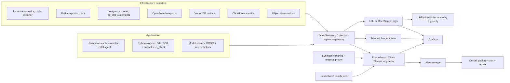

# Stage 2 — Document 14: Monitoring and Observability

| Field | Value |
|---|---|
| Document ID | DIP-OBS-01 |
| Version | 0.1 |
| Builds on | `02` NFR-OBS, `05` §9 (error handling), `08` §9.3 (Kafka monitoring), `09` §2.4 (model monitoring), `12` §9 (security monitoring), `13` §9, `14` (DR), `16` (capacity) |
| Note | Independent reference architecture. Thresholds are starting values to be tuned from measured baselines; telemetry volumes are estimates **[A]**. |

---

## 1. Objectives and principles
1. **Answer three questions fast:** *Is it working? (SLO), what broke? (diagnosis), what will break next? (capacity/trend).*
2. **Alert on symptoms (SLO burn), diagnose with causes:** pages for user-visible harm; dashboards/tickets for causes and trends.
3. **One correlation key:** `trace_id` flows HTTP → Kafka → workers → logs → audit.
4. **No content in telemetry:** IDs, hashes, counts, sizes; never document text, prompts, answers, or secrets (`12` §6.6). Telemetry is an attack surface and a leak vector.
5. **Quality is observed, not assumed:** retrieval/RAG quality signals are first-class metrics alongside latency and errors.
6. **Observability is part of the definition of done:** a service cannot ship without health endpoints, metrics, traces, dashboards, alerts, and a runbook link.
7. **Monitoring must survive the outage it monitors:** minimal independent monitoring at the DR site and an external synthetic prober.

---

## 2. Architecture


- **Pipelines:** OTel Collector as DaemonSet (host/pod level) + gateway tier (batching, tail sampling, PII/content scrubbing processors, routing). Backends are open and swappable (OTLP everywhere).
- **Separation of planes:** operational telemetry (this document) vs **audit** (`audit_logs`, append-only, `12` §9.1) vs **security detections** (SIEM). Operational logs are not an audit substitute and have different retention/integrity guarantees.
- **Multi-cluster:** each cluster runs its own Prometheus; global view via Thanos/Mimir; DR site runs a minimal always-on stack (Prometheus + Alertmanager + a few canaries) so failover decisions are observable.
- **Access control:** Grafana via SSO with role mapping (operators, developers read-only for non-prod, security read for security dashboards); log access limited by namespace; traces may contain IDs of documents → classified as INTERNAL; query text excluded.

---

## 3. Instrumentation standards

### 3.1 Metrics
Naming `dip_<service>_<subject>_<unit>` (Prometheus conventions), labels low-cardinality only (service, route template, stage, status class, error_class, model_version, priority, tier). **Forbidden labels:** user_id, document_id, chunk_id, query text, trace_id (use exemplars for trace linking). Cardinality budget per service ≤ 5,000 series; CI check scans for unbounded labels. Histograms with explicit buckets aligned to SLOs (e.g., search latency buckets at 50/100/200/400/800/1500/3000 ms). Exemplars enabled for latency histograms.

Spring Boot (Java) baseline:
```yaml
management:
  endpoints.web.exposure.include: health,prometheus,info
  endpoint.health.probes.enabled: true
  metrics:
    distribution:
      percentiles-histogram.http.server.requests: true
      slo.http.server.requests: 100ms,200ms,400ms,800ms,1500ms,3000ms
    tags: { service: ${spring.application.name}, env: ${DEPLOY_ENV} }
  tracing.sampling.probability: 1.0      # head sampling off; tail sampling in the collector
```

### 3.2 Logs
JSON structured (`timestamp, level, service, version, env, trace_id, span_id, event, message, error_class, stack (sanitized, size-limited)`), single-line; levels: ERROR (actionable), WARN (degraded/retry), INFO (business events, one per significant transition), DEBUG (off in prod, dynamic enablement with expiry, content still forbidden). Scrubbing: log filters redact patterns (tokens, emails optional, long text fields), unit tests ensure sensitive classes never logged; user identifiers hashed (`user_id_hash`) unless audit. Sampling for noisy INFO at collector. Retention: 14 days hot, 30–90 days warm in object storage (security-relevant logs: per SIEM policy), ERROR logs 90 days.

### 3.3 Tracing
W3C Trace Context on HTTP and **Kafka headers** (`traceparent`), spans per boundary: gateway → service → DB/Kafka/OpenSearch/vector/LLM → worker stages. Key spans/attributes (no content): `search.pipeline` (children: `scope.resolve`, `bm25`, `vector`, `fuse`, `rerank`, `acl.postcheck`), `rag.pipeline` (`route`, `retrieve`, `compress`, `llm.generate` with token counts, `citation.validate`, `repair`), `ingest.task` (stage, range, attempt, pages, duration, error_class), `kafka.consume` (lag at consume, partition). Links (not parent-child) between the ingestion trace of a version across its many tasks: one **version-level trace ID** derived from `version_id` hash so all stages of a document appear under one trace group. Sampling: tail-based in collector — keep 100% of errors, 100% of requests > SLO latency, 100% of INSUFFICIENT_EVIDENCE/validation-failure traces (for quality triage), 10% of normal online traces, 2% of ingestion task spans (100% for failed/retried). Trace coverage target ≥ 99% of user requests have a root trace (NFR-OBS-01).

### 3.4 Health endpoints
Liveness/readiness/startup per `13` §9.1; deep dependency health on an internal-only endpoint for canaries and operators.

---

## 4. SLIs, SLOs and error budgets

SLO window 30 days rolling. SLIs measured at the **gateway/synthetic** (user perspective) where possible.

| ID | Service/capability | SLI | SLO | Error budget | Source |
|---|---|---|---|---|---|
| SLO-1 | Search availability | % of search requests with non-5xx and not `503 SRCH-5031` | 99.9% (Medium/Large), 99.5% Initial | 43 min/month | NFR-AVL-01 |
| SLO-2 | Search latency | % of requests ≤ 800 ms (≤ 1.5 s Large) | 95% | 5% slow | NFR-PRF-01 |
| SLO-3 | AI query availability | % non-5xx AI queries (INSUFFICIENT_EVIDENCE and degraded retrieval-only responses count as success) | 99.9% (Medium/Large), 99.5% Initial — aligned to NFR-AVL-01 "search and Q&A"; attainable because LLM outages degrade to retrieval-only answers | 43 min/month | NFR-AVL-01 |
| SLO-4 | AI latency | TTFT ≤ 3 s and complete ≤ 15 s | 95% | | NFR-PRF-04 |
| SLO-5 | Answer integrity | % of served answers with all FACT claims validated (post-validation) — measured by validator + sampled human audit | ≥ 98% (hallucination ≤ 2%) | | `09` §6 |
| SLO-6 | Document API | Availability & P95 ≤ 150 ms (reads), upload initiate ≤ 300 ms | 99.9% / 95% | | NFR-PRF-07 |
| SLO-7 | Ingestion freshness | % of documents INDEXED within target after upload (digital ≤ 5 min; scanned ≤ 30 min), when not in backfill mode | 95% | | NFR-PRF-06 |
| SLO-8 | Ingestion durability | Acknowledged uploads lost | 0 | 0 | NFR-REL-01 |
| SLO-9 | Index consistency | Drift rate (versions with parity violations) | < 0.01%/day | | S-AC7 |
| SLO-10 | Security | Unauthorized exposure incidents; cross-fingerprint cache hits; NOT_PERMITTED leaks to users | 0 | 0 | NFR-SEC-03 |
| SLO-11 | Analytics | Success rate and P95 ≤ 5 s (ClickHouse path) | 99% / 95% | | NFR-PRF-09 |
| SLO-12 | Audit completeness | % of auditable events with an audit record within 60 s | 100% (spool guarantees) | | BO-5 |
| SLO-13 | Permission propagation | Revocation effective within 60 s (measured by probe); grant within 5 min | 99% | | FR-IAM-08 |

**Burn-rate alerting (multi-window, multi-burn-rate)** for SLO-1/2/3/4/6 (Google SRE style): page when both (1 h and 5 min) burn > 14.4× budget rate, or (6 h and 30 min) > 6×; ticket when (3 d and 6 h) > 1×. Error budget policy: when a 30-day budget is exhausted, feature releases for the affected service pause; reliability work takes priority (agreed with stakeholders at G-gates).

---

## 5. Metrics catalogue (by component)

### 5.1 Edge and services (RED)
`http_server_requests_seconds{route,status}` (rate, errors, duration), `dip_gateway_ratelimit_rejections_total{tier}`, `dip_authz_decisions_total{result,reason}`, `dip_pdp_cache_hit_ratio`, `dip_pdp_latency_seconds`, JVM (heap, GC pause, threads), DB pool (`hikaricp_connections_active/pending/timeout`), circuit-breaker state/calls (`resilience4j_circuitbreaker_*`), bulkhead saturation, outbox lag (`dip_outbox_oldest_unpublished_seconds`), idempotency replays.

### 5.2 Ingestion (the critical queue system)
| Metric | Meaning | Use |
|---|---|---|
| `kafka_consumergroup_lag{group,topic}` and **oldest message age** `dip_consumer_oldest_message_age_seconds` | backlog | scaling, alert |
| `dip_ingest_task_duration_seconds{stage,priority}` histogram | per-task time | per-stage SLO, B2/B7 reality check |
| `dip_ingest_tasks_total{stage,status,error_class}` | outcomes | failure rates |
| `dip_ingest_retries_total{stage,tier}`, `dip_dlq_depth{topic}` | retry/DLQ | alerts |
| `dip_version_state_count{state}` | versions per state | stuck detection |
| `dip_version_time_in_state_seconds{state}` | dwell time | SLO-7 |
| `dip_upload_to_indexed_seconds` histogram (by doc size class, scanned/digital) | end-to-end freshness | SLO-7 |
| `dip_page_quality_score` histogram, `dip_pages_ocr_total`, `dip_pages_low_quality_total` | content quality | scan share monitoring (validates W10!) |
| `dip_backfill_governor_state` (released/paused) and release rate | governor | tuning |
| `dip_inflight_per_document_max` | fairness | NFR-SCL-04 |
| `dip_sandbox_kills_total{reason}` (timeout, OOM, limit), `dip_quarantine_total{reason}` | untrusted-file safety | security |
| `dip_dedupe_skips_total`, `dip_lease_expiries_total` | idempotency/sweeper | health |
| `dip_embedding_cache_hit_ratio`, `dip_embed_tokens_total`, tokens/s per GPU | efficiency | B1 reality, cost |

### 5.3 Search
`dip_search_latency_seconds{stage}` (scope, embed, bm25, vector, fuse, rerank, postcheck), `dip_search_requests_total{mode,degraded,intent}`, `dip_search_zero_results_ratio`, `dip_search_degraded_ratio{reason}`, `dip_acl_postcheck_dropped_ratio` (index-tag-lag / bug indicator; alert if > 1% sustained), `dip_rerank_skipped_ratio`, `dip_cache_hit_ratio{cache}`, `dip_cache_cross_fingerprint_hits_total` (**must be 0**), `dip_filter_selectivity` histogram, `dip_exact_search_switch_total`, OpenSearch (`search_latency`, heap, GC, thread-pool rejections, shard allocation, segment counts), vector DB (QPS/shard, latency percentiles per shard, RAM, disk reads for rescoring, segment optimization state, **ANN recall audit result** from weekly job).

### 5.4 AI / RAG / models
| Metric | Notes |
|---|---|
| `dip_ai_requests_total{route,evidence_status,band}` | distribution shifts signal quality drift |
| `dip_ai_stage_latency_seconds{stage}` | route, retrieve, compress, llm_ttft, llm_total, validate, repair |
| `dip_llm_tokens_total{direction,model,route}`, `dip_llm_queue_depth`, `dip_llm_kv_cache_usage`, `dip_llm_prefix_cache_hit_ratio`, `dip_llm_timeouts_total` | cost + capacity (validates C6/C7/C8) |
| `dip_citation_validation_total{result}` (VERIFIED / each FAILED_*), `dip_claims_removed_ratio`, `dip_repair_attempts_total`, `dip_insufficient_evidence_ratio` | online RAG health |
| `dip_nli_latency_seconds`, NLI queue depth | validator capacity |
| `dip_route_confidence` histogram and `dip_route_overrides_total` | router quality |
| `dip_nl2sql_total{outcome}` (accepted, rejected_by_reason, timeout, empty), cost estimate histogram | analytics safety |
| Model serving: per model `latency`, `batch_size`, `queue_wait`, GPU utilization/memory/temperature (DCGM), OOM count, model version info gauge (`dip_model_info{kind,name,version}`) | `09` §2.4 |
| Embedding drift: mean cosine to centroid, vector norm distribution, ANN-vs-exact recall (weekly), duplicate-vector ratio | `09` §2.4 |
| Quality (offline/online): nightly eval metrics pushed as gauges (`dip_eval_ndcg10`, `dip_eval_faithfulness`, … labeled with config version) | trend and regression visibility |
| Feedback: `dip_feedback_total{signal}`, CTR@rank, reformulation rate | online relevance proxies |
| Cost: GPU-seconds per query/stage, tokens per query, cost per 1k pages (from metrics × configured rates) | NFR-CST-01 |

### 5.5 Data stores and platform
| Store | Key signals |
|---|---|
| PostgreSQL | connections (active/idle/waiting), replication lag (bytes/seconds), WAL archive lag, TPS, slow queries (`pg_stat_statements` top-N), lock waits, deadlocks, bloat/dead tuples, autovacuum lag, table/partition growth, `processing_jobs` pending count and oldest age, checkpoint stats, disk |
| Kafka | URP, offline partitions, ISR shrink rate, request latency, disk usage per broker, controller changes, rebalance rate per group, produce/consume error rates, MM2 replication lag, Schema Registry errors |
| Object store | request latency/error rates, capacity used % and growth rate (forecast), erasure-coding repair backlog, replication lag to DR (seconds and objects) — **feeds RPO monitoring** (`14` §4.3), lifecycle job success |
| ClickHouse | query latency, merges/parts, replication queue, memory limits hits, readonly rejections |
| Redis | hit ratio, evictions, memory, latency, replication |
| Kubernetes | node/pod health, restarts, OOMKilled, pending pods (esp. GPU), HPA/KEDA states, PDB violations, API server latency, etcd health, certificate expiry (`certmanager_certificate_expiration_timestamp_seconds`) |
| Vault/IdP | seal status, token/lease counts, auth failures, latency, IdP login success/failure |
| Backups | last successful backup age per component, restore-test result (`dip_backup_last_success_age_seconds`, `dip_restore_test_success`), snapshot sizes, WAL archive gap |
| Reconciliation | drift counts per job (`R-INDEX`, `R-OBJ`, `R-ACL`, `R-STATE`, `R-DEL`), repair rates, time since last full run |
| Capacity | utilization vs ceilings (`16` §6), forecasts (`predict_linear`) for storage/RAM/GPU-hours |
| Security | auth failures, denied requests, PDP errors, admission rejections, Falco events, egress-deny hits, audit chain verification result, key-rotation age |

---

## 6. Dashboards (as code in Git)

| Dashboard | Audience | Panels (essentials) |
|---|---|---|
| **Executive/SLO overview** | leadership, on-call | SLO attainment, error budget remaining, active incidents, degraded flags, canary status |
| **User journey** | SRE | upload→INDEXED funnel by stage; search stage waterfall; RAG stage waterfall; error breakdown by `code` |
| **Ingestion pipeline** | SRE/data | lag and oldest age per queue, tasks/s by stage, retry/DLQ, per-state counts, big-document impact, governor state, backfill ETA = backlog ÷ throughput |
| **Search & retrieval** | search team | latency by stage, degraded ratios, cache hit ratios, ACL post-check drops, zero-result ratio, vector/OpenSearch health, ANN recall audit trend |
| **AI/RAG quality & cost** | AI team | evidence status mix, validation failures, insufficient-evidence rate, repair rate, tokens/query, GPU utilization, cost per query, eval trend lines with config version annotations |
| **Models/GPU** | ML-Ops | per-pool utilization, memory, queue, throughput vs benchmark baseline, model version gauges, deployment markers |
| **Data stores** | DBA/SRE | PG, Kafka, OpenSearch, vector, ClickHouse, object store panels with saturation thresholds |
| **Capacity & forecast** | platform | utilization vs ceiling, growth forecasts, time-to-limit, cost trends, model-vs-measured variance |
| **Security & audit** | security | auth anomalies, denied access, injection flags, quarantine, egress denies, audit chain status, key ages — separate access |
| **DR & backup** | SRE/security | backup ages, restore-test results, replication lag (PG/object/Kafka MM2), last drill date, measured RTO/RPO |
| **Release/canary** | release mgr | canary vs baseline comparison (error, latency, business metrics), rollout state |
| **Cost** | platform/finance | GPU-hours, storage, cost per page/query |
Rules: every panel has units and a linked runbook/alert; annotations for deployments, model promotions, config changes, incidents; dashboards reviewed quarterly (remove unused).

---

## 7. Alerting

### 7.1 Principles and routing
Page = needs human action now and users are or will be impacted within the hour. Everything else is a ticket/notification. Each alert has: severity, owner team, runbook URL, dashboard link, and suppress/inhibit rules (e.g., node-down inhibits pod alerts). Severity map: **P1** (page, 24/7: data exposure, SLO fast burn, data loss risk, DR replication broken beyond RPO), **P2** (page in business hours/secondary: slow burn, degraded redundancy), **P3** (ticket), **P4** (info). Maintenance windows silence by label with expiry; alert hygiene review monthly (target < 2 actionable pages/shift per on-call; no alert without action).

### 7.2 Alert catalogue (starting rules)
| Alert | Condition (illustrative PromQL-like) | Sev |
|---|---|---|
| SearchSLOFastBurn | burn_rate(1h)>14.4 and burn_rate(5m)>14.4 for SLO-1/2 | P1 |
| RAGSLOFastBurn | same for SLO-3/4 | P1 |
| UnauthorizedExposureSignal | `increase(dip_cache_cross_fingerprint_hits_total[5m])>0` or validator NOT_PERMITTED reaching response layer > 0 | P1 (security on-call) |
| AclPostcheckDropHigh | `dip_acl_postcheck_dropped_ratio > 0.01` for 15 min | P2 (tag lag or bug) |
| IngestQueueAgeP1 | `max(dip_consumer_oldest_message_age_seconds{priority="p1"}) > 300` for 10 min | P2 (P1 if > 1800) |
| DlqDepth | `dip_dlq_depth > 0` for 15 min (warn); `> 100` or `deriv > 10/min` | P3 / P2 |
| StuckVersions | versions in non-terminal state beyond 3× expected dwell | P3 |
| UploadDurability | any acknowledged upload without object/hash verification | P1 |
| OutboxLag | `dip_outbox_oldest_unpublished_seconds > 60` for 5 min | P2 |
| KafkaURP / OfflinePartitions | `kafka_server_replicamanager_underreplicatedpartitions > 0` for 5 min; offline > 0 | P2 / P1 |
| KafkaDiskHigh | disk > 70% / 80% | P3 / P2 |
| PGReplicationLag | replay lag > 60 s for 5 min (DR replica > 5 min) | P2 (P1 if DR replica > 15 min — RPO breach) |
| PGConnectionsHigh | > 70% of max for 10 min | P3 |
| PGWalArchiveFailing | archive failed > 5 min | P1 |
| ObjectReplicationLag | DR replication lag > 10 min (warn), > 15 min (breach) | P3 / P1 |
| BackupStale | `dip_backup_last_success_age_seconds` > 26 h (daily jobs) | P2 |
| RestoreTestFailed | `dip_restore_test_success==0` | P2 |
| VectorRecallDrop | ANN-vs-exact recall audit < 0.95 | P2 |
| IndexParityDrift | drift > 0.01%/day or any version unrecovered after 24 h | P2 |
| GpuPoolSaturation | utilization > 85% 15 min with queue growth; or pods Pending for GPU > 10 min | P2 |
| LlmQueueDepth / TTFT | queue > threshold or TTFT P95 > 3 s for 10 min | P2 |
| ValidationFailRate | `claims_removed_ratio` or NOT_IN_CONTEXT rate > 2× baseline for 30 min | P2 (quality incident) |
| InsufficientEvidenceSpike | ratio > 2× 7-day baseline for 1 h | P3 (likely index/model problem) |
| EgressDenyHit | any denied egress from `ai-gpu`/`processing` | P1 (security) |
| SandboxCrashLoop | repeated worker crashes for one `idempotency_key` | P2 (suspected exploit) |
| AuditChainMismatch / AuditSpoolBacklog | verification fails; spool age > 5 min | P1 / P2 |
| CertExpiry | < 14 d (warn) / < 3 d (page) | P3 / P1 |
| VaultSealedOrDown | sealed or unreachable | P1 |
| IdPDown | login success rate < 50% for 5 min | P1 |
| ErrorBudgetExhausted | budget remaining < 0 | P2 (process trigger) |
| CapacityForecast | predicted storage/RAM/GPU limit < 6 months (hardware lead-time) / < 30 days | P3 / P2 |
| CanaryFailing | synthetic canary fails 2 of 3 runs | P1 (see §8) |
| ScanShareDrift | observed scanned share deviates > 10 pt from planning assumption | P4 (capacity model input) |

Example rule (Prometheus):
```yaml
- alert: IngestQueueAgeP1
  expr: max by (group) (dip_consumer_oldest_message_age_seconds{priority="p1"}) > 300
  for: 10m
  labels: { severity: page-business, team: data-platform }
  annotations:
    summary: "Ingestion lag above 5 min on {{ $labels.group }}"
    runbook: "https://runbooks.internal/ingestion-lag"
    dashboard: "https://grafana.internal/d/ingest"
- alert: SearchLatencySLOFastBurn
  expr: |
    ( sum(rate(dip_search_latency_seconds_count{le_slo="slow"}[1h])) / sum(rate(dip_search_latency_seconds_count[1h])) ) > (14.4 * 0.05)
    and
    ( sum(rate(dip_search_latency_seconds_count{le_slo="slow"}[5m])) / sum(rate(dip_search_latency_seconds_count[5m])) ) > (14.4 * 0.05)
  labels: { severity: page, team: search }
```
(Real rules use histogram bucket arithmetic; shown schematically.)

---

## 8. Synthetic monitoring and canaries
| Canary | Frequency | What | Pass |
|---|---|---|---|
| **Upload-to-index** | every 15 min | Upload a tiny synthetic document with a unique token via the public API as a canary user; poll status; search for the token; verify page citation; then delete | INDEXED ≤ 5 min; searchable; delete saga completes |
| **Search** | 1 min | Known queries with known expected top hit (identifier and natural-language) | Hit in top 3, latency within SLO |
| **RAG** | 5 min | Question with known answer in canary documents (+ one unanswerable question) | Correct, validated citations; unanswerable → INSUFFICIENT_EVIDENCE |
| **Authorization** | 5 min | Canary users in two departments: A must never see B's canary doc via search/RAG/status; revoked access takes effect ≤ 60 s | 0 leaks, revocation ≤ 60 s (SLO-13) |
| **Analytics** | 5 min | Known NL question and SQL with known result; a malicious statement must be rejected | Correct / rejected |
| **Login/token** | 1 min | OIDC flow for canary user | success |
| **DR/replication** | 5 min | Write marker object/row; verify at DR within lag SLO | within thresholds |
| **External prober** | 1 min | From outside the cluster (and from DR site) hits public health and a read-only API | up |
Canaries run as dedicated low-privilege tenants/users with `canary=true` flags (excluded from business analytics), their documents isolated and classified INTERNAL; they exercise the real code path and are subject to the same audit.

---

## 9. Telemetry volume and cost [A]
| Signal | Basis | Initial | Medium | Large |
|---|---|---|---|---|
| Active metric series | ~5,000/service × services + infra exporters (K8s, Kafka, PG, OpenSearch per node) | ~0.2 M | ~0.8 M | **~2–3 M** |
| Prometheus storage (15 s scrape, ~1.5 B/sample after compression, 30 d) | series × 5,760 samples/day × 1.5 B × 30 | ≈ 50 GB | ≈ 0.2 TB | ≈ 0.6–1 TB (long-term in object storage, downsampled 1 y) |
| Traces | spans/s = req/s × ~20 spans × sampling mix (~15% effective incl. errors) | negligible | 130 req/s × 20 × 0.15 ≈ 400 spans/s ≈ 17 GB/day | 520 × 20 × 0.15 ≈ 1,600 spans/s + ingestion spans ≈ 70–100 GB/day (retention 7 d hot) |
| Logs | pods × lines/s × bytes | 30 pods × 5 × 300 B ≈ 4 GB/day | 100 × 10 × 300 B ≈ 26 GB/day | 250 pods × 20 × 300 B ≈ 130 GB/day (14 d hot ≈ 1.8 TB; compressed ≈ 4× less) |
Cost controls: drop/relabel high-cardinality series, tail sampling, log level discipline, downsampling, retention tiers; observability budget reviewed with capacity (`16` §4.4). A hard rule: **monitoring must not exceed ~5–8% of platform infrastructure cost** (target, to be validated).

---

## 10. Runbooks and on-call
- Every alert links to a runbook with: meaning, impact, quick triage (dashboards/queries/commands), common causes, mitigation steps, escalation, rollback/DR links, post-incident checklist. Runbooks stored in Git and an **offline copy** (DR availability).
- On-call: primary/secondary per domain (platform, data/search, AI/ML, security); handoff notes; escalation matrix; incident process (`12` §9.3, `14` §13); blameless post-incident reviews with action items tracked to closure; error-budget reviews monthly.
- Operator console (admin UI) surfaces: DLQ triage, stuck versions, reprocess, reconciliation results, model registry state, canary status — reducing the need for raw database access.

## 11. Quality and drift monitoring (closing the loop with `09`)
| Loop | Mechanism | Output |
|---|---|---|
| Offline nightly | 200-query smoke suite on production snapshot | metrics `dip_eval_*`, trend + alert on drop > tolerance |
| Weekly | ANN-vs-exact audit (2,000 queries), citation human sample (1%), conflict-set run | recall/faithfulness trend |
| Online | Feedback signals, reformulation, zero-result, insufficient-evidence ratio, validation failure ratio | anomaly detection against 7/28-day baselines (seasonality-aware) |
| Change correlation | Annotations on deployments, model promotions, config/chunker changes, re-embedding events | quick attribution |
| Data drift | Document type/language mix, page quality distribution, scan share, chunk length distribution | alerts to capacity/model owners (e.g., `ScanShareDrift`) |
| Cost per outcome | Cost/query, cost per 1k pages | budget guardrails |

## 12. Requirements traceability and acceptance
| Req | Verification | Acceptance |
|---|---|---|
| NFR-OBS-01 tracing coverage | Compare gateway request count vs root traces; fault-injection trace completeness | ≥ 99% of requests traced; Kafka hops linked ≥ 99% |
| NFR-OBS-02 dashboards/alerts mapped to SLOs | Review: each SLO has dashboard + burn-rate alert + runbook | 100% |
| NFR-OBS-03 no content/PII in logs | Automated log scanners with seeded canary secrets/text; test corpus | 0 leaks |
| SLO measurement correctness | Synthetic load with known failures; compare computed SLI vs injected truth | error < 1% |
| Alert quality | Game days/chaos: each injected fault in the `14` §6 catalogue triggers the intended alert within target (P1 ≤ 5 min, P2 ≤ 15 min); no more than 2 false pages/week | pass |
| Canaries | Break each path deliberately | Canary fails and pages within 10 min |
| Telemetry resilience | Kill collector/Prometheus/Loki | Apps unaffected (non-blocking exporters, bounded buffers); data gap ≤ defined; alert on telemetry pipeline health |
| Security monitoring | Red-team injection/bypass/egress attempts | Detected and alerted per `12` §9.2 |
| Capacity forecasting | Inject growth trend | Forecast alert fires at configured horizon |
| DR visibility | During DR drill | Minimal DR stack shows health; replication lag visible |

## 13. Open items
| Item | Plan |
|---|---|
| Tooling choice details (Loki vs OpenSearch for logs; Tempo vs Jaeger; Mimir vs Thanos) | ADR in M12 based on operational skills and volume test |
| Exemplar/trace-to-log correlation cost | Validate in staging |
| Human-in-the-loop quality sampling capacity | Staffing/process with domain owners |
| SIEM product (U-01/U-03 dependent) | Define forwarding interface now (OTLP/syslog/JSON), product later |
| Observability budget share | Measure in staging, set target after M12 |
| Per-tenant/department dashboards | Only if multi-organization (U-02) |

## 14. Next
Architecture Decision Records (ADRs), Implementation Roadmap, Production Readiness Checklist; then consolidated formal documents (Project Charter, BRD, SRS, FRS, NFRS, System Architecture, Data Architecture, AI/ML bundle) assembled from the existing material.
