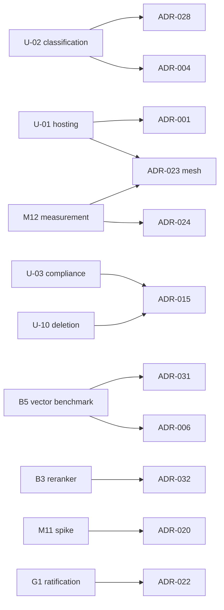

# Stage 2 — Document 15: Architecture Decision Records (ADRs)

| Field | Value |
|---|---|
| Document ID | DIP-ADR-01 |
| Version | 0.1 |
| Builds on | All Stage 1 and Stage 2 documents (`01`–`17`) |
| Note | Independent reference architecture. Statuses: **Accepted** (decided for the reference design), **Provisional** (decided direction, gated by named evidence), **Proposed** (recommended, awaiting stakeholder input), **Open** (alternatives still compete; decision method stated). Consequences are stated honestly, including costs. |

## 0. How ADRs are managed
- One ADR per decision that is costly to reverse, crosses services, or constrains security/operations. Stored in Git (`docs/adr/NNN-title.md`), immutable once Accepted; changes are made by a **new ADR that supersedes** the old one.
- Template: Status · Context · Decision · Alternatives considered (and why rejected) · Consequences (positive, negative, risks) · Evidence/validation · Revisit trigger · Links.
- Ownership: author = proposing architect; approvers = architecture board (principal architect, security lead, platform lead; AI lead for AI ADRs). Approval requires reviewing the alternatives and the evidence plan.
- Provisional ADRs list the **exact evidence** (benchmark/ID) that converts them to Accepted or triggers a change; the roadmap schedules that evidence (`19`).

## 1. Index

| ADR | Decision | Status | Gate/evidence |
|---|---|---|---|
| 001 | Kubernetes + S3-compatible storage + self-managed data services | Accepted (default for U-01) | U-01 |
| 002 | Kafka backbone; PostgreSQL-backed state machine (no workflow engine) | Accepted | M3 load test |
| 003 | Page-range task granularity (25 pages default) | Accepted (parameter tunable) | M3 |
| 004 | Logical isolation by ACL tags + physical isolation for top classification tier | Accepted (default for U-02) | U-02 |
| 005 | OpenSearch for BM25/keyword retrieval | Accepted | B8 |
| 006 | Vector DB: Qdrant first, Milvus benchmark gate before Large | **Provisional** | B5 (M6, M13) |
| 007 | Self-hosted embeddings chosen by bake-off | Accepted (method); model TBD | B1, golden set |
| 008 | Structure-aware parent-child chunking with fallback chain | Accepted | M5 eval |
| 009 | Iceberg lakehouse + ClickHouse + Spark, phased | Accepted | M10 |
| 010 | Authorization: index pre-filter + PostgreSQL post-check | Accepted | M6, M11 suites |
| 011 | Deterministic-first query routing | Accepted | route accuracy |
| 012 | Mechanical citation validation; evidence band instead of probability | Accepted | RAG eval |
| 013 | Transactional outbox for event publication | Accepted | M3 |
| 014 | `searchable` flag flipped only after both indexes confirm | Accepted | M6 |
| 015 | Per-document data keys (crypto-erasure) | Proposed | U-10 |
| 016 | Avro + Schema Registry (BACKWARD_TRANSITIVE) | Provisional | M3 start |
| 017 | Persist embeddings in object store (embedding archive) | Accepted | M5, DR drill |
| 018 | Priority via separate topics + backfill governor | Accepted | M3 |
| 019 | ID-first retrieval; text fetched only for rerank window | Accepted | B8 network test |
| 020 | Policy decision point technology (Java table-driven vs OPA/Cedar) | **Open** | M11 spike |
| 021 | DR topology: warm standby, manual cross-site failover | Accepted | DR drill |
| 022 | Object-store RPO 15 min (async) with loss report | **Proposed** | G1 ratification, B10 |
| 023 | Service mesh vs library-level mTLS | **Open** | M12 measurement |
| 024 | Observability backends (logs/traces/metrics) | **Open** | M12 |
| 025 | Citation support check = deterministic numeric/entity check + NLI | Accepted | B6, RAG eval |
| 026 | Consolidation of 17 candidate services into 13 deployables | Accepted | review each milestone |
| 027 | Pull-based dispatch from PostgreSQL with in-flight caps | Accepted | M3 |
| 028 | No `tenant_id` column (single organization) | **Proposed** | U-02 |
| 029 | Tiered OCR with page-level triage | Accepted | B2/B7 |
| 030 | API: keyset pagination only; SSE for streaming | Accepted | – |
| 031 | Tiered indexing (hot/archive) for Large | **Provisional** | M13 usage data |
| 032 | Selection of reranking policy: adaptive skip + candidate cap | **Provisional** | B3 |

---

## 2. Records

### ADR-001 — Kubernetes, S3-compatible storage, self-managed data services
**Status:** Accepted for the reference design (working default for U-01). **Context:** Confidential content, likely restricted/sovereign infrastructure (C-02, C-04), GPU scheduling, stateful services. **Decision:** Run on Kubernetes (distribution per hosting decision) with operator-managed Kafka, PostgreSQL, OpenSearch, vector DB, ClickHouse and an S3-compatible object store; no application dependency on proprietary cloud primitives. **Alternatives:** (a) managed cloud services — fastest to run but may violate data-boundary/air-gap constraints, vendor lock-in, per-token embedding/LLM costs; (b) VM-only deployment — fewer abstractions but poor GPU/fleet scheduling and slower rollouts; (c) Nomad — simpler but smaller ecosystem for operators/GPU tooling. **Consequences:** + portability, boundary control, uniform ops; − we operate stateful systems (staffing, on-call), longer GPU procurement if on-prem, upgrade burden. **Revisit when:** U-01 resolves to a managed sovereign cloud (then managed data services may replace operators behind the same ports).

### ADR-002 — Kafka backbone; PostgreSQL state machine, no workflow engine
**Status:** Accepted. **Context:** Asynchronous multi-stage pipeline, replay needs, page-range fan-out, priority classes. **Decision:** Kafka for tasks/events; ingestion state and fan-out/fan-in tracked in PostgreSQL (`processing_jobs`, conditional-update stage advancement); no Temporal/Airflow-style engine. **Alternatives:** RabbitMQ/SQS (no cheap replay/log semantics, weaker partitioned ordering, fan-out/backfill rebuilds harder); Pulsar (comparable features, smaller skills base here); Temporal (rich durable workflows but another stateful cluster, workflow-per-page-range at 50k docs/day × ~28 tasks ≈ 1.5 M tasks/day pushes history sizes; our workflows are simple state transitions); Airflow (batch-oriented, not event-driven). **Consequences:** + fewer moving parts, explicit idempotency model, replay for derived data; − we hand-build retry/lease/sweeper logic, no workflow visualization UI (operator console substitutes). **Revisit when:** orchestration logic grows (human approvals, long-running sagas beyond deletion/reprocess) or when sweeper/dispatcher code proves a recurring defect source.

### ADR-003 — Page-range task granularity (25 pages default)
**Status:** Accepted (parameter). **Context:** 10,000-page documents must not block the pipeline (R5); too-small tasks inflate Kafka/PG overhead. **Decision:** Split extraction/OCR into page-range tasks of 25 pages (spreadsheets 100, slides 50) with per-document in-flight cap 8. **Alternatives:** whole-document tasks (head-of-line blocking, long retries lose work); per-page tasks (≈ 5 B tasks at Large, overhead dominates: at 0.4 s/page the task overhead of ~20–50 ms is 5–12%, plus message volume ×25). **Consequences:** + fairness, bounded retry loss (≤ 25 pages), parallelism; − merge complexity (cross-range header/footer detection, tables spanning range boundaries need overlap handling: workers read ±1 page context). **Evidence:** M3 load test with skewed page distribution; NFR-SCL-04 (≤ 20% small-doc degradation).

### ADR-004 — Isolation model: ACL tags + physical isolation for the top tier
**Status:** Accepted (default for U-02). **Context:** Classification levels exist but the scheme is unknown; confidentiality is the top objective. **Decision:** Single cluster with logical isolation (ACL tags, clearance floor, row-level analytics policies); the highest classification tier gets physically separate index sets/namespace/KEK (and optionally a separate cluster). **Alternatives:** shared everything with ACL only (higher blast radius for the most sensitive tier); cluster-per-department (cost and operational multiplication, fragmented search); multi-tenant `tenant_id` model (ADR-028). **Consequences:** + proportional isolation cost; − two code paths (tier routing in search-service), cross-tier queries disallowed by design. **Revisit when:** U-02 defines tiers/organizations differently.

### ADR-005 — OpenSearch for keyword/BM25
**Status:** Accepted. **Context:** Need BM25 with filters, highlighting, sharding to billions of chunks. **Decision:** OpenSearch cluster; Elasticsearch and PostgreSQL FTS rejected. **Alternatives:** Elasticsearch (license changes, OpenSearch is functionally sufficient; revisit if license-compatible distribution is mandated); PostgreSQL FTS (acceptable ≲ 10⁷ chunks, no distributed BM25 at our scale, would load the OLTP system); Solr (viable, smaller momentum); Vespa (excellent hybrid but steep skills curve, single engine for BM25+vector would also replace ADR-006 — noted as a strategic alternative worth a spike). **Consequences:** + mature, replicas/sharding, security plugin; − JVM tuning, shard management, cluster state limits (index grouping per `11` §2.2). **Evidence:** B8 (size/throughput).

### ADR-006 — Vector database: Qdrant first, Milvus gate before Large
**Status:** **Provisional.** **Context:** Filtered ANN at 5.5 M → 5.5 B vectors with strict ACL filters. **Decision:** Start with Qdrant (or pgvector on a *dedicated* PostgreSQL for the 10k-document pilot if minimal ops matter) behind a `VectorStore` port; run benchmark B5 at 10 M/100 M/1 B (amplified ≥ 100 M must be validated against real-distribution embeddings at ≥ 10 M). **Alternatives:** Milvus (strongest declared multi-billion story, higher operational complexity), Weaviate (no differentiator for our constraints), pgvector (single-node ceiling, filtered-ANN recall), Vespa (see ADR-005). **Consequences:** + low-ops start, clean migration path; − risk that Large requires re-indexing into another engine (mitigated by embedding archive ADR-017: ≈ 8 h CPU rebuild at Large instead of GPU weeks). **Exit criteria:** pass/fail rule for staying: filtered recall@100 ≥ 0.97 and P95 ≤ 200 ms at 100 M with ≤ N nodes (N set in B5 plan), cost per million vectors within budget. **Revisit when:** B5 fails or Large approved.

### ADR-007 — Self-hosted embeddings selected by bake-off
**Status:** Accepted (policy), model **TBD**. **Decision:** No managed embedding API for confidential data; open-weight models evaluated against the golden set (`09` §3); selection criteria and weights fixed beforehand. **Alternatives:** managed APIs (violates C-02; also silently changing models, cost ≈ 2.8 T tokens, rate limits); fine-tuned domain model (later, F-06). **Consequences:** + data stays inside; reproducible versions; − GPU ownership; quality must be earned on our domain. **Revisit when:** bake-off shows plateau (fine-tune) or a managed offering is approved for a specific non-sensitive corpus.

### ADR-008 — Structure-aware parent-child chunking with fallback chain
**Status:** Accepted. **Decision:** Default structure-aware child chunks (384 target/512 max) with parent sections ≤ 2,000 tokens; tables/equations atomic; fallback recursive then fixed; contextual prefix embedded; strategy chosen per document type. **Alternatives:** fixed-size only (splits tables/equations, no section provenance); semantic chunking default (extra embedding pass per sentence, unstable across model versions, no demonstrated gain on technical text — kept as an evaluated option); sliding window as strategy (index inflation ×1/(1−overlap), used only as overlap mechanism). **Consequences:** + provenance/context; − chunker complexity and per-type tuning; chunker version changes force re-index (ADR-017/blue-green). **Evidence:** M5 ablations; golden-set Recall@K/nDCG.

### ADR-009 — Iceberg lakehouse + ClickHouse + Spark (phased)
**Status:** Accepted. **Decision:** Event/analytics history and curated datasets in Iceberg on object storage; ClickHouse for interactive aggregation; Spark on Kubernetes for heavy/batch jobs; introduced progressively: PostgreSQL analytics at Initial, ClickHouse at Medium (M10), Spark when ClickHouse limits are hit. **Alternatives:** Delta Lake (strongest with Databricks; engine neutrality preferred), Hudi, a cloud data warehouse (boundary/lock-in), PostgreSQL only (cannot serve large scans without hurting OLTP), Trino-only serving (viable alternative to ClickHouse for ad-hoc federated queries — Trino may be added for lakehouse SQL). **Consequences:** + separation of operational and analytical workloads (§2.7 HLD), time travel/audit archive; − three analytic engines to operate at Large; mitigated by phasing.

### ADR-010 — Authorization: index pre-filter + PostgreSQL post-check
**Status:** Accepted. **Decision:** Compile ACL/clearance filters into both engines (pre-filter) and re-verify every candidate against PostgreSQL before context assembly (authoritative post-check); revocations effective immediately, grants eventually. **Alternatives:** post-filter only (top-K starvation, leaks via ranking side channels), pre-filter only (stale tags allow exposure after revocation), per-user indexes (infeasible). **Consequences:** + defense in depth; − added query latency (≈ 5 ms batched), tag-derivation pipeline, tag-explosion handling. **Evidence:** permission-bypass suite (0 leaks) in M6 and M11.

### ADR-011 — Deterministic-first query routing
**Status:** Accepted. **Decision:** Rules → small classifier → LLM closed-set fallback; aggregation cues block RAG. **Alternatives:** LLM-only router (latency, cost, nondeterminism, prompt-injection exposure), single pipeline for all queries (RAG guessing counts). **Consequences:** + predictable cost/latency, auditability; − rule maintenance, labeled-query effort. **Evidence:** route accuracy ≥ 95%.

### ADR-012 — Mechanical citation validation; evidence band, not probability
**Status:** Accepted. **Decision:** Validate every cited claim against stored chunk text and permissions; one repair attempt; report an evidence-derived band measured against the golden set instead of an LLM self-confidence. **Alternatives:** trust model citations (page/quote fabrication), LLM-judge only (non-deterministic, circular), LLM verbalized confidence (uncalibrated). **Consequences:** + trustworthy provenance; − NLI/GPU cost and latency (+≈ 250 ms), occasional over-removal of correct claims (tracked by false-removal rate). 

### ADR-013 — Transactional outbox
**Status:** Accepted. **Decision:** State change and event are committed in one database transaction; a publisher relays to Kafka (at-least-once; consumers dedupe). **Alternatives:** dual write (lost/phantom events), Debezium CDC outbox (viable and reduces polling; considered an optimization — polling publisher chosen first for simplicity), Kafka transactions (do not cover PostgreSQL). **Consequences:** + no lost events during Kafka outages; − polling load/latency (≈ 200 ms), table cleanup.

### ADR-014 — `searchable` flag after both indexes confirm
**Status:** Accepted. **Decision:** A version becomes visible only after OpenSearch and vector DB each confirm all chunks; flag flip is atomic. **Alternatives:** progressive visibility (partial results, confusing and non-reproducible citations), single-index visibility. **Consequences:** + no half-indexed documents; − visibility delayed until the slowest stage completes. 

### ADR-015 — Per-document data keys (crypto-erasure)
**Status:** Proposed (U-10). **Decision:** Envelope encryption: KMS master → classification KEK → per-document DEK; destroying the DEK renders object ciphertext unreadable (backup windows per DR §9). **Alternatives:** bucket-level keys only (cannot erase one document cryptographically), re-encrypt on delete (expensive), rely on object deletion only (replicas/backups). **Consequences:** + strong deletion semantics for objects; − key management scale (25 M DEKs at Large), derived plaintext stores still need active deletion, backup retention coupling. **Revisit when:** compliance regime defined.

### ADR-016 — Avro + Schema Registry, BACKWARD_TRANSITIVE
**Status:** Provisional (decide at M3 start). **Decision:** Avro payloads, registry-enforced compatibility, schemas registered only by CI. **Alternatives:** Protobuf (equally valid; better if gRPC reuse is wanted; decide before the first producer ships), JSON Schema (verbose, weaker evolution), plain JSON (no enforcement). **Consequences:** + compact, enforced evolution; − registry as critical dependency (HA, caching in clients). **Revisit:** none after first production producer without a v2-topic migration.

### ADR-017 — Embedding archive in object storage
**Status:** Accepted. **Context:** Re-embedding Medium ≈ 3,900 GPU-h (≈ 61 h on 64 GPUs); Large ≈ 39,000 GPU-h (≈ 25 days on 64 GPUs). **Decision:** Persist embeddings (int8/fp16, with model version) as Parquet next to chunk text; use it for DR rebuild and engine migration. **Alternatives:** rely on vector DB snapshots only (single point of failure, engine-bound), re-embed on demand (GPU cost/time unacceptable for RTO). **Consequences:** + CPU-only rebuild (Medium ≈ 3 h, Large ≈ 7.6 h estimated), enables ADR-006 migration; − storage (≈ 0.55 TB Medium, 5.6 TB Large) and same sensitivity as text (encrypted, ACL'd, covered by deletion saga).

### ADR-018 — Priority via topics + backfill governor
**Status:** Accepted. **Decision:** `.p0/.p1/.p2` topics per stage, weighted consumers, and an orchestrator that withholds p2 task release under interactive lag. **Alternatives:** single topic with priority field (no broker priority; head-of-line), separate clusters per priority (cost), consumer-side reordering only. **Consequences:** + interactive work protected, backfill uses idle capacity; − 3× topic count and partitions (partition budget), tuning weights.

### ADR-019 — ID-first retrieval, text only for the rerank window
**Status:** Accepted. **Decision:** BM25/vector responses carry IDs, scores and minimal fields; chunk text is fetched (multi-get) only for the ~30–50 candidates sent to the reranker and final context. **Alternatives:** return full `_source` for k=200 per variant (≈ 3× network and heap churn: ≈ 1.6 Gbps at Large). **Consequences:** + bandwidth/latency reduction; − one extra round trip (≈ 20–40 ms, budgeted), requires doc-values/stored fields design. 

### ADR-020 — PDP technology
**Status:** **Open.** **Options:** (a) Java table-driven evaluator inside identity-access (lowest latency, simple ops, tests via differential matrix); (b) OPA/Rego (policies-as-code, auditable, ecosystem; sidecar/library latency and a second language); (c) Cedar-class engine (analyzable policies, newer ecosystem). **Decision method:** M11 spike measuring p99 latency at 2,000 decisions/s, policy testability, and auditor readability; interface kept pluggable (`PolicyDecisionPort`). **Default until decided:** (a).

### ADR-021 — DR topology: warm standby, manual cross-site failover
**Status:** Accepted. **Decision:** Active/passive; DR site holds data replicas, snapshots, reduced compute; in-site failovers automatic, cross-site failover is a human decision (incident commander). **Alternatives:** active/active (cost, split-brain, cross-store consistency complexity), cold standby (RTO of days), automatic cross-site failover (false-positive/split-brain risk). **Consequences:** + controlled complexity and cost; − RTO bound by human decision plus warm-up; AI capacity reduced at DR. **Revisit:** if T1 RTO < 1 h becomes a requirement.

### ADR-022 — Object-store RPO 15 minutes (async) with loss report
**Status:** Proposed (ratification at G1). **Decision:** Asynchronous cross-site replication; versions marked `replicated` only after confirmation; loss report after failover; re-ingest from sources. **Alternatives:** synchronous multi-site writes (zero loss, higher write latency/cost, availability coupling), 5-min target (not guaranteeable under backfill). **Consequences:** + performance and cost; − bounded loss window for recent uploads, dependency on source retention (U-07). 

### ADR-023 — Service mesh vs library-level mTLS
**Status:** **Open.** **Options:** sidecar mesh (Istio/Linkerd), ambient mesh, SPIFFE/SPIRE with library mTLS. **Method:** M12 staging measurement of added p99 latency and CPU at 520 RPS search path, operational burden, L7 authorization policy needs. **Default:** mesh with mTLS STRICT; library-level fallback if overhead exceeds 5% of latency budget.

### ADR-024 — Observability backends
**Status:** **Open.** **Options:** Prometheus+Mimir/Thanos; Loki vs OpenSearch for logs; Tempo vs Jaeger. **Method:** M12 volume test at Large estimates (`17` §9), operations skill, cost. OTLP everywhere keeps the choice reversible.

### ADR-025 — Citation support check: deterministic checks + NLI
**Status:** Accepted. **Decision:** Numbers/units/identifiers must appear in cited evidence; NLI entailment above fitted threshold; both required. **Alternatives:** NLI only (weak on numeric edits), LLM judge (cost, circular), lexical overlap only (misses negation/qualifiers). **Consequences:** + catches substituted values (dominant failure in technical text); − false removals when evidence expresses values in different units/format (mitigated by unit normalization).

### ADR-026 — Consolidation: 17 candidate services → 13 deployables
**Status:** Accepted. **Decision:** Merge by data ownership, scaling profile, failure domain; separate GPU/CPU and untrusted-content processing. **Alternatives:** 17 services (operational overhead without independent scaling), modular monolith (viable for Initial; scaling/GPU/isolation needs justify the split by Medium). **Consequences:** + fewer deployables; − some services (search-service, ai-orchestration) are large; boundaries re-checked each milestone. **Revisit:** if search-service or ai-orchestration needs independent release cadence of sub-modules.

### ADR-027 — Pull-based dispatch with in-flight caps
**Status:** Accepted. **Decision:** Orchestrator keeps pending tasks in PostgreSQL and releases to Kafka within per-document and global caps. **Alternatives:** publish all tasks immediately (Kafka burst, no per-document fairness), per-document topics (explosion). **Consequences:** + fairness, bounded burst; − PG as dispatch hot path (`ix_jobs_pending`, tune and benchmark B9).

### ADR-028 — No `tenant_id` column
**Status:** Proposed (U-02). **Decision:** Single organization with classification tiers; no tenant column. **Alternatives:** tenant column everywhere (cost: every key/index/query/partition; likely unnecessary), schema-per-tenant. **Consequences:** + simpler schema/queries; − multi-organization later is an expand-migrate-contract across all tables and index/collection layouts (flagged). **Revisit:** if U-02 reveals multiple organizations.

### ADR-029 — Tiered OCR with page-level triage
**Status:** Accepted. **Decision:** Use digital text layer when present; OCR only on pages failing triage (density/garble thresholds); layout/table models only on pages with tables/figures. **Alternatives:** OCR everything (cost ×3.3 at 30% scanned), document-level triage (mixed PDFs mis-handled). **Consequences:** + large GPU savings; − triage errors (false digital) → thresholds tuned on sample (accuracy ≥ 0.98; false-digital ≤ 1%).

### ADR-030 — API conventions: keyset pagination, SSE streaming
**Status:** Accepted. **Alternatives:** offset pagination (unstable, slow), WebSockets (bidirectional not needed), GraphQL (introspection/authorization complexity for document-level ACL). **Consequences:** + stable lists, proxy-friendly streaming; − no random page access, no total counts by default.

### ADR-031 — Tiered indexing for Large (hot/archive)
**Status:** Provisional. **Context:** 6.5 TB RAM-resident vectors at Large is cost-prohibitive. **Decision:** Hot tier (current versions, recent/active) int8 RAM-resident; archive tier binary/disk or BM25-only; per-tier alias/collection; mixed-tier model versions allowed only across tiers. **Alternatives:** index everything uniformly (cost), drop archive from search (functional loss). **Evidence:** usage statistics (what fraction of queries touch archive) and recall impact (B5). **Revisit:** after 3 months of Medium telemetry.

### ADR-032 — Reranking policy: adaptive skip + candidate cap
**Status:** Provisional. **Decision:** Rerank 30 candidates by default, 20 for identifier queries, skip when lexical and vector agree with large margin, drop under load; cache. **Alternatives:** always rerank 100 (GPU ×3), never rerank (quality loss on revisions/qualifiers), distilled-only. **Evidence:** B3 knee curve and skip-rate quality parity. **Consequences:** + GPU cost down ≈ 55% (hypothesis); − added policy surface, risk of skipping when needed (monitored via post-hoc eval of skipped queries).

---

## 3. Decision dependencies and open-decision calendar

| Decision | Needed by | Blocking what |
|---|---|---|
| ADR-016 (serialization) | start of M3 | all Kafka producers/consumers |
| ADR-006 first selection | M5 end (collection design) | M6 |
| ADR-004/028 | M1 | schema (tenant/tier fields), index layout |
| ADR-015 | M2 (key hierarchy affects upload) | document-service |
| ADR-020 | M11 | PDP hardening |
| ADR-022 | before M12 DR design freeze | DR plan |
| ADR-023/024 | M12 | deployment |
Open ADRs that are **not decided by their needed-by date escalate** to the architecture board with a default (stated per ADR) applied and recorded.

## 4. Quality bar for new ADRs
Checklist: states the forces (requirements, constraints), ≥ 2 real alternatives with reasons, consequences including negative ones, evidence plan or evidence, owner and revisit trigger, security review for data-handling decisions, cost impact stated, linked to requirement IDs.
