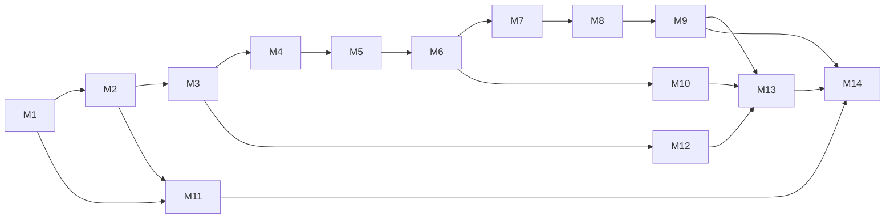

# Stage 2 — Document 16: Implementation Roadmap

| Field | Value |
|---|---|
| Document ID | DIP-RDM-01 |
| Version | 0.1 |
| Builds on | `01`–`18` (requirements, designs, ADR gates, capacity benchmarks B1–B12, test gates, DR drills) |
| Note | Independent reference architecture. **Effort and duration figures are planning estimates** from the assumptions in §2 (±30–40% until Milestone 3 provides measured velocity). No calendar dates are asserted. |

---

## 1. Delivery approach
1. **Walking skeleton first** (M1–M3): thin end-to-end path (upload → event → worker → status) with CI/CD, observability and security baselines in place before depth is added.
2. **Value early:** a usable hybrid search over the pilot corpus (end of M7) precedes RAG (M8); analytics (M10) and hardening (M11–M14) follow.
3. **De-risk before scale:** corpus sampling, golden-set creation, GPU procurement and capacity benchmarks start in M1; each tier step (Initial → Medium → Large) is gated by measured evidence (§8).
4. **Vertical slices, horizontal tracks:** each milestone delivers production-quality code *with* tests, docs, dashboards, alerts and runbook stubs (definition of done, §3).
5. **Continuous tracks** run throughout: Evaluation & Data (golden set), Security (threat model, red team), Platform (CI/CD, IaC), QA automation.
6. **Decision gates** (G1–G6, §8) are explicit approval points; ADR open items are scheduled where they block work (`18` §3).

## 2. Planning assumptions (to be confirmed)
| ID | Assumption | Effect if wrong |
|---|---|---|
| PA-1 | Core team ≈ 14 FTE: 5 Java backend, 4 Python/ML/data, 2 platform/SRE, 1 SDET, 1 security engineer (part-time shared), 1 architect/tech lead; plus part-time PM, SME annotators (≈ 0.5 FTE), UX/front-end as separate workstream (UI not in this architecture set) | Duration scales roughly inversely; ML track is the bottleneck risk |
| PA-2 | Infrastructure environments available at M1 (dev, test); staging by M3; GPUs: 4–8 in staging by M4 | OCR/embedding/LLM milestones slip with GPU lead time (procurement may take months if on-prem: start in M1) |
| PA-3 | Sample corpus (≥ 1,000 real documents, sanitized or approved for staging) available by M2; SMEs available for labeling (U-06) | Evaluation and quality claims blocked (R11) |
| PA-4 | U-01, U-02, U-04 answered by end of M1; others by their needed-by milestone (`18` §3) | Re-work in hosting/isolation design |
| PA-5 | Sprints of 2 weeks; effort in **person-weeks (pw)**; complexity T-shirt scale S (≤ 10 pw), M (10–30), L (30–60), XL (> 60) | – |

Indicative timeline: sequential critical path ≈ 70–80 weeks; with parallel tracks (M10, M11, M12 overlap earlier milestones) a **calendar of about 17–21 months to production readiness for the Medium tier** is a planning figure; Large-tier expansion is a post-M14 program gated by benchmarks (§8). These are estimates, to be replaced by velocity data after M3.

## 3. Definition of Done (applies to every milestone)
Code merged with ≥ 80% coverage on core packages; contract tests (API/events/DB) green; security checks (SAST/SCA/image/secret) clean; dashboards, alerts and runbook stub for each new component; threat model delta reviewed; ADR updated if a decision was made; docs updated (OpenAPI, event schemas, DDL); performance smoke within budget; demo to stakeholders; deployed to staging via GitOps.

## 4. Milestone overview

```mermaid
gantt
    title Milestone sequence (relative weeks, indicative)
    dateFormat  X
    axisFormat  W%s
    section Foundation
    M1 Foundation & architecture          :m1, 0, 6
    M2 Upload & storage                    :m2, 4, 10
    M3 Kafka ingestion                      :m3, 8, 16
    section Processing
    M4 PDF extraction & OCR                 :m4, 14, 24
    M5 Chunking & embeddings                :m5, 22, 30
    section Retrieval
    M6 Vector & keyword search              :m6, 28, 36
    M7 Hybrid retrieval & reranking         :m7, 34, 40
    M8 RAG & LLM                            :m8, 38, 46
    M9 Multi-document reasoning             :m9, 44, 52
    section Platform tracks
    M10 Analytics engine                    :m10, 36, 48
    M11 Security & audit                    :m11, 30, 50
    M12 K8s deployment & observability      :m12, 20, 54
    M13 Performance optimization            :m13, 50, 62
    M14 Production readiness & DR           :m14, 58, 68
```

Dependency map:

Critical path: M1 → M2 → M3 → M4 → M5 → M6 → M7 → M8 → M9 → M13 → M14. Parallelizable: M10 (after M6), M11 (from M2, hardening continuous), M12 (from M3, infrastructure maturity continuous), evaluation/labeling track.

---

## 5. Milestones

Conventions per milestone: **Objectives · Tasks · Dependencies · Deliverables · Acceptance criteria (measurable) · Test cases · Complexity/effort.** Requirement IDs refer to `02`.

### M1 — Foundation and architecture
**Objectives:** Establish repositories, standards, environments, CI skeleton, identity baseline, domain model; resolve gating decisions; start long-lead items.
**Tasks:**
1. Monorepo/multi-repo layout; coding standards; ADR process; Spring Boot service template (health, metrics, tracing, problem+json, config, security filters); Python worker template (Kafka consumer skeleton, OTel, idempotent handler harness).
2. CI/CD skeleton: build, unit/SAST/SCA, image build/sign, ephemeral env; Terraform for dev/test; Argo CD bootstrap; internal registry.
3. Dev/test clusters with Kafka, PostgreSQL, MinIO, OpenSearch, vector DB (single-node), Redis, Keycloak (Testcontainers parity).
4. Identity baseline: Keycloak realm, OIDC login for a test UI/API client, gateway JWT validation, role/permission seed, departments model (`06` `iam` schema + Flyway).
5. Domain model and DB migrations for `iam`, `docs` core tables; event envelope + schema registry decision (ADR-016).
6. Stakeholder workshops: resolve U-01, U-02, U-04, U-05 as far as possible; ratify NFR targets; classification scheme draft.
7. **Long-lead starts:** GPU procurement request (sized by `16` Initial/Medium), corpus sampling plan (A-02, A-06 measurement), golden-set labeling plan and tooling, red-team charter.
8. Threat model v1 and security baseline policies (network policies, admission rules) in dev.
**Dependencies:** approval G1 (architecture), access to environments.
**Deliverables:** repos + templates, pipelines, dev/test envs, Keycloak realm, `iam` schema, ADR set updated (004, 016, 028 decided or defaulted), procurement request, sampling plan, threat model v1, team working agreement.
**Acceptance criteria:** (1) A "hello" service built, signed, deployed to dev via GitOps in ≤ 30 min from commit; (2) OIDC login → gateway → service returns 401 without token, 403 with insufficient role, 200 with proper role (automated tests); (3) CI blocks a deliberately vulnerable dependency and an unsigned image; (4) environment recreated from code in ≤ 4 h (dev); (5) decisions U-01/U-02 recorded or defaulted by board in writing; (6) NFR targets ratified or amended in the SRS change log.
**Test cases:** auth matrix skeleton (10 role × endpoint cases); pipeline negative tests (secret in repo, high-CVE dependency, unsigned image); Flyway migrate/clean on empty and seeded DB; template health/readiness/trace propagation test.
**Complexity:** M (≈ 25 pw). Risk: hosting decision delay.

### M2 — Document upload and storage
**Objectives:** Resumable direct-to-object-store upload, versioning, lifecycle skeleton, metadata, validation entry point, outbox.
**Tasks:**
1. `docs` schema (documents, versions, metadata, upload sessions, outbox), `iam.document_acl` basics, document-level authorization checks.
2. `POST /documents/upload`, `/complete`, `/parts`, `GET /documents/{id}`, `/status`, list with keyset pagination; bulk-upload; idempotency keys; problem+json errors; OpenAPI published and contract-tested.
3. Object storage integration: multipart, presigned URLs, hash verification (streaming), object lock on audit prefix; per-document DEK envelope (ADR-015 decision default/proposed) and KMS/Vault integration stub.
4. Version state machine (domain code) and transitions API; duplicate detection by SHA-256; new-version linking.
5. Transactional outbox + publisher (Kafka may be a stub topic in M2 using embedded Kafka); lifecycle states and retention fields.
6. Quarantine landing prefix and validator interface (stub: type/size/extension checks).
7. Basic UI/CLI upload client for testing (resume, bulk).
**Dependencies:** M1.
**Deliverables:** document-service v0.1, OpenAPI v1 (documents subset), upload client, DB migrations, runbook for upload failures, dashboards (upload rate, errors).
**Acceptance criteria:** (1) 5 GiB file upload succeeds with forced connection drops and resumes without re-uploading completed parts; (2) SHA-256 mismatch rejected with `422`; (3) 1,000-item bulk upload accepted with per-item results; (4) upload initiate P95 ≤ 300 ms at 50 rps; (5) outbox: killing the service between DB commit and publish loses 0 events across 1,000 trials; (6) users cannot read documents outside their department (0 leaks in 500-case ACL matrix); (7) OpenAPI conformance 100% for implemented endpoints.
**Test cases:** multipart resume; presigned URL expiry; duplicate upload policy (warn/reject); concurrent version creation (unique constraint, optimistic locking); outbox crash test; authorization matrix; large-file hash verification time (≤ 2 min for 5 GiB at target hardware).
**Complexity:** M (≈ 30 pw).

### M3 — Asynchronous ingestion using Kafka
**Objectives:** Event backbone, orchestrator, retry/DLQ topology, page-range task framework, idempotency, priorities and governor; first load test.
**Tasks:**
1. Kafka (Strimzi) in test/staging; topic-as-code; Schema Registry; ACLs; client configs (idempotent producers, cooperative consumers, static membership).
2. ingestion-orchestrator: `ingest` schema (`processing_jobs`, `processing_events`, `processed_events`), validation stage (real MIME sniffing, AV scan integration, active-content detection), planner (page-range splitter using a probe), dispatcher with in-flight caps (ADR-027), stage advancer (conditional SQL), lease sweeper, retry tiers and DLQ, operator console API (list/reprocess/replay).
3. Worker framework (Python): generic `StageWorker` with idempotency/lease/checkpoint, weighted priority poller, backpressure pause/resume, sandbox runtime class (gVisor/Kata) and resource limits.
4. Stub workers (echo/sleep/fail modes) to test the framework at scale; fault-injection hooks.
5. Backfill governor and priority topics (ADR-018); KEDA lag-based autoscaling.
6. Observability: queue lag/age metrics, task histograms, state counts, ingestion dashboard, DLQ alerts; trace propagation across Kafka.
7. **Load/fault test program:** Kafka at 10× planning peak, redelivery, rebalance, broker kill, consumer crash; **B9, B11**.
**Dependencies:** M2 (events), M1 (CI/CD, templates), ADR-016.
**Deliverables:** orchestrator v0.1, worker framework + stub pool, Kafka topics/ACLs as code, ops console API, ingestion dashboards/alerts, chaos test suite, load-test report (measured partition/lease/dispatch parameters), ADR-002/003/018/027 evidence.
**Acceptance criteria:** (1) Duplicate delivery ×3 of every message leaves identical final state (0 diffs in 1,000-document run); (2) worker kill mid-task → task completes ≤ lease + backoff, no duplicate side effects; (3) with a 10,000-page synthetic document in flight, P95 pipeline time of 100-page documents increases ≤ 20% (NFR-SCL-04); (4) single broker kill → no loss, producers continue; 2-broker kill → outbox buffers, 0 lost acknowledged uploads, recovery lag cleared ≤ 15 min; (5) DLQ path correct for the four error classes; (6) lag-based autoscaling reaches target within 5 min; (7) throughput: orchestrator dispatch ≥ 500 tasks/s sustained (≥ 10× Large avg) with PG CPU < 50%.
**Test cases:** `15` §4.5 full table; stale-event guard; per-document cap; governor under p0 load; schema evolution test; sweeper correctness under clock skew.
**Complexity:** L (≈ 45 pw).

### M4 — PDF extraction and OCR
**Objectives:** Real extraction and OCR with page-level routing, layout/tables, quality scoring; bake-offs B2/B7; classification and language detection.
**Tasks:**
1. Extraction workers: born-digital PDF text with coordinates, reading order, header/footer detection (cross-range confirmation), tables (ruled/unruled), figures/captions, equation handling (LaTeX or image fallback); Office formats (DOCX/XLSX/PPTX) native extractors.
2. Page triage (digital vs scanned) with thresholds fitted on the sample; OCR pool (engine selected by **bake-off B2**: ≥ 3 candidates + Tesseract baseline); preprocessing (deskew/denoise); confidence capture; layout/table models only where needed.
3. Merge step: document structure tree, cross-range tables, header/footer consolidation, per-page quality score and `LOW_QUALITY` flag; page artifacts to object storage (`page-range.json` schema); content normalization (Unicode, hyphenation, hidden/zero-width character stripping for injection hygiene).
4. Classifier (rules + small model), language detection, injection-pattern detector (`12` §10), PII tagging (optional).
5. Sandbox hardening and fuzzing of parsers (continuous fuzz target); malicious-file corpus; quarantine flow (`12` §11).
6. Benchmarks: **B2 (OCR s/page), B7 (extraction CPU)**, measure real scan share (validates A-06) and page-count distribution (A-02) on the sample.
**Dependencies:** M3 (framework), sample corpus (PA-3), GPUs in staging (PA-2).
**Deliverables:** extraction/OCR workers, page-artifact schema, quality reports, OCR bake-off ADR/report, updated capacity model inputs, adversarial corpus + fuzz harness, classification model v1.
**Acceptance criteria:** OCR CER ≤ 1.5% (clean), ≤ 4% (medium), ≤ 12% (poor) on the labeled set (`15` §4.7); table TEDS ≥ 0.85 ruled / ≥ 0.70 unruled; reading-order ≥ 0.95; page triage accuracy ≥ 0.98 with false-"digital" ≤ 1%; no parser sandbox escape or crash cascade in the exploit corpus (0 escapes; crashes isolated to one task); 100-page digital PDF extracted in ≤ 2 min P95 and scanned in ≤ 20 min P95 on staging (feeds NFR-PRF-06); measured scan share and page distribution published, capacity model updated (CAP-2 partial).
**Test cases:** golden-file extraction tests per layout type; mixed digital/scanned PDF; encrypted/corrupt files; zip/PDF bombs; macro documents; OCR regression on engine/version change; partial-failure policy (skip page + flag) verified; large-document (5,000 pages) behavior and memory ceiling.
**Complexity:** XL (≈ 65 pw). Risk: OCR quality/cost (R1), parser exploits (R9).

### M5 — Chunking and embeddings
**Objectives:** Structure-aware chunking, embedding service with GPU batching, model registry, embedding archive, bake-off B1, golden-set v1.
**Tasks:**
1. Chunker (ADR-008): section tree, parent-child, table/equation atoms, contextual prefix, deterministic chunk IDs, `ingest.document_chunks` + chunk Parquet in object store; strategy per document type; chunker version registry.
2. Embedding service: dynamic batching, FP16/INT8, bisect-on-OOM, content-hash cache, cross-version vector reuse, retry/DLQ; **embedding archive** (ADR-017); `embedding_metadata`; model registry (`ai.model_registry`) with lifecycle states and eval report links.
3. **Embedding bake-off (B1)** over ≥ 3 candidates on the golden set v1 (≥ 500 labeled queries, `09` §5.1); dimension/quantization study; decision recorded (ADR-007 outcome).
4. Evaluation harness v1 (`dip-eval`): Recall@K, nDCG, MRR, reports to object store; nightly smoke; gating framework wired to CI paths.
5. Golden-set tooling and SME labeling pipeline; pooling-based judgments; synthetic bootstrap flagged.
6. Embedding drift metrics and cost metrics.
**Dependencies:** M4 (artifacts), SMEs (U-06), GPUs for embedding.
**Deliverables:** chunking worker, embedding service, model registry v1, golden set v1 (frozen test split), evaluation harness v1, bake-off report, measured B1 throughput, chunk statistics report, updated capacity model.
**Acceptance criteria:** chunk IDs deterministic (re-run yields identical IDs/text hashes in 100% of documents); tables never split without repeated header (100% in test set); every chunk carries page range/section path (100%); embedding throughput measured and ≥ 80% of the assumption **or** capacity model updated; poison chunk isolated without stalling (injected 1-in-10,000 bad chunk) ; vector reuse across versions saves ≥ 60% of embed tokens on a revision test set where ≤ 20% of pages changed; embedding model chosen with documented margin: best candidate ≥ +3 pt nDCG@10 vs baseline BM25-only dense baseline *or* decision recorded with trade-offs; golden set ≥ 500 queries with κ ≥ 0.7 inter-annotator agreement on a 100-query overlap.
**Test cases:** chunker golden files per type; idempotent re-chunk; embedding cache hit/miss; OOM bisect; model registry transitions; chunk-label remapping by text overlap after chunker version change.
**Complexity:** L (≈ 50 pw).

### M6 — Vector and keyword search
**Objectives:** Index writers, `searchable` flip, OpenSearch + vector DB indexes, first search API with ACL filtering; benchmarks B5 (10M, 100M), B8.
**Tasks:**
1. Indexer: OpenSearch index templates/analyzers (`11` §2.1), vector collection per model version, payload indexes; idempotent bulk upserts; ILM/rollover; atomic `searchable` flip after both confirm (ADR-014); reconciliation job R-INDEX/R-ACL v1.
2. `acl_tags` derivation and `iam.permission.changed` consumer for retagging; PG post-check batch API.
3. search-service v0.1: scope resolver, KEYWORD and SEMANTIC modes, filter compilation, exact-search switch for narrow filters, ID-first retrieval (ADR-019), caching with permission fingerprint; `POST /search`; degraded-mode semantics.
4. **Benchmarks:** B5 on 10 M (real embeddings) and 100 M (amplified, flagged) with ACL filters; B8 OpenSearch sizing/throughput; recall vs exact audit job.
5. **Permission-bypass suite v1** (randomized + adversarial probes), cross-fingerprint cache tests.
6. Dashboards: search stage latency, index parity, ACL drop ratio.
**Dependencies:** M5 (chunks/embeddings), ADR-006 first selection.
**Deliverables:** indexer, search-service v0.1, index templates, reconciliation v1, B5/B8 reports (ADR-006/031 evidence), security suite v1, search dashboards.
**Acceptance criteria:** ANN recall@100 vs exact ≥ 0.97 at the chosen operating point on filtered workload at 10 M; P95 BM25 ≤ 150 ms and vector ≤ 200 ms at 10 M under 50 QPS; permission suite 10,000 probes → 0 unauthorized hits; revocation effective ≤ 60 s (probe) with PG post-check making it immediate for a revoked document; index parity drift < 0.01% after ingesting the pilot corpus; `searchable` never true for partially indexed versions (fault-injection test killing indexer mid-way); search works in degraded mode when either engine is down (200 + `degraded`).
**Test cases:** `15` §4.2 search rows; filter selectivity edge cases; tag-explosion fallback; stale-tag revocation test; duplicate/near-duplicate collapsing; reindex alias switch.
**Complexity:** L (≈ 45 pw).

### M7 — Hybrid retrieval and reranking
**Objectives:** RRF fusion, reranker service, adaptive retrieval, query rewriting (rules), evaluation gates active; **B3**.
**Tasks:**
1. Fusion (RRF, weights, identifier-intent rules), dedupe/collapse (exact, near-dup, cross-version), diversification, parent expansion, section-level index for hierarchical retrieval (summaries optional, M9 for generation).
2. Reranker service (bake-off ≥ 3 candidates, GPU batching), candidate cap, adaptive skip, timeout fallback, caching; **B3** knee curves and skip-parity study.
3. Query processing: normalization, acronym/synonym glossary governance (versioned artifact), conversational rewrite (small LLM optional/behind flag), multi-query (off by default).
4. Evaluation gating enforced (Gate 1 retrieval); ablations: BM25-only, vector-only, hybrid, +rerank; hyperparameter tuning (dev split) and confirmation (test split).
5. Search feedback endpoint and online metrics; learned sparse (SPLADE-class) evaluation spike.
**Dependencies:** M6, golden set (M5), GPUs for reranker.
**Deliverables:** hybrid search v1.0, reranker service, glossary v1, tuning report (parameter table `11` §7), B3 report (ADR-032 evidence), eval gate in CI, public search API v1 final.
**Acceptance criteria:** Recall@50 (pre-rerank) ≥ 0.95; Recall@20 ≥ 0.90; nDCG@10 ≥ 0.75; MRR ≥ 0.70 (golden test split); hybrid nDCG@10 ≥ best single retriever + 5 pt; P95 hybrid search ≤ 800 ms at 100 QPS (Medium-scaled staging) ; reranker adaptive skip preserves nDCG@10 within 0.5 pt while skipping ≥ 30% of queries (or decision recorded); each single-component failure leaves 200 + `degraded` (chaos test); pilot users (Initial tier, ≈ 10,000 docs) can use search — **first user-visible release (Pilot)**.
**Test cases:** RRF property tests; identifier query set (part numbers, doc numbers); revision-similarity hard negatives; load/soak at planned QPS; cache correctness (no cross-fingerprint hits).
**Complexity:** M–L (≈ 35 pw).

### M8 — RAG and LLM integration
**Objectives:** llm-gateway, RAG pipeline with citation validation and evidence status, structured response, router, sessions; **B4, B6**.
**Tasks:**
1. LLM serving (vLLM-class) in no-egress namespace; llm-gateway (quotas, timeouts, breaker, audit hashing); model/prompt registry integration; **LLM bake-off** (≥ 3 candidates; faithfulness, latency, tokens/s B4); NLI bake-off (B6).
2. ai-orchestration: router (rules + small classifier), context selection/compression, prompt templates (versioned, injection-aware), structured generation, citation validator (`05` §8.3), repair loop, evidence assessor and bands, INSUFFICIENT_EVIDENCE path, fallback to retrieval-only; sessions/messages/responses/citations persistence; SSE streaming with `final` event.
3. `POST /ai/query`, `/ai/summarize` (single-doc), chat session APIs; permission re-checks; exposure audit.
4. RAG evaluation suite (golden QA incl. unanswerable); ablations (rewrite/rerank/compress/prefix/repair); human adjudication process; band calibration against golden set.
5. Security: injection corpus v1 in CI; output sanitization; no-tool generation step.
**Dependencies:** M7, GPUs for LLM/NLI, golden QA set (SME effort).
**Deliverables:** RAG v1, llm-gateway, validator, evaluation reports (faithfulness, citation P/R, hallucination, unanswerable), B4/B6 reports, calibrated bands, injection suite v1, model/prompt registry entries with eval reports.
**Acceptance criteria:** faithfulness ≥ 0.95; citation precision ≥ 0.95; citation recall ≥ 0.90; post-validation hallucination ≤ 2%; unanswerable detection ≥ 90% with false refusal ≤ 10%; HIGH band observed faithfulness ≥ 0.97; **0** unauthorized exposure (permission suite on AI endpoints) and **0** successful injection exfiltration in ≥ 200 cases; TTFT ≤ 3 s and complete ≤ 15 s P95 at Initial-scale load; LLM outage → retrieval-only response (chaos test); every answer's sources verified against stored text (100%).
**Test cases:** `15` §4.8; each validator failure code; repair loop bound; context overflow; session re-authorization after ACL revocation; LLM timeout; malformed JSON recovery.
**Complexity:** XL (≈ 65 pw). Risk: LLM quality ceiling (R14, U-09).

### M9 — Multi-document reasoning
**Objectives:** Compare, conflict/supersession detection, hierarchical RAG and summaries, bounded decomposition/corrective retrieval; optional Graph/Agentic pilots.
**Tasks:**
1. Version graph usage in retrieval (current default, superseded flags); supersession reference extraction + document-controller review UI/API; conflict detection (structured fact extraction: entity/attribute/value/unit; unit normalization); offline conflict scan job over lakehouse/PG facts (advisory).
2. Version comparison pipeline (section alignment, diff, change classification, validated quotes); `POST /documents/compare`.
3. Hierarchical RAG: section/document summaries (map-reduce, versioned, ACL-inheriting) and coarse-to-fine retrieval; multi-document summarization.
4. Query decomposition (≤ 3 depth), corrective retrieval (1 round), HYBRID (SQL+RAG) planning stub for M10.
5. **Pilots (optional, gated):** Graph RAG on one project subset; agentic multi-hop on the multi-hop set; adopt only with ≥ 3 pt gain and bounded cost (`10` §4).
6. Evaluation sets for conflicts, comparison, multi-hop; ablations.
**Dependencies:** M8, version/lifecycle data, SMEs/document controllers.
**Deliverables:** compare/conflict/supersession features, hierarchical retrieval, summary store, evaluation reports, pilot reports (go/no-go ADRs), document-controller workflow.
**Acceptance criteria:** conflict detection recall ≥ 0.85 and precision ≥ 0.80 on the seeded set; superseded-information detection recall ≥ 0.90 on labeled version pairs; comparison change recall ≥ 0.85 with 100% validated quotes; multi-hop set answer accuracy improves ≥ 5 pt over single-pass RAG; summaries: faithfulness ≥ 0.95, coverage metadata correct; hierarchical retrieval improves Recall@20 on wide-scope queries ≥ 5 pt or reduces latency ≥ 30% at equal quality; pilot go/no-go decisions recorded.
**Test cases:** revision pairs with known changes; unit-converted conflicts ("0.028 kV" vs "28 V"); same-version internal contradiction; multi-document diversity constraint tests; decomposition depth limits.
**Complexity:** L (≈ 45 pw).

### M10 — Analytics engine
**Objectives:** Operational/analytical separation, curated views, safe NL-to-SQL, ClickHouse and Spark paths, router integration.
**Tasks:**
1. CDC (Debezium) and event sinks → Iceberg; curated schemas/views (documents, versions, processing metrics, usage); ClickHouse deployment and ingestion; row-level policies; read-only roles.
2. analytics-service: SQL validator (AST), schema allow-list, cost estimation (EXPLAIN), timeouts/row caps, audit, async batch (Spark on K8s) path and result download; NL-to-SQL planner (small LLM, schema-subset prompting), golden SQL set (150).
3. Router integration (SQL/SPARK/HYBRID) and HYBRID plans (SQL → document IDs → RAG scope).
4. Statistical/trend functions library; scheduled reports; dashboards for ingestion health from the lake.
5. Security tests for SQL (DDL/DML/file functions/injection), row-level policy tests.
**Dependencies:** M6 (data), M3 events, ClickHouse/Iceberg infra from M12 track.
**Deliverables:** analytics API v1, curated datasets, validator, NL-to-SQL, Spark job template, SQL evaluation report.
**Acceptance criteria:** NL-to-SQL execution accuracy ≥ 0.80 on the golden SQL set; **0** non-read-only executions and 100% rejection of the SQL safety corpus (≥ 500 statements); interactive query P95 ≤ 5 s on 100 M-row curated tables; row-level policy tests 0 leaks; estimate-exceeds-budget queries route to batch with correct status API; analytics load does not change OLTP P95 (OLTP isolation test: ΔP95 ≤ 5%).
**Test cases:** `15` §4.2 analytics rows; EXPLAIN-based cost gating; tenant/department row policy fuzz; Iceberg delete + compaction correctness (for deletion saga).
**Complexity:** L (≈ 40 pw).

### M11 — Security and audit
**Objectives:** Close security gaps, formal audit service, key/secret management, PDP decision, red-team and pen-test, deletion saga.
**Tasks:**
1. audit-notification service: append-only store, hash chain, WORM anchors, local spool, audit APIs (`GET /audit/logs`, exports), separation of duties (Audit Admin), SIEM forwarding.
2. Key management: KMS/HSM integration, KEK/DEK hierarchy (ADR-015 final), rotation, crypto-erasure, application-level field encryption for chat/prompt data; Vault dynamic DB credentials.
3. **PDP spike and decision (ADR-020)**; policy-as-code tests; step-up authentication for sensitive operations; token revocation list; ABAC attributes.
4. Deletion saga (all stores incl. Iceberg), legal-hold handling, retention jobs, deletion ledger, certificates; reconciliation R-DEL.
5. Network policies and mTLS enforcement across namespaces; admission policies (signed images, PSS restricted); sandbox runtime verification; egress deny verification tests.
6. Security test program: expanded permission/injection corpora, SQL suite, DAST, parser fuzzing in CI, **external pen-test #1** (staging), remediation.
7. Row-level security prototype on `docs.documents` (defense in depth); data classification workflow (downgrade approvals).
**Dependencies:** M2 (documents), M6 (index tags), M8 (AI), parallel with M7–M10.
**Deliverables:** audit service, KMS/Vault integration, deletion saga, ADR-020 outcome, pen-test report + closure, security dashboards/alerts, runbooks (incident response).
**Acceptance criteria:** audit completeness 100% in event-coverage test (every action class produces an audit record ≤ 60 s) and tamper test detects 100% of modified rows; key rotation completes without data loss; crypto-erasure test: erased document unreadable and absent from all stores, certificate recorded, verified after restore replay; egress deny: 100% of attempted connections from `ai-gpu`/`processing` blocked and alerted; pen-test: 0 critical/high unresolved; permission-bypass suite 0 leaks; PDP p99 ≤ 20 ms at 2,000 decisions/s; secrets scanners 0 findings.
**Test cases:** `12` §15 table; differential authorization matrix; break-glass flow; audit chain verification after partition rotation; legal-hold deletion refusal.
**Complexity:** XL (≈ 60 pw).

### M12 — Kubernetes deployment and observability
**Objectives:** Production-grade platform: staging parity, GitOps, autoscaling, mesh/backends decisions, full observability, canary/blue-green.
**Tasks:**
1. Production/staging Terraform/IaC; node pools (GPU, stateful, processing sandbox); storage classes; Strimzi/operators for all stateful services in HA; Argo CD app-of-apps with sync waves; policies-as-code repository.
2. Service mesh/mTLS decision (ADR-023) by measurement; ingress/WAF; admin ingress separation.
3. Observability stack (ADR-024), OTel collectors, dashboards/alerts/SLOs as code (`17`), synthetic canaries, runbooks; log scrubbing tests.
4. Progressive delivery (Argo Rollouts/Flagger), blue-green for gateway/model servers; rollback drills; DR-site bootstrap (empty cluster from IaC).
5. KEDA scalers for all worker pools and model servers; priority classes; PDBs; quotas.
6. Backup tooling (pgBackRest, snapshots, Velero, replication) deployed (restore tests in M14).
**Dependencies:** M3 (needs Kafka/workers), M1 CI/CD; continuous with other milestones.
**Deliverables:** staging and production clusters, GitOps repos, observability stack, SLO dashboards, canaries, release process docs.
**Acceptance criteria:** environment recreated from code ≤ 4 h (I-AC1); zero-downtime rolling deploy under load (0 failed requests beyond error budget); rollback ≤ 10 min (service/model/config drills); admission rejects unsigned/privileged/`latest` (I-AC6); network isolation matrix 100% as designed; every SLO has dashboard + burn-rate alert + runbook (NFR-OBS-02); trace coverage ≥ 99% (NFR-OBS-01); canaries detect deliberate faults ≤ 10 min; no content/PII in logs (scanner test).
**Test cases:** `13` §11, `17` §12.
**Complexity:** XL (≈ 60 pw, spread across the timeline).

### M13 — Performance optimization
**Objectives:** Measure and tune to NFRs at Medium scale; validate capacity model; tiering and mitigation work; Large-readiness evidence.
**Tasks:**
1. Full load/stress/soak/spike program (`15` §4.9); ingestion throughput at scaled rate; scalability curves; capacity benchmarks B1–B12 consolidated; update `16` model (±25% validation).
2. Optimizations driven by profiles: vector parameters (`M`, `ef`, quantization/oversample), OpenSearch shard/index layout, PG queries/indexes, adaptive reranking, prefix caching/compression, cache hit rates, Kafka tuning, GPU batch sizes, autoscaling thresholds.
3. Tiered indexing implementation (ADR-031) and archive tier policy; chunk-metadata offload design (ChunkRepository → lakehouse) if needed; embedding-migration rehearsal (blue/green) on staging.
4. B5 at 1 B (amplified + real-distribution validation) and ADR-006 final decision; cost model with real unit costs; capacity forecast dashboards.
5. Medium-scale data load (≈ 1 M documents synthetic/public amplified) in staging, including index-scale tests and DR snapshot sizes.
**Dependencies:** M9, M10, M12 (production-like staging), GPUs.
**Deliverables:** performance report, updated capacity model/BOM for Medium (and evidence-based projection for Large), tuned configs (versioned), ADR-006/031/032 closed, tiering implementation, cost dashboards.
**Acceptance criteria:** all NFR-PRF targets met at Medium planning peak (search P95 ≤ 800 ms, RAG TTFT ≤ 3 s/complete ≤ 15 s, ingestion ≥ 5,600 docs/day sustained with burst headroom, upload initiate ≤ 300 ms); stress: graceful degradation, no data loss/unauthorized exposure at 300% load; soak 72 h clean; capacity model predictions within ±25% of measured; NFR-SCL-04 re-verified; B5 decision documented with pass/fail rule applied; migration rehearsal completes with rollback tested.
**Test cases:** as above plus tail-latency injection, index-merge-under-load, vacuum/bloat soak.
**Complexity:** L (≈ 45 pw).

### M14 — Production readiness and disaster recovery
**Objectives:** Verify DR, finalize operations, complete readiness checklist, execute go-live for the Medium tier (or phased pilot → production), handover.
**Tasks:**
1. DR environment and replication (PG, object, Kafka MM2, snapshots, embedding archive) in production-like staging and production; **restore benchmarks** on real volume replacing §8.3 estimates; cross-site DR exercise (partial) then game day; ransomware tabletop + immutable-backup rebuild; erasure replay test.
2. Runbooks complete (`14` S1–S20), on-call rotation and escalation, incident process, training, operator console; communication templates.
3. Final security review: pen-test #2, red-team (injection/bypass), compliance mapping (once U-03 known), access reviews, secrets rotation.
4. Production-readiness checklist (`20`) review; risk register review; launch plan (phased onboarding by department, hypercare plan, rollback criteria); user documentation and training; UAT sign-off including BO-1 time study.
5. Operational handover: SLO ownership, error-budget policy adoption, capacity review cadence, cost reporting.
**Dependencies:** M11, M12, M13, M9.
**Deliverables:** DR test reports (measured RTO/RPO), signed readiness checklist, launch/hypercare plan, final runbooks, UAT report, operational handover pack.
**Acceptance criteria:** measured RTO/RPO meet `14` §2 targets (T0 ≤ 1 h, T1 degraded ≤ 4 h) or approved variance; weekly automated restores 100% for 4 consecutive weeks; all checklist items complete or have signed risk acceptance; pen-test 0 critical/high open; UAT: median task time ↓ ≥ 50% (BO-1) and sign-off by business owner; hypercare staffing in place; no open S1/S2 defects.
**Test cases:** `14` §12 full programme, `15` §6 release gate, canary/rollback dry-run at launch.
**Complexity:** L (≈ 35 pw).

---

## 6. Effort and resourcing summary

| Milestone | Complexity | Effort (pw, ±35%) | Primary skills | Parallel with |
|---|---|---|---|---|
| M1 | M | 25 | architect, platform, security | – |
| M2 | M | 30 | Java, platform | M1 tail |
| M3 | L | 45 | Java, Python, SRE | M12 start |
| M4 | XL | 65 | Python/ML, SRE | – |
| M5 | L | 50 | Python/ML, data/eval | labeling |
| M6 | L | 45 | Java, search, SRE | M11 |
| M7 | M–L | 35 | search, ML | M10, M11 |
| M8 | XL | 65 | Java, ML, security | M10, M11 |
| M9 | L | 45 | ML, Java | M10, M11, M12 |
| M10 | L | 40 | data eng, Java | M7–M9 |
| M11 | XL | 60 | security, Java, SRE | M6–M10 |
| M12 | XL | 60 | SRE/platform | M3–M13 |
| M13 | L | 45 | all | – |
| M14 | L | 35 | SRE, security, QA | – |
| **Total** | | **≈ 645 pw** | | |
645 pw ÷ 14 FTE ≈ 46 weeks if perfectly parallel; realistic with dependencies, ramp, reviews, defects and hiring ≈ 70–90 weeks, consistent with the 17–21 month planning figure. If the team is smaller (e.g., 8 FTE) duration extends toward 24–30 months; reduce scope by sequencing M9 pilots and M10 Spark path after first production use.

## 7. Scope priorities (MoSCoW across milestones)
| Priority | Items |
|---|---|
| **Must (production gate)** | M1–M8, M11, M12, M14; M13 NFR validation; core of M9 (compare/conflict/supersession) |
| **Should** | Hierarchical RAG, corrective retrieval, M10 ClickHouse path, tiered indexing (before Large), learned sparse evaluation |
| **Could (pilot, evidence-gated)** | Graph RAG, agentic RAG, HyDE, LTR, ColBERT-class retrieval, multilingual expansion (F-04) |
| **Won't (v1)** | Predictive analytics (F-03), federation (F-05), multimodal image search (F-07), fine-tuned models (F-06) unless evaluation triggers them |

## 8. Decision and release gates

| Gate | When | Decision | Evidence required |
|---|---|---|---|
| **G1 Architecture approval** | before M1 | Approve architecture, ratify NFRs, defaults for U-01…U-10 | Stage 1/2 documents, ADR index |
| **G2 Pilot readiness** | end of M7 | Release search to pilot users (Initial tier) | M7 acceptance, security suite, canary stable 2 weeks |
| **G3 AI readiness** | end of M8 | Enable RAG for pilot users | RAG gates, injection/permission 0 findings, LLM capacity at pilot load |
| **G4 Medium commitment** | after M13 evidence | Approve Medium-tier hardware/spend | Capacity model validated ±25%, B1–B6/B8 results, cost model |
| **G5 Production go-live** | end of M14 | Launch (phased by department) | Readiness checklist, DR measured, pen-test closure, UAT |
| **G6 Large-tier program** | after ≥ 3 months of Medium production telemetry | Approve Large expansion plan | B5 at scale, tier usage data, GPU benchmark updates, ADR-006/031 final, budget, DR retest at new size, U-08 real query rates |

## 9. Risk management in the plan (top items; full list in `03` §4)
| Risk | Plan mitigation | Milestone check |
|---|---|---|
| R1 OCR cost/quality | Early sampling (M1), bake-off (M4), triage | M4 acceptance |
| R2 Vector scale | B5 early (M6), tiering (M13), archive (M5) | M6/M13 |
| R3 Permission leakage | Suite from M6, repeated each milestone; red team M11/M14 | every release |
| R5 Large-doc blocking | M3 test with 10k-page doc | M3 |
| R6/R8 Hallucination/injection | M8 gates; CI corpora | M8/M11 |
| R11 No golden data | Labeling track from M1; synthetic flagged | M5 gate: no quality claims without it |
| R12 Operational complexity | Phased adoption (ClickHouse/Spark later), runbooks, platform staffing | M12/M14 |
| R13 Capacity assumptions | Benchmarks and model validation | M13 |
| R14 LLM quality ceiling | Early LLM bake-off (M8), retrieval-first value (G2) | M8 |
| Hosting/GPU lead time | Procurement in M1 | M4 |
| Staffing shortfall (PA-1) | Re-plan at M3 with measured velocity; scope levers (§7) | M3 |
| Scope creep from "agentic/graph" enthusiasm | Evidence-gated pilots with explicit adoption criteria | M9 |

## 10. Progress tracking and reporting
Per sprint: burndown vs milestone scope, acceptance-criteria dashboard (green/red per criterion), risk/ADR status, quality metrics (`15` §7), capacity-model variance, DORA metrics (lead time, deployment frequency, change failure rate, MTTR). Per milestone: demo, retrospective, update of estimates, re-baseline of the roadmap. Steering committee at each gate G1–G6.

## 11. Dependencies on stakeholders (explicit asks)
| Ask | Needed by |
|---|---|
| U-01 hosting; GPU procurement approval | M1 |
| U-02 classification scheme, tenancy | M1 |
| U-04 IdP details | M1 |
| Sample corpus access (PA-3), SME labeling capacity (≈ 0.5 FTE for ~9 months) | M2 / M5 |
| U-05 languages | M4 |
| U-09 approved LLM(s) and licenses | M7 (bake-off prep) |
| U-03 compliance regime, retention periods; U-10 deletion semantics | M2 (keys), M11 |
| U-07 source system connectors scope (and source retention for loss-report re-ingest) | M3 (connectors), M14 |
| U-08 realistic usage estimates / pilot telemetry | M7 onward |
| Business owner for UAT and BO-1 study | M14 |

## 12. Open items
| Item | Plan |
|---|---|
| UI/front-end plan and team (not in this architecture set) | Define in M1; needed for pilot (M7) and UAT |
| Connectors to source systems (U-07) | Scope in M3; implement as separate small services if required |
| Staffing plan and on-call model | Decide in M1; revisit at G4 |
| Training/change management | Plan in M12–M14 (documentation, workshops for document controllers) |
| Roadmap re-baseline after M3 | Mandatory |
