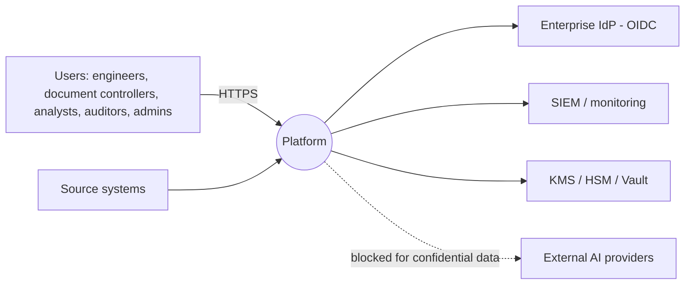
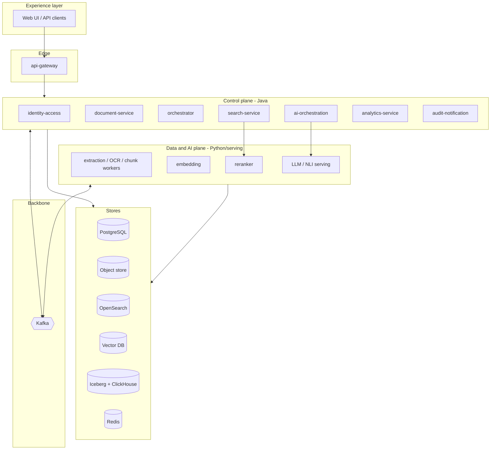

# System Architecture Document

| Field | Value |
|---|---|
| Document ID | DIP-SAD-01 |
| Version | 0.1 |
| Purpose | The single consolidated view of the architecture: it states the architecture once, links each element to requirements, quality attributes, decisions and detailed designs, and records the known limits. Detailed designs remain in the referenced documents; where they differ, this document names which governs. |
| Note | Independent reference architecture; not an ISRO specification. Capacity numbers are calculated from labeled assumptions and have not been benchmarked. |

---

## 1. Introduction

### 1.1 What the system is
A secure, distributed platform that ingests technical documents at scale, enriches them (text, tables, layout, OCR, classification), and exposes four deliberately separate engines: **retrieval** (find passages), **grounded reasoning** (RAG with validated citations, comparison, conflict/supersession detection), **structured analytics** (SQL/aggregation), and **batch/statistical analysis** (Spark). Authorization is enforced before any text reaches an LLM, and every access is audited.

### 1.2 Architectural drivers (from `02`)
| Driver | Source | Architectural consequence |
|---|---|---|
| Confidentiality; no content to external AI | C-02, NFR-SEC | Self-hosted models in no-egress zone; authorization layers L1–L7; encryption with per-document keys |
| Millions of documents / billions of pages, skewed sizes | A-01…A-03, NFR-SCL | Page-range tasks, independent worker pools, tiered indexes, quantized/disk ANN |
| Continuous ingestion with replay and failure isolation | NFR-REL | Kafka backbone, outbox, idempotent consumers, retry tiers/DLQ, reconciliation |
| Trustworthy, auditable answers | BO-2, BO-5 | Mechanical citation validation, evidence bands, structured responses, exposure audit |
| Distinct retrieval vs analytics vs reasoning | Brief §2 | Router, separate engines and stores (OLTP vs lakehouse/ClickHouse) |
| Scale-up path without redesign | NFR-SCL-03 | Same components at all tiers; deployment sizing differs; ports around replaceable stores |
| Java (control plane) + Python (AI) | C-01 | Two runtimes, contracts via OpenAPI/Avro, separate failure domains |
| Rebuildable derived data | R4, R7 | Object store + PostgreSQL as truth; indexes, vectors, caches, Kafka are derived |

### 1.3 Quality attribute priorities (ordered)
1. **Security/confidentiality** (never traded for performance or cost).
2. **Correctness and traceability** of answers and of data (provenance, audit, consistency).
3. **Reliability and recoverability** (no loss of acknowledged uploads; degrade before fail).
4. **Scalability** (independent horizontal scaling; evolution Initial → Large).
5. **Performance** (latency SLOs).
6. **Operability and observability.**
7. **Cost efficiency** (levers designed in: triage, tiering, quantization, adaptive reranking).

### 1.4 Constraints and assumptions
`01` §3.3 (constraints C-01…C-07), §3.1 (assumptions A-01…A-09), working defaults for U-01…U-10 in `04` §0. Notably: infrastructure under organizational control, S3-compatible storage, Kubernetes, single organization with classification tiers.

---

## 2. Architecture overview

### 2.1 Context (see `03` §1)

### 2.2 Architectural style
Event-driven microservices split by business capability and operational profile (13 deployables, ADR-026); synchronous query path (HTTP) with a latency budget; asynchronous ingestion path (Kafka); hexagonal service structure (domain core, ports to stores/models so engines can be replaced: `VectorStore`, `ChunkRepository`, `PolicyDecisionPort`, `LlmClient`); CQRS-like separation between authoritative stores (writes) and derived read-optimized indexes; policy-as-code for authorization, network and admission.

### 2.3 Principles
1. Object store + PostgreSQL are authoritative; everything else is rebuildable.
2. At-least-once delivery and idempotent consumers; no end-to-end exactly-once claims.
3. Deterministic pipelines first; LLM is one bounded step; agents only where evidence shows need.
4. Default deny; fail closed on authorization uncertainty.
5. Untrusted content (files, retrieved text) is data, processed in sandboxes and never instruction.
6. Every derived artifact inherits the strictest ACL/classification of its inputs.
7. Same architecture at every scale; scale is a deployment parameter.
8. Everything as code; immutable signed artifacts; measured, not assumed, capacity.

---

## 3. Logical architecture

### 3.1 Components (authoritative list; governs over earlier drafts)

| # | Deployable | Runtime | Responsibility | Data it owns | Detailed design |
|---|---|---|---|---|---|
| 1 | api-gateway | Java | TLS, JWT validation, rate limits, routing, WAF integration | none | `07` §1, `13` |
| 2 | identity-access-service | Java | IdP integration, org/dept/roles/ACLs, policy decision point, scope resolution | `iam.*` | `12` §3–4, `06` §4.1 |
| 3 | document-service | Java | Upload (presign/multipart), documents/versions/metadata, lifecycle, outbox | `docs.*` | `05` §2, `06` §4.2 |
| 4 | ingestion-orchestrator | Java | Validation, planning, page-range dispatch, state machine, retries, sweeper, reconciliation hooks | `ingest.processing_*` | `05` §3 |
| 5 | extraction-workers | Python (CPU, sandboxed) | PDF/Office extraction, layout, tables, triage, classification, language, injection/PII detectors | artifacts in object store | `05` §4, `09` §4.3 |
| 6 | ocr-workers | Python (GPU) | OCR with preprocessing and confidence capture; scales separately from extraction (same code base and contract) | artifacts in object store | `05` §4.3, `09` §4.3 |
| 7 | chunking-worker | Python | Structure-aware parent-child chunks, deterministic IDs, contextual prefix | `ingest.document_chunks` | `05` §6 |
| 8 | embedding-service | Python (GPU) | Batched embeddings, cache, archive, model versions | `embedding_metadata` | `09` §3 |
| 9 | search-service | Java | Query pipeline: scope → rewrite → BM25 ∥ vector → RRF → dedupe → rerank → ACL post-check → parents; indexer module | none (stateless) | `05` §5, `11` |
| 10 | reranker-service | Python (GPU) | Cross-encoder scoring | none | `09` §4.1, `11` §4 |
| 11 | ai-orchestration-service (incl. llm-gateway) | Java (+ Python gateway) | Router, RAG, compare/summarize, citation validation, evidence assessment, sessions; llm-gateway enforces quotas/timeouts/audit for model calls | `ai.*` | `05` §8, `10` |
| 12 | analytics-service | Java | Safe NL-to-SQL, ClickHouse/Spark execution, async jobs | none (read-only) | `07` §5, `12` §6.4 |
| 13 | audit-notification-service | Java | Append-only audit, hash chain/anchors, notifications | `audit.*` | `12` §9, `06` §4.6 |
Supporting platforms (not counted as deployables of this product): Kafka + Schema Registry, PostgreSQL, OpenSearch, vector DB, ClickHouse/Iceberg/Spark, object store, Redis, Keycloak, Vault/KMS, **model-serving workloads (LLM and NLI servers on GPU, no egress; registry in `ai.model_registry`, `09` §2, §4.2, §4.5)**, observability stack, Argo CD/CI.

### 3.2 Layered view

### 3.3 Dependency rules
- Only the control plane faces users; workers never call the control plane synchronously.
- No service writes another service's tables; cross-service data via APIs or events.
- The query path never depends on Kafka; the ingestion path never depends on the LLM.
- Models are reached only through `llm-gateway`/model APIs; model servers have no egress and no inbound from user zones.
- Synchronous call graph depth on the query path ≤ 3 hops (gateway → ai-orchestration → search-service → engines/reranker).

---

## 4. Runtime views

### 4.1 Ingestion (summary; sequence in `04` §2.4)
Client uploads directly to object storage via presigned multipart URLs → `complete` verifies hash, writes state + outbox atomically → `document.version.uploaded` → orchestrator validates (type, AV, active content), probes pages, splits into 25-page tasks (cap 8 in-flight per document, priority topics p0/p1/p2) → extraction/OCR workers write page artifacts → merge, classify → chunk (Parquet + metadata) → embed (archive + vector upsert) → index (OpenSearch + vector) → reconciliation confirms both → `searchable` flag flips atomically (ADR-014) → notification and audit.
State machine: UPLOADED → VALIDATING → QUEUED → PROCESSING → EXTRACTED → CHUNKED → EMBEDDING → INDEXING → INDEXED; plus RETRYING, FAILED, CANCELLED, QUARANTINED (`02` §2.3).

### 4.2 Search
Scope resolution (cached ≤ 60 s) → rewrite/intent → filter compilation (ACL tags ∩ scope, clearance, version state, user filters) → BM25 ∥ vector (k=200, ID-first) → RRF (k=60) → dedupe/collapse → rerank top 30 (adaptive) → PG post-check → diversification → parent expansion → response with provenance. Degradation: one retriever down → other + `degraded`; reranker down → fused order; both retrievers down → 503.

### 4.3 RAG / AI query
Router (rules → classifier → LLM fallback) → [retrieval as above] → ACL post-check → context selection/compression → generation under JSON schema (no tools; sources untrusted) → citation/claim validation (existence, permission, page, quote, numeric/entity, NLI) → one repair → evidence status + band → persistence and exposure audit. SQL route → analytics-service validation/execution; HYBRID → ≤ 3 step plan.

### 4.4 Analytics
CDC/events → Iceberg → ClickHouse curated views; NL question → SQL draft over allow-listed view schema → AST validation, row-level predicates, EXPLAIN cost gate → read-only execution with time/row limits → or async Spark job. Never reads OLTP tables.

### 4.5 Reprocess / model migration
Reprocess from a stage using artifacts in object storage; re-embedding uses chunk text + blue/green collections with alias flip (ADR-017, `09` §3.6). Deletion saga removes derived data and destroys DEK (`06` §7, `14` §9).

---

## 5. Deployment view

### 5.1 Topology (see `13` §4)
Kubernetes per environment (dev/test/staging/prod) with namespaces per trust zone (`edge`, `app`, `processing` sandboxed, `ai-gpu` no egress, `data` stateful on dedicated node pools, `obs`, `sec`). Production in a primary site across ≥ 3 failure domains plus a warm-standby DR site (ADR-021); third-location immutable backups.

### 5.2 Scale tiers (indicative; governed by `16`)
| Dimension | Initial (10k docs) | Medium (1M) | Large (10M) |
|---|---|---|---|
| Chunks | ≈ 5.6 M | ≈ 556 M | ≈ 5.56 B |
| Vector DB | single node | ≈ 10 nodes (5 shards ×2) | tiered hot/archive, ≈ 18 hot + 6–12 archive |
| OpenSearch | 3 nodes | 3–6 | 22–44 |
| GPUs (peak) | ≈ 16 | ≈ 28–40 | ≈ 140–180 backfill → ≈ 75–95 steady |
| Object storage (raw, primary / +DR) | 1.75 / 3.5 TB | 175 / 350 TB | 1.75 / 3.5 PB |
Assumption-based; replaced by benchmarks B1–B12 before each commitment (G4, G6).

---

## 6. Cross-cutting architecture

### 6.1 Security (`12`)
Zones with default-deny networks; OIDC with MFA, short tokens, mTLS; RBAC+ABAC with clearance floor; seven authorization layers for retrieval/AI; envelope encryption (per-document DEK, ADR-015); sandboxed untrusted parsing; prompt-injection controls (no-tool generation, untrusted-context framing, output schema); audit hash chain with WORM anchors; supply chain controls (SBOM, signing, admission); SIEM detections.

### 6.2 Reliability (`05` §9, `08`, `14`)
Idempotency everywhere; outbox; retry with backoff+jitter; DLQ; circuit breakers, bulkheads, timeouts; backpressure and governor; reconciliation jobs; documented degradation matrix; DR tiers T0–T4 with measured RTO/RPO.

### 6.3 Observability (`17`)
OTel traces across HTTP and Kafka, RED/USE metrics, structured logs with no content, 13 SLOs with burn-rate alerts, synthetic canaries (including authorization canaries), quality metrics (RAG validation, evidence status, drift).

### 6.4 Configuration and change (`05` §11, `13` §6, `09` §2)
GitOps; Helm overlays per environment; runtime tunables audited; model/prompt registry with gated promotion; feature flags; expand-migrate-contract for schema; compatible schema evolution for events/APIs.

### 6.5 Evaluation and AI governance (`09`, `15`)
Golden set with frozen test split; regression gates for embedding/chunker/retrieval/prompt/LLM changes; model registry lifecycle (candidate → shadow → canary → active, rollback); licensing and artifact integrity gates.

---

## 7. Technology stack (consolidated; alternatives in `03` §3 and `18`)
| Layer | Choice | ADR |
|---|---|---|
| Orchestration/runtime | Kubernetes, Helm, Argo CD, Terraform | 001 |
| Backend | Java 21, Spring Boot 3, Spring Cloud Gateway, Resilience4j, Flyway | 026 |
| AI/data plane | Python 3.11, FastAPI (health only), confluent-kafka, PyTorch/ONNX/TensorRT, vLLM-class serving | 007 |
| Messaging | Kafka (KRaft, Strimzi), Avro + Schema Registry | 002, 016, 018 |
| Operational DB | PostgreSQL 16 (Patroni/operator), PgBouncer | – |
| Object store | S3-compatible (MinIO/Ceph/cloud) | 001 |
| Keyword search | OpenSearch | 005 |
| Vector search | Qdrant first; Milvus gate | 006 |
| Analytics | Iceberg, ClickHouse, Spark | 009 |
| Cache | Redis | – |
| Identity/secrets | Keycloak-class IdP, Vault, KMS/HSM | 015, 020 |
| Observability | Prometheus/Mimir-Thanos, Tempo/Jaeger, Loki/OpenSearch, Grafana, OTel | 024 |
| CI/CD | GitHub Actions or on-prem equivalent, cosign, Trivy | – |

## 8. Requirements-to-architecture traceability (excerpt; full matrices generated by CI per `15` §13)
| Requirement | Architecture element | Verified by |
|---|---|---|
| FR-DOC-02 resumable large upload | document-service presigned multipart, object store | upload tests, load |
| FR-PRC-12 no pipeline blocking | page-range tasks, dispatch caps, priority topics (ADR-003/018/027) | NFR-SCL-04 test |
| FR-SRC-02 / NFR-SEC-03 authorization | pre-filter + post-check + prompt guard (ADR-010) | permission suite |
| FR-AI-04 citation validation | validator + NLI + numeric checks (ADR-012/025) | RAG eval |
| FR-AI-01 routing | rules → classifier → LLM fallback (ADR-011) | route accuracy |
| FR-ANL-02 safe NL-to-SQL | analytics-service validator, read-only roles, row policies | SQL corpus |
| NFR-REL-04 at-least-once idempotent | outbox, keys, conditional SQL (ADR-013) | Kafka duplicate tests |
| NFR-REL-02 RPO/RTO | DR topology, tiers (ADR-021/022) | DR drills |
| NFR-SCL-03 scale-up without redesign | ports, tiering, same components (ADR-031) | tier-step gates |
| NFR-OBS-01 tracing | OTel across HTTP/Kafka | coverage test |

## 9. Key risks and architectural limits (honest summary)
| Item | Limit / risk | Where managed |
|---|---|---|
| Vector scale | Large-tier engine unproven until B5; RAM-resident cost prohibitive without tiering | ADR-006/031, `16` |
| GPU cost | Online reranker/LLM dominate at scale; mitigations are hypotheses until B3/B4 | `16` §4–7, ADR-032 |
| OCR | Scan share unknown; ±100% effect on OCR GPUs | M4 sampling |
| Consistency | Four stores are eventually consistent; correctness relies on PG post-check and reconciliation | `14` §5 |
| Confidentiality in vectors | Embeddings protected by access control and encryption, not searchable-encryption | `12` §16 |
| Object-store RPO | 15 min proposed vs 5 min in SRS; async replication | ADR-022 |
| Quality claims | Require golden data (U-06) | R11 |
| UI | Not covered by this architecture set | `19` §12 |
| Compliance | Not mapped until regime known | `12` §14 |

## 10. Evolution path
Initial (pilot) → Medium (production, G5) → Large (G6, evidence-gated). Evolution levers already designed: vector engine swap behind `VectorStore` (ADR-006, embedding archive ADR-017); chunk metadata offload to lakehouse (`06` §6.3); tiered indexing (ADR-031); optional Graph/agentic pilots (`10` §4); multi-organization support via a tenant dimension (ADR-028, costly if needed later); active/active DR if RTO demands (ADR-021).

## 11. Document map
`01`–`03` Stage 1 · `04` HLD · `05` LLD · `06` DB · `07` API · `08` Kafka · `09` AI/ML · `10` RAG · `11` Search · `12` Security · `13` Infra · `14` DR · `15` Test · `16` Capacity · `17` Observability · `18` ADRs · `19` Roadmap · `20` Readiness · `21` Charter · `23` Data Architecture.
