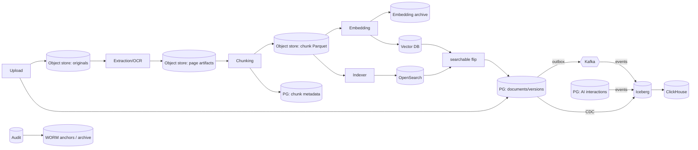

# Data Architecture Document

| Field | Value |
|---|---|
| Document ID | DIP-DAT-01 |
| Version | 0.1 |
| Purpose | One consolidated description of the platform's data: domains, ownership, stores, flows, lifecycle, quality, governance, security and evolution. Physical DDL is in `06`; this document explains *why data lives where it does* and the rules that keep copies consistent. |
| Note | Independent reference architecture. Volumes are calculated from labeled assumptions (`16`); nothing has been measured. |

---

## 1. Principles
1. **Single source of truth per fact:** object store for bytes, PostgreSQL for state/ACL/provenance, Vault/KMS for keys. All other stores hold *derived* copies that can be rebuilt.
2. **No unnecessary duplication of content:** full chunk text exists canonically in object storage (Parquet) and as an indexed copy in OpenSearch only because BM25 needs it; vector DB holds vectors + minimal payload; PostgreSQL holds none.
3. **Provenance by construction:** every derived datum carries `document_id`, `version_id`, pipeline/chunker/model versions and page references.
4. **Immutability of versions:** a document version is never modified; corrections create a new version.
5. **Inheritance of protection:** derived data inherits the highest classification and the intersection of ACLs of its inputs.
6. **Operational and analytical data are separated** (OLTP never serves heavy analytics).
7. **Data is minimal in motion:** events carry references, not content; telemetry carries IDs, not text.
8. **Everything has an owner, a retention rule and a deletion path.**

## 2. Data domains and ownership

| Domain | Contents | Owning service | System of record | Steward (business) |
|---|---|---|---|---|
| Identity & access | Users, roles, permissions, departments, ACLs | identity-access | PostgreSQL `iam` | Security/department heads |
| Documents | Documents, versions, metadata, upload sessions, lifecycle, legal hold | document-service | PostgreSQL `docs` + object store (bytes) | Data owners/document controllers |
| Processing | Jobs, events, dedupe records, artifacts (page JSON, tables, figures, OCR) | ingestion-orchestrator / workers | PostgreSQL `ingest` + object store | Platform |
| Knowledge units | Chunks (text, structure, parents), embeddings, summaries, extracted facts | chunking/embedding/ai services | Object store (Parquet) + PG metadata (≤ Medium) / lakehouse (Large) | AI lead |
| Search | Keyword index, vector index, section/summary index | search-service (indexer) | Derived (OpenSearch, vector DB) | Search lead |
| AI interaction | Chat sessions/messages, AI responses, citations, search history | ai-orchestration / search-service | PostgreSQL `ai` | Security/privacy owner |
| Models & prompts | Registry entries, evaluation reports, golden sets | embedding/ai services | PostgreSQL `ai.model_registry` + object store | AI lead |
| Audit | Audit trail, hash chain, anchors, deletion ledger | audit-notification | PostgreSQL `audit` + WORM object store | Audit admin/compliance |
| Analytics | Curated datasets, event history, chunk table (Large), marts | analytics-service / data platform | Iceberg (+ ClickHouse serving) | Analysts/data owners |
| Operational telemetry | Metrics, logs, traces | platform | Observability stack | SRE |
| Configuration | Helm values, runtime params, policies | platform | Git, `config_params` | Platform/security |

## 3. Data classification and handling
Levels are placeholders pending U-02 (`PUBLIC`, `INTERNAL`, `RESTRICTED`, `CONFIDENTIAL`). Rules:
| Data | Classification rule |
|---|---|
| Documents, artifacts, chunks, vectors, summaries, facts | Document's classification (`class_level` stored with every derived item) |
| Cross-document derived data (comparisons, multi-doc summaries, curated analytics) | Maximum of inputs; ACL = intersection |
| Chat/prompt/response content | Highest classification among exposed chunks; encrypted at field level; retention-limited |
| Audit | RESTRICTED minimum; access by Audit role; chunk IDs, not text |
| Search/analytics query text | INTERNAL minimum; may reveal sensitive intent; retention-limited |
| Metrics/traces | INTERNAL (IDs only); logs contain no content |
| Models/prompts | INTERNAL; integrity-critical |
Labels travel with data: OpenSearch/vector payload `class_level` and `acl_tags`; Parquet metadata; Iceberg table properties; backups inherit key hierarchy.

## 4. Data stores and placement (consolidated; compare `06` §9, `04` §6)

| Store | Holds | Does **not** hold | Consistency | Rebuild source | Scale approach |
|---|---|---|---|---|---|
| PostgreSQL | Identity, documents/versions, state, ACL, jobs, chunk metadata (≤ Medium), AI interactions, registry, audit (recent) | Text, vectors, binaries | Strong (ACID) | Backups/PITR (authoritative) | Schemas per service; partitioning; split clusters; offload chunks at Large |
| Object store | Originals, artifacts, chunk text Parquet, embedding archive, backups/snapshots, audit anchors | Mutable state | Strong per object; async cross-site | Replica site; versions | Erasure coding, prefix design, lifecycle tiers |
| OpenSearch | Chunk text + filter fields + BM25 postings, section/summary index | Authoritative ACL | Eventual (≤ 5 min P95) | Chunk Parquet in object store | Index groups by tier/era; shards 30–50 GB |
| Vector DB | Vectors (quantized) + minimal payload (IDs, `acl_tags`, `class_level`, version state, filters) | Text | Eventual | Embedding archive (CPU rebuild) or re-embed | Collections per model version; shards by `document_id`; tiers |
| Iceberg + ClickHouse | Events, CDC history, curated datasets, audit archive, chunk table (Large) | Operational truth | Eventual (CDC lag) | Kafka archive/PG/object | Partitioned tables; ClickHouse shards |
| Redis | Permission scope cache, result/embedding caches, revocation list | Anything not recomputable | Best-effort | Recompute | Cluster |
| Kafka | Transient events/tasks | Truth | Log | PG/outbox/object | Partitions by consumer parallelism |
| Git | Config, policy, schemas, glossary, prompts (versions mirrored in registry) | Runtime data | Strong | Mirrors | – |

## 5. Data model overview

### 5.1 Core entities (logical; ER in `06` §3)
`Department` 1—N `User`; `Role` N—M `Permission`; `Document` 1—N `DocumentVersion` (self-link `supersedes`); `DocumentVersion` 1—N `Metadata`, `ProcessingJob`, `Chunk`; `Chunk` self-tree (parent/child), 1—N `EmbeddingMetadata` (per model); `ChatSession` 1—N `ChatMessage` 1—0..1 `AiResponse` 1—N `Citation` (snapshotting document name/page/version); `ModelRegistry` referenced by embeddings and responses; `AuditLog` append-only.

### 5.2 Identifier strategy
| Entity | Identifier | Properties |
|---|---|---|
| User, Document, Version, Session, Job | UUIDv7 | Time-ordered; generated by service; safe in URLs |
| Chunk | `chunk_id` = base32(sha256(version_id : chunker_version : ordinal))[:26] | Deterministic, idempotent re-runs, new ID space per chunker version |
| Text identity | `text_hash` = sha256(normalized text) | Embedding cache, dedupe, label remapping |
| File identity | `sha256` of bytes | Exact duplicate detection |
| Events | `event_id` UUID, `idempotency_key` = `{version}:{stage}:{range}:{pipeline_version}` | Dedupe and replay safety |
| Vectors | point ID = `chunk_id` | Idempotent upsert |
| Audit | bigint identity + hash chain | Tamper evidence |
External identifiers (document numbers, part numbers, revision labels) are metadata, never keys.

### 5.3 Versioning and temporal model
- **Document versions** are immutable; `version_no` increments; `supersedes_version_id` links; `effective_date` (from content/metadata) is distinct from upload time. Lifecycle (`DRAFT/ACTIVE/SUPERSEDED/ARCHIVED/DELETED`) is a property of the document/version pair, not of chunks.
- **Current-version semantics:** retrieval filters on `searchable` and version state; history is opt-in.
- **Derived-data versioning:** `pipeline_version`, `chunker_version`, `embedding_model_id@version`, `prompt@version`; any change creates a new derived generation (blue/green), never an in-place mutation.
- **Time travel for analytics:** Iceberg snapshots; as-of queries for audits.

### 5.4 Reference data
Roles/permissions seed, classification levels, document types, glossary of acronyms/synonyms (versioned artifact under governance), unit-normalization tables, allow-listed analytics views. Changes follow PR review; glossary changes trigger the retrieval regression suite.

## 6. Data flows and lineage

**Lineage:** each artifact and chunk records `(version_id, stage, pipeline_version, input_uri, output_uri, worker, timestamp)` in `processing_jobs`/artifact manifests; every AI answer records chunk IDs, model/prompt versions and route; this yields document → chunk → vector → answer → user lineage, usable for impact analysis ("which answers used superseded text?") and for deletion verification. OpenLineage-compatible events from orchestrator/analytics jobs feed a catalog (see §9).

## 7. Analytical data architecture

### 7.1 Layers (lakehouse)
| Layer | Content | Table format | Consumers |
|---|---|---|---|
| Bronze | Raw CDC and Kafka event archives (append-only, schema as emitted) | Iceberg | Replay, forensics, rebuilds |
| Silver | Cleaned, deduplicated, typed entities (documents, versions, jobs, usage, query logs without text) | Iceberg | Spark jobs, ClickHouse ingestion |
| Gold | Curated marts/views for analytics (ingestion health, corpus statistics, supersession candidates, usage, cost), conflict-candidate facts | Iceberg + ClickHouse serving tables | analytics-service (NL-to-SQL allow-list), dashboards |
Rules: gold exposes only allow-listed views; row-level policies by department/classification; curated datasets declare source classification; text content is excluded from analytics layers by default (counts, metadata, IDs) unless a dataset is explicitly approved (e.g., extracted facts with provenance).

### 7.2 Pipelines
CDC (Debezium) for `docs`, `iam` snapshots, `ingest` summaries → bronze; Kafka sinks for `ai.query.completed`, `document.version.state-changed`, `audit.event` (archive) → bronze; scheduled Spark/dbt-style transformations bronze → silver → gold; ClickHouse loads from gold; data-quality tests at each hop (§8). Idempotent `MERGE` by key + `event_id`; late-arriving data handled by partition reprocessing.

### 7.3 Query classes
Interactive aggregation (ClickHouse, ≤ 5 s), batch/statistical (Spark, async), metadata analytics on PostgreSQL only at the Initial tier (read replica, curated views). Router decides (`10` §3 stage 1, `07` §5). Deletion compliance: Iceberg `DELETE` + snapshot expiry + compaction ensure physical removal; verified in the deletion saga.

## 8. Data quality
| Dimension | Rule | Check | Action |
|---|---|---|---|
| Completeness | Every INDEXED version has chunk counts equal across PG manifest, OpenSearch, vector DB | R-INDEX nightly + hourly sample | Auto-repair; alert > 0.01%/day |
| Integrity | `sha256` matches object; chunk text hash matches stored; page ranges within `page_count` | Sampled verification, ingest-time asserts | Quarantine/flag; re-ingest |
| Validity | Schemas (DDL constraints, Avro, JSON schema); allow-listed enum values; `class_level` ≤ clearance of uploader | Constraints + contract tests | Reject at boundary |
| Uniqueness | Duplicate bytes (SHA), near-duplicates (MinHash) flagged; unique idempotency keys | Unique indexes; dedupe jobs | Warn/reject per policy |
| Consistency | PG ACL ↔ index `acl_tags`; version state ↔ `searchable`; deletion ledger ↔ all stores | R-ACL, R-DEL | Retag/re-delete |
| Timeliness | Index lag ≤ 5 min P95; CDC lag ≤ 10 min; analytics freshness SLA | Lag metrics | Alert, scale |
| Extraction quality | Page `quality_score`, OCR confidence, table structure sanity; LOW_QUALITY flag propagates to answers | Per-page scoring; sampled accuracy sets | Flag, surface warnings, lower retrieval weight |
| Lineage/provenance | Every chunk/answer traceable; citations snapshotted | Coverage tests | Block release if gaps |
| Accuracy of extracted facts | Entity/attribute/value/unit extraction precision on labeled set | Eval set | Advisory only until ≥ target |
Data-quality metrics are first-class (`17` §5.2/5.5) and appear on the ingestion and reconciliation dashboards.

## 9. Governance, catalog and stewardship
- **Ownership:** each domain has a technical owner (service team) and a business steward (data owners); a data-owner council decides classification scheme, retention, access policy and golden-set access.
- **Catalog and metadata management:** a lightweight catalog (e.g., DataHub/OpenMetadata-class, or Git-generated docs initially) registers datasets (PG schemas, Parquet manifests, Iceberg tables, analytics views), owners, classification, retention, lineage, quality status. **Data contracts** (event schemas in Schema Registry, OpenAPI, curated view definitions) are versioned and CI-checked.
- **Access governance:** access by role/ACL/ABAC only; analytics via allow-listed views; production data never in non-production; quarterly access reviews; audit of metadata changes.
- **Policy as code:** retention, classification-handling and deletion rules expressed as configuration + tests, not wikis.
- **Change control for data structures:** expand-migrate-contract; ADR for store changes; regression gates for chunker/embedding changes.
- **Data protection impact:** privacy classification for chat/search history; retention-limited; field-level encryption; subject-erasure support via deletion saga (jurisdictional applicability to be confirmed, U-03).

## 10. Lifecycle, retention and deletion (details `06` §7, `14` §9)
| Data | Default retention (proposal) | End-of-life mechanism |
|---|---|---|
| Original versions and derived artifacts | Per classification/lifecycle; superseded versions retained (default 10 years or policy) but excluded from default search | Deletion saga + DEK destruction |
| Chunks/vectors/index entries | Life of version | Deleted with version; embedding archive included |
| Processing events | 13 months (archive earlier) | Partition archive/drop |
| Search history | 12 months | Partition drop |
| Chat/prompt/response | 90 days after last activity | Scheduled purge; audit-relevant exceptions per U-03 |
| Audit | 7 years | Archive to Iceberg/WORM then expire |
| Outbox/dedupe | 3 / 7 days | Cleanup jobs |
| Kafka | 3–30 days | Broker retention |
| Backups | Data backups per policy; **key-bearing backups ≤ 35 days** (erasure bound) | Expiry |
| Telemetry | Metrics 30 d (+downsampled 1 y), logs 14–90 d, traces 7 d | Retention policies |
Legal hold overrides deletion and backup expiry for held data. Deletion order: mark non-searchable → delete index entries → delete metadata/chunks → delete artifacts/originals + destroy DEK → verify → certificate → re-verify at 24 h; ledger replay after any restore.

## 11. Data security (summary of `12`)
Encryption in transit/at rest (envelope keys; separate backup KEKs); ACL tags and PG post-check; field-level encryption for chat/prompt data; no content in events/logs/traces; secrets in Vault; row-level policies in analytics; sandboxed parsing; audit of data access with chunk-level exposure; separate physical stores for the top classification tier (ADR-004); non-production uses synthetic/public/sanitized data only.

## 12. Volumes and growth (calculated, `16` §4.4)
| Store | Initial | Medium | Large |
|---|---|---|---|
| Object (logical: originals + artifacts) | 1.25 TB | 125 TB | 1.25 PB |
| Chunk Parquet + embedding archive (inside artifacts) | ≈ 8 GB + 5.6 GB | ≈ 0.8 TB + 0.56 TB | ≈ 2.4 TB + 5.6 TB |
| OpenSearch | 11 GB | 1.1 TB | 11 TB |
| Vector DB resident (int8 + graph) | 6.5 GB | ≈ 650 GB | ≈ 6.5 TB (tiered) |
| PostgreSQL | ≈ 10 GB | ≈ 0.7 TB | ≈ 1–2 TB (chunks offloaded) |
| Lakehouse / ClickHouse | – | ≈ 5–10 TB | ≈ 80–150 TB |
Steady growth at Large after backfill ≈ 500 GB/day logical (≈ 180 TB/year; ≈ 500 TB/year raw with EC and DR). Forecast alerts at ≥ 6 months before limits.

## 13. Data evolution and migration paths
| Change | Mechanism |
|---|---|
| New chunking strategy/version | New `chunker_version` ID space; blue/green index; label remapping by text overlap; evaluation gate |
| New embedding model | New collection/alias flip; vector reuse where text unchanged; tiered migration at Large |
| New vector engine | Rebuild from embedding archive behind `VectorStore` port |
| Chunk metadata outgrows PostgreSQL | `ChunkRepository` switches to lakehouse; PG keeps manifests |
| Schema changes | Expand → migrate → contract; Flyway; Avro compatible evolution |
| Multi-organization | Add `tenant_id` + index/collection partitioning (ADR-028 costs) |
| New classification scheme | Re-map levels via migration; reindex payload `class_level`; audit of reclassification |
| Analytics expansion | New gold views through PR + allow-list review |

## 14. Risks and open items
| Item | Note |
|---|---|
| Chunk-metadata scale in PG at Medium (≈ 0.5 TB) | Operational risk (R12); offload trigger defined |
| Embedding archive adds sensitive derived data | Same controls; counted in deletion saga |
| Classification scheme and tenancy (U-02) | Drives payload fields and index layout |
| Retention periods and audit-relevance of chat/citations (U-03) | Pending |
| Extracted facts quality for conflict detection | Advisory until evaluated |
| Catalog tooling choice | Defer; start with Git-generated catalog |
| Cross-store consistency under partial failure | Reconciliation + PG post-check + atomic searchable flag (CR-1…CR-8, `14` §5) |

## 15. Acceptance criteria for this architecture
| ID | Criterion |
|---|---|
| DA-1 | For every INDEXED version, chunk counts/ID sets match across PG manifest, OpenSearch and vector DB (drift < 0.01%/day) |
| DA-2 | Every datum in derived stores traceable to `version_id` and pipeline versions (100% in lineage audit) |
| DA-3 | No document text or vectors in PostgreSQL, events, logs or traces (scanner tests) |
| DA-4 | Every derived dataset declares classification and inherits ACL (automated check on curated views) |
| DA-5 | Deletion verification: 0 residual items across all stores after saga and after restore replay |
| DA-6 | Analytics queries cannot reach OLTP tables (permission test) and do not move OLTP P95 > 5% |
| DA-7 | Rebuild drills: OpenSearch and vector DB rebuilt from object-store sources within measured, documented times |
| DA-8 | Catalog lists 100% of production datasets with owner, classification and retention |
